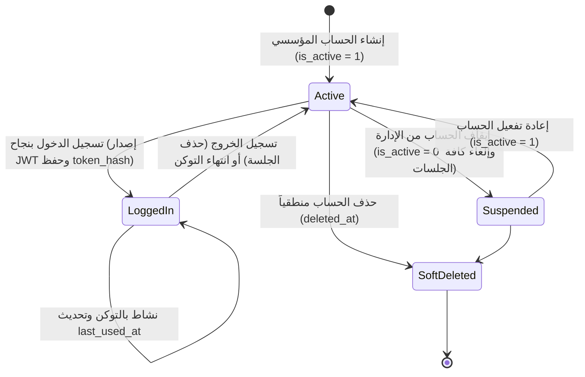

# ⚙️ مواصفات Backend — المرحلة 01: الهوية والمصادقة والتدقيق (Authentication, Identity & Audit)

> **الهدف:** توثيق منطق المعالجة وقواعد التحقق الصارمة، وحماية الجلسات، والتشفير، وقواعد الحوكمة وإدارة حسابات المستخدمين وسجلات التدقيق المطابقة بنسبة 100% لـ [`MD/database.md`](../../database.md) و [`MD/business_rules.md`](../../business_rules.md)، مع توفير الحيادية التقنية التامة (Zero ORM Leakage).  
> 
> ⚠️ **تكامل حوكمي صريح وملزم — مرجع الاستجابات (Network SSoT):**  
> ملف [`routes.md`](./routes.md) هو **المصدر الرئيسي والحصري والوحيد لكافة استجابات ومدخلات الـ API (Network SSoT)**. تم تسجيل كامل شكل الاستجابة (JSON Response Body) ورسائل الخطأ والنجاح صراحةً في [`routes.md`](./routes.md) لجميع الرموز والـ Status Codes (`200 OK`, `201 Created`, `400 Bad Request`, `401 Unauthorized`, `403 Forbidden`, `404 Not Found`, `409 Conflict`, `422 Unprocessable Entity`, `429 Too Many Requests`, `500 Internal Server Error`) لكل رابط.  
> 📌 **توجيه إجباري عند البناء والتطوير:** يلتزم المطور أو نموذج الذكاء الاصطناعي بالكامل بإنشاء ورسم كود الخادم واستجابات الـ API بناءً على الهياكل والرموز المسجلة في ملف [`routes.md`](./routes.md) حصراً بدون أي اجتهاد شخصي.

---

## 1. نطاق المرحلة والحدود المعمارية (Scope & Boundaries)

### 🟢 ما تشمله المرحلة (In-Scope):
- **المصادقة وإدارة الجلسات (`auth`):**
  - تسجيل الدخول الموحد بالرمز المؤسسي (`POST /api/v1/auth/login`) مع الحماية من هجمات التخمين (Rate Limiting).
  - استرجاع بيانات الملف الشخصي والصلاحيات للمستخدم الحالي (`GET /api/v1/auth/me`).
  - تسجيل الخروج وإبطال التوكن وشطب الجلسة (`POST /api/v1/auth/logout`).
  - تغيير كلمة المرور الذاتي للمستخدم بعد مطابقة الحالية (`POST /api/v1/auth/change-password`).
- **إدارة حسابات المستخدمين (`users`):**
  - استعراض وتصفية وبحث حسابات المستخدمين بالترقيم والفلترة (`GET /api/v1/users`).
  - استعراض تفاصيل حساب مستخدم محدد وسجل الدخول (`GET /api/v1/users/:id`).
  - تفعيل أو إيقاف الحساب (`PUT /api/v1/users/:id/status`) وإلغاء جلساته النشطة فورياً عند الإيقاف.
  - إعادة تعيين كلمة المرور من قِبل مدير النظام (`POST /api/v1/users/:id/reset-password`).
- **سجلات التدقيق الأمني والحركات (`audit_logs`):**
  - استعراض وتصفية سجلات التدقيق الأمني بالترقيم والفلترة بالنطاق الزمني والنوع (`GET /api/v1/audit-logs`).
  - استعراض تفاصيل حركة تدقيق محددة ومقارنة القيم السابقة والجديدة (`GET /api/v1/audit-logs/:id`).
- **الحوكمة وقواعد ثبات النظام:**
  - قصر صلاحيات إدارة المستخدمين والاطلاع على سجلات التدقيق حصراً على مدير النظام (`role_type = 'admin'`).
  - التوثيق التلقائي لكافة حركات تسجيل الدخول، الخروج، تغيير كلمات المرور، والتعديلات الحساسة في `audit_logs`.

### 🔴 خارج نطاق المرحلة (Out-of-Scope):
- إنشاء البروفايل الأكاديمي للمعلم وتعيين المواد $\rightarrow$ تابعة للمرحلة `03` (`teachers`).
- إنشاء ملفات الطلاب وأولياء الأمور وتسجيلهم بالشعب $\rightarrow$ تابعة للمرحلة `04` (`students`, `guardians`).

---

## 2. حوكمة الأدوار وقواعد الوصول وعزل البيانات (RBAC & Scoping Rules)

### 👥 مصفوفة الفاعلين والصلاحيات:
- **الزائر / غير المصادق عليه (Guest / Public):**
  - يحق له فقط استدعاء مسار تسجيل الدخول الموحد `POST /api/v1/auth/login` (بحد أقصى 5 محاولات في الدقيقة).
- **المستخدم المسجل (Any Authenticated User):**
  - يحق له استرجاع بيانات حسابه الشخصي (`GET /auth/me`)، تسجيل الخروج (`POST /auth/logout`)، وتغيير كلمة المرور الخاصة به (`POST /auth/change-password`).
- **مدير النظام (Admin - `role_type = 'admin'`):**
  - يمتلك الصلاحية الكاملة على مسارات إدارة المستخدمين (`/users`), تفعيل وإيقاف الحسابات، إعادة تعيين كلمات المرور، واستعراض سجلات التدقيق الأمني (`/audit-logs`).
- **باقي الأدوار (Teacher, Student, Parent):**
  - يُحظر عليهم تماماً الوصول لمسارات إدارة المستخدمين أو سجلات التدقيق (`403 Forbidden`).

---

## 3. دورة حياة الكيانات وقواعد ثبات النظام (Lifecycles & System Invariants)

### 🔒 قواعد ثبات النظام الصارمة (System Invariants):
1. **الرمز المؤسسي الموحد (`user_code Invariant`):**
   - تسجيل الدخول يعتمد حصراً على `user_code` المطابق للنمط المؤسسي (`ADM-`, `TCH-`, `STU-`, `PAR-`).
   - قيد التفرد `uq_users_user_code` يمنع تكرار أي رمز.
2. **أمان وتجزئة التوكن (`token_hash Invariant`):**
   - يُخزن التوكن في قاعدة البيانات كـ `SHA-256 Hash` لحماية الجلسات في حال تسريب البيانات.
3. **التشفير القوي لكلمات المرور:**
   - تشفير كلمات المرور باستخدام خوارزميات قياسية (`bcrypt` أو `argon2id`) ويحظر تخزينها كنص صريح.
4. **سجلات التدقيق الأمني (Audit Logging Invariant):**
   - توثيق كافة محاولات الدخول، الخروج، التعديل، والحذف تلقائياً في `audit_logs` مع الـ IP والـ User-Agent.

---

## 4. العمليات المنطقية للمجال (Domain Operations & Execution Logic)

---

### 🔐 المجموعة 1: المصادقة وإدارة الجلسات (`auth`)

#### 📋 جدول العمليات:
| # | العملية المنطقية (Operation) | HTTP Method & Endpoint | الصلاحية | رمز النجاح | مرجع العقد في `routes.md` |
| :-: | :--- | :--- | :--- | :---: | :--- |
| **1.1** | تسجيل الدخول الموحد | `POST /api/v1/auth/login` | عام (Public) | `200 OK` | [في routes.md](./routes.md) |
| **1.2** | استرجاع الملف الشخصي والجلسة | `GET /api/v1/auth/me` | مسجل دخول | `200 OK` | [في routes.md](./routes.md) |
| **1.3** | تسجيل الخروج وإبطال الجلسة | `POST /api/v1/auth/logout` | مسجل دخول | `200 OK` | [في routes.md](./routes.md) |
| **1.4** | تغيير كلمة المرور الذاتي | `POST /api/v1/auth/change-password` | مسجل دخول | `200 OK` | [في routes.md](./routes.md) |

---

#### 🔹 [Operation 1.1] `POST /api/v1/auth/login` — تسجيل الدخول الموحد
- **الغرض والوظيفة:** التحقق من مطابقة `user_code` وكلمة المرور، فحص حالة التفعيل `is_active`، إصدار توكن JWT، تسجيل الجلسة في `personal_access_tokens`، تحديث `last_login_at`، وتوثيق الدخول في `audit_logs`.
- **قواعد التحقق (Validation Rules):**
  - `user_code`: مطلوب، نص لا يتجاوز 30 حرفاً، يطابق النمط المؤسسي.
  - `password`: مطلوب، نص لا يقل عن 8 أحرف.
  - `device_name`: اختياري، نص لا يتجاوز 255 حرفاً.
- **عقد الاستجابات (Network SSoT):** مسجلة في [`routes.md`](./routes.md).

#### 🔹 [Operation 1.2] `GET /api/v1/auth/me` — استرجاع الملف الشخصي
- **الغرض والوظيفة:** استخراج معرف المستخدم من التوكن المفكك، استرجاع بيانات الحساب، الدور، والصلاحيات.
- **عقد الاستجابات (Network SSoT):** مسجلة في [`routes.md`](./routes.md).

#### 🔹 [Operation 1.3] `POST /api/v1/auth/logout` — تسجيل الخروج
- **الغرض والوظيفة:** حذف سجل التوكن الحالي من `personal_access_tokens` وتوثيق حركة الخروج في `audit_logs`.
- **عقد الاستجابات (Network SSoT):** مسجلة في [`routes.md`](./routes.md).

#### 🔹 [Operation 1.4] `POST /api/v1/auth/change-password` — تغيير كلمة المرور الذاتي
- **الغرض والوظيفة:** التحقق من صحة كلمة المرور الحالية، تشفير وتحديث كلمة المرور الجديدة في `users`، وتوثيق الحركة في `audit_logs`.
- **قواعد التحقق (Validation Rules):**
  - `current_password`: مطلوب، يطابق كلمة المرور الحالية.
  - `new_password`: مطلوب، لا يقل عن 8 أحرف، يختلف عن الحالية، ومطابق لـ `new_password_confirmation`.
- **عقد الاستجابات (Network SSoT):** مسجلة في [`routes.md`](./routes.md).

---

### 👥 المجموعة 2: إدارة حسابات المستخدمين (`users`)

#### 📋 جدول العمليات:
| # | العملية المنطقية (Operation) | HTTP Method & Endpoint | الصلاحية | رمز النجاح | مرجع العقد في `routes.md` |
| :-: | :--- | :--- | :--- | :---: | :--- |
| **2.1** | استعراض وتصفية حسابات المستخدمين | `GET /api/v1/users` | `admin` | `200 OK` | [في routes.md](./routes.md) |
| **2.2** | استعراض تفاصيل حساب مستخدم | `GET /api/v1/users/:id` | `admin` | `200 OK` | [في routes.md](./routes.md) |
| **2.3** | تعديل حالة تفعيل الحساب | `PUT /api/v1/users/:id/status` | `admin` | `200 OK` | [في routes.md](./routes.md) |
| **2.4** | إعادة تعيين كلمة المرور من الإدارة | `POST /api/v1/users/:id/reset-password` | `admin` | `200 OK` | [في routes.md](./routes.md) |

---

#### 🔹 [Operation 2.1] `GET /api/v1/users` — استعراض وتصفية قائمة المستخدمين
- **الغرض والوظيفة:** استرجاع قائمة المستخدمين بالهيكل الشجري المبوب بالأدوار (`role_types -> users`) مع دعم الفلترة بالدور `role_type`، حالة التفعيل `is_active`، والبحث بالرمز المؤسسي والترقيم.
- **عقد الاستجابات (Network SSoT):** مسجلة في [`routes.md`](./routes.md).

#### 🔹 [Operation 2.2] `GET /api/v1/users/:id` — استعراض تفاصيل حساب مستخدم
- **الغرض والوظيفة:** استرجاع بيانات الحساب، تاريخ الإنشاء، وآخر تسجيل دخول.
- **عقد الاستجابات (Network SSoT):** مسجلة في [`routes.md`](./routes.md).

#### 🔹 [Operation 2.3] `PUT /api/v1/users/:id/status` — تعديل حالة تفعيل الحساب
- **الغرض والوظيفة:** تعديل `is_active` (1 أو 0) وتوثيق الحركة، وإلغاء وحذف كافة جلسات المستخدم من `personal_access_tokens` في حال الإيقاف.
- **عقد الاستجابات (Network SSoT):** مسجلة في [`routes.md`](./routes.md).

#### 🔹 [Operation 2.4] `POST /api/v1/users/:id/reset-password` — إعادة تعيين كلمة المرور
- **الغرض والوظيفة:** تحديث كلمة المرور للمستخدم بكلمة مرور جديدة مشفرة، وإلغاء جلساته السابقة لإجباره على تسجيل الدخول بكلمة المرور الجديدة.
- **عقد الاستجابات (Network SSoT):** مسجلة في [`routes.md`](./routes.md).

---

### 📜 المجموعة 3: سجلات التدقيق الأمني (`audit_logs`)

#### 📋 جدول العمليات:
| # | العملية المنطقية (Operation) | HTTP Method & Endpoint | الصلاحية | رمز النجاح | مرجع العقد في `routes.md` |
| :-: | :--- | :--- | :--- | :---: | :--- |
| **3.1** | استعراض وتصفية سجلات التدقيق | `GET /api/v1/audit-logs` | `admin` | `200 OK` | [في routes.md](./routes.md) |
| **3.2** | استعراض تفاصيل حركة تدقيق | `GET /api/v1/audit-logs/:id` | `admin` | `200 OK` | [في routes.md](./routes.md) |

---

## 5. الأداء، التزامن، والنزاهة المرجعية (Performance & Data Integrity)

1. **الاستعلامات والفهارس:**
   - استخدام الفهارس المعتمدة في `MD/database.md`: `uq_users_user_code`, `uq_tokens_token_hash`, `idx_audit_user_id`, `idx_audit_action`, `idx_audit_created_at`.
2. **المعاملات الذرية (Atomic Commit):**
   - تسجيل الدخول وتغيير كلمة المرور وتعديل الحالة تنفذ كمعاملات ذرية مترابطة مع التوثيق بـ `audit_logs`.
3. **تجنب التسريب التقني:**
   - توحيد الردود ورسائل الخطأ عبر الرموز المعيارية (`400`, `401`, `403`, `404`, `422`, `429`, `500`).

---

## 6. معايير القبول الهندسية للباك إند (Backend Acceptance Criteria)

تعتبر متطلبات الخادم لهذه المرحلة مستوفاة بالكامل عند تحقق المعايير التالية:

- [ ] قصر صلاحية إدارة المستخدمين والاطلاع على سجلات التدقيق حصراً على المستخدمين بدور `admin`.
- [ ] تطبيق Rate Limiting بحد أقصى 5 محاولات في الدقيقة على مسار `/auth/login`.
- [ ] التحقق الصارم من تشفير كلمات المرور باستخدام خوارزمية آمنة.
- [ ] شطب الجلسات النشطة فورياً عند تسجيل الخروج أو عند إيقاف الحساب أو إعادة تعيين كلمة المرور.
- [ ] تسجيل وتوثيق كافة الحركات الحساسة في `audit_logs`.
- [ ] مطابقة كافة المدخلات والمخرجات بنسبة 100% لعقد الشبكة في [`routes.md`](./routes.md).
