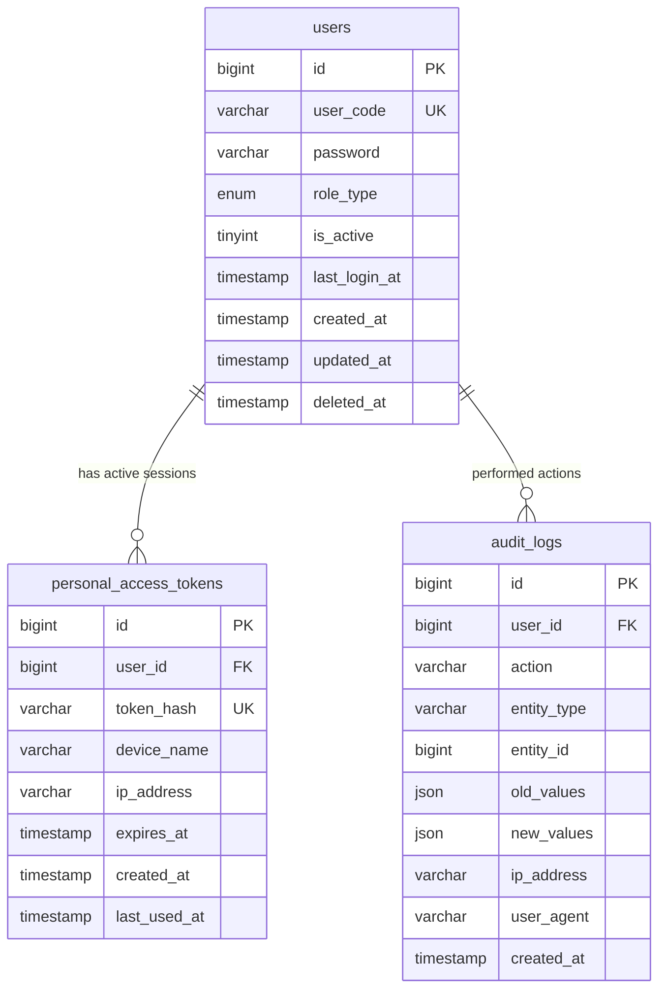

# 📊 مواصفات البيانات والكيانات — المرحلة 01: الهوية والمصادقة والتدقيق (Data Specification)

> **الهدف:** توثيق المخطط الهيكلي الدقيق لجداول مرحلة الهوية والمصادقة والتدقيق (`users`, `personal_access_tokens`, `audit_logs`) المطابق بنسبة 100% للمصدر الرئيسي والحصري للحقيقة: [`MD/database.md`](../../database.md).  
> 
> ⚠️ **إرشادات وتنبيهات حوكمية إجبارية (System Governance Directives):**  
> 1. **قواعد العمل العامة (Business Rules SSoT):** يلزم على المطور أو الذكاء الاصطناعي قراءة واعتماد **ملف القواعد العامة بالمنظومة [`MD/business_rules.md`](../../business_rules.md)** والالتزام التام بكافة القيود ومصفوفة الصلاحيات والحوكمة المذكورة فيه قبل التكوييد والبناء.  
> 2. **مرجع شبكة الطلبات والاستجابات (Network SSoT):** ملف [`routes.md`](./routes.md) هو المصدر الرئيسي والوحيد لعقد الشبكة بالمنظومة؛ حيث تم توثيق **جسم الطلب الكامل (`Request Body Payload`)** لكل رابط، و**كامل شكل الاستجابة الصريحة (`Response Body Payload`)** لجميع الرموز والـ Status Codes (`200 OK`, `201 Created`, `400 Bad Request`, `401 Unauthorized`, `403 Forbidden`, `404 Not Found`, `409 Conflict`, `422 Unprocessable Entity`, `429 Too Many Requests`, `500 Server Error`).  
> 📌 **توجيه إجباري عند البناء والتطوير:** يلتزم المطور بالكامل برسم وبناء مدخلات ومخرجات كود الـ Controllers والواجهات بناءً على الهياكل والرموز المسجلة في ملف [`routes.md`](./routes.md) حصراً بدون أي اجتهاد شخصي.

---

## 1. جدول حسابات المستخدمين (`users`)

> **الوصف:** الجدول الأساسي لهويات ومصادقة كافة مستخدمي النظام (الإدارة، المعلم، الطالب، ولي الأمر) بالاعتماد الحصري على الرمز المؤسسي الموحد (`user_code`).

### 📋 هيكل الأعمدة (Columns Matrix):

| اسم العمود (Column) | نوع البيانات (MySQL Type) | القيود والخصائص (Constraints) | الوصف والدلالة الوظيفية |
| :--- | :--- | :--- | :--- |
| `id` | `BIGINT UNSIGNED` | `PRIMARY KEY AUTO_INCREMENT` | المعرف الرقمي الداخلي الفريد للسجل. |
| `user_code` | `VARCHAR(30)` | `NOT NULL, UNIQUE` | الرمز المؤسسي الموحد لتسجيل الدخول (`ADM-1001`, `TCH-2005`, `STU-3042`, `PAR-4010`). |
| `password` | `VARCHAR(255)` | `NOT NULL` | كلمة المرور المشفرة بخوارزمية آمنة (`bcrypt` أو `argon2id`). |
| `role_type` | `ENUM('admin', 'teacher', 'student', 'parent')` | `NOT NULL, INDEXED` | الدور الأساسي للمستخدم لتحديد لوحة التحكم والصلاحيات. |
| `is_active` | `TINYINT(1)` | `NOT NULL, DEFAULT 1, INDEXED` | حالة تفعيل الحساب (`1 = نشط`, `0 = معطل/موقوف`). |
| `last_login_at` | `TIMESTAMP` | `NULL DEFAULT NULL` | تاريخ وتوقيت آخر عملية تسجيل دخول ناجحة. |
| `created_at` | `TIMESTAMP` | `NOT NULL, DEFAULT CURRENT_TIMESTAMP` | توقيت إنشاء الحساب. |
| `updated_at` | `TIMESTAMP` | `NULL ON UPDATE CURRENT_TIMESTAMP` | توقيت آخر تحديث لبيانات الحساب. |
| `deleted_at` | `TIMESTAMP` | `NULL DEFAULT NULL, INDEXED` | طابع الحذف المنطقي (Soft Delete). |

### 🔗 العلاقات والمفاتيح الخارجية (Foreign Keys):
* *لا يحتوي على مفاتيح خارجية (جدول أساسي جذري Root Entity).*

### ⚡ الفهارس وقيود التفرد (Indexes & Constraints):
* `PRIMARY KEY (id)`
* `UNIQUE INDEX uq_users_user_code (user_code)`
* `INDEX idx_users_role_type (role_type)`
* `INDEX idx_users_is_active (is_active)`
* `INDEX idx_users_deleted_at (deleted_at)`

---

## 2. جدول جلسات التوكن (`personal_access_tokens`)

> **الوصف:** جدول حفظ وإدارة توكنات المصادقة النشطة (Bearer JWT Tokens) وتتبع الجلسات وإلغائها عند تسجيل الخروج.

### 📋 هيكل الأعمدة (Columns Matrix):

| اسم العمود (Column) | نوع البيانات (MySQL Type) | القيود والخصائص (Constraints) | الوصف والدلالة الوظيفية |
| :--- | :--- | :--- | :--- |
| `id` | `BIGINT UNSIGNED` | `PRIMARY KEY AUTO_INCREMENT` | المعرف الرقمي الداخلي للجلسة. |
| `user_id` | `BIGINT UNSIGNED` | `NOT NULL, INDEXED` | معرف المستخدم صاحب الجلسة المرتبط بجدول `users`. |
| `token_hash` | `VARCHAR(64)` | `NOT NULL, UNIQUE` | التجزئة الآمنة للتوكن (`SHA-256 Hash`) للتحقق السريع. |
| `device_name` | `VARCHAR(255)` | `NULL DEFAULT NULL` | اسم الجهاز أو المتصفح المستخدم في الدخول. |
| `ip_address` | `VARCHAR(45)` | `NULL DEFAULT NULL` | عنوان الـ IP لمسجل الدخول (يدعم IPv4 و IPv6). |
| `expires_at` | `TIMESTAMP` | `NOT NULL, INDEXED` | تاريخ وتوقيت انتهاء صلاحية التوكن. |
| `created_at` | `TIMESTAMP` | `NOT NULL, DEFAULT CURRENT_TIMESTAMP` | تاريخ وتوقيت إنشاء الجلسة. |
| `last_used_at` | `TIMESTAMP` | `NULL DEFAULT NULL` | توقيت آخر نشاط تم استخدامه بهذا التوكن. |

### 🔗 العلاقات والمفاتيح الخارجية (Foreign Keys):
* `user_id` يرتبط بجدول `users(id)` مع سلوك:
  * `ON DELETE CASCADE` (عند حذف حساب المستخدم نهائياً يتم شطب كافة جلساته تلقائياً).
  * `ON UPDATE CASCADE`.

### ⚡ الفهارس وقيود التفرد (Indexes & Constraints):
* `PRIMARY KEY (id)`
* `UNIQUE INDEX uq_tokens_token_hash (token_hash)`
* `INDEX idx_tokens_user_id (user_id)`
* `INDEX idx_tokens_expires_at (expires_at)`

---

## 3. جدول سجل التدقيق وتتبع العمليات (`audit_logs`)

> **الوصف:** جدول تسجيل وتتبع كافة العمليات الحساسة (إنشاء، تعديل، حذف، ترحيل، رصد درجات، تسجيل دخول) مع توثيق القيم السابقة والجديدة لضمان الشفافية والأمان.

### 📋 هيكل الأعمدة (Columns Matrix):

| اسم العمود (Column) | نوع البيانات (MySQL Type) | القيود والخصائص (Constraints) | الوصف والدلالة الوظيفية |
| :--- | :--- | :--- | :--- |
| `id` | `BIGINT UNSIGNED` | `PRIMARY KEY AUTO_INCREMENT` | المعرف الرقمي الفريد للحركة. |
| `user_id` | `BIGINT UNSIGNED` | `NULL DEFAULT NULL, INDEXED` | معرف المستخدم منفذ العملية (يرتبط بـ `users.id`). |
| `action` | `VARCHAR(50)` | `NOT NULL, INDEXED` | نوع الحركة (`login`, `logout`, `create`, `update`, `delete`, `promote`, `export`, `password_change`). |
| `entity_type` | `VARCHAR(100)` | `NOT NULL, INDEXED` | اسم الكيان/الجدول المتأثر (مثل: `User`, `Student`, `Assignment`, `OfficialExam`). |
| `entity_id` | `BIGINT UNSIGNED` | `NULL DEFAULT NULL, INDEXED` | رقم السجل المتأثر داخل الكيان. |
| `old_values` | `JSON` | `NULL DEFAULT NULL` | القيم السابقة قبل التعديل بصيغة JSON. |
| `new_values` | `JSON` | `NULL DEFAULT NULL` | القيم الجديدة بعد التعديل بصيغة JSON. |
| `ip_address` | `VARCHAR(45)` | `NULL DEFAULT NULL` | عنوان الـ IP لمنفذ الحركة. |
| `user_agent` | `VARCHAR(255)` | `NULL DEFAULT NULL` | بيانات المتصفح ونظام التشغيل المستخدم. |
| `created_at` | `TIMESTAMP` | `NOT NULL, DEFAULT CURRENT_TIMESTAMP, INDEXED` | توقيت حدوث الحركة بدقة. |

### 🔗 العلاقات والمفاتيح الخارجية (Foreign Keys):
* `user_id` يرتبط بجدول `users(id)` مع سلوك:
  * `ON DELETE SET NULL` (للحفاظ على السجل التاريخي للتدقيق حتى لو حُذف المستخدم).
  * `ON UPDATE CASCADE`.

### ⚡ الفهارس وقيود التفرد (Indexes & Constraints):
* `PRIMARY KEY (id)`
* `INDEX idx_audit_user_id (user_id)`
* `INDEX idx_audit_action (action)`
* `INDEX idx_audit_entity (entity_type, entity_id)`
* `INDEX idx_audit_created_at (created_at)`

---

## 4. مخطط الكيانات والعلاقات لـ Phase 01 (ERD)

