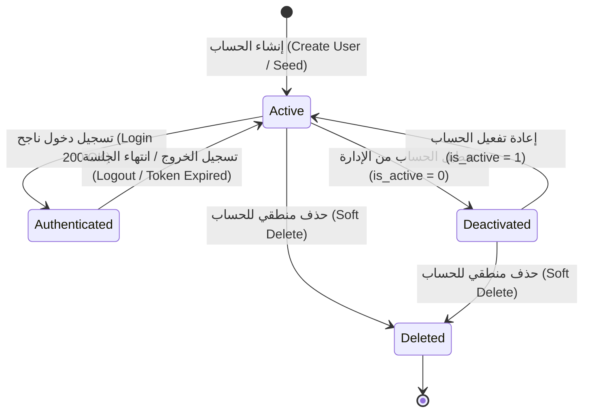

# 📊 مواصفات البيانات والكيانات — المرحلة 01: الهوية والمصادقة والتدقيق (Data Specification)

> **الهدف:** توثيق المخطط الهيكلي للجداول والكيانات، والعلاقات، والفهارس، وقيود النزاهة، ودورة حياة الحالات الخاصة بمرحلة الهوية والمصادقة والتدقيق، والمشتقة بالكامل بنسبة 100% من مخطط قاعدة البيانات المعتمد في `MD/database.md`.

---

## 1. جداول وكيانات المرحلة (Phase Tables Schema)

---

### 1.1 جدول حسابات المستخدمين (`users`)

> **الوصف:** السجل الجذري لهويات ومصادقة كافة مستخدمي النظام (الإدارة، المعلم، الطالب، ولي الأمر) بالاعتماد الحصري على الرمز المؤسسي الموحد.

| اسم الحقل | نوع البيانات (SQL Data Type) | القيود والخصائص (Constraints) | الوصف والدلالة الوظيفية |
| :--- | :--- | :--- | :--- |
| `id` | `BIGINT UNSIGNED` | `PRIMARY KEY AUTO_INCREMENT` | المعرف الرقمي الداخلي الفريد للمستخدم. |
| `user_code` | `VARCHAR(30)` | `UNIQUE NOT NULL` | الرمز المؤسسي الموحد لتسجيل الدخول (`ADM-XXXX`, `TCH-XXXX`, `STU-XXXX`, `PAR-XXXX`). |
| `password` | `VARCHAR(255)` | `NOT NULL` | كلمة المرور المشفرة بخوارزمية آمنة (`bcrypt` أو `argon2id`). |
| `role_type` | `ENUM('admin', 'teacher', 'student', 'parent')` | `NOT NULL` | الدور الأساسي للمستخدم لتحديد لوحة التحكم والصلاحيات. |
| `is_active` | `TINYINT(1)` | `DEFAULT 1, NOT NULL` | حالة تفعيل الحساب (`1 = نشط`, `0 = معطل/موقوف`). |
| `last_login_at` | `TIMESTAMP` | `NULLABLE` | تاريخ وتوقيت آخر عملية تسجيل دخول ناجحة. |
| `created_at` | `TIMESTAMP` | `DEFAULT CURRENT_TIMESTAMP, NOT NULL` | توقيت إنشاء الحساب. |
| `updated_at` | `TIMESTAMP` | `NULLABLE ON UPDATE CURRENT_TIMESTAMP` | توقيت آخر تحديث لبيانات الحساب. |
| `deleted_at` | `TIMESTAMP` | `NULLABLE` | طابع الحذف المنطقي (Soft Delete). |

---

### 1.2 جدول جلسات التوكن (`personal_access_tokens`)

> **الوصف:** جدول حفظ وإدارة توكنات المصادقة النشطة (JWT / Bearer Tokens) وتتبع الجلسات وإلغائها عند تسجيل الخروج.

| اسم الحقل | نوع البيانات (SQL Data Type) | القيود والخصائص (Constraints) | الوصف والدلالة الوظيفية |
| :--- | :--- | :--- | :--- |
| `id` | `BIGINT UNSIGNED` | `PRIMARY KEY AUTO_INCREMENT` | المعرف الرقمي الداخلي للجلسة. |
| `user_id` | `BIGINT UNSIGNED` | `NOT NULL, INDEXED` | معرف المستخدم صاحب الجلسة (يرتبط بـ `users.id`). |
| `token_hash` | `VARCHAR(64)` | `UNIQUE NOT NULL` | التجزئة الآمنة للتوكن (`SHA-256 Hash`) للتحقق السريع. |
| `device_name` | `VARCHAR(255)` | `NULLABLE` | اسم الجهاز أو المتصفح المستخدم في الدخول. |
| `ip_address` | `VARCHAR(45)` | `NULLABLE` | عنوان الـ IP لمسجل الدخول (يدعم IPv4 و IPv6). |
| `expires_at` | `TIMESTAMP` | `NOT NULL, INDEXED` | تاريخ وتوقيت انتهاء صلاحية التوكن. |
| `created_at` | `TIMESTAMP` | `DEFAULT CURRENT_TIMESTAMP, NOT NULL` | تاريخ وتوقيت إنشاء الجلسة. |
| `last_used_at` | `TIMESTAMP` | `NULLABLE` | توقيت آخر نشاط تم استخدامه بهذا التوكن. |

---

### 1.3 جدول سجل التدقيق وتتبع العمليات (`audit_logs`)

> **الوصف:** جدول تسجيل وتتبع كافة العمليات الحساسة (إنشاء، تعديل، حذف، ترحيل، رصد درجات، مصادقة) مع توثيق القيم السابقة والجديدة لضمان الشفافية والأمان.

| اسم الحقل | نوع البيانات (SQL Data Type) | القيود والخصائص (Constraints) | الوصف والدلالة الوظيفية |
| :--- | :--- | :--- | :--- |
| `id` | `BIGINT UNSIGNED` | `PRIMARY KEY AUTO_INCREMENT` | المعرف الرقمي الفريد للحركة. |
| `user_id` | `BIGINT UNSIGNED` | `NULLABLE, INDEXED` | معرف المستخدم منفذ العملية (يرتبط بـ `users.id`). |
| `action` | `VARCHAR(50)` | `NOT NULL, INDEXED` | نوع الحركة (`login`, `logout`, `failed_login`, `password_change`, `create`, `update`, `delete`). |
| `entity_type` | `VARCHAR(100)` | `NOT NULL` | اسم الكيان/الجدول المتأثر (مثل: `User`, `Token`, `Assignment`). |
| `entity_id` | `BIGINT UNSIGNED` | `NULLABLE` | رقم السجل المتأثر داخل الكيان. |
| `old_values` | `JSON` | `NULLABLE` | القيم السابقة قبل التعديل بصيغة JSON. |
| `new_values` | `JSON` | `NULLABLE` | القيم الجديدة بعد التعديل بصيغة JSON. |
| `ip_address` | `VARCHAR(45)` | `NULLABLE` | عنوان الـ IP لمنفذ الحركة. |
| `user_agent` | `VARCHAR(255)` | `NULLABLE` | بيانات المتصفح ونظام التشغيل المستخدم. |
| `created_at` | `TIMESTAMP` | `DEFAULT CURRENT_TIMESTAMP, NOT NULL` | توقيت حدوث الحركة بدقة. |

---

## 2. العلاقات والتكامل المرجعي (Relationships & Foreign Keys)

| الكيان المصدر | نوع العلاقة | الحقل المحلي (Local Key) | الكيان الهدف | الحقل الخارجي (Target Key) | سلوك الحذف (`ON DELETE`) | سلوك التحديث (`ON UPDATE`) |
| :--- | :--- | :--- | :--- | :--- | :--- | :--- |
| `personal_access_tokens` | `BelongsTo` | `user_id` | `users` | `id` | `CASCADE` (حذف كافة التوكنات عند حذف المستخدم) | `CASCADE` |
| `audit_logs` | `BelongsTo` | `user_id` | `users` | `id` | `SET NULL` (الحفاظ على سجل التدقيق تاريخياً) | `CASCADE` |

---

## 3. الفهارس وقيود التفرد (Indexes & Constraints)

### 3.1 قيود التفرد (Unique Constraints):
- `uq_users_user_code`: قيد تفرد الرمز المؤسسي الموحد `UNIQUE (user_code)` في جدول `users`.
- `uq_tokens_token_hash`: قيد تفرد تجزئة التوكن `UNIQUE (token_hash)` في جدول `personal_access_tokens`.

### 3.2 فهارس تحسين الاستعلامات والأداء (Performance Indexes):
- `idx_users_role_type`: فهرس حقل الدور `role_type` في `users` لتسريع استعلامات الإحصائيات والتوجيه.
- `idx_users_is_active`: فهرس حالة الحساب `is_active` في `users` لتسريع التحقق وقت الدخول.
- `idx_users_deleted_at`: فهرس الحذف المنطقي `deleted_at` في `users` لاستبعاد المحذوفين.
- `idx_tokens_user_id`: فهرس `user_id` في `personal_access_tokens` لجلب وإلغاء جلسات المستخدم فوراً.
- `idx_tokens_expires_at`: فهرس `expires_at` في `personal_access_tokens` لتسريع تنظيف الجلسات المنتهية.
- `idx_audit_user_id`: فهرس `user_id` في `audit_logs` للبحث في سجل حركات مستخدم محدد.
- `idx_audit_action`: فهرس `action` في `audit_logs` لفلترة أنواع العمليات.
- `idx_audit_entity`: فهرس مركب `(entity_type, entity_id)` في `audit_logs` لتتبع تاريخ كيان معين.
- `idx_audit_created_at`: فهرس `created_at` في `audit_logs` لترتيب وعرض الحركات زمنياً.

---

## 4. مخطط الكيانات والعلاقات (Entity Relationship Diagram - ERD)

---

## 5. دورة حياة المستخدم ومصفوفة الحالات (User State Machine)

### 📋 مصفوفة التحولات المسموحة وقواعدها:
1. **`Active` ➔ `Authenticated`:** مسموح فقط عند تقديم `user_code` و `password` صحيحين وحساب نشط (`is_active = 1`).
2. **`Authenticated` ➔ `Active`:** يتم فوراً عند استدعاء `POST /api/v1/auth/logout` أو انتهاء `expires_at` للتوكن.
3. **`Active` ➔ `Deactivated`:** مسموح للإدارة حصراً لإيقاف دخول مستخدم مؤقتاً دون حذف بياناته.
4. **`Deactivated` ➔ `Active`:** مسموح للإدارة حصراً لإعادة تفعيل الحساب.
5. **`*` ➔ `Deleted`:** يتم وسم السجل في `deleted_at` مع إبطال كافة جلساته في `personal_access_tokens` فوراً.

---

## 6. سياسة الحذف المنطقي والنزاهة التاريخية (Soft Deletion Policy)

1. **تسجيل وقت الحذف:** يتم حفظ توقيت الحذف في حقل `deleted_at` بجدول `users`.
2. **إبطال الجلسات الفوري:** عند وسم المستخدم بالحذف المنطقي، يتم شطب كافة توكنات جلساته النشطة في `personal_access_tokens` فوراً داخل Transaction.
3. **حفظ سجل التدقيق:** يظل سجل حركات المستخدم محفوظاً في `audit_logs` وتتحول قيم `user_id` إلى `NULL` في حال حذف السجل الجذري مع بقاء كامل تفاصيل الحركة ومحتواها.

---

## 7. مطابقة المخطط ومصدر الحقيقة (SSoT Alignment)

- كافة تعريفات الجداول، والأنواع، والعلاقات، والفهارس المذكورة في هذه الوثيقة متطابقة تماماً مع المصدر الرئيسي للحقيقة:
  [`MD/database.md`](../../database.md) (المرحلة 01).
- تلتزم حزم العمل البرمجية المنفذة في هذه المرحلة بهذا المخطط دون أي انحراف.
