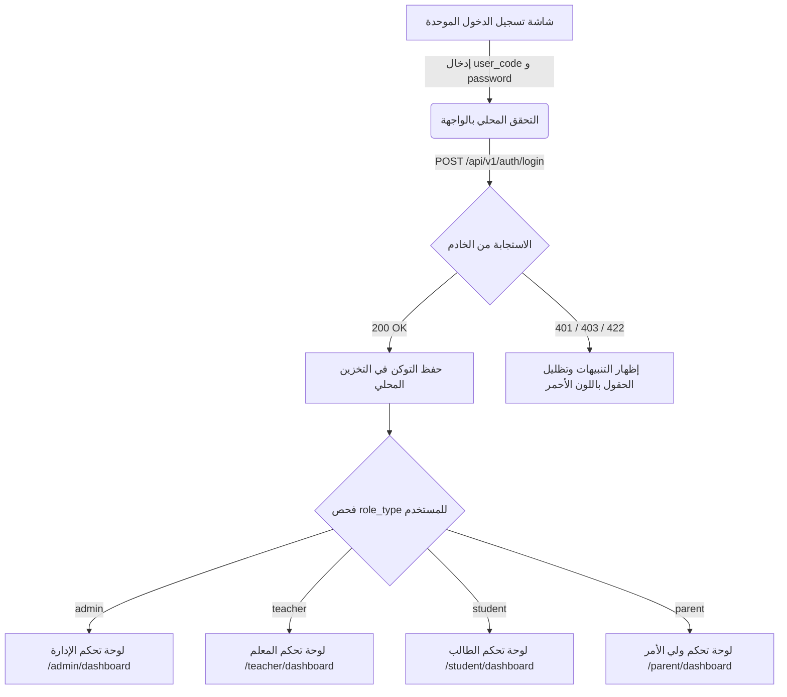
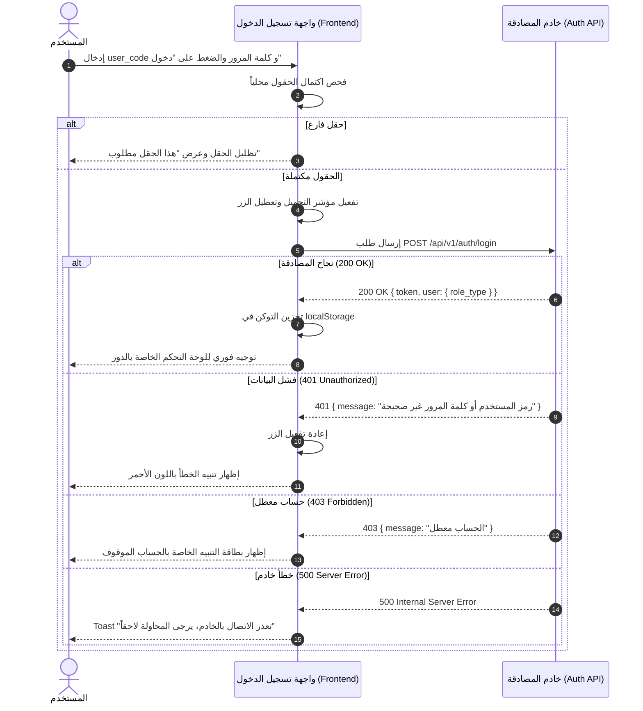

# 🖥️ مواصفات Frontend — المرحلة 01: الهوية والمصادقة والتدقيق (Presentation Layer)

> **الهدف:** توفير واجهة مستخدم حديثة وتفاعلية ومتجاوبة لشاشة تسجيل الدخول الموحدة، مع تطبيق نظام التصميم المعتمد، والتوجيه التلقائي للمستخدمين وفق أدوارهم، ودعم الاتجاه الأصيل (`dir="rtl"`).  
> ⚠️ **ملاحظة تكامل حوكمية (DRY & SSoT):** كافة هياكل واستجابات الـ JSON الصريحة وحالات الـ Status Codes لكل رابط يتم بناؤها ومعالجتها بالرجوع الحصري لملف [`routes.md`](./routes.md).

---

## 1. بنية العميل وتدفق البيانات (API Client Architecture)

### 1.1 الترويسات العامة المرفقة تلقائياً (Common Request Headers)
```http
Authorization: Bearer <ACCESS_TOKEN>
Accept: application/json
Accept-Language: ar
Content-Type: application/json
```

### 1.2 مصفوفة التعامل الشامل مع استجابات الـ HTTP (Global HTTP Status Matrix)

| كود الحالة | نوع الحالة | سلوك الواجهة وتجربة المستخدم (Frontend UX Action) |
| :--- | :--- | :--- |
| **`200 OK`** | نجاح تسجيل الدخول | حفظ التوكن في `localStorage` وتوجيه المستخدم فوراً إلى لوحة التحكم المقابلة لدوره (`Auto-Redirect`). |
| **`400 Bad Request`** | صياغة طلب غير صحيحة | عرض تنبيه خطأ عام في أعلى بطاقة الدخول. |
| **`401 Unauthorized`** | بيانات الدخول خاطئة | تظليل الحقول باللون الأحمر وإظهار رسالة: `رمز المستخدم أو كلمة المرور غير صحيحة`. |
| **`403 Forbidden`** | حساب معطل | إظهار بطاقة تنبيه حمراء: `هذا الحساب معطل حالياً من قِبل الإدارة. يرجى مراجعة إدارة المدرسة`. |
| **`422 Unprocessable`** | فشل التحقق الأولي | إظهار رسائل التحقق الدقيقة تحت حقل الرمز وحقل كلمة المرور. |
| **`429 Rate Limit`** | تجاوز المحاولات | تعطيل زر الدخول وعرض عداد تنازلي (60 ثانية) للمحاولة مجدداً. |
| **`500 Server Error`** | خطأ خادم داخلي | إشعار عائم Toast: `تعذر الاتصال بالخادم، يرجى المحاولة لاحقاً`. |

---

## 2. نظام التصميم والاتجاه الأصيل (Design Tokens & RTL)

1. **رموز التصميم (Design Tokens):**
   - الالتزام التام بالمتغيرات المحددة في `MD/design_rules.md` لجميع الألوان، والظلال، والمسافات، ونصف القطر (Border Radius).
   - يُحظر تماماً استخدام ألوان صلبة (Hex Codes) خارج نظام التصميم المعتمد.
2. **الاتجاه الأصيل (Native RTL Support):**
   - الحاوية الجذرية تدعم `dir="rtl"`.
   - استخدام الخصائص المنطقية في التنسيق (`margin-inline-start`, `padding-inline-end`, `border-start-start-radius`).
3. **التجاوب مع الشاشات (Responsive Viewports):**
   - توافق كامل ومظهر سلس عبر الهواتف الذكية (Mobile 375px)، والأجهزة اللوحية (Tablet 768px)، والشاشات المكتبية (Desktop 1280px+).

---

## 3. قدرات وسياسات الواجهة المفعلة (Frontend Capabilities)

1. **منع النقر المزدوج وتعطيل الزر (Prevent Double Submission):**
   * تعطيل زر "تسجيل الدخول" وتحويله لمؤشر تحميل دائري (*Loading Spinner*) فور الضغط لمنع إرسال طلبات متكررة.
2. **إظهار/إخفاء كلمة المرور (Show/Hide Password Toggle):**
   * زر تفاعلي بجانب حقل كلمة المرور للتبديل السلس بين النص الصريح والمخفي مع تغيير أيقونة العين.
3. **التنظيف التلقائي عند انتهاء الجلسة (Auto Session Cleanup):**
   * عند استلام استجابة `401 Unauthorized` من أي طلب في التطبيق، يتم مسح التوكن فوراً وتوجيه المستخدم لصفحة الدخول.

---

## 4. الشاشات والعمليات وربط الـ API (Screens & Operations)

### الشاشة (1): شاشة تسجيل الدخول الموحدة (`Unified Login Screen`)



#### أ. مكونات الشاشة:
- **شعار المدرسة واسم النظام (Header Branding):** اسم المنظومة الترحيبي.
- **حقل رمز المستخدم (`user_code`):** حقل نصي يحمل نصاً إرشادياً واضحاً (مثال: `ADM-1001`, `TCH-2005`, `STU-3042`).
- **حقل كلمة المرور (`password`):** حقل كلمة مرور آمن مع زر إظهار/إخفاء كلمة المرور.
- **زر الدخول الأساسي (Primary CTA):** زر عريض `تسجيل الدخول` بحالة تفاعلية ومؤشر تحميل.
- **منطقة التنبيهات والأخطاء (Error Feedback Box):** تظهر فقط عند وجود خطأ في الدخول.

#### ب. مصفوفة التوجيه التلقائي للأدوار (Role-Based Redirection Matrix):

| الدور المستلم (`role_type`) | المسار الموجه إليه بالواجهة | الوصف |
| :--- | :--- | :--- |
| **`admin`** | `/admin/dashboard` | لوحة التحكم الإدارية العامة وإدارة المدرسة. |
| **`teacher`** | `/teacher/dashboard` | لوحة تحكم المعلم (المواد، الحصص، الواجبات). |
| **`student`** | `/student/dashboard` | بوابة الطالب (الجدول، الواجبات، التطبيقات، الامتحانات). |
| **`parent`** | `/parent/dashboard` | بوابة ولي الأمر (متابعة الأبناء وسياق الطالب). |

#### ج. نقاط الاتصال ومعالجة الاستجابات الخاصة بالشاشة:

| الإجراء (UI Action) | نقطة الاتصال | المرجع التفصيلي في `routes.md` | معالجة وسلوك الواجهة لكافة حالات الاستجابة |
| :--- | :--- | :--- | :--- |
| **تسجيل الدخول** | `POST /api/v1/auth/login` | [البند 3.1 في `routes.md`](./routes.md#31-تسجيل-الدخول-الموحد-unified-login) | • **`200 OK`**: حفظ التوكن في `localStorage` وتوجيه فوري للوحة التحكم المقابلة للدور.<br>• **`400 Bad Request`**: تنبيه خطأ عام في أعلى البطاقة.<br>• **`401 Unauthorized`**: تظليل الحقول بالأحمر: `رمز المستخدم أو كلمة المرور غير صحيحة`.<br>• **`403 Forbidden`**: بطاقة تنبيه حمراء: `هذا الحساب معطل حالياً من قِبل الإدارة`.<br>• **`422 Unprocessable`**: إظهار رسائل التحقق الدقيقة تحت حقل الرمز وكلمة المرور.<br>• **`429 Rate Limit`**: تعطيل زر الدخول وعرض عداد تنازلي (60 ثانية).<br>• **`500 Server Error`**: Toast عائم: `تعذر الاتصال بالخادم، يرجى المحاولة لاحقاً`. |

---

### الشاشة (2): نافذة تغيير كلمة المرور (`Change Password Modal`)

#### أ. المكونات:
- حقل `كلمة المرور الحالية`.
- حقل `كلمة المرور الجديدة` (مع مؤشر قوة كلمة المرور).
- حقل `تأكيد كلمة المرور الجديدة`.
- أزرار `تحديث كلمة المرور` و `إلغاء`.

#### ب. نقاط الاتصال ومعالجة الاستجابات الخاصة بالنافذة:

| الإجراء (UI Action) | نقطة الاتصال | المرجع التفصيلي في `routes.md` | معالجة وسلوك الواجهة لكافة حالات الاستجابة |
| :--- | :--- | :--- | :--- |
| **تحديث كلمة المرور** | `POST /api/v1/auth/change-password` | [البند 3.4 في `routes.md`](./routes.md#34-تغيير-كلمة-المرور-change-password) | • **`200 OK`**: إغلاق النافذة المنبثقة + Toast أخضر: `تم تحديث كلمة المرور بنجاح`.<br>• **`401 Unauthorized`**: مسح التوكن وإعادة التوجيه لصفحة تسجيل الدخول.<br>• **`422 Unprocessable`**: تظليل الحقول وعرض رسائل الخطأ الدقيقة (مثل عدم مطابقة التأكيد أو كلمة مرور حالية خاطئة).<br>• **`500 Server Error`**: إشعار خطأ أحمر مع زر إعادة المحاولة. |

---

## 5. تدفق معالجة الأخطاء والتسلسل (Sequence Diagram)



---

## 6. حالات الواجهة الأربع (UI States Coverage)

| الحالة (State) | متى تحدث؟ | التوصيف وسلوك الواجهة (UX Implementation) |
| :--- | :--- | :--- |
| **1. حالة التحميل (Loading)** | أثناء إرسال طلب تسجيل الدخول | تحويل زر تسجيل الدخول إلى Spinner دوار مع تعطيل الحقول لمنع التعديل أثناء الإرسال. |
| **2. حالة الفراغ (Empty)** | عند تحميل شاشة الدخول لأول مرة | عرض النموذج نظيفاً مع وضع التركيز التلقائي (*Auto-focus*) على حقل رمز المستخدم. |
| **3. حالة الخطأ (Error)** | عند استلام `401`, `403`, `429`, أو `500` | تظليل الحقول باللون الأحمر وعرض رسالة الخطأ المناسبة في صندوق التنبيهات بوضوح. |
| **4. حالة النجاح (Success)** | بعد استلام `200 OK` | إخفاء النموذج وعرض وميض نجاح سريع مع تحويل المستخدم فوراً للوحة التحكم. |

---

## 7. إدارة الجلسة والتخزين المحلي (Session & Storage Management)

1. **حفظ التوكن:** حفظ التوكن الصادر في `localStorage` تحت المفتاح `auth_token`.
2. **استرجاع الجلسة عند فتح التطبيق (App Bootstrap):**
   * عند تشغيل الواجهة، إذا وُجد توكن، يتم استدعاء `GET /api/v1/auth/me` للتأكد من سريان الجلسة.
   * إذا كانت الجلسة صالحة: توجيه المستخدم تلقائياً للوحة تحكمه دون الحاجة لإعادة تسجيل الدخول.
   * إذا كانت الجلسة منتهية (`401`): مسح التوكن وفتح شاشة الدخول.
3. **تسجيل الخروج:**
   * استدعاء `POST /api/v1/auth/logout`.
   * مسح `auth_token` وتوجيه المستخدم فوراً لشاشة تسجيل الدخول.

---

## 8. معايير القبول لتكامل الواجهة (Frontend Acceptance Criteria)

- [ ] شاشة تسجيل الدخول الموحدة مبنية بالكامل وتدعم الاتجاه الأصيل `dir="rtl"`.
- [ ] يتم التحقق الأولي من الحقول قبل الإرسال لمنع الطلبات الفارغة.
- [ ] زر الدخول يظهر مؤشر التحميل ويتعطل أثناء معالجة الطلب لمنع التكرار.
- [ ] زر إظهار/إخفاء كلمة المرور يعمل بسلاسة.
- [ ] معالجة كافة حالات الاستجابة (200, 401, 403, 422, 429, 500) مطبقة بدقة متناهية.
- [ ] التوجيه التلقائي بناءً على `role_type` يعمل بنجاح لكافة الأدوار الأربعة (`admin`, `teacher`, `student`, `parent`).
- [ ] نافذة تغيير كلمة المرور تعمل بنجاح مع مطابقة التأكيد.
- [ ] تجربة الاستخدام متوافقة وسلسة عبر جميع أحجام الشاشات والأجهزة.
