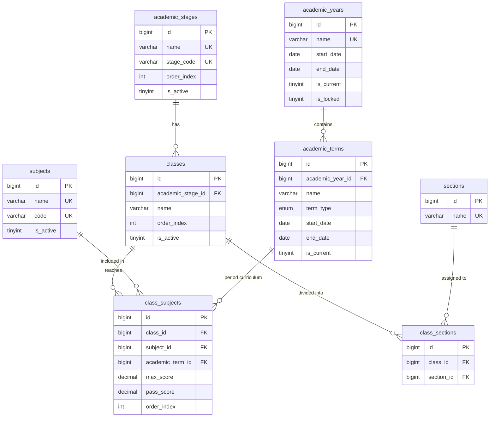
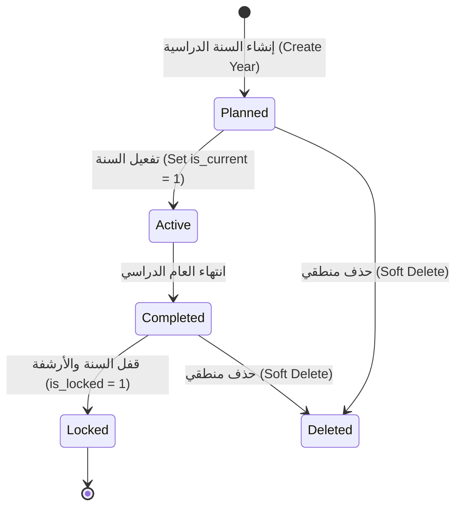

# 📊 مواصفات البيانات والكيانات — المرحلة 02: الهيكل الأكاديمي والمناهج (Data Specification)

> **الهدف:** توثيق المخطط الهيكلي للجداول الثمانية، والعلاقات، والفهارس، وقيود النزاهة، ودورة حياة الحالات وفق **التسلسل التنفيذي الأكاديمي المعتمد**، والمشتقة بالكامل بنسبة 100% من مخطط قاعدة البيانات المعتمد في [`MD/database.md`](../../database.md).

---

## 1. جداول وكيانات المرحلة بالترتيب الأكاديمي (Phase Tables Schema & Lifecycle)

---

### 1.1 [الخطوة 1] جدول السنوات الدراسية (`academic_years`)

> **الوصف:** السجل المرجعي للسنوات الدراسية في المنظومة (مثال: `2025/2026`, `2026/2027`)، وضبط السنة النشطة حالياً.

| اسم الحقل | نوع البيانات (SQL Data Type) | القيود والخصائص (Constraints) | الوصف والدلالة الوظيفية |
| :--- | :--- | :--- | :--- |
| `id` | `BIGINT UNSIGNED` | `PRIMARY KEY AUTO_INCREMENT` | المعرف الفريد للسنة الدراسية. |
| `name` | `VARCHAR(50)` | `UNIQUE NOT NULL` | مسمى السنة الدراسية (مثال: `2025/2026`). |
| `start_date` | `DATE` | `NOT NULL` | تاريخ بداية السنة الدراسية. |
| `end_date` | `DATE` | `NOT NULL` | تاريخ نهاية السنة الدراسية (`end_date > start_date`). |
| `is_current` | `TINYINT(1)` | `DEFAULT 0, NOT NULL, INDEXED` | محدد السنة النشطة حالياً (`1 = السنة الحالية`, سنة واحدة نشطة فقط). |
| `is_locked` | `TINYINT(1)` | `DEFAULT 0, NOT NULL` | قفل السنة بعد الإغلاق لمنع التعديل (`1 = مقفلة`). |
| `created_at` | `TIMESTAMP` | `DEFAULT CURRENT_TIMESTAMP, NOT NULL` | توقيت الإنشاء. |
| `updated_at` | `TIMESTAMP` | `NULLABLE ON UPDATE CURRENT_TIMESTAMP` | توقيت آخر تحديث. |
| `deleted_at` | `TIMESTAMP` | `NULLABLE` | طابع الحذف المنطقي (Soft Delete). |

---

### 1.2 [الخطوة 2] جدول الفصول/الفترات الدراسية (`academic_terms`)

> **الوصف:** تقسيم السنة الدراسية إلى فترات دراسية (مثال: `الفترة الأولى`, `الفترة الثانية`, `الفترة الثالثة`) وضبط الفترة النشطة حالياً.

| اسم الحقل | نوع البيانات (SQL Data Type) | القيود والخصائص (Constraints) | الوصف والدلالة الوظيفية |
| :--- | :--- | :--- | :--- |
| `id` | `BIGINT UNSIGNED` | `PRIMARY KEY AUTO_INCREMENT` | المعرف الفريد للفصل/الفترة الدراسية. |
| `academic_year_id` | `BIGINT UNSIGNED` | `NOT NULL, INDEXED` | السنة الدراسية التابع لها الفصل (يرتبط بـ `academic_years.id`). |
| `name` | `VARCHAR(50)` | `NOT NULL` | مسمى الفصل/الفترة (مثال: `الفترة الأولى`, `الفترة الثانية`). |
| `term_type` | `ENUM('first_term', 'second_term', 'third_term', 'full_year')` | `NOT NULL` | نوع/رمز الفترة الدراسية. |
| `start_date` | `DATE` | `NOT NULL` | تاريخ بداية الفترة. |
| `end_date` | `DATE` | `NOT NULL` | تاريخ نهاية الفترة. |
| `is_current` | `TINYINT(1)` | `DEFAULT 0, NOT NULL, INDEXED` | محدد الفترة النشطة حالياً (`1 = الفترة الحالية`, فترة نشطة واحدة للسنة). |
| `created_at` | `TIMESTAMP` | `DEFAULT CURRENT_TIMESTAMP, NOT NULL` | توقيت الإنشاء. |
| `updated_at` | `TIMESTAMP` | `NULLABLE ON UPDATE CURRENT_TIMESTAMP` | توقيت آخر تحديث. |
| `deleted_at` | `TIMESTAMP` | `NULLABLE` | طابع الحذف المنطقي. |

---

### 1.3 [الخطوة 3] جدول المراحل التعليمية (`academic_stages`)

> **الوصف:** تصنيف المراحل التعليمية بالمدرسة (مثال: `تمهيدي`, `ابتدائي`, `إعدادي`, `ثانوي`).

| اسم الحقل | نوع البيانات (SQL Data Type) | القيود والخصائص (Constraints) | الوصف والدلالة الوظيفية |
| :--- | :--- | :--- | :--- |
| `id` | `BIGINT UNSIGNED` | `PRIMARY KEY AUTO_INCREMENT` | المعرف الفريد للمرحلة التعليمية. |
| `name` | `VARCHAR(50)` | `UNIQUE NOT NULL` | اسم المرحلة (مثال: `المرحلة الابتدائية`, `المرحلة الإعدادية`). |
| `stage_code` | `VARCHAR(20)` | `UNIQUE NOT NULL` | الرمز البرمجي للمرحلة (`KG`, `PRIMARY`, `PREP`, `SEC`). |
| `order_index` | `INT UNSIGNED` | `DEFAULT 1, NOT NULL, INDEXED` | الترتيب التسلسلي للمراحل. |
| `is_active` | `TINYINT(1)` | `DEFAULT 1, NOT NULL` | حالة التفعيل (`1 = مفعلة`, `0 = معطلة`). |
| `created_at` | `TIMESTAMP` | `DEFAULT CURRENT_TIMESTAMP, NOT NULL` | توقيت الإنشاء. |
| `updated_at` | `TIMESTAMP` | `NULLABLE ON UPDATE CURRENT_TIMESTAMP` | توقيت آخر تحديث. |
| `deleted_at` | `TIMESTAMP` | `NULLABLE` | طابع الحذف المنطقي. |

---

### 1.4 [الخطوة 4] جدول الصفوف الدراسية وتحديد تبعيتها للمراحل (`classes`)

> **الوصف:** الصفوف الدراسية وتحديد المرحلة التعليمية التابع لها كل صف.  
> *أمثلة التبعية:*  
> - الصفوف من الأول إلى السادس (`academic_stage_id` = المرحلة الابتدائية).  
> - الصفوف من السابع إلى التاسع (`academic_stage_id` = المرحلة الإعدادية).  
> - الصفوف من العاشر إلى الثاني عشر (`academic_stage_id` = المرحلة الثانوية).

| اسم الحقل | نوع البيانات (SQL Data Type) | القيود والخصائص (Constraints) | الوصف والدلالة الوظيفية |
| :--- | :--- | :--- | :--- |
| `id` | `BIGINT UNSIGNED` | `PRIMARY KEY AUTO_INCREMENT` | المعرف الفريد للصف الدراسي. |
| `academic_stage_id` | `BIGINT UNSIGNED` | `NOT NULL, INDEXED` | المرحلة التعليمية التابع لها الصف (يرتبط بـ `academic_stages.id`). |
| `name` | `VARCHAR(50)` | `NOT NULL` | اسم الصف (مثال: `الصف الأول`, `الصف الخامس`, `الصف السابع`). |
| `order_index` | `INT UNSIGNED` | `DEFAULT 1, NOT NULL, INDEXED` | الترتيب الأكاديمي للصف. |
| `is_active` | `TINYINT(1)` | `DEFAULT 1, NOT NULL` | حالة التفعيل. |
| `created_at` | `TIMESTAMP` | `DEFAULT CURRENT_TIMESTAMP, NOT NULL` | توقيت الإنشاء. |
| `updated_at` | `TIMESTAMP` | `NULLABLE ON UPDATE CURRENT_TIMESTAMP` | توقيت آخر تحديث. |
| `deleted_at` | `TIMESTAMP` | `NULLABLE` | طابع الحذف المنطقي. |

---

### 1.5 [الخطوة 5] جدول الشُعب العامة (`sections`)

> **الوصف:** بنك مسميات الشُعب المعتمدة في المدرسة لمرة واحدة (مثال: `الشعبة أ`, `الشعبة ب`, `الشعبة ج`, `الشعبة د`).

| اسم الحقل | نوع البيانات (SQL Data Type) | القيود والخصائص (Constraints) | الوصف والدلالة الوظيفية |
| :--- | :--- | :--- | :--- |
| `id` | `BIGINT UNSIGNED` | `PRIMARY KEY AUTO_INCREMENT` | المعرف الفريد للشعبة. |
| `name` | `VARCHAR(20)` | `UNIQUE NOT NULL` | مسمى الشعبة (مثال: `الشعبة أ`, `الشعبة ب`, `الشعبة ج`). |
| `created_at` | `TIMESTAMP` | `DEFAULT CURRENT_TIMESTAMP, NOT NULL` | توقيت الإنشاء. |
| `updated_at` | `TIMESTAMP` | `NULLABLE ON UPDATE CURRENT_TIMESTAMP` | توقيت آخر تحديث. |
| `deleted_at` | `TIMESTAMP` | `NULLABLE` | طابع الحذف المنطقي. |

---

### 1.6 [الخطوة 6] جدول بنك المواد الدراسية العامة (`subjects`)

> **الوصف:** بنك المواد والمساقات التعليمية العامة بالمدرسة (مثال: `الرياضيات`, `العلوم`, `اللغة العربية`).

| اسم الحقل | نوع البيانات (SQL Data Type) | القيود والخصائص (Constraints) | الوصف والدلالة الوظيفية |
| :--- | :--- | :--- | :--- |
| `id` | `BIGINT UNSIGNED` | `PRIMARY KEY AUTO_INCREMENT` | المعرف الفريد للمادة. |
| `name` | `VARCHAR(100)` | `UNIQUE NOT NULL` | اسم المادة (مثال: `الرياضيات`, `اللغة العربية`). |
| `code` | `VARCHAR(20)` | `UNIQUE NOT NULL` | الرمز البرمجي للمادة (مثال: `MATH`, `ARABIC`). |
| `is_active` | `TINYINT(1)` | `DEFAULT 1, NOT NULL` | حالة التفعيل. |
| `created_at` | `TIMESTAMP` | `DEFAULT CURRENT_TIMESTAMP, NOT NULL` | توقيت الإنشاء. |
| `updated_at` | `TIMESTAMP` | `NULLABLE ON UPDATE CURRENT_TIMESTAMP` | توقيت آخر تحديث. |
| `deleted_at` | `TIMESTAMP` | `NULLABLE` | طابع الحذف المنطقي. |

---

### 1.7 [الخطوة 7] جدول ربط وتسكين الشُعب بالصفوف (`class_sections`)

> **الوصف:** تخصيص وفتح الشُعب المتاحة لكل صف دراسي (مثال: الصف الخامس تفتح له الشعبة أ والشعبة ب لتشكيل `خامس/أ` و `خامس/ب`).

| اسم الحقل | نوع البيانات (SQL Data Type) | القيود والخصائص (Constraints) | الوصف والدلالة الوظيفية |
| :--- | :--- | :--- | :--- |
| `id` | `BIGINT UNSIGNED` | `PRIMARY KEY AUTO_INCREMENT` | المعرف الفريد لسجل ربط الصف بالشعبة. |
| `class_id` | `BIGINT UNSIGNED` | `NOT NULL, INDEXED` | الصف الدراسي (يرتبط بـ `classes.id`). |
| `section_id` | `BIGINT UNSIGNED` | `NOT NULL, INDEXED` | الشعبة (يرتبط بـ `sections.id`). |
| `created_at` | `TIMESTAMP` | `DEFAULT CURRENT_TIMESTAMP, NOT NULL` | توقيت الإنشاء. |
| `updated_at` | `TIMESTAMP` | `NULLABLE ON UPDATE CURRENT_TIMESTAMP` | توقيت آخر تحديث. |
| `deleted_at` | `TIMESTAMP` | `NULLABLE` | طابع الحذف المنطقي. |

---

### 1.8 [الخطوة 8] جدول مناهج الصفوف والدرجات لكل فترة دراسية (`class_subjects`)

> **الوصف:** ربط المواد بالصفوف والفصول/الفترات الدراسية وتحديد الدرجة العظمى ودرجة النجاح المخصصة لكل فترة دراسية بشكل مستقل ومفصل.  
> *مثال واقعي:* إذا كان الصف الخامس يحتوي على "الفترة الأولى" و"الفترة الثانية"، فيتم إضافة سجل لمادة الرياضيات للفترة الأولى (`academic_term_id = 1`, `max_score = 100`, `pass_score = 50`) وسجل آخر للفترة الثانية (`academic_term_id = 2`, `max_score = 100`, `pass_score = 50`).

| اسم الحقل | نوع البيانات (SQL Data Type) | القيود والخصائص (Constraints) | الوصف والدلالة الوظيفية |
| :--- | :--- | :--- | :--- |
| `id` | `BIGINT UNSIGNED` | `PRIMARY KEY AUTO_INCREMENT` | المعرف الفريد لمقرر المادة بالفترة الدراسية. |
| `class_id` | `BIGINT UNSIGNED` | `NOT NULL, INDEXED` | الصف الدراسي (يرتبط بـ `classes.id`). |
| `subject_id` | `BIGINT UNSIGNED` | `NOT NULL, INDEXED` | المادة الدراسية (يرتبط بـ `subjects.id`). |
| `academic_term_id` | `BIGINT UNSIGNED` | `NOT NULL, INDEXED` | الفترة/الفصل الدراسي (يرتبط بـ `academic_terms.id`). |
| `max_score` | `DECIMAL(5,2) UNSIGNED` | `DEFAULT 100.00, NOT NULL` | الدرجة العظمى للمادة في هذه الفترة الدراسية. |
| `pass_score` | `DECIMAL(5,2) UNSIGNED` | `DEFAULT 50.00, NOT NULL` | درجة النجاح الصغرى في هذه الفترة (`pass_score <= max_score`). |
| `order_index` | `INT UNSIGNED` | `DEFAULT 1, NOT NULL` | ترتيب المادة في كشف درجات هذه الفترة. |
| `created_at` | `TIMESTAMP` | `DEFAULT CURRENT_TIMESTAMP, NOT NULL` | توقيت الإنشاء. |
| `updated_at` | `TIMESTAMP` | `NULLABLE ON UPDATE CURRENT_TIMESTAMP` | توقيت آخر تحديث. |
| `deleted_at` | `TIMESTAMP` | `NULLABLE` | طابع الحذف المنطقي. |

---

## 2. العلاقات والتكامل المرجعي (Relationships & Foreign Keys)

| الكيان المصدر | نوع العلاقة | الحقل المحلي (Local Key) | الكيان الهدف | الحقل الخارجي (Target Key) | سلوك الحذف (`ON DELETE`) | سلوك التحديث (`ON UPDATE`) |
| :--- | :--- | :--- | :--- | :--- | :--- | :--- |
| `academic_terms` | `BelongsTo` | `academic_year_id` | `academic_years` | `id` | `CASCADE` | `CASCADE` |
| `classes` | `BelongsTo` | `academic_stage_id` | `academic_stages` | `id` | `RESTRICT` (منع حذف المرحلة إذا كانت تضم صفوفاً) | `CASCADE` |
| `class_sections` | `BelongsTo` | `class_id` | `classes` | `id` | `RESTRICT` (منع حذف الصف إذا كان يضم شعباً) | `CASCADE` |
| `class_sections` | `BelongsTo` | `section_id` | `sections` | `id` | `RESTRICT` (منع حذف الشعبة إذا كانت مستخدمة بصف) | `CASCADE` |
| `class_subjects` | `BelongsTo` | `class_id` | `classes` | `id` | `CASCADE` | `CASCADE` |
| `class_subjects` | `BelongsTo` | `subject_id` | `subjects` | `id` | `RESTRICT` (منع حذف المادة إذا كانت مسندة لصفوف) | `CASCADE` |
| `class_subjects` | `BelongsTo` | `academic_term_id` | `academic_terms` | `id` | `RESTRICT` (منع حذف الفصل الدراسي إذا كان يضم مناهج) | `CASCADE` |

---

## 3. الفهارس وقيود التفرد (Indexes & Constraints)

### 3.1 قيود التفرد المركبة والبسيطة (Unique Constraints):
- `academic_years`: `UNIQUE (name)`
- `academic_terms`: `UNIQUE (academic_year_id, term_type)` لمنع تكرار نفس نوع الفصل في نفس السنة.
- `academic_stages`: `UNIQUE (name)` و `UNIQUE (stage_code)`
- `classes`: `UNIQUE (academic_stage_id, name)` لمنع تكرار اسم الصف في نفس المرحلة.
- `sections`: `UNIQUE (name)`
- `class_sections`: `UNIQUE (class_id, section_id)` لمنع تكرار فتح نفس الشعبة في نفس الصف.
- `subjects`: `UNIQUE (name)` و `UNIQUE (code)`
- `class_subjects`: `UNIQUE INDEX uq_class_subject_term (class_id, subject_id, academic_term_id)` لمنع تكرار ربط نفس المادة بالصف في نفس الفترة الدراسية.

---

## 4. مخطط الكيانات والعلاقات (Entity Relationship Diagram - ERD)

---

## 5. دورة حياة السنة والفصل الدراسي (State Machine Diagram)

---

## 6. مطابقة المخطط ومصدر الحقيقة (SSoT Alignment)

- كافة تعريفات الجداول، والأنواع، والعلاقات، والفهارس المذكورة في هذه الوثيقة متطابقة تماماً مع المصدر الرئيسي للحقيقة: [`MD/database.md`](../../database.md) (المرحلة 02).
