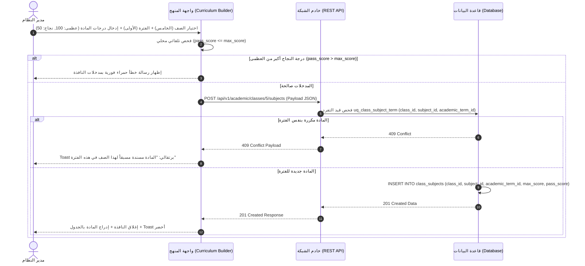

# 🖥️ مواصفات Frontend — المرحلة 02: الهيكل الأكاديمي والمناهج (User Interface & User Experience)

> **الهدف:** توثيق الواجهات الأمامية، والشاشات، والنماذج المنبثقة، وتجربة المستخدم، ومعالجة كافة استجابات الـ API **مقسمة بالكامل وفق الخطوات التنفيذية الـ 8 المعتمدة**.  
> 
> ⚠️ **تكامل حوكمي صريح ومرجع الاستجابات والحركات (Network SSoT):**  
> ملف [`routes.md`](./routes.md) هو **المصدر الرئيسي والحصري والوحيد للشبكة والاستجابات (Network SSoT)**. يلتزم مطور الواجهات بالكامل بالرجوع لملف [`routes.md`](./routes.md) للاطلاع على هياكل الـ JSON الصريحة لكافة رموز وحالات الاستجابة لكل حركة وإجراء بالواجهة (`200 OK`, `201 Created`, `400 Bad Request`, `401 Unauthorized`, `403 Forbidden`, `404 Not Found`, `409 Conflict`, `422 Unprocessable`, `500 Server Error`).

---

## 1. الهيكلية العامة لنظام التصميم والواجهات (Design System & Layout Invariants)

- **الاتجاه الأصيل (Native Direction):** `dir="rtl"` إجباري بكافة الواجهات والنماذج.
- **خطوط الطباعة المعيارية:** خط `Cairo` للتطبيقات العربية والمستندات الرسمية.
- **التصميم المتجاوب (Responsive Breakpoints):**
  - شاشات المكتبي (Desktop): `1280px+` (جدول كامل وشجرة تفاعلية متعددة الأعمدة).
  - اللوحي (Tablet): `768px - 1024px` (بطاقات وشجرة قابلة للطي).
  - الهواتف (Mobile): `< 768px` (شجرة عمودية مع حقول تحكم عائمة).

---

## 2. مصفوفة التعامل الشامل مع استجابات الـ HTTP (Global UX Matrix)

| كود الاستجابة | سلوك واجهة المستخدم (UI Action & Behavior) | طريقة العرض والتنبيه |
| :--- | :--- | :--- |
| **`200 OK` / `201 Created`** | إغلاق المودال المنبثق فوراً، إدراج العنصر بالواجهة، وإظهار تنبيه نجاح. | Toast أخضر: `تمت العملية بنجاح.` |
| **`400 Bad Request`** | إبراز الحقول غير الصالحة باللون الأحمر واحتفاظ المستخدم بمدخلاته. | Banner أحمر علوي بالنافذة المنبثقة. |
| **`403 Forbidden`** | منع الإجراء وإظهار رسالة عدم إمكانية تعديل سنة مقفلة أو حذف كيان مرتبط. | بطاقة alert حمراء ثابته بأعلى الصفحة. |
| **`409 Conflict`** | إظهار تنبيه تكرار المسمى أو رمز الكيان أو إسناد المادة مسبقاً بنفس الفترة. | Toast برتقالي: `العنصر مسجل مسبقاً بالمنظومة.` |
| **`422 Unprocessable`** | إظهار خطأ إذا كان تاريخ النهاية قبل البداية أو `pass_score > max_score`. | نص خطأ أحمر تحت حقل الإدخال مباشرة. |

---

## 📅 الخطوة 1: شاشة وإجراءات إدارة السنوات الدراسية (`academic_years`)

> **الوصف المختصر:** شاشة وتفاصيل إدارة التقويم السنوي للمدرسة، عرض قائمة السنوات، وسوم "السنة النشطة" و"السنة المقفلة"، والنوافذ المنبثقة لإضافة وتعديل وقفل وتفعيل السنة الحالية.

### 1.1 نقاط الاتصال وسلوكيات الواجهة للخطوة 1:
| الوصف الوظيفي للإجراء (UI Action) | نقطة الاتصال | المرجع التفصيلي في `routes.md` | معالجة وسلوك الواجهة لكافة حالات الاستجابة |
| :--- | :--- | :--- | :--- |
| **جلب قائمة السنوات الدراسية** | `GET /api/v1/academic/years` | [الخطوة 1 في `routes.md`](./routes.md#الخطوة-1-إدارة-السنوات-الدراسية-academic_years) | عرض قائمة السنوات بالجدول وتظليل السنة النشطة بلون مميز. |
| **إنشاء سنة دراسية جديدة** | `POST /api/v1/academic/years` | [الخطوة 1 في `routes.md`](./routes.md#الخطوة-1-إدارة-السنوات-الدراسية-academic_years) | • **`201 Created`**: إغلاق النافذة + تحديث الجدول + Toast أخضر. • **`409 Conflict`**: تنبيه تكرار مسمى السنة. • **`422 Unprocessable`**: إظهار خطأ إذا كان تاريخ النهاية قبل البداية. |
| **تعديل بيانات سنة دراسية** | `PUT /api/v1/academic/years/:id` | [الخطوة 1 في `routes.md`](./routes.md#الخطوة-1-إدارة-السنوات-الدراسية-academic_years) | • **`200 OK`**: تحديث السجل بالجدول فوراً. • **`403 Forbidden`**: بطاقة تنبيه: `لا يمكن تعديل سنة دراسية مقفلة`. |
| **حذف سنة دراسية غير مرتبطة** | `DELETE /api/v1/academic/years/:id` | [الخطوة 1 في `routes.md`](./routes.md#الخطوة-1-إدارة-السنوات-الدراسية-academic_years) | • **`200 OK`**: إزالة السنة من الجدول. • **`403 Forbidden`**: تنبيه بوجود فصول دراسية مرتبطة للسنة (`RESTRICT`). |
| **تفعيل السنة النشطة حالياً** | `POST /years/:id/set-current` | [الخطوة 1 في `routes.md`](./routes.md#الخطوة-1-إدارة-السنوات-الدراسية-academic_years) | • **`200 OK`**: نقل وسم "السنة الحالية" للسنة الجديدة وإلغائه عن السابقة. |

---

## ⏱️ الخطوة 2: شاشة وإجراءات إدارة الفترات/الفصول الدراسية (`academic_terms`)

> **الوصف المختصر:** مكونات وأكورديون الفترات الدراسية التابعة للسنة المحددة (`الفترة الأولى`, `الفترة الثانية`, `الفترة الثالثة`)، عرض وسوم الفترة النشطة حالياً، والنوافذ المنبثقة لإضافة/تعديل/تفعيل فترة.

### 2.1 نقاط الاتصال وسلوكيات الواجهة للخطوة 2:
| الوصف الوظيفي للإجراء (UI Action) | نقطة الاتصال | المرجع التفصيلي في `routes.md` | معالجة وسلوك الواجهة لكافة حالات الاستجابة |
| :--- | :--- | :--- | :--- |
| **عرض فترات سنة دراسية معينة** | `GET /years/:year_id/terms` | [الخطوة 2 في `routes.md`](./routes.md#الخطوة-2-إدارة-الفصولالفترات-الدراسية-academic_terms) | عرض قائمة الفترات داخل أكورديون السنة المختارة. |
| **إنشاء فترة دراسية جديدة** | `POST /years/:year_id/terms` | [الخطوة 2 في `routes.md`](./routes.md#الخطوة-2-إدارة-الفصولالفترات-الدراسية-academic_terms) | • **`201 Created`**: إدراج الفترة بأكورديون السنة فوراً. • **`409 Conflict`**: تنبيه بتكرار نوع الفترة بنفس السنة. |
| **تعديل بيانات فترة دراسية** | `PUT /terms/:id` | [الخطوة 2 في `routes.md`](./routes.md#الخطوة-2-إدارة-الفصولالفترات-الدراسية-academic_terms) | • **`200 OK`**: تحديث مسمى أو تواريخ الفترة بالواجهة. |
| **حذف فترة دراسية غير مرتبطة**| `DELETE /terms/:id` | [الخطوة 2 في `routes.md`](./routes.md#الخطوة-2-إدارة-الفصولالفترات-الدراسية-academic_terms) | • **`200 OK`**: حذف الفترة. • **`403 Forbidden`**: تنبيه بوجود مناهج/درجات تابعة للفترة. |
| **تفعيل الفترة النشطة حالياً** | `POST /terms/:id/set-current` | [الخطوة 2 في `routes.md`](./routes.md#الخطوة-2-إدارة-الفصولالفترات-الدراسية-academic_terms) | • **`200 OK`**: نقل وسم الفترة النشطة للفترة الجديدة التابعة للنفس السنة. |

---

## 🏛️ الخطوة 3: شاشة وإجراءات إدارة المراحل التعليمية (`academic_stages`)

> **الوصف المختصر:** كروت وبطاقات شجرة المراحل الأكاديمة الكبرى في المدرسة (تمهيدي، ابتدائي، إعدادي، ثانوي) مع إمكانية إعادة الترتيب السحب والإسقاط والنوافذ المنبثقة لإضافة/تعديل/حذف مرحلة.

### 3.1 نقاط الاتصال وسلوكيات الواجهة للخطوة 3:
| الوصف الوظيفي للإجراء (UI Action) | نقطة الاتصال | المرجع التفصيلي في `routes.md` | معالجة وسلوك الواجهة لكافة حالات الاستجابة |
| :--- | :--- | :--- | :--- |
| **جلب شجرة الهيكل الأكاديمي** | `GET /stages` | [الخطوة 3 في `routes.md`](./routes.md#الخطوة-3-إدارة-المراحل-التعليمية-academic_stages) | بناء الشجرة التفاعلية للمراحل والصفوف والشعب المفتوحة. |
| **إنشاء مرحلة تعليمية جديدة** | `POST /stages` | [الخطوة 3 في `routes.md`](./routes.md#الخطوة-3-إدارة-المراحل-التعليمية-academic_stages) | • **`201 Created`**: إدراج كارت المرحلة بالشجرة فوراً. • **`409 Conflict`**: تنبيه بتكرار رمز أو مسمى المرحلة. |
| **تعديل مرحلة تعليمية** | `PUT /stages/:id` | [الخطوة 3 في `routes.md`](./routes.md#الخطوة-3-إدارة-المراحل-التعليمية-academic_stages) | • **`200 OK`**: تحديث اسم أو ترتيب المرحلة بالشجرة. |
| **حذف مرحلة تعليمية فارغة** | `DELETE /stages/:id` | [الخطوة 3 في `routes.md`](./routes.md#الخطوة-3-إدارة-المراحل-التعليمية-academic_stages) | • **`200 OK`**: حذف كارت المرحلة. • **`403 Forbidden`**: بطاقة تنبيه: `تضم هذه المرحلة صفوفاً تابعة` (`RESTRICT`). |

---

## 🏫 الخطوة 4: شاشة وإجراءات إدارة الصفوف وتسكينها بالمراحل (`classes`)

> **الوصف المختصر:** قوائم وبطاقات الصفوف المدمجة تحت كروت المراحل التعليمية (الصفوف 1-6 تحت الابتدائي، 7-9 تحت الإعدادي، 10-12 تحت الثانوي)، والنوافذ المنبثقة لإضافة/تعديل/حذف صف وتسلسله الأكاديمي.

### 4.1 نقاط الاتصال وسلوكيات الواجهة للخطوة 4:
| الوصف الوظيفي للإجراء (UI Action) | نقطة الاتصال | المرجع التفصيلي في `routes.md` | معالجة وسلوك الواجهة لكافة حالات الاستجابة |
| :--- | :--- | :--- | :--- |
| **جلب صفوف مرحلة تعليمية** | `GET /classes` | [الخطوة 4 في `routes.md`](./routes.md#الخطوة-4-إدارة-الصفوف-الدراسية-وتحديد-تببيتها-للمراحل-classes) | عرض صفوف المرحلة المختارة بالواجهة. |
| **إنشاء صف دراسي وتسكينه بمرحلة**| `POST /classes` | [الخطوة 4 في `routes.md`](./routes.md#الخطوة-4-إدارة-الصفوف-الدراسية-وتحديد-تببيتها-للمراحل-classes) | • **`201 Created`**: إدراج الصف فوراً تحت كارت المرحلة المقابلة. |
| **تعديل بيانات صف دراسي** | `PUT /classes/:id` | [الخطوة 4 في `routes.md`](./routes.md#الخطوة-4-إدارة-الصفوف-الدراسية-وتحديد-تببيتها-للمراحل-classes) | • **`200 OK`**: تحديث اسم أو ترتيب الصف بالواجهة. |
| **حذف صف دراسي غير مرتبط** | `DELETE /classes/:id` | [الخطوة 4 في `routes.md`](./routes.md#الخطوة-4-إدارة-الصفوف-الدراسية-وتحديد-تببيتها-للمراحل-classes) | • **`200 OK`**: حذف الصف. • **`403 Forbidden`**: بطاقة تنبيه: `الصف يضم شعباً أو مناهج تابعة` (`RESTRICT`). |

---

## 🔠 الخطوة 5: شاشة وإجراءات إدارة بنك الشُعب العامة (`sections`)

> **الوصف المختصر:** جدول وبنك المسميات المتاحة للشعب العامة بالمدرسة لمرة واحدة (الشعبة أ، الشعبة ب، الشعبة ج)، والنوافذ المنبثقة لإضافة وتعديل وحذف مسمى شعبة عامة.

### 5.1 نقاط الاتصال وسلوكيات الواجهة للخطوة 5:
| الوصف الوظيفي للإجراء (UI Action) | نقطة الاتصال | المرجع التفصيلي في `routes.md` | معالجة وسلوك الواجهة لكافة حالات الاستجابة |
| :--- | :--- | :--- | :--- |
| **جلب بنك الشعب العامة** | `GET /sections` | [الخطوة 5 في `routes.md`](./routes.md#الخطوة-5-إدارة-بنك-الشعب-العامة-sections) | عرض قائمة الشعب العامة المتاحة بالمنظومة. |
| **إنشاء شعبة عامة جديدة** | `POST /sections` | [الخطوة 5 في `routes.md`](./routes.md#الخطوة-5-إدارة-بنك-الشعب-العامة-sections) | • **`201 Created`**: إضافة الشعبة لبنك الشعب العامة. • **`409 Conflict`**: مسمى الشعبة مكرر. |
| **تعديل مسمى شعبة عامة** | `PUT /sections/:id` | [الخطوة 5 في `routes.md`](./routes.md#الخطوة-5-إدارة-بنك-الشعب-العامة-sections) | • **`200 OK`**: تحديث مسمى الشعبة العامة بالبنك. |
| **حذف شعبة عامة غير مستخدمة** | `DELETE /sections/:id` | [الخطوة 5 في `routes.md`](./routes.md#الخطوة-5-إدارة-بنك-الشعب-العامة-sections) | • **`200 OK`**: حذف الشعبة. • **`403 Forbidden`**: الشعبة مستخدمة ومفتوحة بصفوف. |

---

## 📖 الخطوة 6: شاشة وإجراءات إدارة بنك المواد العامة (`subjects`)

> **الوصف المختصر:** بنك المواد والمساقات التعليمية العامة بالمدرسة، والنوافذ المنبثقة لإضافة/تعديل/حذف مادة عامة باسمها العربي ورمزها البرمجي (مثال: الرياضيات MATH، العلوم SCI).

### 6.1 نقاط الاتصال وسلوكيات الواجهة للخطوة 6:
| الوصف الوظيفي للإجراء (UI Action) | نقطة الاتصال | المرجع التفصيلي في `routes.md` | معالجة وسلوك الواجهة لكافة حالات الاستجابة |
| :--- | :--- | :--- | :--- |
| **جلب بنك المواد العامة** | `GET /subjects` | [الخطوة 6 في `routes.md`](./routes.md#الخطوة-6-إدارة-بنك-المواد-الدراسية-العامة-subjects) | عرض جدول بنك المواد ورموزها الرسمية. |
| **إضافة مادة جديدة لبنك المواد** | `POST /subjects` | [الخطوة 6 في `routes.md`](./routes.md#الخطوة-6-إدارة-بنك-المواد-الدراسية-العامة-subjects) | • **`201 Created`**: إدراج المادة في بنك المواد العامة. |
| **تعديل بيانات مادة عامة** | `PUT /subjects/:id` | [الخطوة 6 في `routes.md`](./routes.md#الخطوة-6-إدارة-بنك-المواد-الدراسية-العامة-subjects) | • **`200 OK`**: تحديث اسم أو رمز المادة بالبنك. |
| **حذف مادة عامة غير مسندة** | `DELETE /subjects/:id` | [الخطوة 6 في `routes.md`](./routes.md#الخطوة-6-إدارة-بنك-المواد-الدراسية-العامة-subjects) | • **`200 OK`**: حذف المادة. • **`403 Forbidden`**: المادة مسندة ومقررة لمناهج صفوف. |

---

## 🧩 الخطوة 7: شاشة وإجراءات ربط وتسكين الشُعب بالصفوف (`class_sections`)

> **الوصف المختصر:** وسوم وأزرار الشعب المفتوحة التابعة لكل صف دراسي داخل شجرة الهيكل الأكاديمي (مثل: `خامس/أ`, `خامس/ب`)، والنوافذ المنبثقة لفتح شعبة لصف أو فك ربطها.

### 7.1 نقاط الاتصال وسلوكيات الواجهة للخطوة 7:
| الوصف الوظيفي للإجراء (UI Action) | نقطة الاتصال | المرجع التفصيلي في `routes.md` | معالجة وسلوك الواجهة لكافة حالات الاستجابة |
| :--- | :--- | :--- | :--- |
| **عرض شعب صف دراسي مفتوحة** | `GET /classes/:class_id/sections` | [الخطوة 7 في `routes.md`](./routes.md#الخطوة-7-إدارة-ربط-وتسكين-الشعب-بالصفوف-class_sections) | جلب وإظهار الشعب المفتوحة تحت كارت الصف المختار. |
| **فتح وتسكين شعبة لصف دراسي** | `POST /class-sections` | [الخطوة 7 في `routes.md`](./routes.md#الخطوة-7-إدارة-ربط-وتسكين-الشعب-بالصفوف-class_sections) | • **`201 Created`**: إدراج الشعبة فوراً داخل كارت الصف. • **`409 Conflict`**: تنبيه بوجود الربط مسبقاً. |
| **فك ربط شعبة من صف دراسي** | `DELETE /class-sections/:id` | [الخطوة 7 في `routes.md`](./routes.md#الخطوة-7-إدارة-ربط-وتسكين-الشعب-بالصفوف-class_sections) | • **`200 OK`**: إزالة الشعبة من كارت الصف. • **`403 Forbidden`**: بطاقة تنبيه: `يوجد طلاب مسجلون بتلك الشعبة`. |

---

## 📝 الخطوة 8: شاشة وإجراءات بناء مناهج الصفوف والدرجات لكل فترة (`class_subjects`)

> **الوصف المختصر:** شاشة بناء المنهج والدرجات، تحتوي على محدِّدات الصف والفترة الدراسية، وجدول المواد المقررة، والنوافذ المنبثقة لإسناد مادة وتحديد `max_score` و `pass_score` لكل فترة على حدة.

### 8.1 نقاط الاتصال وسلوكيات الواجهة للخطوة 8:
| الوصف الوظيفي للإجراء (UI Action) | نقطة الاتصال | المرجع التفصيلي في `routes.md` | معالجة وسلوك الواجهة لكافة حالات الاستجابة |
| :--- | :--- | :--- | :--- |
| **عرض منهج الصف بالفترة الدراسية** | `GET /classes/:class_id/subjects` | [الخطوة 8 في `routes.md`](./routes.md#الخطوة-8-إدارة-مناهج-الصفوف-والدرجات-لكل-فترة-دراسية-class_subjects) | عرض جدول المواد والدرجات العظمى والنجاح للفترة المختارة. |
| **إسناد مادة لصف وتحديد درجات الفترة**| `POST /classes/:class_id/subjects` | [الخطوة 8 في `routes.md`](./routes.md#الخطوة-8-إدارة-مناهج-الصفوف-والدرجات-لكل-فترة-دراسية-class_subjects) | • **`201 Created`**: إدراج المادة وتحديد درجاتها للفترة. • **`422 Unprocessable`**: خطأ أحمر إذا كان `pass_score > max_score`. |
| **تعديل درجات مادة بالفترة الدراسية** | `PUT /classes/:class_id/subjects/:id` | [الخطوة 8 في `routes.md`](./routes.md#الخطوة-8-إدارة-مناهج-الصفوف-والدرجات-لكل-فترة-دراسية-class_subjects) | • **`200 OK`**: تحديث `max_score` و `pass_score` لهذه الفترة. |
| **إزالة مادة من منهج فترة دراسية** | `DELETE /classes/:id/subjects/:sub_id` | [الخطوة 8 في `routes.md`](./routes.md#الخطوة-8-إدارة-مناهج-الصفوف-والدرجات-لكل-فترة-دراسية-class_subjects) | • **`200 OK`**: شطب المادة من جدول الفترة. • **`403 Forbidden`**: تنبيه لارتباط المادة باختبارات/حصص. |

---

## 4. مخطط تسلسل التحقق من إسناد المادة والدرجات (Sequence Diagram)

---

## 5. حالات الشاشات الأربع (Four Core UI States)

1. **حالة التحميل (Loading State):** عرض هياكل شيمر رمادية متحرّكة (`Shimmer Cards`) أثناء جلب السنوات أو الهيكل الأكاديمي.
2. **حالة الفراغ (Empty State):** عند عدم وجود صفوف أو مناهج مضافة، عرض أيقونة توضيحية وزر إجرائي بارز: `"لا توجد مواد مسندة لهذه الفترة - اضغط لإضافة مادة"`.
3. **حالة الخطأ (Error State):** عند انقطاع الاتصال أو أخطاء الخادم، إظهار زر إعادة المحاولة (`Retry Button`) دون فقدان البيانات.
4. **حالة النجاح والبيانات (Success State):** عرض الجداول والشجرة الهرمية بألوان واضحة وتحديث فوري.
