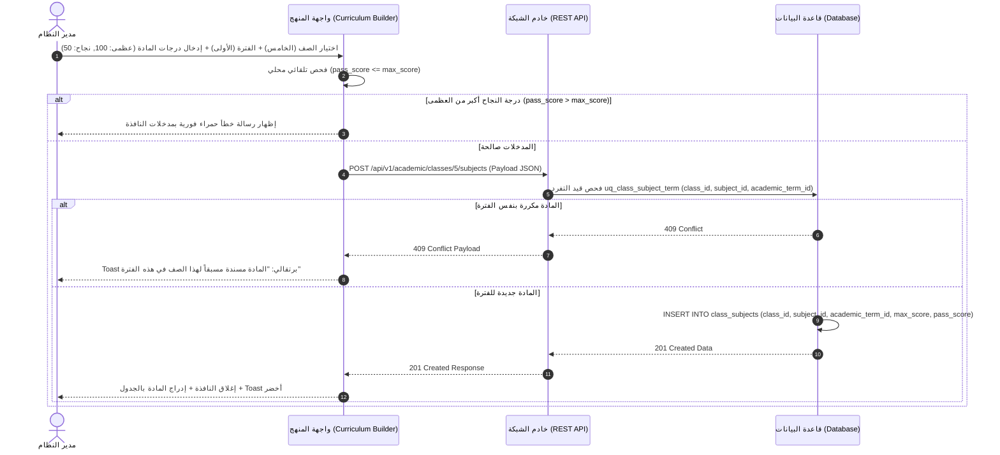

# 🖥️ مواصفات Frontend — المرحلة 02: الهيكل الأكاديمي والمناهج (User Interface & User Experience)

> **الهدف:** توثيق الواجهات الأمامية، والشاشات، والنماذج المنبثقة، وتجربة المستخدم، ومعالجة كافة استجابات الـ API وفق **الخطوات التنفيذية الأكاديمية الـ 8 المعتمدة**.

---

## 1. الهيكلية العامة لنظام التصميم والواجهات (Design System & Layout Invariants)

- **الاتجاه الأصيل (Native Direction):** `dir="rtl"` إجباري بكافة الواجهات والنماذج.
- **خطوط الطباعة المعيارية:** خط `Cairo` للتطبيقات العربية والمستندات الرسمية.
- **التصميم المتجاوب (Responsive Breakpoints):**
  - شاشات المكتبي (Desktop): `1280px+` (جدول كامل وشجرة تفاعلية متعددة الأعمدة).
  - اللوحي (Tablet): `768px - 1024px` (بطاقات وشجرة قابلة للطي).
  - الهواتف (Mobile): `< 768px` (شجرة عمودية مع حقول تحكم عائمة).

---

## 2. مصفوفة التعامل الشامل مع استجابات الـ HTTP (Global UX Matrix)

| كود الاستجابة | سلوك واجهة المستخدم (UI Action & Behavior) | طريقة العرض والتنبيه |
| :--- | :--- | :--- |
| **`200 OK` / `201 Created`** | إغلاق المودال المنبثق فوراً، إدراج العنصر بالواجهة، وإظهار تنبيه نجاح. | Toast أخضر: `تمت العملية بنجاح.` |
| **`400 Bad Request`** | إبراز الحقول غير الصالحة باللون الأحمر واحتفاظ المستخدم بمدخلاته. | Banner أحمر علوي بالنافذة المنبثقة. |
| **`403 Forbidden`** | منع الإجراء وإظهار رسالة عدم إمكانية تعديل سنة مقفلة أو حذف كيان مرتبط. | بطاقة alert حمراء ثابته بأعلى الصفحة. |
| **`409 Conflict`** | إظهار تنبيه تكرار المسمى أو رمز الكيان أو إسناد المادة مسبقاً بنفس الفترة. | Toast برتقالي: `العنصر مسجل مسبقاً بالمنظومة.` |
| **`422 Unprocessable`** | إظهار خطأ إذا كان تاريخ النهاية قبل البداية أو `pass_score > max_score`. | نص خطأ أحمر تحت حقل الإدخال مباشرة. |

---

## 3. تفاصيل شاشات الواجهة والخطوات التنفيذية الـ 8 (Screens & Step-by-Step UI)

---

### الشاشة (1): شاشة إدارة السنوات والفصول الدراسية [الخطوة 1 و 2] (`Academic Years & Terms View`)

#### أ. مكونات الشاشة:
1. **جدول السنوات الدراسية (Academic Years Table):** يعرض اسم السنة (`2025/2026`), تواريخ البداية والنهاية, وسم "السنة الحالية النشطة" (`Active Badge`), وزر القفل.
2. **أكورديون الفصول الدراسية التابعة للسنة (Terms Accordion):** يعرض الفترات التابعة للسنة المختارة (`الفترة الأولى`, `الفترة الثانية`, `الفترة الثالثة`) مع وسم الفترة النشطة حالياً.
3. **أزرار الإجراءات السريعة:** إضافة/تعديل/حذف سنة دراسية، وتفعيل السنة النشطة، وإضافة/تعديل/حذف فترة دراسية.

#### ب. نقاط الاتصال ومعالجة الاستجابات للشاشة (1):

| الخطوة والعملية (UI Action) | نقطة الاتصال | المرجع التفصيلي في `routes.md` | معالجة وسلوك الواجهة لكافة حالات الاستجابة |
| :--- | :--- | :--- | :--- |
| **[1] جلب قائمة السنوات** | `GET /api/v1/academic/years` | [الخطوة 1 في `routes.md`](./routes.md#الخطوة-1-إدارة-السنوات-الدراسية-academic_years) | عرض قائمة السنوات وتظليل السنة النشطة بلون متميز. |
| **[1] إضافة سنة دراسية** | `POST /api/v1/academic/years` | [الخطوة 1 في `routes.md`](./routes.md#الخطوة-1-إدارة-السنوات-الدراسية-academic_years) | • **`201 Created`**: إغلاق المودال + تحديث الجدول + Toast أخضر. • **`409 Conflict`**: تنبيه تكرار اسم السنة. • **`422 Unprocessable`**: خطأ إذا كان `end_date < start_date`. |
| **[1] تعديل سنة دراسية** | `PUT /api/v1/academic/years/:id` | [الخطوة 1 في `routes.md`](./routes.md#الخطوة-1-إدارة-السنوات-الدراسية-academic_years) | • **`200 OK`**: تحديث السجل فوراً. • **`403 Forbidden`**: تنبيه: `لا يمكن تعديل سنة مقفلة`. |
| **[1] حذف سنة دراسية** | `DELETE /api/v1/academic/years/:id` | [الخطوة 1 في `routes.md`](./routes.md#الخطوة-1-إدارة-السنوات-الدراسية-academic_years) | • **`200 OK`**: إزالة السنة. • **`403 Forbidden`**: تنبيه بوجود فصول تابعة (`RESTRICT`). |
| **[1] تفعيل السنة النشطة** | `POST /years/:id/set-current` | [الخطوة 1 في `routes.md`](./routes.md#الخطوة-1-إدارة-السنوات-الدراسية-academic_years) | • **`200 OK`**: نقل وسم "السنة الحالية" للسنة الجديدة ذرياً. |
| **[2] إضافة فترة دراسية** | `POST /years/:year_id/terms` | [الخطوة 2 في `routes.md`](./routes.md#الخطوة-2-إدارة-الفصولالفترات-الدراسية-academic_terms) | • **`201 Created`**: إدراج الفترة بأكورديون السنة فوراً. |
| **[2] تعديل فترة دراسية** | `PUT /api/v1/academic/terms/:id` | [الخطوة 2 في `routes.md`](./routes.md#الخطوة-2-إدارة-الفصولالفترات-الدراسية-academic_terms) | • **`200 OK`**: تحديث مسمى أو تواريخ الفترة. |
| **[2] حذف فترة دراسية** | `DELETE /api/v1/academic/terms/:id` | [الخطوة 2 في `routes.md`](./routes.md#الخطوة-2-إدارة-الفصولالفترات-الدراسية-academic_terms) | • **`200 OK`**: حذف الفترة. • **`403 Forbidden`**: تنبيه بوجود مناهج/درجات تابعة. |
| **[2] تفعيل الفترة النشطة**| `POST /terms/:id/set-current` | [الخطوة 2 في `routes.md`](./routes.md#الخطوة-2-إدارة-الفصولالفترات-الدراسية-academic_terms) | • **`200 OK`**: نقل وسم الفترة النشطة للفترة الجديدة بنفس السنة. |

---

### الشاشة (2): شاشة الهيكل الأكاديمي والصفوف والشُعب [الخطوات 3، 4، 5، و 7] (`Academic Hierarchy View`)

#### أ. مكونات الشاشة:
1. **بطاقات المراحل التعليمية [الخطوة 3]:** كروت مخصصة لكل مرحلة (`تمهيدي`, `ابتدائي`, `إعدادي`, `ثانوي`).
2. **قائمة الصفوف وتحديد تبعيتها [الخطوة 4]:** عرض الصفوف مدمجة تحت كارت المرحلة المقابلة (مثل: الصفوف 1-6 تحت الابتدائي، 7-9 تحت الإعدادي، 10-12 تحت الثانوي).
3. **بنك الشُعب العامة [الخطوة 5]:** قائمة المسميات المتاحة للشعب العامة (`الشعبة أ`, `الشعبة ب`, `الشعبة ج`).
4. **تسكين وربط الشُعب بالصفوف [الخطوة 7]:** إدراج وسوم الشعب المفتوحة تحت كارت كل صف (مثل: `الصف الخامس - الشعبة أ`, `الشعبة ب`).

#### ب. نقاط الاتصال ومعالجة الاستجابات للشاشة (2):

| الخطوة والعملية (UI Action) | نقطة الاتصال | المرجع التفصيلي في `routes.md` | معالجة وسلوك الواجهة لكافة حالات الاستجابة |
| :--- | :--- | :--- | :--- |
| **[3] جلب الهيكل الأكاديمي** | `GET /api/v1/academic/stages` | [الخطوة 3 في `routes.md`](./routes.md#الخطوة-3-إدارة-المراحل-التعليمية-academic_stages) | بناء الشجرة التفاعلية للمراحل والصفوف والشعب المفتوحة. |
| **[3] إضافة/تعديل مرحلة** | `POST / PUT /academic/stages` | [الخطوة 3 في `routes.md`](./routes.md#الخطوة-3-إدارة-المراحل-التعليمية-academic_stages) | • **`201/200`**: تحديث كارت المرحلة بالشجرة فوراً. |
| **[3] حذف مرحلة تعليمية** | `DELETE /academic/stages/:id` | [الخطوة 3 في `routes.md`](./routes.md#الخطوة-3-إدارة-المراحل-التعليمية-academic_stages) | • **`200 OK`**: حذف المرحلة. • **`403 Forbidden`**: تنبيه بوجود صفوف تابعة (`RESTRICT`). |
| **[4] إضافة صف وتسكينه بمرحلة**| `POST /api/v1/academic/classes` | [الخطوة 4 في `routes.md`](./routes.md#الخطوة-4-إدارة-الصفوف-الدراسية-وتحديد-تببيتها-للمراحل-classes) | • **`201 Created`**: إدراج الصف تحت المرحلة المحددة. |
| **[4] تعديل/حذف صف دراسي** | `PUT / DELETE /academic/classes/:id` | [الخطوة 4 في `routes.md`](./routes.md#الخطوة-4-إدارة-الصفوف-الدراسية-وتحديد-تببيتها-للمراحل-classes) | • **`200 OK`**: تحديث/حذف الصف. • **`403 Forbidden`**: منع الحذف لوجود شعب أو مناهج. |
| **[5] إضافة/تعديل/حذف شعبة عامة**| `POST / PUT / DELETE /sections` | [الخطوة 5 في `routes.md`](./routes.md#الخطوة-5-إدارة-بنك-الشعب-العامة-sections) | • **`201/200`**: تحديث بنك الشعب العامة. • **`409 Conflict`**: تكرار مسمى الشعبة. |
| **[7] ربط شعبة بصف** | `POST /academic/class-sections` | [الخطوة 7 في `routes.md`](./routes.md#الخطوة-7-إدارة-ربط-وتسكين-الشعب-بالصفوف-class_sections) | • **`201 Created`**: إدراج الشعبة فوراً تحت كارت الصف. |
| **[7] فك ربط شعبة من صف** | `DELETE /class-sections/:id` | [الخطوة 7 في `routes.md`](./routes.md#الخطوة-7-إدارة-ربط-وتسكين-الشعب-بالصفوف-class_sections) | • **`200 OK`**: إزالة الشعبة من كارت الصف. • **`403 Forbidden`**: تنبيه بوجود طلاب مسجلين. |

---

### الشاشة (3): شاشة بناء مناهج الصفوف والدرجات لكل فترة [الخطوات 6 و 8] (`Curriculum Builder View`)

#### أ. مكونات الشاشة:
1. **محدِّد الصف الدراسي والفصل/الفترة (Class & Term Selectors):** قائمتان منسدلتان لاختيار الصف الدراسي والفترة الدراسية (مثال: اختيار `الصف الخامس` + `الفترة الأولى`).
2. **جدول بنك المواد العامة [الخطوة 6]:** لإضافة وتعديل وحذف المواد العامة بالمدرسة (رياضيات، علوم، عربي).
3. **جدول مناهج الصفوف والدرجات لكل فترة [الخطوة 8]:** يعرض اسم المادة، رمزها، الدرجة العظمى للفترة (`max_score`)، ودرجة النجاح للفترة (`pass_score`).
4. **نافذة منبثقة لإسناد مادة وتحديد درجات الفترة:** لاختيار المادة، واختيار الفترة الدراسية، وإدخال `max_score` و `pass_score` المخصصة لتلك الفترة.

#### ب. نقاط الاتصال ومعالجة الاستجابات للشاشة (3):

| الخطوة والعملية (UI Action) | نقطة الاتصال | المرجع التفصيلي في `routes.md` | معالجة وسلوك الواجهة لكافة حالات الاستجابة |
| :--- | :--- | :--- | :--- |
| **[6] إضافة/تعديل/حذف مادة عامة**| `POST / PUT / DELETE /subjects` | [الخطوة 6 في `routes.md`](./routes.md#الخطوة-6-إدارة-بنك-المواد-الدراسية-العامة-subjects) | • **`201/200`**: تحديث بنك المواد العامة. • **`403 Forbidden`**: المادة مسندة لصفوف. |
| **[8] جلب منهج الصف بالفترة** | `GET /classes/:id/subjects?academic_term_id=1` | [الخطوة 8 في `routes.md`](./routes.md#الخطوة-8-إدارة-مناهج-الصفوف-والدرجات-لكل-فترة-دراسية-class_subjects) | عرض جدول المواد والدرجات المخصصة للفترة المحددة. |
| **[8] إسناد مادة لصف وفترة** | `POST /classes/:class_id/subjects` | [الخطوة 8 في `routes.md`](./routes.md#الخطوة-8-إدارة-مناهج-الصفوف-والدرجات-لكل-فترة-دراسية-class_subjects) | • **`201 Created`**: إدراج المادة وتحديد درجاتها للفترة. • **`422 Unprocessable`**: خطأ إذا كانت `pass_score > max_score`. |
| **[8] تعديل درجات مادة بالفترة**| `PUT /classes/:class_id/subjects/:id` | [الخطوة 8 في `routes.md`](./routes.md#الخطوة-8-إدارة-مناهج-الصفوف-والدرجات-لكل-فترة-دراسية-class_subjects) | • **`200 OK`**: تحديث الدرجة العظمى والنجاح لهذه الفترة. |
| **[8] إزالة مادة من منهج الفترة**| `DELETE /classes/:id/subjects/:sub_id?academic_term_id=1` | [الخطوة 8 في `routes.md`](./routes.md#الخطوة-8-إدارة-مناهج-الصفوف-والدرجات-لكل-فترة-دراسية-class_subjects) | • **`200 OK`**: شطب المادة من جدول الفترة. • **`403 Forbidden`**: تنبيه لارتباط المادة باختبارات/حصص. |

---

## 4. مخطط تسلسل التحقق من إسناد المادة والدرجات (Sequence Diagram)

---

## 5. حالات الشاشات الأربع (Four Core UI States)

1. **حالة التحميل (Loading State):** عرض هياكل شيمر رمادية متحرّكة (`Shimmer Cards`) أثناء جلب السنوات أو الهيكل الأكاديمي.
2. **حالة الفراغ (Empty State):** عند عدم وجود صفوف أو مناهج مضافة، عرض أيقونة توضيحية وزر إجرائي بارز: `"لا توجد مواد مسندة لهذه الفترة - اضغط لإضافة مادة"`.
3. **حالة الخطأ (Error State):** عند انقطاع الاتصال أو أخطاء الخادم، إظهار زر إعادة المحاولة (`Retry Button`) دون فقدان البيانات.
4. **حالة النجاح والبيانات (Success State):** عرض الجداول والشجرة الهرمية بألوان واضحة وتحديث فوري.
