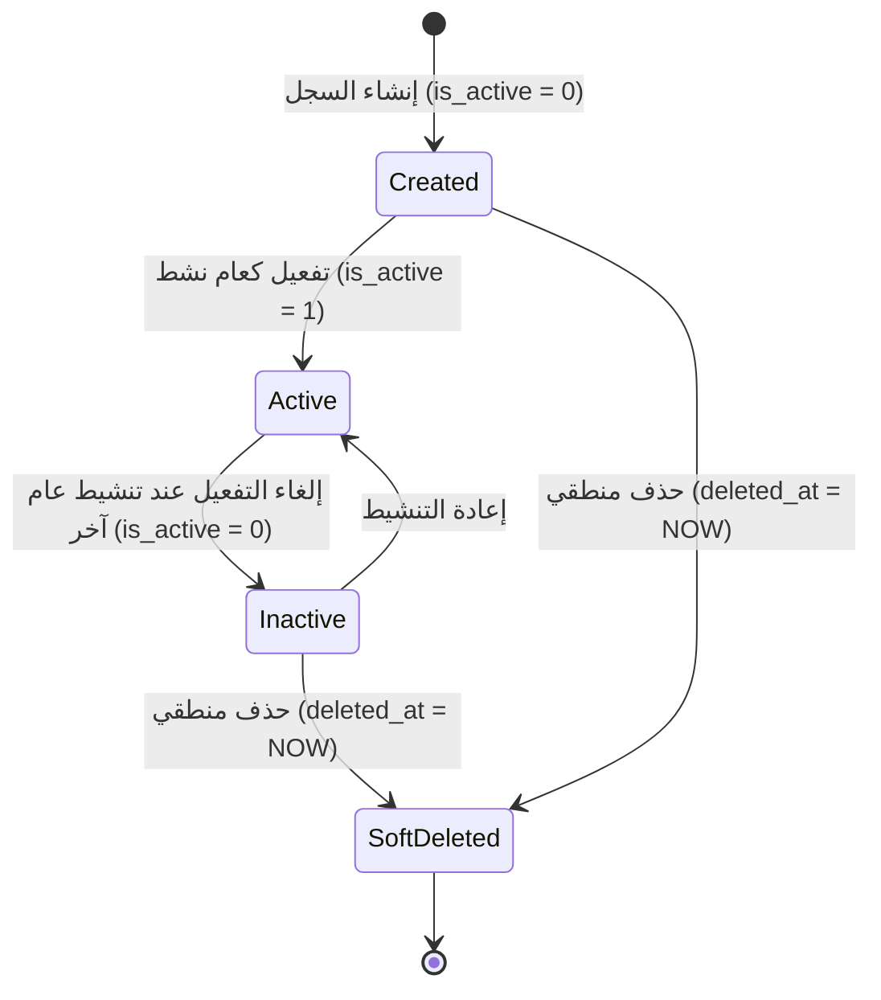

# ⚙️ مواصفات Backend — المرحلة 02-A: إدارة السنوات والسمسترات والمراحل

> **الهدف:** توثيق منطق المعالجة وقواعد التحقق والمعاملات الذرية الحصرية للجداول الثلاثة (`academic_years`, `academic_terms`, `academic_stages`) المطابقة بنسبة 100% لـ [`MD/database.md`](../../database.md) و [`MD/business_rules.md`](../../business_rules.md).  
> 
> ⚠️ **تكامل حوكمي صريح وملزم — مرجع الاستجابات (Network SSoT):**  
> ملف [`routes.md`](./routes.md) هو **المصدر الرئيسي والحصري والوحيد لكافة استجابات الـ API (Network SSoT)**. تم تسجيل كامل شكل الاستجابة (JSON Response Body) ورسائل الخطأ والنجاح صراحةً في [`routes.md`](./routes.md) لجميع الرموز والـ Status Codes (`200 OK`, `201 Created`, `400 Bad Request`, `401 Unauthorized`, `403 Forbidden`, `404 Not Found`, `409 Conflict`, `422 Unprocessable Entity`, `500 Internal Server Error`) لكل رابط.  
> 📌 **توجيه إجباري عند البناء والتطوير:** يلتزم المطور أو نموذج الذكاء الاصطناعي بالكامل بإنشاء ورسم كود الخادم واستجابات الـ API بناءً على الهياكل والرموز المسجلة في ملف [`routes.md`](./routes.md) حصراً بدون أي اجتهاد شخصي.

---

## 1. نطاق المرحلة والحدود المعمارية (Scope & Boundaries)

### 🟢 ما تشمله المرحلة (In-Scope):
- **السنوات الدراسية (`academic_years`) — [5 مسارات]:**
  - استعراض والبحث وتصفية السنوات الدراسية (`GET /api/v1/academic/years`).
  - إنشاء سنة دراسية جديدة (`POST /api/v1/academic/years`).
  - تعديل بيانات سنة دراسية قائمة (`PUT /api/v1/academic/years/:id`).
  - حذف سنة دراسية غير مرتبطة منطقياً (`DELETE /api/v1/academic/years/:id`).
  - تفعيل العام الدراسي النشط ذرياً (`POST /api/v1/academic/years/:id/activate`).
- **كتالوج الفترات المرجعي (`academic_terms` - Master Catalog) — [4 مسارات]:**
  - استعراض وبحث كتالوج الفترات المعياري (`GET /api/v1/academic/terms`).
  - إضافة فترة معيارية جديدة للكتالوج (`POST /api/v1/academic/terms`).
  - تعديل مسمى أو ترتيب فترة بالكتالوج (`PUT /api/v1/academic/terms/:id`).
  - حذف فترة غير مستخدمة من الكتالوج (`DELETE /api/v1/academic/terms/:id`).
- **المراحل التعليمية (`academic_stages`) — [4 مسارات]:**
  - استعراض شجرة المراحل التعليمية مرتبة (`GET /api/v1/academic/stages`).
  - إضافة مرحلة تعليمية جديدة (`POST /api/v1/academic/stages`).
  - تعديل بيانات مرحلة تعليمية (`PUT /api/v1/academic/stages/:id`).
  - حذف مرحلة تعليمية فارغة لا تتبعها صفوف (`DELETE /api/v1/academic/stages/:id`).
- **الحوكمة والنزاهة:**
  - قصر كافة عمليات الكتابة والتعديل والتفعيل على مدير النظام (`admin`).
  - حظر الحذف في حال وجود ارتباطات نشطة (`ON DELETE RESTRICT`) وإرجاع رمز التعارض `409 Conflict`.
  - تسجيل كافة العمليات في سجلات التدقيق `audit_logs`.

### 🔴 خارج نطاق المرحلة (Out-of-Scope):
- إدارة الصفوف والفصول الدراسية (`classes`) وتخصيص فترات وتواريخ الصفوف (`class_academic_terms`) والشعب (`sections`) $\rightarrow$ محالة إلى المرحلة `02-B`.
- إدارة المواد والمناهج التعليمية (`subjects`) وربطها بالصفوف $\rightarrow$ محالة إلى المرحلة `02-C`.
- تسكين الطلاب أو قيدهم في الفصول $\rightarrow$ محال إلى المرحلة `04`.

---

## 2. حوكمة الأدوار وقواعد الوصول وعزل البيانات (RBAC & Scoping Rules)

### 👥 مصفوفة الفاعلين والصلاحيات:
- **مدير النظام (Admin - `role_type = 'admin'`):**
  - يمتلك الصلاحية الكاملة على كافة العمليات الـ 13 (قراءة، إنشاء، تعديل، حذف، تفعيل العام النشط).
- **المعلم (Teacher)، الطالب (Student)، ولي الأمر (Parent):**
  - **يُحظر عليهم تماماً** تنفيذ أي عملية تعديل أو إضافة أو حذف أو تفعيل على الهيكل الأكاديمي.
  - أي محاولة وصول غير مصرح بها تُرفض فوراً برمز المنع الصريح `403 Forbidden`.
- **المستخدم غير المصادق عليه (Unauthenticated):**
  - أي طلب يفتقر إلى توكن `Bearer JWT` صالح ونشط يُرفض برمز `401 Unauthorized`.

---

## 3. دورة حياة الكيانات وقواعد ثبات النظام (Lifecycles & System Invariants)

### 🔒 قواعد ثبات النظام الصارمة (System Invariants):
1. **العام الدراسي النشط الوحيد (Single Active Year Invariant):**
   - يوجد عام دراسي نشط واحد فقط (`is_active = 1`) بالمنظومة في أي لحظة زمنية.
   - لا يتم تغيير العام النشط إلا عبر عملية التفعيل الذرية (`POST /api/v1/academic/years/:id/activate`).
2. **الحماية المرجعية الصارمة (Strict RESTRICT Protection):**
   - يمنع الحذف المنطقي أو الفيزيائي لأي عام مرتبط بفترات صفوف أو طلاب.
   - يمنع حذف أي فترة مرجعية مستخدمة في جدول `class_academic_terms`.
   - يمنع حذف أي مرحلة تعليمية تحتوي على صفوف مسجلة في `classes`.
   - رمز الخطأ المعياري لمنع الحذف المرجعي هو `409 Conflict`.
3. **دورة حياة الحذف المنطقي (Soft Delete Lifecycle):**
   - الحذف لا يشطب السجل نهائياً بل يضبط حقل `deleted_at = CURRENT_TIMESTAMP`.
   - تُستثنى السجلات المحذوفة منطقياً تلقائياً من كافة استعلامات العرض والبحث والربط.

---

## 4. العمليات المنطقية والمسارات التفصيلية للمجال (Domain Operations & Routes)

---

### 📅 الخطوة 1: إدارة السنوات الدراسية (`academic_years`) — [5 مسارات]

> **الوصف:** إدارة دورة حياة الأعوام الدراسية وتحديد تواريخ البدء والانتهاء، والتحكم في العام الدراسي النشط الحصري بالمنظومة بحركة ذرية واحدة.

#### 📋 جدول مسارات الخطوة 1:
| # | العملية المنطقية (Operation) | HTTP Method & Endpoint | الصلاحية | رمز النجاح | مرجع العقد في `routes.md` |
| :-: | :--- | :--- | :---: | :-: | :--- |
| **1.1** | استعراض وبحث قائمة السنوات الدراسية | `GET /api/v1/academic/years` | `admin` | `200 OK` | [في routes.md](./routes.md) |
| **1.2** | إضافة سنة دراسية جديدة | `POST /api/v1/academic/years` | `admin` | `201 Created` | [في routes.md](./routes.md) |
| **1.3** | تعديل سنة دراسية قائمة | `PUT /api/v1/academic/years/:id` | `admin` | `200 OK` | [في routes.md](./routes.md) |
| **1.4** | حذف سنة دراسية غير مرتبطة | `DELETE /api/v1/academic/years/:id` | `admin` | `200 OK` | [في routes.md](./routes.md) |
| **1.5** | تفعيل العام الدراسي النشط (ذري) | `POST /api/v1/academic/years/:id/activate` | `admin` | `200 OK` | [في routes.md](./routes.md) |

---

#### 🔹 [Operation 1.1] `GET /api/v1/academic/years` — استعراض وبحث قائمة السنوات الدراسية
- **الغرض والوظيفة:** استرجاع قائمة السنوات الدراسية مع دعم الترقيم والبحث والفرز وحالة التفعيل.
- **قواعد المعالجة والخادم:**
  - استرجاع السجلات النشطة فقط (`deleted_at IS NULL`).
  - دعم الفرز حسب `id`, `name`, `start_date`, `end_date` والفرز الافتراضي تنازلياً حسب `id DESC`.
  - تطبيق الترقيم الافتراضي `15` سجلاً لكل صفحة.
- **عقد الاستجابات والمعاملات (Network SSoT):**
  - تخضع معاملات الاستعلام وهياكل الـ JSON الصريحة لحالات النجاح (`200 OK` بقائمة بيانات أو فارغة) وحالات الخطأ (`401`, `403`) بالكامل للعقد الموثق في [`routes.md`](./routes.md).

#### 🔹 [Operation 1.2] `POST /api/v1/academic/years` — إنشاء سنة دراسية جديدة
- **الغرض والوظيفة:** إضافة عام دراسي جديد للنظام.
- **قواعد التحقق (Validation Rules):**
  - `name`: مطلوب، نصي، أقصى طول 50 حرفاً، فريد عبر المنظومة (`uq_academic_years_name`).
  - `start_date`: مطلوب، صيغة تاريخ صالحة (`YYYY-MM-DD`).
  - `end_date`: مطلوب، صيغة تاريخ صالحة، ويجب أن يكون تاريخ النهاية لاحقاً لتاريخ البداية (`end_date > start_date`).
- **خطوات التنفيذ:**
  - إنشاء السجل بحالة غير نشطة افتراضياً `is_active = 0`.
  - تسجيل العملية في `audit_logs` (`action = 'create'`, `entity_type = 'AcademicYear'`).
- **عقد الاستجابات والمدخلات (Network SSoT):**
  - تخضع هيكلية الـ Request Body وهوية الاستجابات الصريحة (`201 Created`, `409 Conflict`, `422 Unprocessable Entity`) بالكامل للتفاصيل المسجلة في [`routes.md`](./routes.md).

#### 🔹 [Operation 1.3] `PUT /api/v1/academic/years/:id` — تعديل سنة دراسية
- **الغرض والوظيفة:** تعديل بيانات سنة دراسية قائمة غير محذوفة.
- **قواعد المعالجة:**
  - التحقق من وجود السجل وعدم حذفه (`404 Not Found` إن لم يوجد).
  - التحقق من عدم تعارض الاسم مع عام آخر (`409 Conflict`).
  - التحقق من أن `end_date > start_date` (`422 Unprocessable Entity`).
  - تحديث بيانات السجل وتسجيل القيم السابقة والجديدة في `audit_logs`.
- **عقد الاستجابات والمدخلات (Network SSoT):**
  - تفاصيل جسم الطلب والردود (`200 OK`, `404 Not Found`, `409 Conflict`, `422 Unprocessable Entity`) محددة بدقة في [`routes.md`](./routes.md).

#### 🔹 [Operation 1.4] `DELETE /api/v1/academic/years/:id` — حذف سنة دراسية غير مرتبطة
- **الغرض والوظيفة:** تنفيذ الحذف المنطقي لسنة دراسية غير مستخدمة.
- **قواعد المعالجة والحماية المرجعية:**
  - التحقق من وجود السجل (`404 Not Found`).
  - **فحص الارتباطات التابعة:** التحقق من عدم وجود سجلات مرتبطة في `class_academic_terms` أو `student_enrollments`.
  - إذا وجدت ارتباطات: رفض الحذف وإرجاع `409 Conflict` مع رسالة منع الحذف المرجعي (RESTRICT).
  - إذا كانت السنة حرة: ضبط `deleted_at = CURRENT_TIMESTAMP` وتسجيل العملية في `audit_logs`.
- **عقد الاستجابات والمدخلات (Network SSoT):**
  - تخضع استجابات الحذف (`200 OK`, `404 Not Found`, `409 Conflict`) بالكامل للموثق في [`routes.md`](./routes.md).

#### 🔹 [Operation 1.5] `POST /api/v1/academic/years/:id/activate` — تفعيل العام الدراسي النشط (Atomic Activation)
- **الغرض والوظيفة:** تحويل السنة المستهدفة إلى العام الدراسي النشط الحصري بالمنظومة (`is_active = 1`).
- **المعاملة الذرية وقفل التنافسية (Atomic Transaction & Concurrency Control):**
  - يتم تنفيذ العملية داخل **معاملة قاعدة بيانات ذرية (Atomic Transaction)** وفق الخطوات التالية:
    1. التحقق من وجود السنة الدراسية المستهدفة (`404 Not Found` إن لم توجد).
    2. تطبيق قفل حصري على مستوى السجلات (Pessimistic / Row-Level Lock) لمنع تضارب التفعيل المتزامن.
    3. تحديث كافة الأعوام التي تحمل `is_active = 1` لضبط `is_active = 0`.
    4. تحديث العام المستهدف لضبط `is_active = 1`.
    5. توثيق العملية في `audit_logs`.
    6. في حال حدوث أي استثناء أو خطأ، يتم تنفيذ التراجع الشامل (Rollback) الفوري لضمان عدم وجود حالة جزئية.
- **عقد الاستجابات والمدخلات (Network SSoT):**
  - استجابات التفعيل (`200 OK`, `404 Not Found`, `500 Server Error`) مسجلة بكامل هيئتها في [`routes.md`](./routes.md).

---

### 🗓️ الخطوة 2: كتالوج الفترات المرجعي (`academic_terms`) — [4 مسارات]

> **الوصف:** إدارة الفترات والسمسترات المعيارية المعتمدة في الدولة لمرة واحدة كمرجع عام موحد دون ربطها بتواريخ ثابتة.

#### 📋 جدول مسارات الخطوة 2:
| # | العملية المنطقية (Operation) | HTTP Method & Endpoint | الصلاحية | رمز النجاح | مرجع العقد في `routes.md` |
| :-: | :--- | :--- | :---: | :-: | :--- |
| **2.1** | استعراض كتالوج الفترات العام | `GET /api/v1/academic/terms` | `admin` | `200 OK` | [في routes.md](./routes.md) |
| **2.2** | إضافة فترة للكتالوج العام | `POST /api/v1/academic/terms` | `admin` | `201 Created` | [في routes.md](./routes.md) |
| **2.3** | تعديل فترة بالكتالوج العام | `PUT /api/v1/academic/terms/:id` | `admin` | `200 OK` | [في routes.md](./routes.md) |
| **2.4** | حذف فترة غير مستخدمة | `DELETE /api/v1/academic/terms/:id` | `admin` | `200 OK` | [في routes.md](./routes.md) |

---

#### 🔹 [Operation 2.1] `GET /api/v1/academic/terms` — استعراض وبحث كتالوج الفترات العام
- **الغرض والوظيفة:** استرجاع الفترات المعيارية العامة بالكتالوج المرجعي مرتبة تصاعدياً بـ `term_number ASC`.
- **عقد الاستجابات والمعاملات (Network SSoT):**
  - معاملات الاستعلام وهياكل الـ JSON الصريحة لـ (`200 OK`, `401 Unauthorized`, `403 Forbidden`) موثقة في [`routes.md`](./routes.md).

#### 🔹 [Operation 2.2] `POST /api/v1/academic/terms` — إضافة فترة لكتالوج الفترات العام
- **الغرض والوظيفة:** تعريف فترة معيارية جديدة على مستوى النظام.
- **قواعد التحقق:**
  - `name`: مطلوب، نصي، أقصى طول 50، فريد بالكتالوج (`uq_terms_name`).
  - `term_number`: مطلوب، رقم صحيح موجب (`INTEGER >= 1`)، فريد بالكتالوج (`uq_terms_number`).
- **التنفيذ:** حفظ السجل وتوثيق الإضافة في `audit_logs`.
- **عقد الاستجابات والمدخلات (Network SSoT):**
  - هيكل الطلب واستجابات (`201 Created`, `409 Conflict`, `422 Unprocessable Entity`) مسجلة في [`routes.md`](./routes.md).

#### 🔹 [Operation 2.3] `PUT /api/v1/academic/terms/:id` — تعديل مسمى أو ترتيب فترة بالكتالوج
- **الغرض والوظيفة:** تحديث بيانات فترة مرجعية بالكتالوج العام.
- **قواعد التحقق:** التحقق من وجود السجل وعدم تكرار المسمى أو الترتيب مع فترة أخرى.
- **عقد الاستجابات والمدخلات (Network SSoT):**
  - هيكل التحديث والردود (`200 OK`, `404 Not Found`, `409 Conflict`, `422 Unprocessable Entity`) موثقة في [`routes.md`](./routes.md).

#### 🔹 [Operation 2.4] `DELETE /api/v1/academic/terms/:id` — حذف فترة غير مستخدمة من الكتالوج
- **الغرض والوظيفة:** حذف فترة مرجعية معيارية غير مستخدمة في أي صف دراسي.
- **قواعد الحماية المرجعية:**
  - فحص جدول تخصيص فترات الصفوف `class_academic_terms`.
  - إذا كانت الفترة مرتبطة بأي صف دراسي: رفض الحذف وإرجاع `409 Conflict` (RESTRICT).
  - إذا كانت حرة: تنفيذ الحذف المنطقي وتوثيق الحركة في `audit_logs`.
- **عقد الاستجابات والمدخلات (Network SSoT):**
  - ردود الحذف (`200 OK`, `404 Not Found`, `409 Conflict`) موثقة صراحةً في [`routes.md`](./routes.md).

---

### 🏛️ الخطوة 3: إدارة المراحل التعليمية (`academic_stages`) — [4 مسارات]

> **الوصف:** تعريف المراحل التعليمية الكبرى بالمنظومة (مثل: المرحلة الابتدائية، الإعدادية، الثانوية) وضبط ترتيبها الهيكلي.

#### 📋 جدول مسارات الخطوة 3:
| # | العملية المنطقية (Operation) | HTTP Method & Endpoint | الصلاحية | رمز النجاح | مرجع العقد في `routes.md` |
| :-: | :--- | :--- | :---: | :-: | :--- |
| **3.1** | استعراض قائمة المراحل التعليمية | `GET /api/v1/academic/stages` | `admin` | `200 OK` | [في routes.md](./routes.md) |
| **3.2** | إضافة مرحلة تعليمية جديدة | `POST /api/v1/academic/stages` | `admin` | `201 Created` | [في routes.md](./routes.md) |
| **3.3** | تعديل مرحلة تعليمية قائمة | `PUT /api/v1/academic/stages/:id` | `admin` | `200 OK` | [في routes.md](./routes.md) |
| **3.4** | حذف مرحلة تعليمية فارغة | `DELETE /api/v1/academic/stages/:id` | `admin` | `200 OK` | [في routes.md](./routes.md) |

---

#### 🔹 [Operation 3.1] `GET /api/v1/academic/stages` — استعراض وبحث المراحل التعليمية
- **الغرض والوظيفة:** استرجاع المراحل التعليمية مرتبة تصاعدياً بحسب أولوية العرض `order_index ASC`.
- **عقد الاستجابات والمعاملات (Network SSoT):**
  - معاملات الفرز والترقيم وهياكل JSON لـ (`200 OK`, `401`, `403`) مسجلة في [`routes.md`](./routes.md).

#### 🔹 [Operation 3.2] `POST /api/v1/academic/stages` — إضافة مرحلة تعليمية
- **الغرض والوظيفة:** إدخال مرحلة تعليمية جديدة بالهيكل الأكاديمي.
- **قواعد التحقق:**
  - `name`: مطلوب، نصي، أقصى طول 50، فريد (`uq_stages_name`).
  - `order_index`: اختياري (افتراضي `1`)، رقم صحيح موجب.
- **عقد الاستجابات والمدخلات (Network SSoT):**
  - جسم الطلب والردود (`201 Created`, `409 Conflict`, `422 Unprocessable Entity`) مسجلة في [`routes.md`](./routes.md).

#### 🔹 [Operation 3.3] `PUT /api/v1/academic/stages/:id` — تعديل مرحلة تعليمية
- **الغرض والوظيفة:** تعديل مسمى المرحلة أو ترتيبها الأكاديمي مع التحقق من عدم تكرار الاسم.
- **عقد الاستجابات والمدخلات (Network SSoT):**
  - استجابات التعديل (`200 OK`, `404 Not Found`, `409 Conflict`, `422 Unprocessable Entity`) مسجلة في [`routes.md`](./routes.md).

#### 🔹 [Operation 3.4] `DELETE /api/v1/academic/stages/:id` — حذف مرحلة تعليمية فارغة
- **الغرض والوظيفة:** حذف مرحلة تعليمية لا تحتوي على صفوف دراسية.
- **قواعد الحماية المرجعية:**
  - فحص جدول الصفوف الدراسية `classes` للتحقق من عدم وجود صفوف تتبع هذه المرحلة (`stage_id`).
  - إذا وجدت صفوف: رفض الحذف وإرجاع `409 Conflict` (حماية RESTRICT).
  - إذا كانت فارغة: تنفيذ الحذف المنطقي وتوثيق الحركة في `audit_logs`.
- **عقد الاستجابات والمدخلات (Network SSoT):**
  - ردود الحذف (`200 OK`, `404 Not Found`, `409 Conflict`) مسجلة صراحةً في [`routes.md`](./routes.md).

---

## 5. الأداء، التزامن، والنزاهة المرجعية (Performance & Data Integrity)

1. **تحسين الاستعلامات والفهارس:**
   - كافة استعلامات القوائم تستخدم فهارس التصفية والفرز المعتمدة في `MD/database.md`:
     - `idx_academic_years_is_active` و `idx_academic_years_deleted_at` لتسريع فلترة الأعوام واستبعاد المحذوفات.
     - `idx_stages_order_index` لضمان سرعة فرز المراحل دون فرز بالذاكرة (FileSort).
     - فهارس التفرد (`uq_academic_years_name`, `uq_terms_name`, `uq_terms_number`, `uq_stages_name`) للتحقق السريع قبل الإدخال.
2. **الترقيم ومنع الإغراق (Pagination & DoS Protection):**
   - حصر عدد السجلات في مسارات الـ GET بحد أقصى لمنع تحميل الذاكرة.
3. **تجنب التسريب التقني والأمني في الاستجابات:**
   - عدم كشف أي تفاصيل عن أسماء الجداول الداخلية أو الاستعلامات أو الأخطاء البرمجية للمستخدم، وتوحيد رسائل الأخطاء عبر الرموز المعيارية (`400`, `401`, `403`, `404`, `409`, `422`, `500`).

---

## 6. معايير القبول الهندسية للباك إند (Backend Acceptance Criteria)

تعتبر متطلبات الخادم لهذه المرحلة مستوفاة بالكامل عند تحقق المعايير التالية:

- [ ] قصر صلاحية الإنشاء والتعديل والحذف والتفعيل حصراً على المستخدمين بدور `admin`.
- [ ] إرجاع `401 Unauthorized` لأي طلب بدون توكن مصادقة صالح.
- [ ] إرجاع `403 Forbidden` عند محاولة المعلم أو الطالب أو ولي الأمر إجراء أي تعديل.
- [ ] التحقق الصارم من صحة التواريخ واشتراط `end_date > start_date` وإرجاع `422` عند المخالفة.
- [ ] التحقق من تفرد الأسماء وأرقام الفترات وإرجاع `409 Conflict` عند التكرار.
- [ ] تنفيذ عملية تفعيل العام النشط داخل Atomic Transaction تضمن وجود عام نشط واحد فقط (`is_active = 1`) وإلغاء تفعيل البقية.
- [ ] التراجع التلقائي الكامل (Rollback) في حال فشل أي خطوة أثناء عملية التفعيل.
- [ ] منع حذف أي سنة أو فترة أو مرحلة مرتبطة بسجلات تابعة نشطة وإرجاع `409 Conflict`.
- [ ] تنفيذ الحذف المنطقي بضبط طابع `deleted_at` واستبعاد السجلات المحذوفة من القوائم.
- [ ] تسجيل جميع حركات الإنشاء والتعديل والحذف والتفعيل في جدول `audit_logs`.
- [ ] مطابقة كافة المدخلات والمخرجات بنسبة 100% لعقد الشبكة في [`routes.md`](./routes.md).
