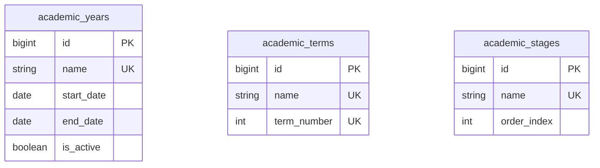

# 📊 مواصفات البيانات والكيانات — المرحلة 02-A (Data Specification)

> **الهدف:** توثيق المخطط الهيكلي للجداول الثلاثة (`academic_years`, `academic_terms`, `academic_stages`) المطابقة بنسبة 100% للمصدر الرئيسي والحصري للحقيقة: [`MD/database.md`](../../database.md).  
> 
> ⚠️ **إرشادات وتنبيهات حوكمية إجبارية (System Governance Directives):**  
> 1. **قواعد العمل العامة (Business Rules SSoT):** يلزم على المطور أو الذكاء الاصطناعي قراءة واعتماد **ملف القواعد العامة بالمنظومة [`MD/business_rules.md`](../../business_rules.md)** والالتزام التام بكافة القيود ومصفوفة الصلاحيات والحوكمة المذكورة فيه قبل التكوييد والبناء.  
> 2. **مرجع شبكة الطلبات والاستجابات (Network SSoT):** ملف [`routes.md`](./routes.md) هو المصدر الرئيسي والوحيد لعقد الشبكة بالمنظومة؛ حيث تم توثيق **جسم الطلب الكامل (`Request Body Payload`)** لكل رابط، و**كامل شكل الاستجابة الصريحة (`Response Body Payload`)** لجميع الرموز والـ Status Codes (`200 OK`, `201 Created`, `400 Bad Request`, `401 Unauthorized`, `403 Forbidden`, `404 Not Found`, `409 Conflict`, `422 Unprocessable`, `500 Server Error`).  
> 📌 **توجيه إجباري عند البناء والتطوير:** يلتزم المطور بالكامل برسم وبناء مدخلات ومخرجات كود الـ Controllers والواجهات بناءً على الهياكل والرموز المسجلة في ملف [`routes.md`](./routes.md) حصراً بدون أي اجتهاد شخصي.

---

## 1. هيكل الجداول والكيانات (Tables Matrix)

---

### 1.1 [الخطوة 1] جدول الأعوام الدراسية (`academic_years`)

> **الوصف:** جدول إدارة السنوات الدراسية في المدرسة، وتحديد تواريخ البدء والانتهاء، والتحكم في العام الدراسي النشط.

| اسم العمود (Column) | نوع البيانات (MySQL Type) | القيود والخصائص (Constraints) | الوصف والدلالة الوظيفية |
| :--- | :--- | :--- | :--- |
| `id` | `BIGINT UNSIGNED` | `PRIMARY KEY AUTO_INCREMENT` | المعرف الرقمي الفريد للعام الدراسي. |
| `name` | `VARCHAR(50)` | `NOT NULL, UNIQUE` | المسمى الرسمي للعام الدراسي (مثال: `2025/2026`). |
| `start_date` | `DATE` | `NOT NULL` | تاريخ بداية العام الدراسي. |
| `end_date` | `DATE` | `NOT NULL` | تاريخ نهاية العام الدراسي. |
| `is_active` | `TINYINT(1)` | `NOT NULL, DEFAULT 0` | حالة العام (`1 = العام النشط حالياً`, `0 = غير نشط`). |
| `created_at` | `TIMESTAMP` | `NOT NULL, DEFAULT CURRENT_TIMESTAMP` | توقيت إنشاء السجل. |
| `updated_at` | `TIMESTAMP` | `NULL ON UPDATE CURRENT_TIMESTAMP` | توقيت آخر تحديث. |
| `deleted_at` | `TIMESTAMP` | `NULL DEFAULT NULL` | طابع الحذف المنطقي. |

- **العلاقات والقيود:**
  - `UNIQUE INDEX uq_academic_years_name (name)`.
  - `INDEX idx_academic_years_is_active (is_active)`.

---

### 1.2 [الخطوة 2] جدول كتالوج الفترات المرجعي (`academic_terms` - Master Catalog)

> **الوصف:** الكتالوج المرجعي العام لتعريف الفترات والسمسترات المعتمدة في الدولة لمرة واحدة فقط دون ربطها بتواريخ ثابتة (مثل: الفصل الأول، الفصل الثاني، الفصل الثالث).

| اسم العمود (Column) | نوع البيانات (MySQL Type) | القيود والخصائص (Constraints) | الوصف والدلالة الوظيفية |
| :--- | :--- | :--- | :--- |
| `id` | `BIGINT UNSIGNED` | `PRIMARY KEY AUTO_INCREMENT` | المعرف الرقمي الفريد للفصل الدراسي/السمستر. |
| `name` | `VARCHAR(50)` | `NOT NULL, UNIQUE` | مسمى الفترة المعياري (مثال: `الفصل الأول`, `الفصل الثاني`, `الفصل الثالث`). |
| `term_number` | `TINYINT UNSIGNED` | `NOT NULL, UNIQUE` | ترتيب الفصل المعتمد (`1`, `2`, `3`). |
| `created_at` | `TIMESTAMP` | `NOT NULL, DEFAULT CURRENT_TIMESTAMP` | توقيت إنشاء السجل. |
| `updated_at` | `TIMESTAMP` | `NULL ON UPDATE CURRENT_TIMESTAMP` | توقيت آخر تحديث. |
| `deleted_at` | `TIMESTAMP` | `NULL DEFAULT NULL` | طابع الحذف المنطقي. |

- **العلاقات والقيود:**
  - `UNIQUE INDEX uq_terms_name (name)`.
  - `UNIQUE INDEX uq_terms_number (term_number)`.

---

### 1.3 [الخطوة 3] جدول المراحل الدراسية (`academic_stages`)

> **الوصف:** جدول المراحل التعليمية الكبرى في الهيكل المدرسي (مثل: المرحلة الابتدائية، الإعدادية/المتوسطة، الثانوية).

| اسم العمود (Column) | نوع البيانات (MySQL Type) | القيود والخصائص (Constraints) | الوصف والدلالة الوظيفية |
| :--- | :--- | :--- | :--- |
| `id` | `BIGINT UNSIGNED` | `PRIMARY KEY AUTO_INCREMENT` | المعرف الرقمي الفريد للمرحلة. |
| `name` | `VARCHAR(50)` | `NOT NULL, UNIQUE` | اسم المرحلة (مثال: `المرحلة الابتدائية`). |
| `order_index` | `SMALLINT UNSIGNED` | `NOT NULL, DEFAULT 1` | ترتيب المرحلة الأكاديمي للعرض والفرز. |
| `created_at` | `TIMESTAMP` | `NOT NULL, DEFAULT CURRENT_TIMESTAMP` | توقيت إنشاء السجل. |
| `updated_at` | `TIMESTAMP` | `NULL ON UPDATE CURRENT_TIMESTAMP` | توقيت آخر تحديث. |
| `deleted_at` | `TIMESTAMP` | `NULL DEFAULT NULL` | طابع الحذف المنطقي. |

- **العلاقات والقيود:**
  - `UNIQUE INDEX uq_stages_name (name)`.
  - `INDEX idx_stages_order_index (order_index)`.

---

## 2. مخطط الكيانات والعلاقات لـ 02-A (ERD)

