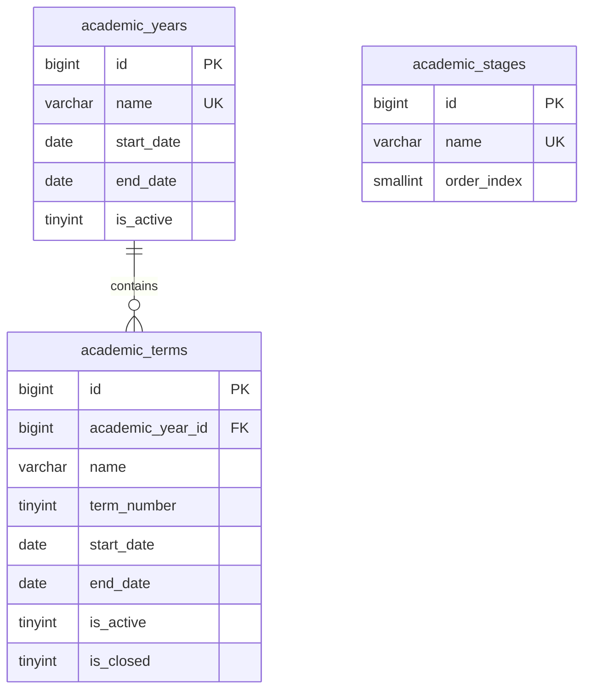

# 📊 مواصفات البيانات والكيانات — المرحلة 02-A (Data Specification)

> **الهدف:** توثيق المخطط الهيكلي للجداول الثلاثة الأولى (`academic_years`, `academic_terms`, `academic_stages`) المطابقة بنسبة 100% للمصدر الرئيسي والحصري للحقيقة: [`MD/database.md`](../../database.md).  
> 
> ⚠️ **إرشادات وتنبيهات حوكمية إجبارية (System Governance Directives):**  
> 1. **قواعد العمل العامة (Business Rules SSoT):** يلزم على المطور أو الذكاء الاصطناعي قراءة واعتماد **ملف القواعد العامة بالمنظومة [`MD/business_rules.md`](../../business_rules.md)** والالتزام التام بكافة القيود ومصفوفة الصلاحيات والحوكمة المذكورة فيه قبل التكوييد والبناء.  
> 2. **مرجع شبكة الطلبات والاستجابات (Network SSoT):** ملف [`routes.md`](./routes.md) هو المصدر الرئيسي والوحيد لعقد الشبكة بالمنظومة؛ حيث تم توثيق **جسم الطلب الكامل (`Request Body Payload`)** لكل رابط، و**كامل شكل الاستجابة الصريحة (`Response Body Payload`)** لجميع الرموز والـ Status Codes (`200 OK`, `201 Created`, `400 Bad Request`, `401 Unauthorized`, `403 Forbidden`, `404 Not Found`, `409 Conflict`, `422 Unprocessable`, `500 Server Error`).  
> 📌 **توجيه إجباري عند البناء والتطوير:** يلتزم المطور بالكامل برسم وبناء مدخلات ومخرجات كود الـ Controllers والواجهات بناءً على الهياكل والرموز المسجلة في ملف [`routes.md`](./routes.md) حصراً بدون أي اجتهاد شخصي.

---

## 1. هيكل الجداول والكيانات (Tables Matrix)

---

### 1.1 [الخطوة 1] جدول السنوات الدراسية (`academic_years`)

> **الوصف:** سجل العام الدراسي وتاريخ البداية والنهاية، والتحكم في العام الدراسي النشط (`is_active = 1`).

| اسم العمود (Column) | نوع البيانات (MySQL Type) | القيود والخصائص (Constraints) | الوصف والدلالة الوظيفية |
| :--- | :--- | :--- | :--- |
| `id` | `BIGINT UNSIGNED` | `PRIMARY KEY AUTO_INCREMENT` | المعرف الرقمي الفريد للعام الدراسي. |
| `name` | `VARCHAR(50)` | `NOT NULL, UNIQUE` | المسمى الرسمي للعام الدراسي (مثال: `2025/2026`). |
| `start_date` | `DATE` | `NOT NULL` | تاريخ بداية العام الدراسي. |
| `end_date` | `DATE` | `NOT NULL` | تاريخ نهاية العام الدراسي (`end_date > start_date`). |
| `is_active` | `TINYINT(1)` | `NOT NULL, DEFAULT 0, INDEXED` | حالة العام (`1 = العام النشط حالياً`, `0 = غير نشط/مغلق`). |
| `created_at` | `TIMESTAMP` | `NOT NULL, DEFAULT CURRENT_TIMESTAMP` | توقيت إنشاء السجل. |
| `updated_at` | `TIMESTAMP` | `NULL ON UPDATE CURRENT_TIMESTAMP` | توقيت آخر تحديث. |
| `deleted_at` | `TIMESTAMP` | `NULL DEFAULT NULL` | طابع الحذف المنطقي. |

- **الفهارس والقيود:**
  - `PRIMARY KEY (id)`
  - `UNIQUE INDEX uq_academic_years_name (name)`
  - `INDEX idx_academic_years_is_active (is_active)`
  - `INDEX idx_academic_years_deleted_at (deleted_at)`

---

### 1.2 [الخطوة 2] جدول الفصول/الفترات الدراسية (`academic_terms`)

> **الوصف:** تقسيم العام الدراسي إلى فصول/فترات دراسية وتحديد ترتيب الفترة (`term_number = 1, 2, 3`) وحالتها النشطة والمغلقة.

| اسم العمود (Column) | نوع البيانات (MySQL Type) | القيود والخصائص (Constraints) | الوصف والدلالة الوظيفية |
| :--- | :--- | :--- | :--- |
| `id` | `BIGINT UNSIGNED` | `PRIMARY KEY AUTO_INCREMENT` | المعرف الرقمي الفريد للفصل الدراسي/السمستر. |
| `academic_year_id` | `BIGINT UNSIGNED` | `NOT NULL, INDEXED` | معرف العام الدراسي (يرتبط بـ `academic_years.id`). |
| `name` | `VARCHAR(50)` | `NOT NULL` | مسمى الفترة (مثال: `الفصل الأول`, `الفصل الثاني`). |
| `term_number` | `TINYINT UNSIGNED` | `NOT NULL` | ترتيب الفصل خلال العام الدراسي (`1`, `2`, `3`). |
| `start_date` | `DATE` | `NOT NULL` | تاريخ بداية الفصل الدراسي. |
| `end_date` | `DATE` | `NOT NULL` | تاريخ نهاية الفصل الدراسي. |
| `is_active` | `TINYINT(1)` | `NOT NULL, DEFAULT 0, INDEXED` | هل هو الفصل النشط حالياً للعمليات؟ (`1 = نشط`, `0 = غير نشط`). |
| `is_closed` | `TINYINT(1)` | `NOT NULL, DEFAULT 0, INDEXED` | هل تم إغلاق الفصل نهائياً واعتماد درجاته؟ (`1 = مغلق للأرشفة`, `0 = مفتوح`). |
| `created_at` | `TIMESTAMP` | `NOT NULL, DEFAULT CURRENT_TIMESTAMP` | توقيت إنشاء السجل. |
| `updated_at` | `TIMESTAMP` | `NULL ON UPDATE CURRENT_TIMESTAMP` | توقيت آخر تحديث. |
| `deleted_at` | `TIMESTAMP` | `NULL DEFAULT NULL` | طابع الحذف المنطقي. |

- **العلاقات والقيود:**
  - `academic_year_id` يرتبط بجدول `academic_years(id)` مع `ON DELETE RESTRICT, ON UPDATE CASCADE`.
  - `UNIQUE INDEX uq_terms_year_number (academic_year_id, term_number)` لمنع تكرار نفس رقم الفترة في نفس العام.

---

### 1.3 [الخطوة 3] جدول المراحل الدراسية (`academic_stages`)

> **الوصف:** جدول المراحل التعليمية الكبرى بالهيكل المدرسي (مثال: `المرحلة الابتدائية`, `المرحلة الإعدادية`, `المرحلة الثانوية`).

| اسم العمود (Column) | نوع البيانات (MySQL Type) | القيود والخصائص (Constraints) | الوصف والدلالة الوظيفية |
| :--- | :--- | :--- | :--- |
| `id` | `BIGINT UNSIGNED` | `PRIMARY KEY AUTO_INCREMENT` | المعرف الرقمي الفريد للمرحلة. |
| `name` | `VARCHAR(50)` | `NOT NULL, UNIQUE` | اسم المرحلة (مثال: `المرحلة الابتدائية`). |
| `order_index` | `SMALLINT UNSIGNED` | `NOT NULL, DEFAULT 1, INDEXED` | ترتيب المرحلة الأكاديمي للعرض والفرز بالواجهات. |
| `created_at` | `TIMESTAMP` | `NOT NULL, DEFAULT CURRENT_TIMESTAMP` | توقيت إنشاء السجل. |
| `updated_at` | `TIMESTAMP` | `NULL ON UPDATE CURRENT_TIMESTAMP` | توقيت آخر تحديث. |
| `deleted_at` | `TIMESTAMP` | `NULL DEFAULT NULL` | طابع الحذف المنطقي. |

- **الفهارس والقيود:**
  - `PRIMARY KEY (id)`
  - `UNIQUE INDEX uq_stages_name (name)`
  - `INDEX idx_stages_order_index (order_index)`

---

## 2. مخطط الكيانات (ERD Diagram for 02-A)

