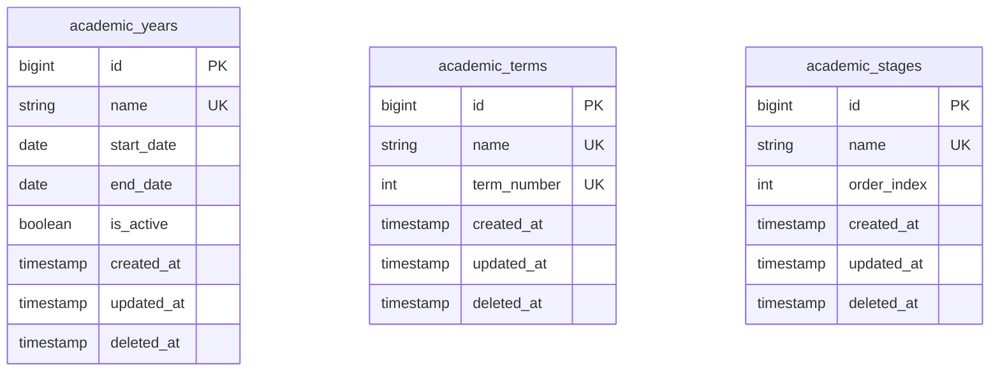

# 📊 مواصفات البيانات والكيانات — المرحلة 02-A (Data Specification)

> **الهدف:** توثيق المخطط الهيكلي للجداول الثلاثة (`academic_years`, `academic_terms`, `academic_stages`) المطابقة بنسبة 100% للمصدر الرئيسي والحصري للحقيقة: [`MD/database.md`](../../database.md).  
> 
> ⚠️ **إرشادات وتنبيهات حوكمية إجبارية (System Governance Directives):**  
> 1. **قواعد العمل العامة (Business Rules SSoT):** يلزم قراءة واعتماد **ملف القواعد العامة بالمنظومة [`MD/business_rules.md`](../../business_rules.md)** والالتزام التام بكافة القيود ومصفوفة الصلاحيات والحوكمة المذكورة فيه.  
> 2. **مرجع شبكة الطلبات والاستجابات (Network SSoT):** ملف [`routes.md`](./routes.md) هو المصدر الرئيسي والوحيد لعقد الشبكة بالمنظومة لكافة مسارات الـ API (الطلبات والاستجابات).  
> 📌 **توجيه إجباري:** تُبنى نماذج البيانات ومخططات التحقق بناءً على الهياكل والرموز المسجلة في هذا الملف وملف [`MD/database.md`](../../database.md).

---

## 1. هيكل الجداول والكيانات (Tables Matrix)

---

### 1.1 [الخطوة 1] جدول الأعوام الدراسية (`academic_years`)

> **الوصف:** جدول إدارة السنوات الدراسية في المدرسة، وتحديد تواريخ البدء والانتهاء، والتحكم في العام الدراسي النشط.

| اسم العمود (Column) | نوع البيانات (MySQL Type) | القيود والخصائص (Constraints) | الوصف والدلالة الوظيفية |
| :--- | :--- | :--- | :--- |
| `id` | `BIGINT UNSIGNED` | `PRIMARY KEY AUTO_INCREMENT` | المعرف الرقمي الفريد للعام الدراسي. |
| `name` | `VARCHAR(50)` | `NOT NULL, UNIQUE` | المسمى الرسمي للعام الدراسي (مثال: `2025/2026`). |
| `start_date` | `DATE` | `NOT NULL` | تاريخ بداية العام الدراسي. |
| `end_date` | `DATE` | `NOT NULL` | تاريخ نهاية العام الدراسي. |
| `is_active` | `TINYINT(1)` | `NOT NULL, DEFAULT 0` | حالة العام (`1 = العام النشط حالياً`, `0 = غير نشط`). |
| `created_at` | `TIMESTAMP` | `NOT NULL, DEFAULT CURRENT_TIMESTAMP` | توقيت إنشاء السجل. |
| `updated_at` | `TIMESTAMP` | `NULL ON UPDATE CURRENT_TIMESTAMP` | توقيت آخر تحديث. |
| `deleted_at` | `TIMESTAMP` | `NULL DEFAULT NULL` | طابع الحذف المنطقي (Soft Delete). |

- **الفهارس والقيود (Indexes & Constraints):**
  - `PRIMARY KEY (id)`
  - `UNIQUE INDEX uq_academic_years_name (name)`
  - `INDEX idx_academic_years_is_active (is_active)`
  - `INDEX idx_academic_years_deleted_at (deleted_at)`

- **قيود منطق الأعمال وقواعد البيانات (Business & Data Invariants):**
  - `uq_academic_years_name`: يمنع تكرار اسم السنة الدراسية نهائياً.
  - `end_date > start_date`: يجب أن يكون تاريخ نهاية العام لاحقاً لتاريخ البداية.
  - `Single Active Year`: يوجد عام دراسي نشط واحد فقط بالمنظومة (`is_active = 1`) في أي لحظة زمنية.
  - `ON DELETE RESTRICT`: يمنع حذف أي عام دراسي مرتبط بسجلات في `class_academic_terms` أو `student_enrollments`.

---

### 1.2 [الخطوة 2] جدول كتالوج الفترات المرجعي (`academic_terms` - Master Catalog)

> **الوصف:** الكتالوج المرجعي العام لتعريف الفترات والسمسترات المعتمدة في الدولة لمرة واحدة فقط دون ربطها بتواريخ ثابتة (مثل: الفصل الأول، الفصل الثاني، الفصل الثالث).

| اسم العمود (Column) | نوع البيانات (MySQL Type) | القيود والخصائص (Constraints) | الوصف والدلالة الوظيفية |
| :--- | :--- | :--- | :--- |
| `id` | `BIGINT UNSIGNED` | `PRIMARY KEY AUTO_INCREMENT` | المعرف الرقمي الفريد للفصل الدراسي/السمستر. |
| `name` | `VARCHAR(50)` | `NOT NULL, UNIQUE` | مسمى الفترة المعياري (مثال: `الفصل الأول`, `الفصل الثاني`, `الفصل الثالث`). |
| `term_number` | `TINYINT UNSIGNED` | `NOT NULL, UNIQUE` | ترتيب الفصل المعتمد (`1`, `2`, `3`). |
| `created_at` | `TIMESTAMP` | `NOT NULL, DEFAULT CURRENT_TIMESTAMP` | توقيت إنشاء السجل. |
| `updated_at` | `TIMESTAMP` | `NULL ON UPDATE CURRENT_TIMESTAMP` | توقيت آخر تحديث. |
| `deleted_at` | `TIMESTAMP` | `NULL DEFAULT NULL` | طابع الحذف المنطقي (Soft Delete). |

- **الفهارس والقيود (Indexes & Constraints):**
  - `PRIMARY KEY (id)`
  - `UNIQUE INDEX uq_terms_name (name)`
  - `UNIQUE INDEX uq_terms_number (term_number)`

- **قيود منطق الأعمال وقواعد البيانات (Business & Data Invariants):**
  - `uq_terms_name`: يمنع تكرار مسمى الفترة داخل الكتالوج المرجعي.
  - `uq_terms_number`: يمنع تكرار رقم ترتيب الفترة داخل الكتالوج المرجعي.
  - `ON DELETE RESTRICT`: يمنع حذف أي فترة مرجعية مستخدمة في جدول تخصيص فترات الصفوف `class_academic_terms`.

---

### 1.3 [الخطوة 3] جدول المراحل الدراسية (`academic_stages`)

> **الوصف:** جدول المراحل التعليمية الكبرى في الهيكل المدرسي (مثل: المرحلة الابتدائية، الإعدادية/المتوسطة، الثانوية).

| اسم العمود (Column) | نوع البيانات (MySQL Type) | القيود والخصائص (Constraints) | الوصف والدلالة الوظيفية |
| :--- | :--- | :--- | :--- |
| `id` | `BIGINT UNSIGNED` | `PRIMARY KEY AUTO_INCREMENT` | المعرف الرقمي الفريد للمرحلة. |
| `name` | `VARCHAR(50)` | `NOT NULL, UNIQUE` | اسم المرحلة (مثال: `المرحلة الابتدائية`). |
| `order_index` | `SMALLINT UNSIGNED` | `NOT NULL, DEFAULT 1` | ترتيب المرحلة الأكاديمي للعرض والفرز. |
| `created_at` | `TIMESTAMP` | `NOT NULL, DEFAULT CURRENT_TIMESTAMP` | توقيت إنشاء السجل. |
| `updated_at` | `TIMESTAMP` | `NULL ON UPDATE CURRENT_TIMESTAMP` | توقيت آخر تحديث. |
| `deleted_at` | `TIMESTAMP` | `NULL DEFAULT NULL` | طابع الحذف المنطقي (Soft Delete). |

- **الفهارس والقيود (Indexes & Constraints):**
  - `PRIMARY KEY (id)`
  - `UNIQUE INDEX uq_stages_name (name)`
  - `INDEX idx_stages_order_index (order_index)`

- **قيود منطق الأعمال وقواعد البيانات (Business & Data Invariants):**
  - `uq_stages_name`: يمنع تكرار مسمى المرحلة الدراسية.
  - `ON DELETE RESTRICT`: يمنع حذف أي مرحلة تعليمية تتبعها صفوف دراسية بجدول `classes`.

---

## 2. دورة حياة البيانات والحذف المنطقي (Data Lifecycle & Soft Deletes)

1. **الإنشاء (Creation):** إنشاء السجلات بحالتها الأولية مع توثيق `created_at`.
2. **التعديل (Update):** تعديل الحقول المسموحة مع توثيق `updated_at`.
3. **الحذف المنطقي (Soft Delete):** 
   - عند الحذف، يتم ضبط قيمة `deleted_at` إلى التوقيت الحالي بدلاً من الحذف الفيزيائي للسجل.
   - كافة استعلامات القراءة تستثني السجلات التي تحتوي على `deleted_at IS NOT NULL`.
4. **حماية التكامل المرجعي (Referential Protection):**
   - يُرفض الحذف المنطقي أو الفيزيائي إذا كان السجل مرتبطاً ببيانات تابعة نشطة وفق مبدأ `RESTRICT`، ويُعاد رمز التعارض `409 Conflict`.

---

## 3. مخطط الكيانات والعلاقات لـ 02-A (ERD)

