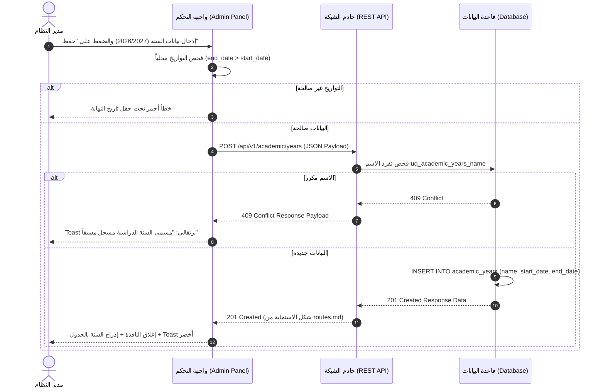

# 🖥️ مواصفات Frontend — المرحلة 02-A (User Interface & User Experience)

> **الهدف:** توثيق الواجهات الأمامية، والشاشات، والنماذج المنبثقة، وتجربة المستخدم، ومعالجة كافة استجابات الـ API **مقسمة بالكامل وفق الخطوات التنفيذية الثلاث للمرحلة 02-A**.  
> 
> ⚠️ **إرشادات وتنبيهات حوكمية إجبارية (System Governance Directives):**  
> 1. **قواعد العمل العامة (Business Rules SSoT):** يلزم على المطور أو الذكاء الاصطناعي قراءة واعتماد **ملف القواعد العامة بالمنظومة [`MD/business_rules.md`](../../business_rules.md)** والالتزام التام بكافة القيود ومصفوفة الصلاحيات والحوكمة المذكورة فيه قبل التكوييد والبناء.  
> 2. **مرجع شبكة الطلبات والاستجابات (Network SSoT):** ملف [`routes.md`](./routes.md) هو المصدر الرئيسي والوحيد لعقد الشبكة بالمنظومة؛ حيث تم توثيق **جسم الطلب الكامل (`Request Body Payload`)** لكل رابط، و**كامل شكل الاستجابة الصريحة (`Response Body Payload`)** لجميع الرموز والـ Status Codes (`200 OK`, `201 Created`, `400 Bad Request`, `401 Unauthorized`, `403 Forbidden`, `404 Not Found`, `409 Conflict`, `422 Unprocessable`, `500 Server Error`).  
> 📌 **توجيه إجباري عند البناء والتطوير:** يلتزم مطور الواجهات بالكامل برسم وتحديد معالجات الاستجابة (Response Handlers) والتنبيهات بالواجهة بناءً على الهياكل المسجلة في ملف [`routes.md`](./routes.md) حصراً.

---

## 1. الهيكلية العامة لنظام التصميم والواجهات (Design System & Layout Invariants)

- **الاتجاه الأصيل (Native Direction):** `dir="rtl"` إجباري بكافة الواجهات والنماذج.
- **خطوط الطباعة المعيارية:** خط `Cairo` للتطبيقات العربية والمستندات الرسمية.
- **التصميم المتجاوب (Responsive Breakpoints):**
  - شاشات المكتبي (Desktop): `1280px+` (جدول كامل وشجرة تفاعلية متعددة الأعمدة).
  - اللوحي (Tablet): `768px - 1024px` (بطاقات وشجرة قابلة للطي).
  - الهواتف (Mobile): `< 768px` (شجرة عمودية مع حقول تحكم عائمة).

---

## 📅 الخطوة 1: شاشة وإجراءات إدارة السنوات الدراسية (`academic_years`) — [5 مسارات]

> **الوصف المختصر:** شاشة وتفاصيل إدارة التقويم السنوي للمدرسة، عرض قائمة السنوات، وسوم "السنة النشطة" (`is_active = 1`) و"السنة المقفلة"، والنوافذ المنبثقة لإضافة وتعديل وقفل وتفعيل السنة الحالية.

### 1.1 مكونات الشاشة والـ UI Components:
- **جدول السنوات الدراسية (Academic Years Table):** يعرض مسمى السنة (`name`), تاريخ البداية (`start_date`), تاريخ النهاية (`end_date`), وسم الحالة النشطة (`is_active Badge`), وأزرار التحكم.
- **النوافذ المنبثقة (Modals):**
  - نافذة "إضافة سنة دراسية جديدة" (حقول `name`, `start_date`, `end_date`).
  - نافذة "تعديل سنة دراسية" (حقول متضمنة القيم الحالية).
  - نافذة "تأكيد تفعيل السنة النشطة" (تنفيذ ذري مع تنبيه إلغاء تفعيل السابقة).
  - نافذة "تأكيد حذف سنة دراسية".

### 1.2 مصفوفة الإجراءات والروابط للخطوة 1:
| الإجراء (UI Action) | HTTP Method & Endpoint | المرجع التفصيلي في `routes.md` | سلوك ومعالجة الاستجابة بالواجهة |
| :--- | :--- | :--- | :--- |
| **جلب قائمة السنوات الدراسية** | `GET /api/v1/academic/years` | [في `routes.md`](./routes.md#11-get-apiv1academicyears--عرض-قائمة-السنوات-الدراسية) | • **`200 OK`**: عرض البيانات بالجدول وتظليل السنة النشطة بلون مميز. |
| **إنشاء سنة دراسية جديدة** | `POST /api/v1/academic/years` | [في `routes.md`](./routes.md#12-post-apiv1academicyears--إنشاء-سنة-دراسية-جديدة) | • **`201 Created`**: إغلاق النافذة + تحديث الجدول + Toast أخضر. • **`409 Conflict`**: تنبيه تكرار اسم السنة. • **`422 Unprocessable`**: إظهار خطأ أحمر تحت حقل التاريخ إذا كان `end_date <= start_date`. |
| **تعديل بيانات سنة دراسية** | `PUT /api/v1/academic/years/:id` | [في `routes.md`](./routes.md#13-put-apiv1academicyearsid--تعديل-بيانات-سنة-دراسية) | • **`200 OK`**: تحديث السجل بالجدول فوراً. • **`403 Forbidden`**: بطاقة تنبيه: `لا يمكن تعديل سنة دراسية مقفلة`. |
| **حذف سنة دراسية غير مرتبطة** | `DELETE /api/v1/academic/years/:id` | [في `routes.md`](./routes.md#14-delete-apiv1academicyearsid--حذف-سنة-دراسية-غير-مرتبطة) | • **`200 OK`**: إزالة السنة من الجدول. • **`403 Forbidden`**: تنبيه بوجود فصول دراسية تابعة (`RESTRICT`). |
| **تفعيل السنة النشطة حالياً** | `POST /api/v1/academic/years/:id/set-active` | [في `routes.md`](./routes.md#15-post-apiv1academicyearsidset-active--تفعيل-السنة-النشطة-حاليا) | • **`200 OK`**: نقل وسم "السنة النشطة" للسنة الجديدة ذرياً بالواجهة. |

---

## ⏱️ الخطوة 2: شاشة وإجراءات إدارة الفترات/الفصول الدراسية (`academic_terms`) — [5 مسارات]

> **الوصف المختصر:** مكونات وأكورديون الفترات الدراسية التابعة للسنة المحددة (`الفصل الأول`, `الفصل الثاني`), عرض ترتيب الفترة (`term_number`), وسم الفترة النشطة حالياً `is_active`, ورمز الإغلاق `is_closed`.

### 2.1 مكونات الشاشة والـ UI Components:
- **أكورديون الفصول التابعة للسنة (Terms Accordion):** قائمة مطوية لكل سنة تحتوي على فتراتها الدراسية التابعة.
- **النوافذ المنبثقة (Modals):**
  - نافذة "إضافة فترة دراسية جديدة" (حقول `name`, `term_number`, `start_date`, `end_date`).
  - نافذة "تعديل فترة دراسية".
  - نافذة "تأكيد تفعيل الفترة النشطة".
  - نافذة "تأكيد حذف فترة دراسية".

### 2.2 مصفوفة الإجراءات والروابط للخطوة 2:
| الإجراء (UI Action) | HTTP Method & Endpoint | المرجع التفصيلي في `routes.md` | سلوك ومعالجة الاستجابة بالواجهة |
| :--- | :--- | :--- | :--- |
| **عرض فترات سنة دراسية معين** | `GET /api/v1/academic/years/:year_id/terms` | [في `routes.md`](./routes.md#21-get-apiv1academicyearsyear_idterms--عرض-فترات-سنة-دراسية) | • **`200 OK`**: إدراج الفترات داخل الأكورديون وتظليل الفترة النشطة. |
| **إنشاء فترة دراسية جديدة** | `POST /api/v1/academic/years/:year_id/terms` | [في `routes.md`](./routes.md#22-post-apiv1academicyearsyear_idterms--إنشاء-فترة-دراسية-جديدة) | • **`201 Created`**: إدراج الفترة بأكورديون السنة فوراً + Toast أخضر. • **`409 Conflict`**: تنبيه بتكرار term_number بنفس السنة. |
| **تعديل بيانات فترة دراسية** | `PUT /api/v1/academic/terms/:id` | [في `routes.md`](./routes.md#23-put-apiv1academictermsid--تعديل-فترة-دراسية) | • **`200 OK`**: تحديث مسمى أو تواريخ الفترة. • **`403 Forbidden`**: بطاقة تنبيه: `لا يمكن تعديل فصل مغلق (is_closed = 1)`. |
| **حذف فترة دراسية غير مرتبطة**| `DELETE /api/v1/academic/terms/:id` | [في `routes.md`](./routes.md#24-delete-apiv1academictermsid--حذف-فترة-دراسية) | • **`200 OK`**: حذف الفترة. • **`403 Forbidden`**: تنبيه لارتباط الفترة بمناهج ودرجات مسندة (`RESTRICT`). |
| **تفعيل الفترة النشطة حالياً** | `POST /api/v1/academic/terms/:id/set-active` | [في `routes.md`](./routes.md#25-post-apiv1academictermsidset-active--تفعيل-الفترة-النشطة-حاليا) | • **`200 OK`**: نقل وسم الفترة النشطة للفترة الجديدة بنفس السنة. |

---

## 🏛️ الخطوة 3: شاشة وإجراءات إدارة المراحل التعليمية (`academic_stages`) — [4 مسارات]

> **الوصف المختصر:** كروت وبطاقات شجرة المراحل الأكاديمة الكبرى في المدرسة (ابتدائي، إعدادي، ثانوي) مع عرض الترتيب `order_index`, والنوافذ المنبثقة لإضافة/تعديل/حذف مرحلة.

### 3.1 مكونات الشاشة والـ UI Components:
- **شجرة بطاقات المراحل (Hierarchical Cards):** كروت مخصصة تظهر اسم المرحلة والترتيب الهيكلي `order_index`.
- **النوافذ المنبثقة (Modals):**
  - نافذة "إضافة مرحلة تعليمية جديدة" (حقول `name`, `order_index`).
  - نافذة "تعديل مرحلة تعليمية".
  - نافذة "تأكيد حذف مرحلة تعليمية".

### 3.2 مصفوفة الإجراءات والروابط للخطوة 3:
| الإجراء (UI Action) | HTTP Method & Endpoint | المرجع التفصيلي في `routes.md` | سلوك ومعالجة الاستجابة بالواجهة |
| :--- | :--- | :--- | :--- |
| **جلب شجرة الهيكل الأكاديمي** | `GET /api/v1/academic/stages` | [في `routes.md`](./routes.md#31-get-apiv1academicstages--عرض-شجرة-المراحل-التعليمية) | • **`200 OK`**: بناء بطاقات المراحل الهرمية بالترتيب `order_index`. |
| **إنشاء مرحلة تعليمية جديدة** | `POST /api/v1/academic/stages` | [في `routes.md`](./routes.md#32-post-apiv1academicstages--إنشاء-مرحلة-تعليمية-جديدة) | • **`201 Created`**: إدراج كارت المرحلة بالشجرة فوراً. • **`409 Conflict`**: تنبيه بتكرار مسمى المرحلة. |
| **تعديل مرحلة تعليمية** | `PUT /api/v1/academic/stages/:id` | [في `routes.md`](./routes.md#33-put-apiv1academicstagesid--تعديل-مرحلة-تعليمية) | • **`200 OK`**: تحديث اسم أو ترتيب المرحلة بالواجهة. |
| **حذف مرحلة تعليمية فارغة** | `DELETE /api/v1/academic/stages/:id` | [في `routes.md`](./routes.md#34-delete-apiv1academicstagesid--حذف-مرحلة-تعليمية-فارغة) | • **`200 OK`**: حذف كارت المرحلة. • **`403 Forbidden`**: بطاقة تنبيه: `تضم هذه المرحلة صفوفاً تابعة` (`RESTRICT`). |

---

## ⚖️ 4. قواعد البزنس وسلوكيات الواجهة الملزمة (UI Business Rules)

- **مراعاة قواعد المنظومة العامة:** الالتزام التام بالمحددات المذكورة في [`MD/business_rules.md`](../../business_rules.md).
- **تعطيل أزرار التعديل على الأعوام والفصول المغلقة:** يُعطّل الخيار بصرياً ويُظهر وسم قفل ثابتاً للمراحل والسنوات والفصول المغلقة.
- **حصرية عناصر التحكم لدور الإدارة:** لا تظهر أزرار الإضافة والتعديل والحذف إلا لمدير النظام (`role_type = 'admin'`).
- **التنبيهات الفورية (Toasts & Modals):** إظهار تنبيهات ملونة لحالات الأخطاء القياسية (`403` بطاقة alert حمراء، `409` Toast برتقالي، `422` أخطاء حمراء تحت حقول الإدخال).

---

## 5. مخطط تسلسل معالجة الاستجابات للواجهة (Sequence Diagram)

---

## 6. حالات الشاشات الأربع (Four Core UI States)

1. **حالة التحميل (Loading State):** عرض هياكل شيمر رمادية متحرّكة (`Shimmer Skeleton`) أثناء جلب قائمة السنوات أو المراحل.
2. **حالة الفراغ (Empty State):** عند عدم وجود سنوات أو فترات مضافة، عرض أيقونة توضيحية وزر إجرائي بارز: `"لا توجد سنوات دراسية مسجلة - اضغط لإضافة سنة"`.
3. **حالة الخطأ (Error State):** عند انقطاع الاتصال أو أخطاء الخادم، إظهار زر إعادة المحاولة (`Retry Button`) دون فقدان البيانات.
4. **حالة النجاح والبيانات (Success State):** عرض الجداول والأكورديون بألوان واضحة وتحديث فوري.
