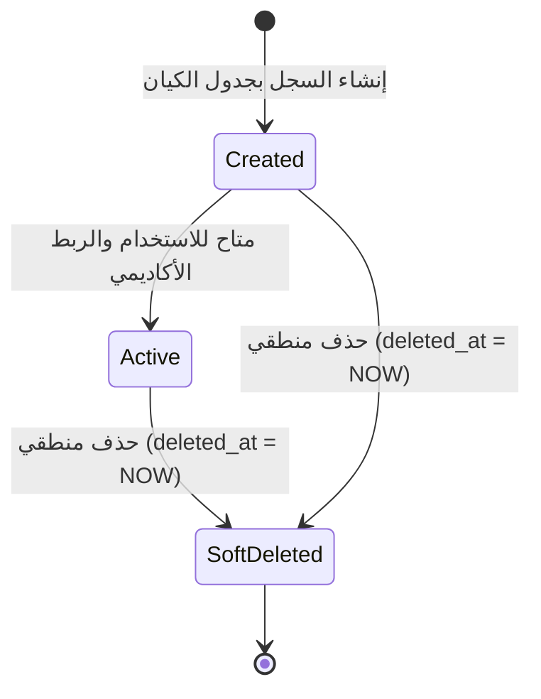

# ⚙️ مواصفات Backend — المرحلة 02-B: إدارة الصفوف والشعب والمواد

> **الهدف:** توثيق منطق المعالجة وقواعد التحقق والمعاملات الذرية الحصرية للجداول الثلاثة (`classes`, `sections`, `subjects`) المطابقة بنسبة 100% لـ [`MD/database.md`](../../database.md) و [`MD/business_rules.md`](../../business_rules.md).  
> 
> ⚠️ **تكامل حوكمي صريح وملزم — مرجع الاستجابات (Network SSoT):**  
> ملف [`routes.md`](./routes.md) هو **المصدر الرئيسي والحصري والوحيد لكافة استجابات ومدخلات الـ API (Network SSoT)**. تم تسجيل كامل شكل الاستجابة (JSON Response Body) ورسائل الخطأ والنجاح صراحةً في [`routes.md`](./routes.md) لجميع الرموز والـ Status Codes (`200 OK`, `201 Created`, `400 Bad Request`, `401 Unauthorized`, `403 Forbidden`, `404 Not Found`, `409 Conflict`, `422 Unprocessable Entity`, `500 Internal Server Error`) لكل رابط.  
> 📌 **توجيه إجباري عند البناء والتطوير:** يلتزم المطور أو نموذج الذكاء الاصطناعي بالكامل بإنشاء ورسم كود الخادم واستجابات الـ API بناءً على الهياكل والرموز المسجلة في ملف [`routes.md`](./routes.md) حصراً بدون أي اجتهاد شخصي.

---

## 1. نطاق المرحلة والحدود المعمارية (Scope & Boundaries)

### 🟢 ما تشمله المرحلة (In-Scope):
- **الصفوف الدراسية (`classes`) — [4 مسارات]:**
  - استعراض والبحث وتصفية الصفوف الدراسية (`GET /api/v1/academic/classes`).
  - إنشاء صف دراسي وتسكينه بمرحلة مع فحص `stage_id` وتفرد `grade_level` بالمرحلة (`POST /api/v1/academic/classes`).
  - تعديل بيانات صف دراسي قائم (`PUT /api/v1/academic/classes/:id`).
  - الحذف المنطقي (Soft Delete) لصف غير مرتبط (`DELETE /api/v1/academic/classes/:id`).
- **كتالوج بنك الشُعب العامة (`sections` - Master Sections) — [4 مسارات]:**
  - استعراض وبحث كتالوج الشعب المعتمدة بالمدرسة (`GET /api/v1/academic/sections`).
  - إضافة شعبة عامة جديدة مع ضبط تفرد الاسم (`POST /api/v1/academic/sections`).
  - تعديل مسمى شعبة عامة (`PUT /api/v1/academic/sections/:id`).
  - حذف شعبة عامة غير مستخدمة بصفوف (`DELETE /api/v1/academic/sections/:id`).
- **كتالوج بنك المواد العامة (`subjects` - Master Catalog) — [4 مسارات]:**
  - استعراض وبحث بنك المواد والمناهج (`GET /api/v1/academic/subjects`).
  - إضافة مادة جديدة مع ضبط تفرد الاسم والكود الرمزي (`POST /api/v1/academic/subjects`).
  - تعديل بيانات مادة ببنك المواد (`PUT /api/v1/academic/subjects/:id`).
  - حذف مادة عامة غير مسندة لمقررات صفوف (`DELETE /api/v1/academic/subjects/:id`).
- **الحوكمة والنزاهة:**
  - قصر كافة عمليات الكتابة والتعديل والحذف على مدير النظام (`admin`).
  - حظر الحذف في حال وجود ارتباطات نشطة (`ON DELETE RESTRICT`) وإرجاع رمز التعارض `409 Conflict`.
  - تسجيل كافة العمليات في سجلات التدقيق `audit_logs`.

### 🔴 خارج نطاق المرحلة (Out-of-Scope):
- تخصيص فترات وتواريخ تقويم الصفوف (`class_academic_terms`) وربط الصفوف بالشعب (`class_sections`) وتسكين مقررات المواد والدرجات العظمى والصغرى (`class_subjects`) $\rightarrow$ محالة إلى المرحلة `02-C`.
- إسناد المعلمين للمواد والشعب $\rightarrow$ محال إلى المرحلة `03`.
- تسكين الطلاب وتوزيعهم على الشعب $\rightarrow$ محال إلى المرحلة `04`.

---

## 2. حوكمة الأدوار وقواعد الوصول وعزل البيانات (RBAC & Scoping Rules)

### 👥 مصفوفة الفاعلين والصلاحيات:
- **مدير النظام (Admin - `role_type = 'admin'`):**
  - يمتلك الصلاحية الكاملة على كافة العمليات الـ 12 (قراءة، إنشاء، تعديل، حذف).
- **المعلم (Teacher)، الطالب (Student)، ولي الأمر (Parent):**
  - **يُحظر عليهم تماماً** تنفيذ أي عملية تعديل أو إضافة أو حذف على الصفوف والشعب والمواد.
  - أي محاولة وصول غير مصرح بها تُرفض فوراً برمز المنع الصريح `403 Forbidden`.
- **المستخدم غير المصادق عليه (Unauthenticated):**
  - أي طلب يفتقر إلى توكن `Bearer JWT` صالح ونشط يُرفض برمز `401 Unauthorized`.

---

## 3. دورة حياة الكيانات وقواعد ثبات النظام (Lifecycles & System Invariants)

### 🔒 قواعد ثبات النظام الصارمة (System Invariants):
1. **قيد التدرج الأكاديمي بالمرحلة (`Class-Stage Hierarchy`):**
   - ينتمي الصف الدراسي لمرحلة تعليمية واحدة فقط (`stage_id`).
   - يمنع تكرار المستوى الرقمي `grade_level` لنفس المرحلة التعليمية (`uq_classes_stage_level`).
2. **كتالوج الشعب والمواد المرجعي العام (Master Catalogs):**
   - تمثل `sections` و `subjects` بنوكاً مرجعية عامة نظيفة لمرة واحدة فقط لمنع التكرار العشوائي في الفصول.
   - تفرد مسمى الشعبة `uq_sections_name` وتفرد مسمى وكود المادة `uq_subjects_name, uq_subjects_code`.
3. **الحماية المرجعية الصارمة (Strict RESTRICT Protection):**
   - يمنع حذف أي صف دراسي مرتبط بفترات صفوف في `class_academic_terms` أو شُعب في `class_sections` أو مقررات في `class_subjects`.
   - يمنع حذف أي شعبة عامة مستخدمة ومسندة لصفوف في `class_sections`.
   - يمنع حذف أي مادة عامة مقررة لصفوف في `class_subjects`.
   - رمز الخطأ المعياري لمنع الحذف المرجعي هو `409 Conflict`.
4. **دورة حياة الحذف المنطقي (Soft Delete Lifecycle):**
   - الحذف لا يشطب السجل نهائياً بل يضبط حقل `deleted_at = CURRENT_TIMESTAMP`.
   - تُستثنى السجلات المحذوفة منطقياً تلقائياً من كافة استعلامات العرض والبحث والربط.

---

## 4. العمليات المنطقية والمسارات التفصيلية للمجال (Domain Operations & Routes)

---

### 🏫 الخطوة 1: إدارة الصفوف وتحديد تبعيتها للمراحل (`classes`) — [4 مسارات]

> **الوصف:** تعريف الصفوف المدرسية وتسكينها بالمرحلة التعليمية وتحديد الترتيب الأكاديمي الرقمي لحساب الترحيل التلقائي.

#### 📋 جدول مسارات الخطوة 1:
| # | العملية المنطقية (Operation) | HTTP Method & Endpoint | الصلاحية | رمز النجاح | مرجع العقد في `routes.md` |
| :-: | :--- | :--- | :---: | :-: | :--- |
| **1.1** | استعراض وبحث قائمة الصفوف الدراسية | `GET /api/v1/academic/classes` | `admin` | `200 OK` | [في routes.md](./routes.md) |
| **1.2** | إنشاء صف دراسي وتسكينه بمرحلة | `POST /api/v1/academic/classes` | `admin` | `201 Created` | [في routes.md](./routes.md) |
| **1.3** | تعديل بيانات صف دراسي قائم | `PUT /api/v1/academic/classes/:id` | `admin` | `200 OK` | [في routes.md](./routes.md) |
| **1.4** | حذف صف دراسي غير مرتبط | `DELETE /api/v1/academic/classes/:id` | `admin` | `200 OK` | [في routes.md](./routes.md) |

---

#### 🔹 [Operation 1.1] `GET /api/v1/academic/classes` — استعراض وبحث قائمة الصفوف الدراسية
- **الغرض والوظيفة:** استرجاع قائمة الصفوف الدراسية مع دعم الترقيم والبحث والفلترة بالمرحلة والمستوى الرقمي.
- **قواعد المعالجة والخادم:**
  - استرجاع السجلات النشطة فقط (`deleted_at IS NULL`).
  - تضمين اسم المرحلة `stage_name` عبر الربط الداخلي مع `academic_stages`.
  - دعم الفرز حسب `id`, `name`, `grade_level`, `stage_id` والفرز الافتراضي تصاعدياً حسب `grade_level ASC`.
  - تطبيق الترقيم الافتراضي `15` سجلاً لكل صفحة.
- **عقد الاستجابات والمعاملات (Network SSoT):**
  - معاملات الاستعلام وهياكل الـ JSON الصريحة لـ (`200 OK`, `401 Unauthorized`, `403 Forbidden`) موثقة بالكامل في [`routes.md`](./routes.md).

#### 🔹 [Operation 1.2] `POST /api/v1/academic/classes` — إنشاء صف دراسي وتسكينه بمرحلة
- **الغرض والوظيفة:** إضافة صف دراسي جديد وتسكينه بالمرحلة التعليمية.
- **قواعد التحقق (Validation Rules):**
  - `stage_id`: مطلوب، معرف مرحلة موجودة وغير محذوفة بجدول `academic_stages`.
  - `name`: مطلوب، نصي، أقصى طول 50 حرفاً (مثال: `الصف الخامس`).
  - `grade_level`: مطلوب، رقم صحيح موجب (`1` إلى `12`).
  - **قيد التفرد:** التحقق من عدم وجود صف بنفس المرحلة يحمل نفس الـ `grade_level` (`uq_classes_stage_level`).
- **خطوات التنفيذ:**
  - إنشاء السجل وتوثيق العملية في `audit_logs` (`action = 'create'`, `entity_type = 'Class'`).
- **عقد الاستجابات والمدخلات (Network SSoT):**
  - تفاصيل الطلب واستجابات (`201 Created`, `409 Conflict`, `422 Unprocessable Entity`) مسجلة في [`routes.md`](./routes.md).

#### 🔹 [Operation 1.3] `PUT /api/v1/academic/classes/:id` — تعديل بيانات صف دراسي
- **الغرض والوظيفة:** تحديث مسمى الصف أو مرحلته أو ترتيبه الرقمي.
- **قواعد المعالجة:**
  - التحقق من وجود السجل وعدم حذفه (`404 Not Found` إن لم يوجد).
  - التحقق من عدم تعارض `stage_id` مع `grade_level` لسجل آخر (`409 Conflict`).
  - تحديث بيانات السجل وتسجيل القيم السابقة والجديدة في `audit_logs`.
- **عقد الاستجابات والمدخلات (Network SSoT):**
  - تفاصيل جسم الطلب والردود (`200 OK`, `404 Not Found`, `409 Conflict`, `422 Unprocessable Entity`) محددة في [`routes.md`](./routes.md).

#### 🔹 [Operation 1.4] `DELETE /api/v1/academic/classes/:id` — حذف صف دراسي غير مرتبط
- **الغرض والوظيفة:** تنفيذ الحذف المنطقي لصف دراسي غير مستخدم.
- **قواعد المعالجة والحماية المرجعية:**
  - التحقق من وجود السجل (`404 Not Found`).
  - **فحص الارتباطات التابعة:** التحقق من عدم وجود سجلات مرتبطة في `class_academic_terms` أو `class_sections` أو `class_subjects`.
  - إذا وجدت ارتباطات: رفض الحذف وإرجاع `409 Conflict` مع رسالة منع الحذف المرجعي (RESTRICT).
  - إذا كان الصف حراً: ضبط `deleted_at = CURRENT_TIMESTAMP` وتسجيل العملية في `audit_logs`.
- **عقد الاستجابات والمدخلات (Network SSoT):**
  - تخضع استجابات الحذف (`200 OK`, `404 Not Found`, `409 Conflict`) للموثق في [`routes.md`](./routes.md).

---

### 🔠 الخطوة 2: إدارة بنك الشُعب العامة (`sections`) — [4 مسارات]

> **الوصف:** إدارة بنك أسماء الشعب المعتمدة بالمدرسة لمرة واحدة فقط كمرجع عام موحد.

#### 📋 جدول مسارات الخطوة 2:
| # | العملية المنطقية (Operation) | HTTP Method & Endpoint | الصلاحية | رمز النجاح | مرجع العقد في `routes.md` |
| :-: | :--- | :--- | :---: | :-: | :--- |
| **2.1** | استعراض وبحث بنك الشعب العامة | `GET /api/v1/academic/sections` | `admin` | `200 OK` | [في routes.md](./routes.md) |
| **2.2** | إنشاء شعبة عامة جديدة | `POST /api/v1/academic/sections` | `admin` | `201 Created` | [في routes.md](./routes.md) |
| **2.3** | تعديل مسمى شعبة عامة | `PUT /api/v1/academic/sections/:id` | `admin` | `200 OK` | [في routes.md](./routes.md) |
| **2.4** | حذف شعبة عامة غير مستخدمة | `DELETE /api/v1/academic/sections/:id` | `admin` | `200 OK` | [في routes.md](./routes.md) |

---

#### 🔹 [Operation 2.1] `GET /api/v1/academic/sections` — استعراض وبحث بنك الشعب العامة
- **الغرض والوظيفة:** استرجاع كتالوج الشعب العامة مع دعم البحث والترقيم.
- **عقد الاستجابات والمعاملات (Network SSoT):**
  - معاملات الاستعلام وهياكل الـ JSON الصريحة لـ (`200 OK`, `401 Unauthorized`, `403 Forbidden`) موثقة في [`routes.md`](./routes.md).

#### 🔹 [Operation 2.2] `POST /api/v1/academic/sections` — إنشاء شعبة عامة جديدة
- **الغرض والوظيفة:** تعريف مسمى شعبة عامة جديدة بالنظام (مثل `شعبة أ`).
- **قواعد التحقق:**
  - `name`: مطلوب، نصي، أقصى طول 50 حرفاً، فريد بالكتالوج (`uq_sections_name`).
- **التنفيذ:** حفظ السجل وتوثيق الإضافة في `audit_logs`.
- **عقد الاستجابات والمدخلات (Network SSoT):**
  - هيكل الطلب واستجابات (`201 Created`, `409 Conflict`, `422 Unprocessable Entity`) مسجلة في [`routes.md`](./routes.md).

#### 🔹 [Operation 2.3] `PUT /api/v1/academic/sections/:id` — تعديل مسمى شعبة عامة
- **الغرض والوظيفة:** تحديث مسمى شعبة عامة قائمة بالكتالوج.
- **قواعد التحقق:** التحقق من وجود السجل وعدم تكرار المسمى مع شعبة أخرى.
- **عقد الاستجابات والمدخلات (Network SSoT):**
  - هيكل التحديث والردود (`200 OK`, `404 Not Found`, `409 Conflict`, `422 Unprocessable Entity`) موثقة في [`routes.md`](./routes.md).

#### 🔹 [Operation 2.4] `DELETE /api/v1/academic/sections/:id` — حذف شعبة عامة غير مستخدمة
- **الغرض والوظيفة:** حذف مسمى شعبة عامة غير مستخدمة في أي صف دراسي.
- **قواعد الحماية المرجعية:**
  - فحص جدول ربط الفصول بالشعب `class_sections`.
  - إذا كانت الشعبة مستخدمة في أي صف: رفض الحذف وإرجاع `409 Conflict` (RESTRICT).
  - إذا كانت حرة: تنفيذ الحذف المنطقي وتوثيق الحركة في `audit_logs`.
- **عقد الاستجابات والمدخلات (Network SSoT):**
  - ردود الحذف (`200 OK`, `404 Not Found`, `409 Conflict`) موثقة صراحةً في [`routes.md`](./routes.md).

---

### 📖 الخطوة 3: إدارة بنك المواد الدراسية العامة (`subjects`) — [4 مسارات]

> **الوصف:** إدارة الكتالوج العام للمواد التعليمية والمناهج المتاحة بالمدرسة لمرة واحدة فقط كمرجع مستقل.

#### 📋 جدول مسارات الخطوة 3:
| # | العملية المنطقية (Operation) | HTTP Method & Endpoint | الصلاحية | رمز النجاح | مرجع العقد في `routes.md` |
| :-: | :--- | :--- | :---: | :-: | :--- |
| **3.1** | استعراض وبحث بنك المواد العامة | `GET /api/v1/academic/subjects` | `admin` | `200 OK` | [في routes.md](./routes.md) |
| **3.2** | إضافة مادة جديدة لبنك المواد | `POST /api/v1/academic/subjects` | `admin` | `201 Created` | [في routes.md](./routes.md) |
| **3.3** | تعديل مادة ببنك المواد | `PUT /api/v1/academic/subjects/:id` | `admin` | `200 OK` | [في routes.md](./routes.md) |
| **3.4** | حذف مادة عامة غير مسندة | `DELETE /api/v1/academic/subjects/:id` | `admin` | `200 OK` | [في routes.md](./routes.md) |

---

#### 🔹 [Operation 3.1] `GET /api/v1/academic/subjects` — استعراض وبحث بنك المواد العامة
- **الغرض والوظيفة:** استرجاع كتالوج المواد العامة مع دعم البحث النصي بالاسم والكود والترقيم.
- **عقد الاستجابات والمعاملات (Network SSoT):**
  - معاملات الفرز والترقيم وهياكل JSON لـ (`200 OK`, `401`, `403`) مسجلة في [`routes.md`](./routes.md).

#### 🔹 [Operation 3.2] `POST /api/v1/academic/subjects` — إضافة مادة جديدة لبنك المواد
- **الغرض والوظيفة:** إدخال مادة تعليمية جديدة وكودها الرمزي بكتالوج المواد.
- **قواعد التحقق:**
  - `name`: مطلوب، نصي، أقصى طول 100، فريد (`uq_subjects_name`).
  - `code`: اختياري، نصي، أقصى طول 30، فريد حال وجوده (`uq_subjects_code`).
- **عقد الاستجابات والمدخلات (Network SSoT):**
  - جسم الطلب والردود (`201 Created`, `409 Conflict`, `422 Unprocessable Entity`) مسجلة في [`routes.md`](./routes.md).

#### 🔹 [Operation 3.3] `PUT /api/v1/academic/subjects/:id` — تعديل مادة ببنك المواد
- **الغرض والوظيفة:** تعديل مسمى المادة أو كودها الرمزي مع التحقق من عدم التكرار.
- **عقد الاستجابات والمدخلات (Network SSoT):**
  - استجابات التعديل (`200 OK`, `404 Not Found`, `409 Conflict`, `422 Unprocessable Entity`) مسجلة في [`routes.md`](./routes.md).

#### 🔹 [Operation 3.4] `DELETE /api/v1/academic/subjects/:id` — حذف مادة عامة غير مسندة
- **الغرض والوظيفة:** حذف مادة تعليمية من الكتالوج العام غير مقررة في أي صف.
- **قواعد الحماية المرجعية:**
  - فحص جدول مقررات الفصول والدرجات `class_subjects`.
  - إذا وجدت مقررات مسندة للمادة: رفض الحذف وإرجاع `409 Conflict` (حماية RESTRICT).
  - إذا كانت فارغة: تنفيذ الحذف المنطقي وتوثيق الحركة في `audit_logs`.
- **عقد الاستجابات والمدخلات (Network SSoT):**
  - ردود الحذف (`200 OK`, `404 Not Found`, `409 Conflict`) مسجلة صراحةً في [`routes.md`](./routes.md).

---

## 5. الأداء، التزامن، والنزاهة المرجعية (Performance & Data Integrity)

1. **تحسين الاستعلامات والفهارس:**
   - كافة استعلامات القوائم تستخدم فهارس التصفية والفرز المعتمدة في `MD/database.md`:
     - `idx_classes_stage_id` و `idx_classes_grade_level` لتسريع فلترة صفوف المراحل.
     - فهارس التفرد (`uq_classes_stage_level`, `uq_sections_name`, `uq_subjects_name`, `uq_subjects_code`) للتحقق السريع ومنع التكرار قبل الإدخال.
2. **الترقيم ومنع الإغراق (Pagination & DoS Protection):**
   - حصر عدد السجلات في مسارات الـ GET بحد أقصى لمنع تحميل الذاكرة.
3. **تجنب التسريب التقني والأمني في الاستجابات:**
   - عدم كشف أي تفاصيل عن أسماء الجداول الداخلية أو الاستعلامات أو الأخطاء البرمجية للمستخدم، وتوحيد رسائل الأخطاء عبر الرموز المعيارية (`400`, `401`, `403`, `404`, `409`, `422`, `500`).

---

## 6. معايير القبول الهندسية للباك إند (Backend Acceptance Criteria)

تعتبر متطلبات الخادم لهذه المرحلة مستوفاة بالكامل عند تحقق المعايير التالية:

- [ ] قصر صلاحية الإنشاء والتعديل والحذف حصراً على المستخدمين بدور `admin`.
- [ ] إرجاع `401 Unauthorized` لأي طلب بدون توكن مصادقة صالح.
- [ ] إرجاع `403 Forbidden` عند محاولة المعلم أو الطالب أو ولي الأمر إجراء أي تعديل.
- [ ] التحقق الصارم من صحة `stage_id` و `grade_level` وإرجاع `422` عند المخالفة.
- [ ] التحقق من تفرد المستوى الرقمي بالمرحلة (`uq_classes_stage_level`) وأسماء الشعب والمواد وأكوادها وإرجاع `409 Conflict` عند التكرار.
- [ ] منع حذف أي صف أو شعبة أو مادة مرتبطة بسجلات تابعة نشطة وإرجاع `409 Conflict`.
- [ ] تنفيذ الحذف المنطقي بضبط طابع `deleted_at` واستبعاد السجلات المحذوفة من القوائم.
- [ ] تسجيل جميع حركات الإنشاء والتعديل والحذف في جدول `audit_logs`.
- [ ] مطابقة كافة المدخلات والمخرجات بنسبة 100% لعقد الشبكة في [`routes.md`](./routes.md).
