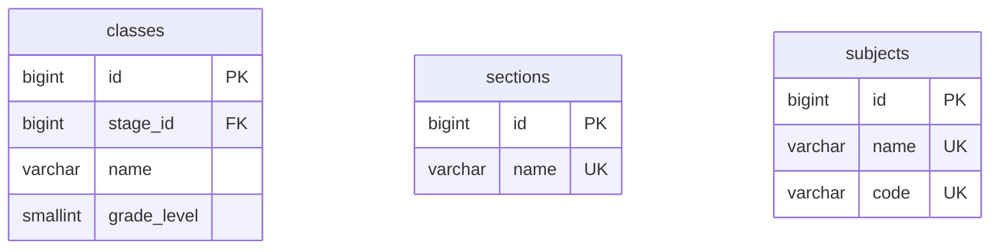

# 📊 مواصفات البيانات والكيانات — المرحلة 02-B (Data Specification)

> **الهدف:** توثيق المخطط الهيكلي للجداول الثلاثة (`classes`, `sections`, `subjects`) المطابقة بنسبة 100% للمصدر الرئيسي والحصري للحقيقة: [`MD/database/database_phase_02.md`](../../database/database_phase_02.md).

---

## 1. هيكل الجداول والكيانات (Tables Matrix)

---

### 1.1 [الخطوة 4] جدول الفصول الدراسية (`classes`)

> **الوصف:** جدول الصفوف المدرسية وربطها بالمرحلة التعليمية عبر `stage_id` وتحديد الترتيب الأكاديمي للترحيل `grade_level`.

| اسم العمود (Column) | نوع البيانات (MySQL Type) | القيود والخصائص (Constraints) | الوصف والدلالة الوظيفية |
| :--- | :--- | :--- | :--- |
| `id` | `BIGINT UNSIGNED` | `PRIMARY KEY AUTO_INCREMENT` | المعرف الرقمي الفريد للفصل/الصف. |
| `stage_id` | `BIGINT UNSIGNED` | `NOT NULL, INDEXED` | معرف المرحلة الدراسية التابع لها (يرتبط بـ `academic_stages.id`). |
| `name` | `VARCHAR(50)` | `NOT NULL` | اسم الفصل الدراسي (مثال: `الصف الخامس`, `الصف السادس`). |
| `grade_level` | `SMALLINT UNSIGNED` | `NOT NULL, INDEXED` | الترتيب الرقمي الأكاديمي (`1` إلى `12`) لحساب الترحيل التلقائي للصف الأعلى. |
| `created_at` | `TIMESTAMP` | `NOT NULL, DEFAULT CURRENT_TIMESTAMP` | توقيت إنشاء السجل. |
| `updated_at` | `TIMESTAMP` | `NULL ON UPDATE CURRENT_TIMESTAMP` | توقيت آخر تحديث. |
| `deleted_at` | `TIMESTAMP` | `NULL DEFAULT NULL` | طابع الحذف المنطقي. |

- **العلاقات والقيود:**
  - `stage_id` يرتبط بجدول `academic_stages(id)` مع `ON DELETE RESTRICT, ON UPDATE CASCADE`.
  - `UNIQUE INDEX uq_classes_stage_level (stage_id, grade_level)`.

---

### 1.2 [الخطوة 5] جدول الشعب الدراسية (`sections`)

> **الوصف:** جدول الشعب المدرسية العامة المستقل لتعريف أسماء الشعب المعتمدة بالمدرسة لمرة واحدة فقط (Master Sections).

| اسم العمود (Column) | نوع البيانات (MySQL Type) | القيود والخصائص (Constraints) | الوصف والدلالة الوظيفية |
| :--- | :--- | :--- | :--- |
| `id` | `BIGINT UNSIGNED` | `PRIMARY KEY AUTO_INCREMENT` | المعرف الرقمي للشعبة. |
| `name` | `VARCHAR(50)` | `NOT NULL, UNIQUE` | مسمى الشعبة العام (مثال: `شعبة أ`, `شعبة ب`, `شعبة ج`). |
| `created_at` | `TIMESTAMP` | `NOT NULL, DEFAULT CURRENT_TIMESTAMP` | توقيت إنشاء السجل. |
| `updated_at` | `TIMESTAMP` | `NULL ON UPDATE CURRENT_TIMESTAMP` | توقيت آخر تحديث. |
| `deleted_at` | `TIMESTAMP` | `NULL DEFAULT NULL` | طابع الحذف المنطقي. |

- **الفهارس والقيود:**
  - `PRIMARY KEY (id)`
  - `UNIQUE INDEX uq_sections_name (name)`

---

### 1.3 [الخطوة 6] جدول كتالوج المواد العام (`subjects`)

> **الوصف:** السجل العام النظيف لكافة المواد والمناهج الدراسية بالمدرسة لمرة واحدة فقط كمرجع مستقل (Master Catalog).

| اسم العمود (Column) | نوع البيانات (MySQL Type) | القيود والخصائص (Constraints) | الوصف والدلالة الوظيفية |
| :--- | :--- | :--- | :--- |
| `id` | `BIGINT UNSIGNED` | `PRIMARY KEY AUTO_INCREMENT` | المعرف الرقمي الفريد للمادة. |
| `name` | `VARCHAR(100)` | `NOT NULL, UNIQUE` | مسمى المادة التعليمية (مثال: `الرياضيات`, `اللغة العربية`, `العلوم`). |
| `code` | `VARCHAR(30)` | `NULL DEFAULT NULL, UNIQUE` | الكود الرمزي للمادة (مثال: `MATH`, `ARAB`, `SCI`). |
| `created_at` | `TIMESTAMP` | `NOT NULL, DEFAULT CURRENT_TIMESTAMP` | توقيت إنشاء السجل. |
| `updated_at` | `TIMESTAMP` | `NULL ON UPDATE CURRENT_TIMESTAMP` | توقيت آخر تحديث. |
| `deleted_at` | `TIMESTAMP` | `NULL DEFAULT NULL` | طابع الحذف المنطقي. |

- **الفهارس والقيود:**
  - `PRIMARY KEY (id)`
  - `UNIQUE INDEX uq_subjects_name (name)`
  - `UNIQUE INDEX uq_subjects_code (code)`

---

## 2. مخطط الكيانات والعلاقات لـ 02-B (ERD)

