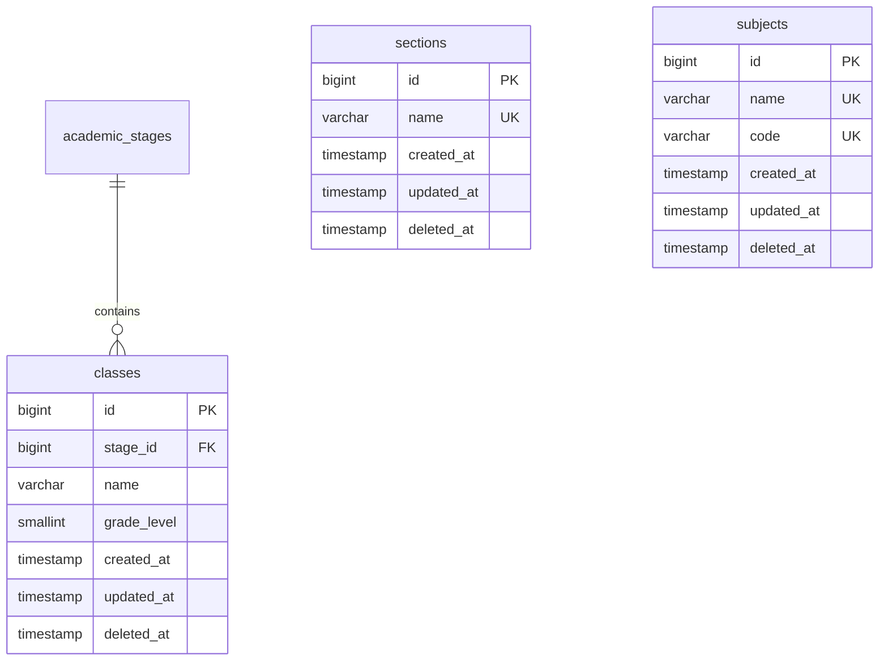

# 📊 مواصفات البيانات والكيانات — المرحلة 02-B (Data Specification)

> **الهدف:** توثيق المخطط الهيكلي للجداول الثلاثة (`classes`, `sections`, `subjects`) المطابقة بنسبة 100% للمصدر الرئيسي والحصري للحقيقة: [`MD/database.md`](../../database.md).  
> 
> ⚠️ **إرشادات وتنبيهات حوكمية إجبارية (System Governance Directives):**  
> 1. **قواعد العمل العامة (Business Rules SSoT):** يلزم قراءة واعتماد **ملف القواعد العامة بالمنظومة [`MD/business_rules.md`](../../business_rules.md)** والالتزام التام بكافة القيود ومصفوفة الصلاحيات والحوكمة المذكورة فيه.  
> 2. **مرجع شبكة الطلبات والاستجابات (Network SSoT):** ملف [`routes.md`](./routes.md) هو المصدر الرئيسي والوحيد لعقد الشبكة بالمنظومة لكافة مسارات الـ API (الطلبات والاستجابات).  
> 📌 **توجيه إجباري:** تُبنى نماذج البيانات ومخططات التحقق بناءً على الهياكل والرموز المسجلة في هذا الملف وملف [`MD/database.md`](../../database.md).

---

## 1. هيكل الجداول والكيانات (Tables Matrix)

---

### 1.1 [الخطوة 1] جدول الفصول الدراسية (`classes`)

> **الوصف:** جدول الصفوف المدرسية وربطها بالمرحلة التعليمية عبر `stage_id` وتحديد الترتيب الأكاديمي للترحيل `grade_level`.

| اسم العمود (Column) | نوع البيانات (MySQL Type) | القيود والخصائص (Constraints) | الوصف والدلالة الوظيفية |
| :--- | :--- | :--- | :--- |
| `id` | `BIGINT UNSIGNED` | `PRIMARY KEY AUTO_INCREMENT` | المعرف الرقمي الفريد للفصل/الصف. |
| `stage_id` | `BIGINT UNSIGNED` | `NOT NULL` | معرف المرحلة الدراسية التابع لها (يرتبط بـ `academic_stages.id`). |
| `name` | `VARCHAR(50)` | `NOT NULL` | اسم الفصل الدراسي (مثال: `الصف الخامس`, `الصف السادس`). |
| `grade_level` | `SMALLINT UNSIGNED` | `NOT NULL` | الترتيب الرقمي الأكاديمي (`1` إلى `12`) لحساب الترحيل التلقائي للصف الأعلى. |
| `created_at` | `TIMESTAMP` | `NOT NULL, DEFAULT CURRENT_TIMESTAMP` | توقيت إنشاء السجل. |
| `updated_at` | `TIMESTAMP` | `NULL ON UPDATE CURRENT_TIMESTAMP` | توقيت آخر تحديث. |
| `deleted_at` | `TIMESTAMP` | `NULL DEFAULT NULL` | طابع الحذف المنطقي (Soft Delete). |

- **العلاقات والمفاتيح الخارجية (Foreign Keys):**
  - `stage_id` يرتبط بجدول `academic_stages(id)` مع `ON DELETE RESTRICT, ON UPDATE CASCADE`.

- **الفهارس والقيود (Indexes & Constraints):**
  - `PRIMARY KEY (id)`
  - `UNIQUE INDEX uq_classes_stage_level (stage_id, grade_level)`
  - `INDEX idx_classes_stage_id (stage_id)`
  - `INDEX idx_classes_grade_level (grade_level)`

- **قيود منطق الأعمال وقواعد البيانات (Business & Data Invariants):**
  - `uq_classes_stage_level`: يمنع تكرار المستوى الرقمي `grade_level` داخل نفس المرحلة التعليمية.
  - `ON DELETE RESTRICT`: يمنع حذف أي صف دراسي مرتبط بفترات بجدول `class_academic_terms` أو شُعب بـ `class_sections` أو مقررات بـ `class_subjects`.

---

### 1.2 [الخطوة 2] جدول الشعب الدراسية (`sections`)

> **الوصف:** جدول الشعب المدرسية العامة المستقل لتعريف أسماء الشعب المعتمدة بالمدرسة لمرة واحدة فقط (Master Sections).

| اسم العمود (Column) | نوع البيانات (MySQL Type) | القيود والخصائص (Constraints) | الوصف والدلالة الوظيفية |
| :--- | :--- | :--- | :--- |
| `id` | `BIGINT UNSIGNED` | `PRIMARY KEY AUTO_INCREMENT` | المعرف الرقمي للشعبة. |
| `name` | `VARCHAR(50)` | `NOT NULL, UNIQUE` | مسمى الشعبة العام (مثال: `شعبة أ`, `شعبة ب`, `شعبة ج`). |
| `created_at` | `TIMESTAMP` | `NOT NULL, DEFAULT CURRENT_TIMESTAMP` | توقيت إنشاء السجل. |
| `updated_at` | `TIMESTAMP` | `NULL ON UPDATE CURRENT_TIMESTAMP` | توقيت آخر تحديث. |
| `deleted_at` | `TIMESTAMP` | `NULL DEFAULT NULL` | طابع الحذف المنطقي (Soft Delete). |

- **الفهارس والقيود (Indexes & Constraints):**
  - `PRIMARY KEY (id)`
  - `UNIQUE INDEX uq_sections_name (name)`

- **قيود منطق الأعمال وقواعد البيانات (Business & Data Invariants):**
  - `uq_sections_name`: يمنع تكرار مسمى الشعبة العامة بالكتالوج المرجعي.
  - `ON DELETE RESTRICT`: يمنع حذف الشعبة العامة إذا كانت مسندة لصفوف بجدول `class_sections`.

---

### 1.3 [الخطوة 3] جدول كتالوج المواد العام (`subjects`)

> **الوصف:** السجل العام النظيف لكافة المواد والمناهج الدراسية بالمدرسة لمرة واحدة فقط كمرجع مستقل (Master Catalog).

| اسم العمود (Column) | نوع البيانات (MySQL Type) | القيود والخصائص (Constraints) | الوصف والدلالة الوظيفية |
| :--- | :--- | :--- | :--- |
| `id` | `BIGINT UNSIGNED` | `PRIMARY KEY AUTO_INCREMENT` | المعرف الرقمي الفريد للمادة. |
| `name` | `VARCHAR(100)` | `NOT NULL, UNIQUE` | مسمى المادة التعليمية (مثال: `الرياضيات`, `اللغة العربية`, `العلوم`). |
| `code` | `VARCHAR(30)` | `NULL DEFAULT NULL, UNIQUE` | الكود الرمزي للمادة (مثال: `MATH`, `ARAB`, `SCI`). |
| `created_at` | `TIMESTAMP` | `NOT NULL, DEFAULT CURRENT_TIMESTAMP` | توقيت إنشاء السجل. |
| `updated_at` | `TIMESTAMP` | `NULL ON UPDATE CURRENT_TIMESTAMP` | توقيت آخر تحديث. |
| `deleted_at` | `TIMESTAMP` | `NULL DEFAULT NULL` | طابع الحذف المنطقي (Soft Delete). |

- **الفهارس والقيود (Indexes & Constraints):**
  - `PRIMARY KEY (id)`
  - `UNIQUE INDEX uq_subjects_name (name)`
  - `UNIQUE INDEX uq_subjects_code (code)`

- **قيود منطق الأعمال وقواعد البيانات (Business & Data Invariants):**
  - `uq_subjects_name`: يمنع تكرار مسمى المادة بالكتالوج العام.
  - `uq_subjects_code`: يمنع تكرار الكود الرمزي للمادة حال وجوده.
  - `ON DELETE RESTRICT`: يمنع حذف المادة العامة إذا كانت مقررة لصف دراسي بجدول `class_subjects`.

---

## 2. دورة حياة البيانات والحذف المنطقي (Data Lifecycle & Soft Deletes)

1. **الإنشاء (Creation):** إنشاء السجلات بحالتها الأولية مع توثيق `created_at`.
2. **التعديل (Update):** تعديل الحقول المسموحة مع توثيق `updated_at`.
3. **الحذف المنطقي (Soft Delete):** 
   - عند الحذف، يتم ضبط قيمة `deleted_at` إلى التوقيت الحالي بدلاً من الحذف الفيزيائي للسجل.
   - كافة استعلامات القراءة تستثني السجلات التي تحتوي على `deleted_at IS NOT NULL`.
4. **حماية التكامل المرجعي (Referential Protection):**
   - يُرفض الحذف المنطقي أو الفيزيائي إذا كان السجل مرتبطاً ببيانات تابعة نشطة وفق مبدأ `RESTRICT`، ويُعاد رمز التعارض `409 Conflict`.

---

## 3. مخطط الكيانات والعلاقات لـ 02-B (ERD)

