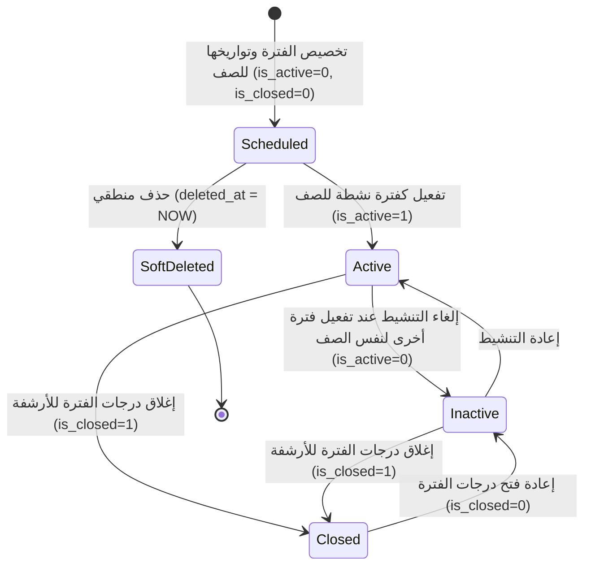

# ⚙️ مواصفات Backend — المرحلة 02-C: إدارة فترات الصفوف وتسكين الشعب والمناهج

> **الهدف:** توثيق منطق المعالجة وقواعد التحقق والمعاملات الذرية الحصرية للجداول الثلاثة (`class_academic_terms`, `class_sections`, `class_subjects`) المطابقة بنسبة 100% لـ [`MD/database.md`](../../database.md) و [`MD/business_rules.md`](../../business_rules.md).  
> 
> ⚠️ **تكامل حوكمي صريح وملزم — مرجع الاستجابات (Network SSoT):**  
> ملف [`routes.md`](./routes.md) هو **المصدر الرئيسي والحصري والوحيد لكافة استجابات ومدخلات الـ API (Network SSoT)**. تم تسجيل كامل شكل الاستجابة (JSON Response Body) ورسائل الخطأ والنجاح صراحةً في [`routes.md`](./routes.md) لجميع الرموز والـ Status Codes (`200 OK`, `201 Created`, `400 Bad Request`, `401 Unauthorized`, `403 Forbidden`, `404 Not Found`, `409 Conflict`, `422 Unprocessable Entity`, `500 Internal Server Error`) لكل رابط.  
> 📌 **توجيه إجباري عند البناء والتطوير:** يلتزم المطور أو نموذج الذكاء الاصطناعي بالكامل بإنشاء ورسم كود الخادم واستجابات الـ API بناءً على الهياكل والرموز المسجلة في ملف [`routes.md`](./routes.md) حصراً بدون أي اجتهاد شخصي.

---

## 1. نطاق المرحلة والحدود المعمارية (Scope & Boundaries)

### 🟢 ما تشمله المرحلة (In-Scope):
- **تواريخ وتخطيط فترات الصفوف (`class_academic_terms`) — [4 مسارات]:**
  - استعراض وبحث فترات وتواريخ الصفوف بالعام (`GET /api/v1/academic/class-academic-terms`).
  - تخصيص وتخطيط فترة وتواريخ لصف بالعام الدراسي (`POST /api/v1/academic/class-academic-terms`).
  - تفعيل الفترة النشطة للصف ذرياً (`POST /api/v1/academic/class-academic-terms/:id/activate`).
  - إغلاق/فتح درجات الفترة للصف للأرشفة (`POST /api/v1/academic/class-academic-terms/:id/close`).
- **ربط وتسكين الشُعب بالصفوف (`class_sections`) — [3 مسارات]:**
  - استعراض الشعب المفتوحة لصف دراسي (`GET /api/v1/academic/class-sections`).
  - تسكين وفتح شعبة لصف مع فحص تفرد الربط (`POST /api/v1/academic/class-sections`).
  - فك ربط شعبة من صف مع حظر الحذف عند وجود طلاب (`DELETE /api/v1/academic/class-sections/:id`).
- **مناهج الصفوف والدرجات لكل فترة (`class_subjects`) — [4 مسارات]:**
  - استعراض هيكل المنهج مقسماً بالفصول للصف (`GET /api/v1/academic/class-subjects`).
  - إسناد مادة لصف وتحديد درجات الفترة بالهيكل الموحد (`POST /api/v1/academic/class-subjects`).
  - تعديل درجات مادة مسندة بالفترة مع منع التعديل بالفترات المغلقة (`PUT /api/v1/academic/class-subjects/:id`).
  - إزالة مادة من منهج فترة الصف مع حظر الإزالة عند وجود درجات رصدت (`DELETE /api/v1/academic/class-subjects/:id`).
- **الحوكمة والنزاهة:**
  - قصر كافة عمليات الكتابة والتعديل والتفعيل والإغلاق على مدير النظام (`admin`).
  - حظر الحذف في حال وجود ارتباطات نشطة (`ON DELETE RESTRICT`) وإرجاع رمز التعارض `409 Conflict`.
  - تسجيل كافة العمليات في سجلات التدقيق `audit_logs`.

### 🔴 خارج نطاق المرحلة (Out-of-Scope):
- تعريف السنوات الدراسية (`academic_years`)، كتالوج الفترات العام (`academic_terms`)، والمراحل (`academic_stages`) $\rightarrow$ محالة إلى المرحلة `02-A`.
- تعريف الفصول/الصفوف (`classes`)، بنك الشعب العامة (`sections`)، وبنك المواد العامة (`subjects`) $\rightarrow$ محالة إلى المرحلة `02-B`.
- إسناد المعلمين للمواد والشعب $\rightarrow$ محال إلى المرحلة `03`.
- تسكين الطلاب وتوزيعهم على الشعب $\rightarrow$ محال إلى المرحلة `04`.

---

## 2. حوكمة الأدوار وقواعد الوصول وعزل البيانات (RBAC & Scoping Rules)

### 👥 مصفوفة الفاعلين والصلاحيات:
- **مدير النظام (Admin - `role_type = 'admin'`):**
  - يمتلك الصلاحية الكاملة على كافة العمليات الـ 11 (قراءة، تخصيص، تسكين، تفعيل، إغلاق، تعديل، فك ربط).
- **المعلم (Teacher)، الطالب (Student)، ولي الأمر (Parent):**
  - **يُحظر عليهم تماماً** إجراء أي تعديل أو تخصيص لفترات أو شُعب أو مناهج ودرجات.
  - أي محاولة وصول غير مصرح بها تُرفض فوراً برمز المنع الصريح `403 Forbidden`.
- **المستخدم غير المصادق عليه (Unauthenticated):**
  - أي طلب يفتقر إلى توكن `Bearer JWT` صالح ونشط يُرفض برمز `401 Unauthorized`.

---

## 3. دورة حياة الكيانات وقواعد ثبات النظام (Lifecycles & System Invariants)

### 🔒 قواعد ثبات النظام الصارمة (System Invariants):
1. **الفترة النشطة الوحيدة لكل صف بالعام (Single Active Term per Class):**
   - يمتلك الصف الدراسي بالعام الواحد فترة نشطة واحدة فقط (`is_active = 1`) لعمليات التدريس وإدخال الدرجات.
   - تفعيل فترة لصف ما يلغي تفعيل باقي فترات نفس الصف لنفس العام بحركة ذرية واحدة داخل المعاملة.
2. **قفل الفترات المغلقة للأرشفة (Closed Term Lock):**
   - إذا تم إغلاق درجات الفترة للصف (`is_closed = 1`)، يُمنع تعديل درجات المواد بجدول `class_subjects` لهذه الفترة وتصبح للقراءة والأرشفة فقط (`409 Conflict`).
3. **قيد نزاهة وتناسب الدرجات واستنتاج الصف (Score & Security Invariant):**
   - يجب دائماً التحقق من أن درجة النجاح الصغرى لا تتجاوز الدرجة الكلية العظمى (`passing_score <= max_score`) مع كون القيم موجبة.
   - يستنتج الخادم معرف الصف الدراسي `class_id` تلقائياً من سجل `class_academic_terms` لضمان منع التلاعب أو إرسال بيانات غير متطابقة.
4. **الحماية المرجعية الصارمة (Strict RESTRICT Protection):**
   - يمنع فك ربط أي شعبة من صف إذا وجد طلاب مسجلون بتلك الشعبة في `student_enrollments`.
   - يمنع إزالة أي مادة من منهج فترة الصف إذا تم رصد درجات امتحانات رسمية أو جدول حصص للمادة بتلك الفترة.
   - رمز الخطأ المعياري لمنع الحذف أو فك الربط المرجعي هو `409 Conflict`.
5. **دورة حياة الحذف المنطقي (Soft Delete Lifecycle):**
   - الحذف لا يشطب السجل نهائياً بل يضبط حقل `deleted_at = CURRENT_TIMESTAMP`.

---

## 4. العمليات المنطقية والمسارات التفصيلية للمجال (Domain Operations & Routes)

---

### 🗓️ الخطوة 1: إدارة تواريخ وتخطيط فترات الصفوف (`class_academic_terms`) — [4 مسارات]

> **الوصف:** تخصيص الفترات والتواريخ الرسمية لكل صف دراسي بالعام طبق تقويم الوزارة والتحكم في الفترة النشطة والمغلقة للصف.

#### 📋 جدول مسارات الخطوة 1:
| # | العملية المنطقية (Operation) | HTTP Method & Endpoint | الصلاحية | رمز النجاح | مرجع العقد في `routes.md` |
| :-: | :--- | :--- | :--- | :---: | :--- |
| **1.1** | استعراض فترات وتواريخ الصفوف بالعام | `GET /api/v1/academic/class-academic-terms` | `admin` | `200 OK` | [في routes.md](./routes.md) |
| **1.2** | تخصيص وتخطيط فترة وتواريخ لصف | `POST /api/v1/academic/class-academic-terms` | `admin` | `201 Created` | [في routes.md](./routes.md) |
| **1.3** | تفعيل الفترة النشطة للصف (ذري) | `POST /api/v1/academic/class-academic-terms/:id/activate` | `admin` | `200 OK` | [في routes.md](./routes.md) |
| **1.4** | إغلاق/فتح درجات الفترة للصف | `POST /api/v1/academic/class-academic-terms/:id/close` | `admin` | `200 OK` | [في routes.md](./routes.md) |

---

#### 🔹 [Operation 1.1] `GET /api/v1/academic/class-academic-terms` — استعراض وبحث تقويم فترات صفوف العام
- **الغرض والوظيفة:** استرجاع تقويم فترات وتواريخ كافة صفوف المدرسة بالعام الدراسي مجمعة هرمياً لكل صف، مع إمكانية الفلترة لصف دراسي محدد عبر المعامل `class_id`.
- **قواعد المعالجة والخادم:**
  - استرجاع السجلات النشطة فقط (`deleted_at IS NULL`).
  - تجميع الفترات تحت كل صف في مصفوفة `classes`.
  - تضمين مسميات العام والصف والفترة المرجعية (`academic_year_name`, `class_name`, `term_name`).
- **عقد الاستجابات والمعاملات (Network SSoT):**
  - معاملات الاستعلام وهياكل الـ JSON الصريحة لـ (`200 OK`) موثقة في [`routes.md`](./routes.md).

#### 🔹 [Operation 1.2] `POST /api/v1/academic/class-academic-terms` — تخصيص وتخطيط فترة وتواريخ لصف
- **الغرض والوظيفة:** تخصيص فترة دراسية وتحديد تواريخ بدايتها ونهايتها لصف محدد بالعام الدراسي.
- **قواعد التحقق (Validation Rules):**
  - `academic_year_id`: مطلوب، معرف عام دراسي صالح.
  - `class_id`: مطلوب، معرف صف دراسي صالح.
  - `academic_term_id`: مطلوب، معرف فترة مرجعية صالحة.
  - `start_date`: مطلوب، تاريخ صالح ضمن النطاق الزمني للعام الدراسي المستهدف.
  - `end_date`: مطلوب، تاريخ صالح يقع بعد `start_date` وضمن نطاق العام الدراسي.
  - **قيد التفرد المركب:** التحقق من عدم تخصيص نفس الفترة لنفس الصف بالعام (`uq_class_term_year`).
- **التنفيذ:** حفظ السجل بحالة أولية (`is_active = 0`, `is_closed = 0`) وتوثيق الإضافة في `audit_logs`.
- **عقد الاستجابات والمدخلات (Network SSoT):**
  - هيكل الطلب واستجابات (`201 Created`, `409 Conflict`, `422 Unprocessable Entity`) مسجلة في [`routes.md`](./routes.md).

#### 🔹 [Operation 1.3] `POST /api/v1/academic/class-academic-terms/:id/activate` — تفعيل الفترة النشطة للصف (Atomic Activation)
- **الغرض والوظيفة:** تحويل الفترة المستهدفة إلى الفترة النشطة الحصرية للصف في هذا العام الدراسي.
- **المعاملة الذرية وقفل التنافسية:**
  - يتم تنفيذ العملية داخل **معاملة قاعدة بيانات ذرية (Atomic Transaction)**:
    1. التحقق من وجود السجل المستهدف واستخراج `academic_year_id` و `class_id`.
    2. تطبيق قفل حصري على مستوى السجلات (Row-Level Lock).
    3. تحديث كافة فترات نفس الصف لنفس العام لضبط `is_active = 0`.
    4. تحديث الفترة المستهدفة لضبط `is_active = 1`.
    5. توثيق العملية في `audit_logs`.
- **عقد الاستجابات والمدخلات (Network SSoT):**
  - استجابات التفعيل (`200 OK`, `404 Not Found`) مسجلة في [`routes.md`](./routes.md).

#### 🔹 [Operation 1.4] `POST /api/v1/academic/class-academic-terms/:id/close` — إغلاق/فتح درجات الفترة للصف
- **الغرض والوظيفة:** تبديل حالة إغلاق درجات الفترة للصف (`is_closed = 1` للأرشفة، أو `is_closed = 0` للفتح).
- **التنفيذ:** تعديل الحقل وتوثيق الحركة في `audit_logs`.
- **عقد الاستجابات والمدخلات (Network SSoT):**
  - استجابات الإغلاق (`200 OK`, `404 Not Found`) مسجلة في [`routes.md`](./routes.md).

---

### 🧩 الخطوة 2: إدارة ربط وتسكين الشُعب بالصفوف (`class_sections`) — [3 مسارات]

> **الوصف:** إدارة فتح الشعب وتسكينها بالصفوف الدراسية وإدارتها بحظر التكرار وحماية فك الربط عند وجود طلاب.

#### 📋 جدول مسارات الخطوة 2:
| # | العملية المنطقية (Operation) | HTTP Method & Endpoint | الصلاحية | رمز النجاح | مرجع العقد في `routes.md` |
| :-: | :--- | :--- | :--- | :---: | :--- |
| **2.1** | استعراض وبحث شُعب الصفوف المفتوحة | `GET /api/v1/academic/class-sections` | `admin` | `200 OK` | [في routes.md](./routes.md) |
| **2.2** | تسكين وربط شعبة بصف | `POST /api/v1/academic/class-sections` | `admin` | `201 Created` | [في routes.md](./routes.md) |
| **2.3** | فك ربط شعبة من صف | `DELETE /api/v1/academic/class-sections/:id` | `admin` | `200 OK` | [في routes.md](./routes.md) |

---

#### 🔹 [Operation 2.1] `GET /api/v1/academic/class-sections` — استعراض وبحث شُعب الصفوف المفتوحة
- **الغرض والوظيفة:** استرجاع قائمة الشعب المفتوحة والمسندة لكافة الصفوف الدراسية بالمدرسة مجمعة هرمياً لكل صف، مع إمكانية الفلترة لصف دراسي محدد عبر المعامل `class_id` أو البحث النصي.
- **عقد الاستجابات والمعاملات (Network SSoT):**
  - معاملات الاستعلام وهياكل الـ JSON الصريحة لـ (`200 OK`) موثقة في [`routes.md`](./routes.md).

#### 🔹 [Operation 2.2] `POST /api/v1/academic/class-sections` — تسكين وربط شعبة بصف
- **الغرض والوظيفة:** فتح شعبة عامة لصف دراسي محدد.
- **قواعد التحقق:**
  - `class_id`: مطلوب، معرف صف موجود بـ `classes`.
  - `section_id`: مطلوب، معرف شعبة عامة موجودة بـ `sections`.
  - **قيد التفرد:** التحقق من عدم فتح نفس الشعبة مسبقاً لنفس الصف (`uq_class_sections`).
- **التنفيذ:** حفظ السجل وتوثيق العملية في `audit_logs`.
- **عقد الاستجابات والمدخلات (Network SSoT):**
  - هيكل الطلب واستجابات (`201 Created`, `409 Conflict`, `422 Unprocessable Entity`) مسجلة في [`routes.md`](./routes.md).

#### 🔹 [Operation 2.3] `DELETE /api/v1/academic/class-sections/:id` — فك ربط شعبة من صف
- **الغرض والوظيفة:** تنفيذ الحذف المنطقي لسجل ربط شعبة بصف.
- **قواعد الحماية المرجعية:**
  - فحص جدول تسكين الطلاب `student_enrollments`.
  - إذا وجد طلاب مسجلون بتلك الشعبة: رفض الحذف وإرجاع `409 Conflict` (RESTRICT).
  - إذا كانت الشعبة خالية: تنفيذ الحذف المنطقي وتوثيق الحركة في `audit_logs`.
- **عقد الاستجابات والمدخلات (Network SSoT):**
  - ردود الحذف (`200 OK`, `404 Not Found`, `409 Conflict`) موثقة صراحةً في [`routes.md`](./routes.md).

---

### 📝 الخطوة 3: إدارة مناهج الصفوف والدرجات لكل فترة (`class_subjects`) — [4 مسارات]

> **الوصف:** إسناد المواد لكل صف بالسمستر المحدد وتخصيص درجة النجاح الصغرى والدرجة العظمى بهيكل موحد.

#### 📋 جدول مسارات الخطوة 3:
| # | العملية المنطقية (Operation) | HTTP Method & Endpoint | الصلاحية | رمز النجاح | مرجع العقد في `routes.md` |
| :-: | :--- | :--- | :--- | :---: | :--- |
| **3.1** | استعراض منهج ومقررات الصف بالفصول | `GET /api/v1/academic/class-subjects` | `admin` | `200 OK` | [في routes.md](./routes.md) |
| **3.2** | إسناد مادة وتحديد درجات الفترة | `POST /api/v1/academic/class-subjects` | `admin` | `201 Created` | [في routes.md](./routes.md) |
| **3.3** | تعديل درجات مادة مسندة بالفترة | `PUT /api/v1/academic/class-subjects/:id` | `admin` | `200 OK` | [في routes.md](./routes.md) |
| **3.4** | إزالة مادة من منهج فترة الصف | `DELETE /api/v1/academic/class-subjects/:id` | `admin` | `200 OK` | [في routes.md](./routes.md) |

---

#### 🔹 [Operation 3.1] `GET /api/v1/academic/class-subjects` — استعراض منهج ومقررات الصف بالفصول
- **الغرض والوظيفة:** استرجاع الهيكل الكامل لمنهج الصف الدراسي موزَّعاً ومنظماً بحسب الفصول الدراسية (`terms`) دون تكرار لبيانات الصف، مع تفاصيل المواد ودرجاتها لكل فصل.
- **عقد الاستجابات والمعاملات (Network SSoT):**
  - معاملات التصفية بـ `class_id` وهياكل JSON الصريحة مقسمة بالفصول لـ (`200 OK`) مسجلة في [`routes.md`](./routes.md).

#### 🔹 [Operation 3.2] `POST /api/v1/academic/class-subjects` — إسناد مادة وتحديد درجات الفترة
- **الغرض والوظيفة:** إضافة مادة لمنهج فترة محددة بالصف وتعيين درجة النجاح والدرجة العظمى (يستنتج الخادم `class_id` تلقائياً من `class_academic_term_id`).
- **قواعد التحقق:**
  - `class_academic_term_id`: مطلوب، معرف فترة صف صالحة وغير محذوفة.
  - `subject_id`: مطلوب، معرف مادة عامة صالحة.
  - `passing_score`: مطلوب، رقم عشري (`>= 0`).
  - `max_score`: مطلوب، رقم عشري (`> 0`).
  - **قيد النزاهة الإجباري:** `passing_score <= max_score`.
  - **قيد التفرد المركب:** التحقق من عدم تكرار المادة لنفس الفترة (`uq_class_term_subject`).
- **عقد الاستجابات والمدخلات (Network SSoT):**
  - جسم الطلب والردود (`201 Created`, `409 Conflict`, `422 Unprocessable Entity`) مسجلة في [`routes.md`](./routes.md).

#### 🔹 [Operation 3.3] `PUT /api/v1/academic/class-subjects/:id` — تعديل درجات مادة مسندة بالفترة
- **الغرض والوظيفة:** تحديث بيانات مادة مسندة بفترة صف (هيكل المدخلات متطابق تماماً مع هيكل الإنشاء).
- **قواعد المعالجة:**
  - التحقق من وجود السجل وعدم حذفه (`404 Not Found`).
  - **فحص حالة إغلاق الفترة:** إذا كانت الفترة مغلقة للأرشفة (`is_closed = 1`)، رفض التعديل وإرجاع `409 Conflict`.
  - التحقق من قيد `passing_score <= max_score` (`422 Unprocessable Entity`).
  - تحديث بيانات السجل وتسجيل القيم في `audit_logs`.
- **عقد الاستجابات والمدخلات (Network SSoT):**
  - استجابات التعديل (`200 OK`, `404 Not Found`, `409 Conflict`, `422 Unprocessable Entity`) مسجلة في [`routes.md`](./routes.md).

#### 🔹 [Operation 3.4] `DELETE /api/v1/academic/class-subjects/:id` — إزالة مادة من منهج فترة الصف
- **الغرض والوظيفة:** حذف مادة من مقررات فترة الصف.
- **قواعد الحماية المرجعية:**
  - التحقق من عدم وجود درجات امتحانات مسجلة أو جدول حصص للمادة في هذه الفترة.
  - إذا وجدت درجات أو حصص: رفض الحذف وإرجاع `409 Conflict` (حماية RESTRICT).
  - إذا كانت المادة حرة: تنفيذ الحذف المنطقي وتوثيق الحركة في `audit_logs`.
- **عقد الاستجابات والمدخلات (Network SSoT):**
  - ردود الحذف (`200 OK`, `404 Not Found`, `409 Conflict`) مسجلة صراحةً في [`routes.md`](./routes.md).

---

## 5. الأداء، التزامن، والنزاهة المرجعية (Performance & Data Integrity)

1. **تحسين الاستعلامات والفهارس:**
   - كافة استعلامات القوائم تستخدم الفهارس المركبة المعتمدة في `MD/database.md`:
     - `uq_class_term_year` و `idx_class_terms_*` لسرعة التحقق وفلترة الفترات.
     - `uq_class_sections` لمنع تكرار فتح الشعب.
     - `uq_class_term_subject` و `idx_class_subjects_*` لسرعة جلب مناهج الفترات.
2. **الترقيم ومنع الإغراق (Pagination & DoS Protection):**
   - حصر عدد السجلات في مسارات الـ GET بحد أقصى لمنع تحميل الذاكرة.
3. **تجنب التسريب التقني والأمني في الاستجابات:**
   - عدم كشف أي تفاصيل عن أسماء الجداول الداخلية أو الاستعلامات أو الأخطاء البرمجية للمستخدم، وتوحيد رسائل الأخطاء عبر الرموز المعيارية (`400`, `401`, `403`, `404`, `409`, `422`, `500`).

---

## 6. معايير القبول الهندسية للباك إند (Backend Acceptance Criteria)

تعتبر متطلبات الخادم لهذه المرحلة مستوفاة بالكامل عند تحقق المعايير التالية:

- [ ] قصر صلاحية التخصيص والتسكين والتفعيل والإغلاق والتعديل والحذف حصراً على المستخدمين بدور `admin`.
- [ ] إرجاع `401 Unauthorized` لأي طلب بدون توكن مصادقة صالح.
- [ ] إرجاع `403 Forbidden` عند محاولة المعلم أو الطالب أو ولي الأمر إجراء أي تعديل.
- [ ] التحقق الصارم من صحة التواريخ ووقوعها ضمن العام الدراسي واشتراط `end_date > start_date`.
- [ ] التحقق الصارم من قيد الدرجات `passing_score <= max_score` وإرجاع `422` عند المخالفة.
- [ ] استنتاج `class_id` تلقائياً من `class_academic_term_id` في عمليات مناهج الصفوف.
- [ ] تطابق هيكل الـ Request Body بين عمليات الإنشاء والتعديل لـ `class-subjects`.
- [ ] التحقق من تفرد القيود المركبة (`uq_class_term_year`, `uq_class_sections`, `uq_class_term_subject`) وإرجاع `409 Conflict`.
- [ ] تنفيذ تفعيل فترة الصف داخل Atomic Transaction تضمن وجود فترة نشطة واحدة فقط لكل صف بالعام.
- [ ] حظر تعديل درجات المواد بالفترات المغلقة للأرشفة (`is_closed = 1`) وإرجاع `409 Conflict`.
- [ ] منع فك ربط الشعب أو إزالة المواد المرتبطة بسجلات نشطة وإرجاع `409 Conflict`.
- [ ] تنفيذ الحذف المنطقي بضبط طابع `deleted_at` واستبعاد السجلات المحذوفة من القوائم.
- [ ] تسجيل جميع الحركات والتعديلات في جدول `audit_logs`.
- [ ] مطابقة كافة المدخلات والمخرجات بنسبة 100% لعقد الشبكة في [`routes.md`](./routes.md).
