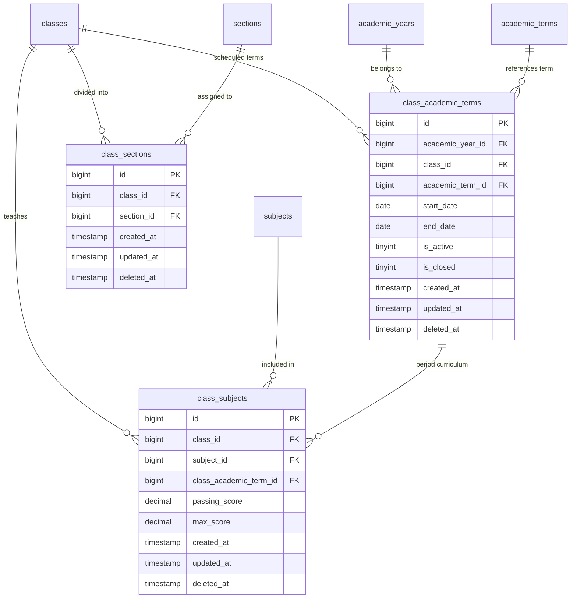

# 📊 مواصفات البيانات والكيانات — المرحلة 02-C (Data Specification)

> **الهدف:** توثيق المخطط الهيكلي للجداول الثلاثة (`class_academic_terms`, `class_sections`, `class_subjects`) المطابقة بنسبة 100% للمصدر الرئيسي والحصري للحقيقة: [`MD/database.md`](../../database.md).  
> 
> ⚠️ **إرشادات وتنبيهات حوكمية إجبارية (System Governance Directives):**  
> 1. **قواعد العمل العامة (Business Rules SSoT):** يلزم قراءة واعتماد **ملف القواعد العامة بالمنظومة [`MD/business_rules.md`](../../business_rules.md)** والالتزام التام بكافة القيود ومصفوفة الصلاحيات والحوكمة المذكورة فيه.  
> 2. **مرجع شبكة الطلبات والاستجابات (Network SSoT):** ملف [`routes.md`](./routes.md) هو المصدر الرئيسي والوحيد لعقد الشبكة بالمنظومة لكافة مسارات الـ API (الطلبات والاستجابات).  
> 📌 **توجيه إجباري:** تُبنى نماذج البيانات ومخططات التحقق بناءً على الهياكل والرموز المسجلة في هذا الملف وملف [`MD/database.md`](../../database.md).

---

## 1. هيكل الجداول والكيانات (Tables Matrix)

---

### 1.1 [الخطوة 1] جدول تواريخ وفترات الصفوف الدراسية (`class_academic_terms`)

> **الوصف:** جدول تخصيص فترات وتواريخ الوزارة وحالتها النشطة والمغلقة لكل صف دراسي بالعام الدراسي، لتلبية التفاوت بين الصفوف العادية والانتقالية والشهادات (9 إعدادي و 12 ثانوية).

| اسم العمود (Column) | نوع البيانات (MySQL Type) | القيود والخصائص (Constraints) | الوصف والدلالة الوظيفية |
| :--- | :--- | :--- | :--- |
| `id` | `BIGINT UNSIGNED` | `PRIMARY KEY AUTO_INCREMENT` | المعرف الرقمي الفريد لتخصيص فترة الصف. |
| `academic_year_id` | `BIGINT UNSIGNED` | `NOT NULL` | معرف العام الدراسي (يرتبط بـ `academic_years.id`). |
| `class_id` | `BIGINT UNSIGNED` | `NOT NULL` | معرف الصف الدراسي (يرتبط بـ `classes.id`). |
| `academic_term_id` | `BIGINT UNSIGNED` | `NOT NULL` | معرف الفترة المرجعية (يرتبط بـ `academic_terms.id`). |
| `start_date` | `DATE` | `NOT NULL` | تاريخ بداية الفترة الرسمية لهذا الصف بالذات طبق تقويم الوزارة. |
| `end_date` | `DATE` | `NOT NULL` | تاريخ نهاية الفترة الرسمية لهذا الصف بالذات طبق تقويم الوزارة. |
| `is_active` | `TINYINT(1)` | `NOT NULL, DEFAULT 0` | هل هي الفترة النشطة حالياً لهذا الصف؟ (`1 = نشطة`, `0 = غير نشطة`). |
| `is_closed` | `TINYINT(1)` | `NOT NULL, DEFAULT 0` | هل تم إغلاق درجات هذه الفترة نهائياً لهذا الصف؟ (`1 = مغلقة للأرشفة`, `0 = مفتوحة`). |
| `created_at` | `TIMESTAMP` | `NOT NULL, DEFAULT CURRENT_TIMESTAMP` | توقيت إنشاء السجل. |
| `updated_at` | `TIMESTAMP` | `NULL ON UPDATE CURRENT_TIMESTAMP` | توقيت آخر تحديث. |
| `deleted_at` | `TIMESTAMP` | `NULL DEFAULT NULL` | طابع الحذف المنطقي (Soft Delete). |

- **العلاقات والمفاتيح الخارجية (Foreign Keys):**
  - `academic_year_id` يرتبط بجدول `academic_years(id)` مع `ON DELETE RESTRICT, ON UPDATE CASCADE`.
  - `class_id` يرتبط بجدول `classes(id)` مع `ON DELETE RESTRICT, ON UPDATE CASCADE`.
  - `academic_term_id` يرتبط بجدول `academic_terms(id)` مع `ON DELETE RESTRICT, ON UPDATE CASCADE`.

- **الفهارس والقيود (Indexes & Constraints):**
  - `PRIMARY KEY (id)`
  - `UNIQUE INDEX uq_class_term_year (academic_year_id, class_id, academic_term_id)`
  - `INDEX idx_class_terms_year (academic_year_id)`
  - `INDEX idx_class_terms_class (class_id)`
  - `INDEX idx_class_terms_term (academic_term_id)`
  - `INDEX idx_class_terms_active (is_active)`
  - `INDEX idx_class_terms_closed (is_closed)`

- **قيود منطق الأعمال وقواعد البيانات (Business & Data Invariants):**
  - `uq_class_term_year`: يمنع تكرار تخصيص نفس الفترة المرجعية لنفس الصف في نفس العام الدراسي.
  - قيد التواريخ: `end_date > start_date` ويجب أن تقع التواريخ ضمن النطاق الزمني للعام الدراسي المستهدف.
  - `Single Active Period per Class`: يوجد فترة نشطة واحدة فقط (`is_active = 1`) لكل صف دراسي بالعام في أي لحظة.

---

### 1.2 [الخطوة 2] جدول ربط الفصول بالشعب (`class_sections`)

> **الوصف:** جدول الربط متعدد لمتعدد يربط كل فصل دراسي بالشعب المفتوحة له (مثل: خامس/أ، خامس/ب).

| اسم العمود (Column) | نوع البيانات (MySQL Type) | القيود والخصائص (Constraints) | الوصف والدلالة الوظيفية |
| :--- | :--- | :--- | :--- |
| `id` | `BIGINT UNSIGNED` | `PRIMARY KEY AUTO_INCREMENT` | المعرف الرقمي لسجل ربط الفصل بالشعبة. |
| `class_id` | `BIGINT UNSIGNED` | `NOT NULL` | معرف الفصل الدراسي (يرتبط بـ `classes.id`). |
| `section_id` | `BIGINT UNSIGNED` | `NOT NULL` | معرف الشعبة (يرتبط بـ `sections.id`). |
| `created_at` | `TIMESTAMP` | `NOT NULL, DEFAULT CURRENT_TIMESTAMP` | توقيت إنشاء السجل. |
| `updated_at` | `TIMESTAMP` | `NULL ON UPDATE CURRENT_TIMESTAMP` | توقيت آخر تحديث. |
| `deleted_at` | `TIMESTAMP` | `NULL DEFAULT NULL` | طابع الحذف المنطقي (Soft Delete). |

- **العلاقات والمفاتيح الخارجية (Foreign Keys):**
  - `class_id` يرتبط بجدول `classes(id)` مع `ON DELETE RESTRICT, ON UPDATE CASCADE`.
  - `section_id` يرتبط بجدول `sections(id)` مع `ON DELETE RESTRICT, ON UPDATE CASCADE`.

- **الفهارس والقيود (Indexes & Constraints):**
  - `PRIMARY KEY (id)`
  - `UNIQUE INDEX uq_class_sections (class_id, section_id)`
  - `INDEX idx_class_sections_class (class_id)`
  - `INDEX idx_class_sections_section (section_id)`

- **قيود منطق الأعمال وقواعد البيانات (Business & Data Invariants):**
  - `uq_class_sections`: يمنع تكرار فتح نفس الشعبة لنفس الصف الدراسي.
  - `ON DELETE RESTRICT`: يمنع فك ربط الشعبة من الصف إذا وجد طلاب مسجلون بتلك الشعبة في `student_enrollments`.

---

### 1.3 [الخطوة 3] جدول مقررات الفصول والدرجات بالفصل الدراسي (`class_subjects`)

> **الوصف:** جدول الربط الثلاثي المحكم يربط كل صف دراسي بالمادة المقررة في تخصيص فترة الصف المحمية بجدول `class_academic_terms` لضمان صحة النزاهة 100%، مع تحديد درجة النجاح الصغرى `passing_score` والدرجة العظمى `max_score` المخصصة لكل سمستر بدقة متناهية.

| اسم العمود (Column) | نوع البيانات (MySQL Type) | القيود والخصائص (Constraints) | الوصف والدلالة الوظيفية |
| :--- | :--- | :--- | :--- |
| `id` | `BIGINT UNSIGNED` | `PRIMARY KEY AUTO_INCREMENT` | المعرف الرقمي لمقرر المادة بالفصل الدراسي. |
| `class_id` | `BIGINT UNSIGNED` | `NOT NULL` | معرف الصف الدراسي (يرتبط بـ `classes.id`). |
| `subject_id` | `BIGINT UNSIGNED` | `NOT NULL` | معرف المادة العامة (يرتبط بـ `subjects.id`). |
| `class_academic_term_id` | `BIGINT UNSIGNED` | `NOT NULL` | معرف تخصيص فترة الصف (يرتبط بـ `class_academic_terms.id`). |
| `passing_score` | `DECIMAL(5,2)` | `NOT NULL, DEFAULT 50.00` | درجة النجاح الصغرى المقررة للمادة في هذا السمستر. |
| `max_score` | `DECIMAL(5,2)` | `NOT NULL, DEFAULT 100.00` | الدرجة الكلية العظمى للمادة في هذا السمستر. |
| `created_at` | `TIMESTAMP` | `NOT NULL, DEFAULT CURRENT_TIMESTAMP` | توقيت إنشاء السجل. |
| `updated_at` | `TIMESTAMP` | `NULL ON UPDATE CURRENT_TIMESTAMP` | توقيت آخر تحديث. |
| `deleted_at` | `TIMESTAMP` | `NULL DEFAULT NULL` | طابع الحذف المنطقي (Soft Delete). |

- **العلاقات والمفاتيح الخارجية (Foreign Keys):**
  - `class_id` يرتبط بجدول `classes(id)` مع `ON DELETE RESTRICT, ON UPDATE CASCADE`.
  - `subject_id` يرتبط بجدول `subjects(id)` مع `ON DELETE RESTRICT, ON UPDATE CASCADE`.
  - `class_academic_term_id` يرتبط بجدول `class_academic_terms(id)` مع `ON DELETE RESTRICT, ON UPDATE CASCADE`.

- **الفهارس والقيود (Indexes & Constraints):**
  - `PRIMARY KEY (id)`
  - `UNIQUE INDEX uq_class_term_subject (class_academic_term_id, subject_id)`
  - `INDEX idx_class_subjects_class (class_id)`
  - `INDEX idx_class_subjects_subject (subject_id)`
  - `INDEX idx_class_subjects_class_term (class_academic_term_id)`

- **قيود منطق الأعمال وقواعد البيانات (Business & Data Invariants):**
  - `uq_class_term_subject`: يمنع تكرار إسناد نفس المادة لنفس فترة الصف الدراسي.
  - قيد الدرجات: يجب دائماً تحقق `passing_score <= max_score` و `passing_score >= 0` و `max_score > 0`.
  - `ON DELETE RESTRICT`: يمنع إزالة أي مادة من منهج الصف إذا تم رصد درجات امتحانات رسمية أو جدول حصص للمادة بتلك الفترة.

---

## 2. دورة حياة البيانات والحذف المنطقي (Data Lifecycle & Soft Deletes)

1. **الإنشاء (Creation):** إنشاء السجلات بحالتها الأولية مع توثيق `created_at`.
2. **التعديل (Update):** تعديل الحقول المسموحة مع توثيق `updated_at` ومنع تعديل درجات المواد إذا كانت الفترة مغلقة للأرشفة (`is_closed = 1`).
3. **الحذف المنطقي (Soft Delete):** 
   - عند الحذف، يتم ضبط قيمة `deleted_at` إلى التوقيت الحالي بدلاً من الحذف الفيزيائي للسجل.
   - كافة استعلامات القراءة تستثني السجلات التي تحتوي على `deleted_at IS NOT NULL`.
4. **حماية التكامل المرجعي (Referential Protection):**
   - يُرفض الحذف المنطقي أو الفيزيائي إذا كان السجل مرتبطاً ببيانات تابعة نشطة وفق مبدأ `RESTRICT`، ويُعاد رمز التعارض `409 Conflict`.

---

## 3. مخطط الكيانات والعلاقات لـ 02-C (ERD)

