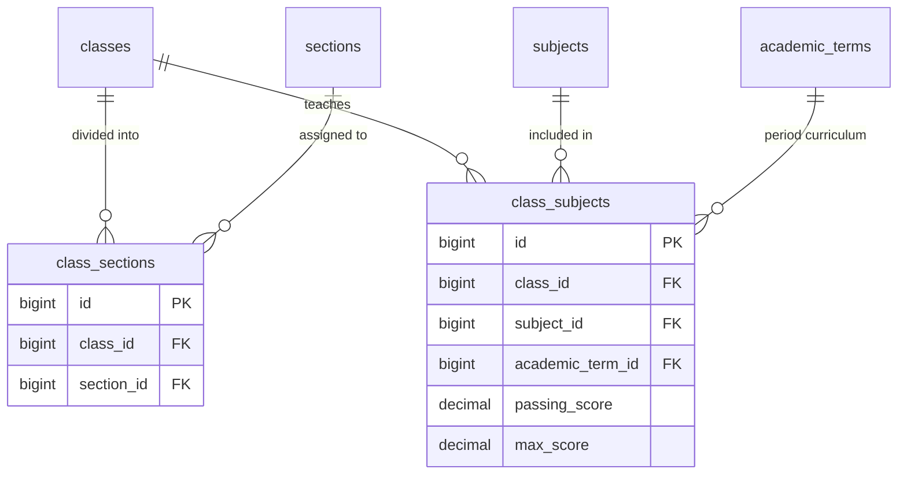

# 📊 مواصفات البيانات والكيانات — المرحلة 02-C (Data Specification)

> **الهدف:** توثيق المخطط الهيكلي للجداول الاثنين (`class_sections`, `class_subjects`) المطابقة بنسبة 100% للمصدر الرئيسي والحصري للحقيقة: [`MD/database/database_phase_02.md`](../../database/database_phase_02.md).

---

## 1. هيكل الجداول والكيانات (Tables Matrix)

---

### 1.1 [الخطوة 7] جدول ربط الفصول بالشعب (`class_sections`)

> **الوصف:** جدول الربط متعدد لمتعدد يربط كل فصل دراسي بالشعب المفتوحة له (مثل: خامس/أ، خامس/ب).

| اسم العمود (Column) | نوع البيانات (MySQL Type) | القيود والخصائص (Constraints) | الوصف والدلالة الوظيفية |
| :--- | :--- | :--- | :--- |
| `id` | `BIGINT UNSIGNED` | `PRIMARY KEY AUTO_INCREMENT` | المعرف الرقمي لسجل ربط الفصل بالشعبة. |
| `class_id` | `BIGINT UNSIGNED` | `NOT NULL, INDEXED` | معرف الفصل الدراسي (يرتبط بـ `classes.id`). |
| `section_id` | `BIGINT UNSIGNED` | `NOT NULL, INDEXED` | معرف الشعبة (يرتبط بـ `sections.id`). |
| `created_at` | `TIMESTAMP` | `NOT NULL, DEFAULT CURRENT_TIMESTAMP` | توقيت إنشاء السجل. |
| `updated_at` | `TIMESTAMP` | `NULL ON UPDATE CURRENT_TIMESTAMP` | توقيت آخر تحديث. |
| `deleted_at` | `TIMESTAMP` | `NULL DEFAULT NULL` | طابع الحذف المنطقي. |

- **العلاقات والقيود:**
  - `class_id` يرتبط بجدول `classes(id)` مع `ON DELETE RESTRICT, ON UPDATE CASCADE`.
  - `section_id` يرتبط بجدول `sections(id)` مع `ON DELETE RESTRICT, ON UPDATE CASCADE`.
  - `UNIQUE INDEX uq_class_sections (class_id, section_id)`.

---

### 1.2 [الخطوة 8] جدول مقررات الفصول والدرجات بالفصل الدراسي (`class_subjects`)

> **الوصف:** جدول الربط الثلاثي يربط كل فصل دراسي بالمادة المقررة في سمستر/فصل محدد، مع تحديد درجة النجاح الصغرى `passing_score` والدرجة العظمى `max_score` المخصصة لكل سمستر بدقة متناهية.

| اسم العمود (Column) | نوع البيانات (MySQL Type) | القيود والخصائص (Constraints) | الوصف والدلالة الوظيفية |
| :--- | :--- | :--- | :--- |
| `id` | `BIGINT UNSIGNED` | `PRIMARY KEY AUTO_INCREMENT` | المعرف الرقمي لمقرر المادة بالفصل الدراسي. |
| `class_id` | `BIGINT UNSIGNED` | `NOT NULL, INDEXED` | معرف الفصل الدراسي (يرتبط بـ `classes.id`). |
| `subject_id` | `BIGINT UNSIGNED` | `NOT NULL, INDEXED` | معرف المادة العامة (يرتبط بـ `subjects.id`). |
| `academic_term_id` | `BIGINT UNSIGNED` | `NOT NULL, INDEXED` | معرف الفصل الدراسي/السمستر (يرتبط بـ `academic_terms.id`). |
| `passing_score` | `DECIMAL(5,2)` | `NOT NULL, DEFAULT 50.00` | درجة النجاح الصغرى المقررة للمادة في هذا السمستر. |
| `max_score` | `DECIMAL(5,2)` | `NOT NULL, DEFAULT 100.00` | الدرجة الكلية العظمى للمادة في هذا السمستر. |
| `created_at` | `TIMESTAMP` | `NOT NULL, DEFAULT CURRENT_TIMESTAMP` | توقيت إنشاء السجل. |
| `updated_at` | `TIMESTAMP` | `NULL ON UPDATE CURRENT_TIMESTAMP` | توقيت آخر تحديث. |
| `deleted_at` | `TIMESTAMP` | `NULL DEFAULT NULL` | طابع الحذف المنطقي. |

- **العلاقات والقيود:**
  - `class_id` يرتبط بجدول `classes(id)` مع `ON DELETE RESTRICT, ON UPDATE CASCADE`.
  - `subject_id` يرتبط بجدول `subjects(id)` مع `ON DELETE RESTRICT, ON UPDATE CASCADE`.
  - `academic_term_id` يرتبط بجدول `academic_terms(id)` مع `ON DELETE RESTRICT, ON UPDATE CASCADE`.
  - `UNIQUE INDEX uq_class_subject_term (class_id, subject_id, academic_term_id)`.

---

## 2. مخطط الكيانات والعلاقات لـ 02-C (ERD)

