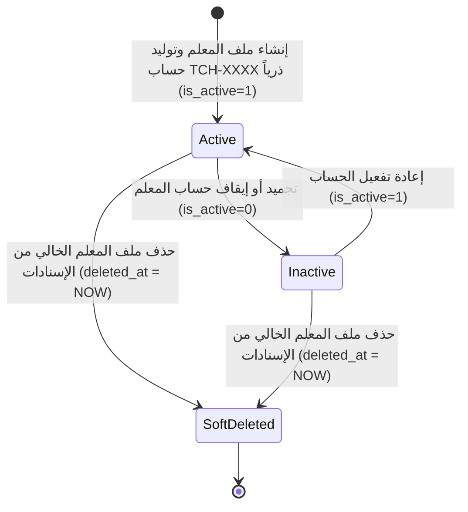

# ⚙️ مواصفات Backend — المرحلة 03-A: إدارة ملفات الكادر التعليمي (Teachers Profiles)

> **الهدف:** توثيق منطق المعالجة وقواعد التحقق والمعاملات الذرية الحصرية لجدول المعلمين (`teachers`) وحساباتهم الموحدة (`users`) المطابقة بنسبة 100% لـ [`MD/database.md`](../../database.md) و [`MD/business_rules.md`](../../business_rules.md)، مع دمج وتوحيد منطق الإنشاء والتعديل (`POST & PUT`) لتوفير الوضوح والرشاقة.  
> 
> ⚠️ **تكامل حوكمي صريح وملزم — مرجع الاستجابات (Network SSoT):**  
> ملف [`routes.md`](./routes.md) هو **المصدر الرئيسي والحصري والوحيد لكافة استجابات ومدخلات الـ API (Network SSoT)**. تم تسجيل كامل شكل الاستجابة (JSON Response Body) ورسائل الخطأ والنجاح صراحةً في [`routes.md`](./routes.md) لجميع الرموز والـ Status Codes (`200 OK`, `201 Created`, `400 Bad Request`, `401 Unauthorized`, `403 Forbidden`, `404 Not Found`, `409 Conflict`, `422 Unprocessable Entity`, `500 Internal Server Error`) لكل رابط.  
> 📌 **توجيه إجباري عند البناء والتطوير:** يلتزم المطور أو نموذج الذكاء الاصطناعي بالكامل بإنشاء ورسم كود الخادم واستجابات الـ API بناءً على الهياكل والرموز المسجلة في ملف [`routes.md`](./routes.md) حصراً بدون أي اجتهاد شخصي.

---

## 1. نطاق المرحلة والحدود المعمارية (Scope & Boundaries)

### 🟢 ما تشمله المرحلة (In-Scope):
- **إدارة سجل وملفات المعلمين (`teachers`) — [5 مسارات موثقة برباعية العمليات المدمجة]:**
  - استعراض وبحث قائمة المعلمين بالتخصص وحالة الحساب والترقيم (`GET /api/v1/teachers`).
  - استعراض تفاصيل ملف معلم محدد وبيانات حسابه (`GET /api/v1/teachers/:id`).
  - إنشاء وتعديل ملف المعلم مع توليد الحساب الموحد (`TCH-XXXX`) ذرياً (`POST & PUT /api/v1/teachers`).
  - حذف ملف المعلم وحسابه مع الحماية المرجعية الصارمة (`DELETE /api/v1/teachers/:id`).
- **الحوكمة والأمان:**
  - قصر عمليات الإضافة والتعديل والحذف على مدير النظام (`admin`).
  - إتاحة عرض الملف الشخصي للمعلم نفسه (`teacher`) أو لمدير النظام (`admin`).
  - حظر الحذف في حال وجود ارتباطات تدريس سابقة أو نشطة (`ON DELETE RESTRICT`) وإرجاع رمز التعارض `409 Conflict`.
  - تسجيل كافة العمليات والتعديلات في سجلات التدقيق `audit_logs`.

### 🔴 خارج نطاق المرحلة (Out-of-Scope):
- إسناد المعلمين للمواد والشعب الدراسية بالفصول $\rightarrow$ محال إلى المرحلة `03-B` (`teaching_assignments`).
- تسكين جداول الحصص الأسبوعية للمعلمين $\rightarrow$ محال إلى المرحلة `05`.
- صلاحيات رصد الواجبات والامتحانات $\rightarrow$ محالة إلى المراحل `06` و `07` و `08`.

---

## 2. حوكمة الأدوار وقواعد الوصول وعزل البيانات (RBAC & Scoping Rules)

### 👥 مصفوفة الفاعلين والصلاحيات:
- **مدير النظام (Admin - `role_type = 'admin'`):**
  - يمتلك الصلاحية الكاملة على كافة مسارات المعلمين (عرض، إنشاء، تعديل، حذف).
- **المعلم (Teacher - `role_type = 'teacher'`):**
  - يمتلك صلاحية استعراض ملفه الشخصي فقط (`GET /api/v1/teachers/:id` حيث `user_id = auth.user.id`).
  - يُحظر عليه استعراض قائمة كافة المعلمين أو تعديل/حذف أي ملف (`403 Forbidden`).
- **الطالب (Student) وولي الأمر (Parent):**
  - يُحظر عليهم تماماً الوصول لمسارات إدارة ملفات المعلمين (`403 Forbidden`).
- **المستخدم غير المصادق عليه (Unauthenticated):**
  - أي طلب يفتقر إلى توكن `Bearer JWT` صالح ونشط يُرفض برمز `401 Unauthorized`.

---

## 3. دورة حياة الكيانات وقواعد ثبات النظام (Lifecycles & System Invariants)

### 🔒 قواعد ثبات النظام الصارمة (System Invariants):
1. **توليد الحساب الموحد ذرياً (Atomic Account Creation):**
   - عند إنشاء معلم جديد، يتم إنشاء حساب بجدول `users` وتوليد رمز مؤسسي فريد بالبادئة `TCH-` (مثل `TCH-2001`) وتشفير كلمة المرور وتعيين `role_type = 'teacher'` وربطه بجدول `teachers` داخل معاملة قاعدة بيانات ذرية واحدة (Atomic Transaction).
2. **علاقة التطابق الفريد (1:1 Unique User Binding):**
   - يرتبط كل سجل معلم بحساب مستخدم واحد فقط (`uq_teachers_user_id`). يمنع ربط أكثر من ملف بنفس حساب الدخول.
3. **الحماية المرجعية الصارمة لمنع الحذف (Strict RESTRICT Protection):**
   - يمنع حذف أي معلم إذا كان مسجلاً في جدول إسناد التدريس `teaching_assignments` لضمان سلامة السجل التاريخي للدرجات والامتحانات وجدول الحصص.
   - رمز الخطأ المعياري لحظر الحذف المرجعي هو `409 Conflict`.
4. **دورة حياة الحذف المنطقي (Soft Delete Lifecycle):**
   - عند حذف معلم غير مرتبط بإسنادات، يتم تعيين `deleted_at = CURRENT_TIMESTAMP` لكل من سجل المعلم وسجل حسابه في `users`، واستبعادهما من الاستعلامات العادية.
5. **سجلات التدقيق (Audit Logging):**
   - تسجل كافة عمليات الإضافة والتعديل والحذف وتغيير الحالة في جدول `audit_logs` متضمنة القيم القديمة والجديدة.

---

## 4. العمليات المنطقية والمسارات التفصيلية للمجال (Domain Operations & Routes)

---

### 👨‍🏫 الخطوة 1: إدارة ملفات وسجل المعلمين (`teachers`)

#### 📋 جدول العمليات المدمجة:
| # | العملية المنطقية (Operation) | HTTP Method & Endpoint | الصلاحية | رمز النجاح | مرجع العقد في `routes.md` |
| :-: | :--- | :--- | :--- | :---: | :--- |
| **1.1** | استعراض وبحث قائمة المعلمين | `GET /api/v1/teachers` | `admin` | `200 OK` | [في routes.md](./routes.md) |
| **1.2** | استعراض تفاصيل ملف معلم محدد | `GET /api/v1/teachers/:id` | `admin` / `teacher (own)` | `200 OK` | [في routes.md](./routes.md) |
| **1.3** | إنشاء وتعديل ملف المعلم | `POST /api/v1/teachers` & `PUT /api/v1/teachers/:id` | `admin` | `201 Created` / `200 OK` | [في routes.md](./routes.md) |
| **1.4** | حذف ملف المعلم وحسابه | `DELETE /api/v1/teachers/:id` | `admin` | `200 OK` | [في routes.md](./routes.md) |

---

#### 🔹 [Operation 1.1] `GET /api/v1/teachers` — استعراض وبحث قائمة المعلمين
- **الغرض والوظيفة:** استرجاع قائمة معلمي المدرسة مع دعم التصفية بالتخصص والبحث النصي بالاسم أو `user_code` وحالة الحساب والفرز والترقيم.
- **قواعد المعالجة والخادم:**
  - استرجاع المعلمين غير المحذوفين (`deleted_at IS NULL`).
  - تضمين حقول الحساب الأساسية (`user_code`, `is_active`) عبر الربط مع `users`.
  - دعم الفرز حسب `id`, `full_name`, `user_code`, `hire_date` والفرز الافتراضي تنازلياً بـ `id DESC`.
- **عقد الاستجابات والمعاملات (Network SSoT):**
  - معاملات الاستعلام وهياكل الـ JSON الصريحة لـ (`200 OK`) موثقة في [`routes.md`](./routes.md).

#### 🔹 [Operation 1.2] `GET /api/v1/teachers/:id` — استعراض تفاصيل ملف معلم محدد
- **الغرض والوظيفة:** جلب الملف الشخصي الكامل لمعلم محدد.
- **قواعد الوصول:** متاح لمدير النظام (`admin`)، أو للمعلم صاحب الملف حصراً (`teacher`).
- **عقد الاستجابات والمعاملات (Network SSoT):**
  - استجابات (`200 OK`, `404 Not Found`) مسجلة في [`routes.md`](./routes.md).

#### 🔹 [Operation 1.3] `POST /api/v1/teachers` & `PUT /api/v1/teachers/:id` — إنشاء وتعديل ملف المعلم (Combined Domain Logic)
- **الغرض والوظيفة:**
  - **في الإنشاء (`POST`):** إضافة معلم جديد وتوليد حسابه تلقائياً بالبادئة `TCH-XXXX` وتشفير كلمة المرور داخل **Atomic Database Transaction**.
  - **في التعديل (`PUT`):** تحديث بيانات المعلم الشخصية والمهنية وتحديث كلمة المرور إذا تم تمريرها.
- **قواعد التحقق المشتركة (Validation Rules):**
  - `full_name`: مطلوب، نصي، أقصى طول 150 حرفاً.
  - `phone`: اختياري، نص رقمي فريد، أقصى طول 20 حرفاً.
  - `specialization`: اختياري، نص، أقصى طول 100 حرف.
  - `hire_date`: اختياري، تاريخ صالح بصيغة `YYYY-MM-DD`.
  - `password`: إلزامي عند الإنشاء (8 خانات على الأقل)، واختياري عند التعديل.
- **عقد الاستجابات والمدخلات (Network SSoT):**
  - هيكل الطلب واستجابات (`201 Created`, `200 OK`, `404 Not Found`, `409 Conflict`, `422 Unprocessable Entity`) مسجلة في [`routes.md`](./routes.md).

#### 🔹 [Operation 1.4] `DELETE /api/v1/teachers/:id` — حذف ملف المعلم وحسابه
- **الغرض والوظيفة:** تنفيذ الحذف المنطقي لملف المعلم وحسابه في `users`.
- **قواعد الحماية المرجعية:**
  - فحص جدول إسناد التدريس `teaching_assignments`.
  - إذا وجد إسناد تدريس مسجل للمعلم: رفض الحذف وإرجاع `409 Conflict` (حماية RESTRICT).
  - إذا كان المعلم حراً: تنفيذ الحذف المنطقي وضبط `deleted_at = NOW` للمعلم وحسابه وتوثيق العملية في `audit_logs`.
- **عقد الاستجابات والمدخلات (Network SSoT):**
  - ردود الحذف (`200 OK`, `404 Not Found`, `409 Conflict`) مسجلة صراحةً في [`routes.md`](./routes.md).

---

## 5. الأداء، التزامن، والنزاهة المرجعية (Performance & Data Integrity)

1. **الاستعلامات والفهارس:**
   - استخدام الفهارس المعتمدة في `MD/database.md`: `uq_teachers_user_id`، `idx_teachers_full_name`، `idx_teachers_deleted_at`.
2. **الترقيم ومنع الإغراق (Pagination & DoS Protection):**
   - حصر عدد السجلات في مسار الـ GET بـ `per_page` لمنع تحميل الذاكرة.
3. **تجنب التسريب التقني والأمني في الاستجابات:**
   - عدم كشف كلمة المرور المشفرة أو تفاصيل الخادم الداخلية، وتوحيد رسائل الأخطاء عبر الرموز المعيارية (`401`, `403`, `404`, `409`, `422`, `500`).

---

## 6. معايير القبول الهندسية للباك إند (Backend Acceptance Criteria)

تعتبر متطلبات الخادم لهذه المرحلة مستوفاة بالكامل عند تحقق المعايير التالية:

- [ ] قصر صلاحية إدارة المعلمين (إنشاء، تعديل، حذف) حصراً على المستخدمين بدور `admin`.
- [ ] إرجاع `401 Unauthorized` لأي طلب بدون توكن مصادقة صالح.
- [ ] إرجاع `403 Forbidden` عند محاولة المعلم الوصول لقائمة المعلمين أو تعديل ملفات غيره.
- [ ] توليد الرمز المؤسسي الموحد `TCH-XXXX` تلقائياً وبشكل فريد داخل Atomic Transaction.
- [ ] التحقق الصارم من تفرد رقم الهاتف وتفرد ربط الحساب `uq_teachers_user_id`.
- [ ] منع حذف أي معلم مسجل بجدول `teaching_assignments` وإرجاع `409 Conflict` (RESTRICT).
- [ ] تنفيذ الحذف المنطقي بضبط `deleted_at` للمعلم وحسابه واستبعادهما من القوائم.
- [ ] تسجيل جميع العمليات والتعديلات في جدول `audit_logs`.
- [ ] مطابقة كافة المدخلات والمخرجات بنسبة 100% لعقد الشبكة في [`routes.md`](./routes.md).
