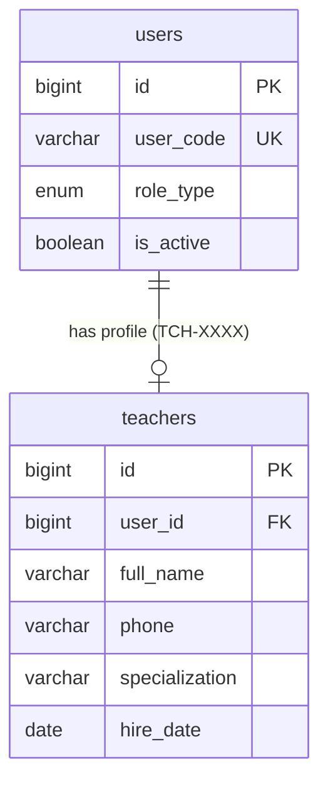

# 📊 مواصفات البيانات والكيانات — المرحلة 03-A (Data Specification)

> **الهدف:** توثيق المخطط الهيكلي لجدول المعلمين (`teachers`) المطابق بنسبة 100% للمصدر الرئيسي والحصري للحقيقة: [`MD/database.md`](../../database.md).  
> 
> ⚠️ **إرشادات وتنبيهات حوكمية إجبارية (System Governance Directives):**  
> 1. **قواعد العمل العامة (Business Rules SSoT):** يلزم على المطور أو الذكاء الاصطناعي قراءة واعتماد **ملف القواعد العامة بالمنظومة [`MD/business_rules.md`](../../business_rules.md)** والالتزام التام بكافة القيود ومصفوفة الصلاحيات والحوكمة المذكورة فيه قبل التكوييد والبناء.  
> 2. **مرجع شبكة الطلبات والاستجابات (Network SSoT):** ملف [`routes.md`](./routes.md) هو المصدر الرئيسي والوحيد لعقد الشبكة بالمنظومة؛ حيث تم توثيق **جسم الطلب الكامل (`Request Body Payload`)** لكل رابط، و**كامل شكل الاستجابة الصريحة (`Response Body Payload`)** لجميع الرموز والـ Status Codes (`200 OK`, `201 Created`, `400 Bad Request`, `401 Unauthorized`, `403 Forbidden`, `404 Not Found`, `409 Conflict`, `422 Unprocessable`, `500 Server Error`).  
> 📌 **توجيه إجباري عند البناء والتطوير:** يلتزم المطور بالكامل برسم وبناء مدخلات ومخرجات كود الـ Controllers والواجهات بناءً على الهياكل والرموز المسجلة في ملف [`routes.md`](./routes.md) حصراً بدون أي اجتهاد شخصي.

---

## 1. هيكل الجداول والكيانات (Tables Matrix)

---

### 1.1 [الخطوة 1] جدول المعلمين (`teachers`)

> **الوصف:** جدول ملفات المعلمين وبياناتهم الشخصية والمهنية وتخصصاتهم العلمية وربطهم بحسابات الدخول الموحدة (`users`).

| اسم العمود (Column) | نوع البيانات (MySQL Type) | القيود والخصائص (Constraints) | الوصف والدلالة الوظيفية |
| :--- | :--- | :--- | :--- |
| `id` | `BIGINT UNSIGNED` | `PRIMARY KEY AUTO_INCREMENT` | المعرف الرقمي الداخلي للمعلم. |
| `user_id` | `BIGINT UNSIGNED` | `NOT NULL, UNIQUE` | معرف حساب الدخول الموحد (يرتبط بـ `users.id` صاحب كود `TCH-XXXX`). |
| `full_name` | `VARCHAR(150)` | `NOT NULL` | الاسم الرباعي واللقب للمعلم. |
| `phone` | `VARCHAR(20)` | `NULL DEFAULT NULL` | رقم هاتف المعلم للتواصل المباشر. |
| `specialization` | `VARCHAR(100)` | `NULL DEFAULT NULL` | التخصص العلمي للمعلم (مثال: رياضيات، علوم، لغة عربية). |
| `hire_date` | `DATE` | `NULL DEFAULT NULL` | تاريخ التعيين والمباشرة بالمدرسة. |
| `created_at` | `TIMESTAMP` | `NOT NULL, DEFAULT CURRENT_TIMESTAMP` | توقيت إنشاء السجل. |
| `updated_at` | `TIMESTAMP` | `NULL ON UPDATE CURRENT_TIMESTAMP` | توقيت آخر تحديث. |
| `deleted_at` | `TIMESTAMP` | `NULL DEFAULT NULL` | طابع الحذف المنطقي. |

- **العلاقات والقيود المرجعية:**
  - `user_id` يرتبط بجدول `users(id)` مع `ON DELETE RESTRICT, ON UPDATE CASCADE`.
  - `UNIQUE INDEX uq_teachers_user_id (user_id)`.
  - `INDEX idx_teachers_full_name (full_name)`.

---

## 2. مخطط الكيانات والعلاقات لـ 03-A (ERD)

