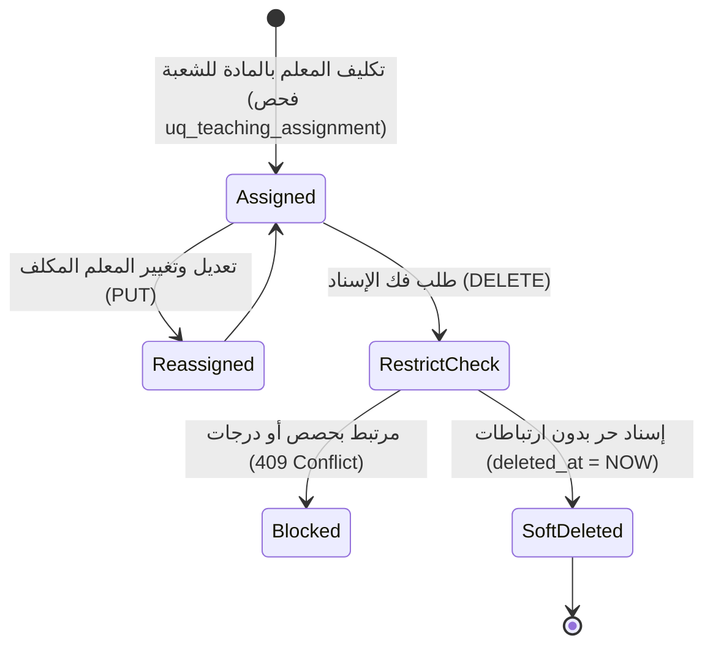

# ⚙️ مواصفات Backend — المرحلة 03-B: إسناد التدريس والنصاب الأكاديمي (Teaching Assignments)

> **الهدف:** توثيق منطق المعالجة وقواعد التحقق وقواعد حوكمة توزيع المواد على المعلمين لجدول `teaching_assignments` المطابقة بنسبة 100% لـ [`MD/database.md`](../../database.md) و [`MD/business_rules.md`](../../business_rules.md)، مع دمج وتوحيد منطق الإنشاء والتعديل (`POST & PUT`) لتوفير الوضوح والرشاقة.  
> 
> ⚠️ **تكامل حوكمي صريح وملزم — مرجع الاستجابات (Network SSoT):**  
> ملف [`routes.md`](./routes.md) هو **المصدر الرئيسي والحصري والوحيد لكافة استجابات ومدخلات الـ API (Network SSoT)**. تم تسجيل كامل شكل الاستجابة (JSON Response Body) ورسائل الخطأ والنجاح صراحةً في [`routes.md`](./routes.md) لجميع الرموز والـ Status Codes (`200 OK`, `201 Created`, `400 Bad Request`, `401 Unauthorized`, `403 Forbidden`, `404 Not Found`, `409 Conflict`, `422 Unprocessable Entity`, `500 Internal Server Error`) لكل رابط.  
> 📌 **توجيه إجباري عند البناء والتطوير:** يلتزم المطور أو نموذج الذكاء الاصطناعي بالكامل بإنشاء ورسم كود الخادم واستجابات الـ API بناءً على الهياكل والرموز المسجلة في ملف [`routes.md`](./routes.md) حصراً بدون أي اجتهاد شخصي.

---

## 1. نطاق المرحلة والحدود المعمارية (Scope & Boundaries)

### 🟢 ما تشمله المرحلة (In-Scope):
- **إدارة سجل وجدول إسناد التدريس الأكاديمي (`teaching_assignments`) — [4 مسارات موثقة برباعية العمليات المدمجة]:**
  - استعراض وبحث توزيع الكادر التعليمي على المواد والشعب مجمعاً بالصفوف والشعب (`GET /api/v1/teaching-assignments`).
  - استعراض النصاب التدريسي والمواد لمعلم محدد بالعام الدراسي (`GET /api/v1/teachers/:teacher_id/assignments`).
  - إنشاء وتعديل إسناد التدريس لمعلم ومادة بشعبة في عام دراسي (`POST & PUT /api/v1/teaching-assignments`).
  - فك وإلغاء إسناد التدريس مع فحص الحماية المرجعية الصارمة (`DELETE /api/v1/teaching-assignments/:id`).
- **الحوكمة والأمان:**
  - قصر عمليات التكليف والتعديل وفك الإسناد على مدير النظام (`admin`).
  - إتاحة عرض النصاب التدريسي للمعلم نفسه (`teacher`) أو لمدير النظام (`admin`).
  - فرض قيد المعلم المسؤول الوحيد لكل مادة بالشعبة في العام الدراسي (`uq_teaching_assignment`).
  - حظر فك الإسناد في حال وجود حصص بالجدول أو درجات أو واجبات (`ON DELETE RESTRICT`) وإرجاع `409 Conflict`.
  - تسجيل كافة العمليات والتعديلات في سجلات التدقيق `audit_logs`.

### 🔴 خارج نطاق المرحلة (Out-of-Scope):
- تعريف المعلمين وإنشاء حساباتهم $\rightarrow$ تابعة للمرحلة `03-A` (`teachers`).
- تسكين جداول الحصص الأسبوعية $\rightarrow$ محال إلى المرحلة `05` (`timetable_slots`).
- إنشاء الواجبات والاختبارات والامتحانات $\rightarrow$ محالة إلى المراحل `06` (الواجبات)، `07` (الاختبارات القصيرة)، و `08` (الامتحانات).

> 🔗 **ملاحظة التكامل المعماري بين المراحل (Cross-Phase Integration):**  
> مخرجات سجلات هذا الجدول (`teaching_assignments`) هي المغذي الرئيسي والمحرك التلقائي لشاشات المراحل اللاحقة:
> 1. **المرحلة 05 (الجداول):** عند تسكين حصة لشعبة في جدول الحصص، يختار المستخدم المادة فتُجلب بيانات المعلم المكلف بها تلقائياً بدون إدخال يدوي عبر معرف `teaching_assignment_id`.
> 2. **المراحل 06 و 07 و 08 (الواجبات، الاختبارات، والامتحانات):** يعتمد النظام على هذا السجل لتحديد صلاحية المعلم المخول حصراً بإنشاء الواجبات المدرسية (Phase 06)، الاختبارات والتقييمات الشهرية (Phase 07)، والامتحانات الفصلية والنهائية (Phase 08) لطلاب تلك الشعبة.

---

## 2. حوكمة الأدوار وقواعد الوصول وعزل البيانات (RBAC & Scoping Rules)

### 👥 مصفوفة الفاعلين والصلاحيات:
- **مدير النظام (Admin - `role_type = 'admin'`):**
  - يمتلك الصلاحية الكاملة على كافة مسارات إسناد التدريس (استعراض، تكليف، تعديل، فك إسناد).
- **المعلم (Teacher - `role_type = 'teacher'`):**
  - يمتلك صلاحية استعراض نصابه التدريسي الخاص به فقط (`GET /api/v1/teachers/:teacher_id/assignments` حيث `teacher_id = auth.teacher.id`).
  - يُحظر عليه إنشاء أو تعديل أو فك أي إسناد تدريس (`403 Forbidden`).
- **الطالب (Student) وولي الأمر (Parent):**
  - يُحظر عليهم تماماً الوصول لمسارات إدارة إسناد التدريس (`403 Forbidden`).
- **المستخدم غير المصادق عليه (Unauthenticated):**
  - أي طلب يفتقر إلى توكن `Bearer JWT` صالح ونشط يُرفض برمز `401 Unauthorized`.

---

## 3. دورة حياة الكيانات وقواعد ثبات النظام (Lifecycles & System Invariants)

### 🔒 قواعد ثبات النظام الصارمة (System Invariants):
1. **قيد المعلم المسؤول الوحيد (Single Teacher Invariant):**
   - يُمنع إسناد نفس المادة لنفس الشعبة في العام الدراسي لأكثر من معلم واحد في نفس الوقت (`uq_teaching_assignment: academic_year_id, class_section_id, subject_id`).
   - عند محاولة تكرار الإسناد لنفس المادة والشعبة، يرفض الطلب برمز `409 Conflict`.
2. **صحة العام الدراسي والشعبة والمادة:**
   - يجب أن تكون الشعبة والمادة تابعة للمرحلة الدراسية المعتمدة بالعام الدراسي.
3. **الحماية المرجعية الصارمة (RESTRICT Delete Protection):**
   - يُحظر فك أو حذف أي إسناد تدريس إذا كان مرتبطاً بحصص في جدول الحصص الأسبوعي (`timetable_slots`) أو واجبات أو امتحانات سابقة، ويُرجع الخادم `409 Conflict`.
4. **دورة حياة الحذف المنطقي (Soft Delete):**
   - عند فك إسناد حر، يتم تعيين `deleted_at = CURRENT_TIMESTAMP` للسجل واستبعاده من الاستعلامات.
5. **سجلات التدقيق (Audit Logging):**
   - تسجل كافة عمليات الإسناد وتغيير المعلم المكلف وفك الإسناد في جدول `audit_logs`.

---

## 4. العمليات المنطقية والمسارات التفصيلية للمجال (Domain Operations & Routes)

---

### 📚 الخطوة 1: إدارة سجل وجدول إسناد التدريس الأكاديمي (`teaching_assignments`)

#### 📋 جدول العمليات المدمجة:
| # | العملية المنطقية (Operation) | HTTP Method & Endpoint | الصلاحية | رمز النجاح | مرجع العقد في `routes.md` |
| :-: | :--- | :--- | :--- | :---: | :--- |
| **1.1** | استعراض وبحث توزيع الكادر التعليمي على المواد والشعب | `GET /api/v1/teaching-assignments` | `admin` | `200 OK` | [في routes.md](./routes.md) |
| **1.2** | استعراض النصاب التدريسي لمعلم محدد | `GET /api/v1/teachers/:teacher_id/assignments` | `admin` / `teacher (own)` | `200 OK` | [في routes.md](./routes.md) |
| **1.3** | إسناد وتعديل تكليف التدريس | `POST /api/v1/teaching-assignments` & `PUT /api/v1/teaching-assignments/:id` | `admin` | `201 Created` / `200 OK` | [في routes.md](./routes.md) |
| **1.4** | فك وإلغاء إسناد تدريس | `DELETE /api/v1/teaching-assignments/:id` | `admin` | `200 OK` | [في routes.md](./routes.md) |

---

#### 🔹 [Operation 1.1] `GET /api/v1/teaching-assignments` — استعراض وبحث توزيع الكادر التعليمي على المواد والشعب
- **الغرض والوظيفة:** استرجاع خريطة توزيع الكادر التعليمي على المواد والشعب بالعام الدراسي مجمعة هرمياً لكل صف وشعبة (`classes -> sections -> assignments`) بدون تكرار للبيانات مع دعم التصفية بالصف أو الشعبة أو المعلم أو المادة ودعم الترقيم.
- **قواعد المعالجة والخادم:**
  - استرجاع السجلات النشطة فقط (`deleted_at IS NULL`).
  - تجميع الشُعب والمواد المخصصة ومعلميها تحت الصف الدراسي التابع لها في مصفوفة `classes`.
  - تضمين مسميات المواد والمعلمين وشاراتهم (`subject_name`, `subject_code`, `teacher_name`, `teacher_code`).
- **عقد الاستجابات والمعاملات (Network SSoT):**
  - معاملات الاستعلام وهياكل الـ JSON الصريحة لـ (`200 OK`) موثقة في [`routes.md`](./routes.md).

#### 🔹 [Operation 1.2] `GET /api/v1/teachers/:teacher_id/assignments` — استعراض النصاب التدريسي لمعلم محدد
- **الغرض والوظيفة:** جلب قائمة كافة المواد والشعب المكلف بها معلم محدد بالعام الدراسي.
- **قواعد الوصول:** متاح لمدير النظام (`admin`)، أو للمعلم صاحب النصاب حصراً (`teacher`).
- **عقد الاستجابات والمعاملات (Network SSoT):**
  - استجابات (`200 OK`, `404 Not Found`) مسجلة في [`routes.md`](./routes.md).

#### 🔹 [Operation 1.3] `POST /api/v1/teaching-assignments` & `PUT /api/v1/teaching-assignments/:id` — إسناد وتعديل تكليف التدريس (Combined Domain Logic)
- **الغرض والوظيفة:**
  - **في الإنشاء (`POST`):** تكليف معلم مسؤول عن تدريس مادة لشعبة في عام دراسي محدد.
  - **في التعديل (`PUT`):** تحديث وتعديل سجل الإسناد (تغيير المعلم المكلف أو الشعبة أو المادة) مع التحقق من عدم التعارض.
- **قواعد التحقق المشتركة (Validation Rules):**
  - `academic_year_id`: مطلوب، معرف عام دراسي صالح.
  - `class_section_id`: مطلوب، معرف شعبة صف صالحة.
  - `subject_id`: مطلوب، معرف مادة صالحة.
  - `teacher_id`: مطلوب، معرف معلم صالح ونشط.
  - **قيد التفرد المركب:** التحقق من عدم تخصيص نفس المادة لنفس الشعبة بالعام الدراسي لمعلم آخر (`uq_teaching_assignment`).
- **عقد الاستجابات والمدخلات (Network SSoT):**
  - هيكل الطلب الموحد واستجابات (`201 Created`, `200 OK`, `404 Not Found`, `409 Conflict`, `422 Unprocessable Entity`) مسجلة في [`routes.md`](./routes.md).

#### 🔹 [Operation 1.4] `DELETE /api/v1/teaching-assignments/:id` — فك وإلغاء إسناد تدريس مادة
- **الغرض والوظيفة:** فك ارتباط المعلم بالمادة والشعبة، مع التحقق الإجباري الصارم من عدم وجود ارتباطات بحصص أو درجات أو واجبات (`RESTRICT`).
- **عقد الاستجابات والمدخلات (Network SSoT):**
  - ردود الفك والحذف (`200 OK`, `404 Not Found`, `409 Conflict`) مسجلة صراحةً في [`routes.md`](./routes.md).

---

## 5. الأداء، التزامن، والنزاهة المرجعية (Performance & Data Integrity)

1. **تحسين الاستعلامات والفهارس:**
   - استخدام الفهارس المعتمدة في `MD/database.md`:
     - `uq_teaching_assignment` لمنع تكرار تكليف أكثر من معلم لنفس المادة والشعبة.
     - `idx_teaching_assignments_teacher` لسرعة جلب النصاب التدريسي للمعلم.
     - `idx_teaching_assignments_section` لسرعة جلب مواد ومعلمي الشعبة.
2. **عزل المعاملات المصرفية (Atomic Transactions):**
   - تنفيذ عمليات التكليف والتعديل داخل Transaction تضمن عدم التكرار.
3. **تجنب التسريب التقني:**
   - كافة الاستجابات والأخطاء موحدة ومطابقة لمعايير الـ JSON الصريحة في `routes.md`.

---

## 6. معايير القبول الهندسية للباك إند (Backend Acceptance Criteria)

- [ ] قصر صلاحيات التكليف والتعديل وفك الإسناد حصراً على المستخدمين بدور `admin`.
- [ ] السماح للمعلم باستعراض نصابه التدريسي الخاص به فقط برقم معرفه.
- [ ] إرجاع `401 Unauthorized` لأي طلب بدون توكن مصادقة صالح.
- [ ] إرجاع `403 Forbidden` عند محاولة المعلم إجراء أي تعديل على إسنادات التدريس.
- [ ] منع تكرار إسناد المادة لنفس الشعبة بالعام الدراسي لمعلم آخر وإرجاع `409 Conflict`.
- [ ] منع فك إسناد تدريس مرتبط بحصص أو درجات أو واجبات وإرجاع `409 Conflict` (حماية RESTRICT).
- [ ] تطابق كامل بين حقول الـ Request Body في الإنشاء والتعديل.
- [ ] استبعاد السجلات المحذوفة منطقياً من كافة استعلامات القوائم.
- [ ] تسجيل جميع حركات التكليف والتعديل وفك الإسناد في جدول `audit_logs`.
