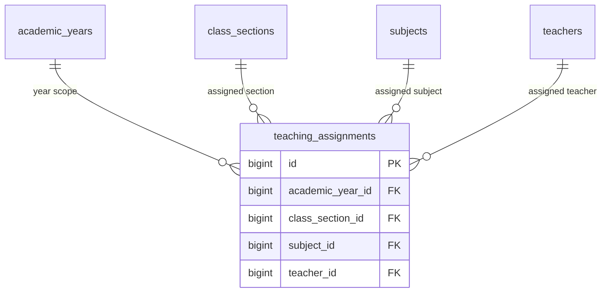

# 📊 مواصفات البيانات والكيانات — المرحلة 03-B (Data Specification)

> **الهدف:** توثيق المخطط الهيكلي لجدول إسناد التدريس الثلاثي (`teaching_assignments`) المطابق بنسبة 100% للمصدر الرئيسي والحصري للحقيقة: [`MD/database.md`](../../database.md).  
> 
> ⚠️ **إرشادات وتنبيهات حوكمية إجبارية (System Governance Directives):**  
> 1. **قواعد العمل العامة (Business Rules SSoT):** يلزم على المطور أو الذكاء الاصطناعي قراءة واعتماد **ملف القواعد العامة بالمنظومة [`MD/business_rules.md`](../../business_rules.md)** والالتزام التام بكافة القيود ومصفوفة الصلاحيات والحوكمة المذكورة فيه قبل التكوييد والبناء.  
> 2. **مرجع شبكة الطلبات والاستجابات (Network SSoT):** ملف [`routes.md`](./routes.md) هو المصدر الرئيسي والوحيد لعقد الشبكة بالمنظومة؛ حيث تم توثيق **جسم الطلب الكامل (`Request Body Payload`)** لكل رابط، و**كامل شكل الاستجابة الصريحة (`Response Body Payload`)** لجميع الرموز والـ Status Codes (`200 OK`, `201 Created`, `400 Bad Request`, `401 Unauthorized`, `403 Forbidden`, `404 Not Found`, `409 Conflict`, `422 Unprocessable`, `500 Server Error`).  
> 📌 **توجيه إجباري عند البناء والتطوير:** يلتزم المطور بالكامل برسم وبناء مدخلات ومخرجات كود الـ Controllers والواجهات بناءً على الهياكل والرموز المسجلة في ملف [`routes.md`](./routes.md) حصراً بدون أي اجتهاد شخصي.

---

## 1. هيكل الجداول والكيانات (Tables Matrix)

---

### 1.1 [الخطوة 1] جدول إسناد التدريس الأكاديمي (`teaching_assignments`)

> **الوصف:** حلقة الوصل المحورية التي تحدد المعلم المسؤول عن تدريس مادة دراسية محددة لشعبة وفصل محدد خلال عام دراسي محدد.

| اسم العمود (Column) | نوع البيانات (MySQL Type) | القيود والخصائص (Constraints) | الوصف والدلالة الوظيفية |
| :--- | :--- | :--- | :--- |
| `id` | `BIGINT UNSIGNED` | `PRIMARY KEY AUTO_INCREMENT` | المعرف الرقمي الفريد لسجل الإسناد الأكاديمي. |
| `academic_year_id` | `BIGINT UNSIGNED` | `NOT NULL, INDEXED` | معرف العام الدراسي النشط (يرتبط بـ `academic_years.id`). |
| `class_section_id` | `BIGINT UNSIGNED` | `NOT NULL, INDEXED` | معرف الفصل والشعبة المحددة (يرتبط بـ `class_sections.id`). |
| `subject_id` | `BIGINT UNSIGNED` | `NOT NULL, INDEXED` | معرف المادة الدراسية المسندة (يرتبط بـ `subjects.id`). |
| `teacher_id` | `BIGINT UNSIGNED` | `NOT NULL, INDEXED` | معرف المعلم المكلف بالتدريس (يرتبط بـ `teachers.id`). |
| `created_at` | `TIMESTAMP` | `NOT NULL, DEFAULT CURRENT_TIMESTAMP` | توقيت إنشاء السجل. |
| `updated_at` | `TIMESTAMP` | `NULL ON UPDATE CURRENT_TIMESTAMP` | توقيت آخر تحديث. |
| `deleted_at` | `TIMESTAMP` | `NULL DEFAULT NULL` | طابع الحذف المنطقي. |

- **العلاقات والقيود المرجعية:**
  - `academic_year_id` يرتبط بجدول `academic_years(id)` مع `ON DELETE RESTRICT, ON UPDATE CASCADE`.
  - `class_section_id` يرتبط بجدول `class_sections(id)` مع `ON DELETE RESTRICT, ON UPDATE CASCADE`.
  - `subject_id` يرتبط بجدول `subjects(id)` مع `ON DELETE RESTRICT, ON UPDATE CASCADE`.
  - `teacher_id` يرتبط بجدول `teachers(id)` مع `ON DELETE RESTRICT, ON UPDATE CASCADE`.
  - `UNIQUE INDEX uq_teaching_assignment (academic_year_id, class_section_id, subject_id)`.

---

## 2. مخطط الكيانات والعلاقات لـ 03-B (ERD)

