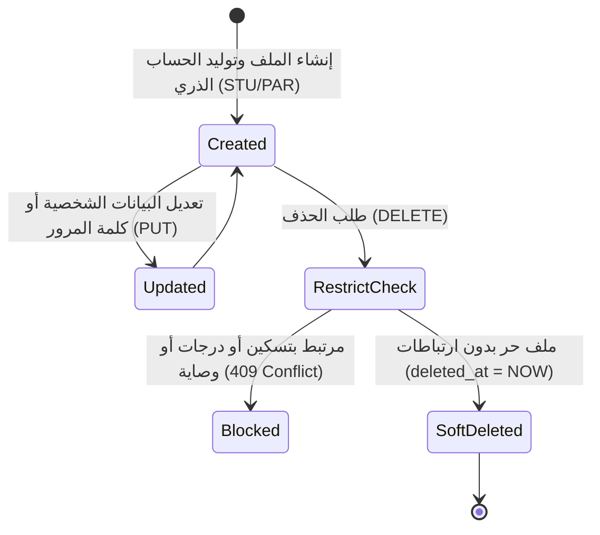

# ⚙️ مواصفات Backend — المرحلة 04-A: سجلات الطلاب وأولياء الأمور والوصاية (Students & Guardians)

> **الهدف:** توثيق منطق المعالجة وقواعد التحقق وقواعد حوكمة ملفات الطلاب وأولياء الأمور والوصاية الأسرية لجداول `students`, `guardians`, `guardian_students` المطابقة بنسبة 100% لـ [`MD/database.md`](../../database.md) و [`MD/business_rules.md`](../../business_rules.md)، مع دمج وتوحيد منطق الإنشاء والتعديل (`POST & PUT`) لتوفير الوضوح والرشاقة.  
> 
> ⚠️ **تكامل حوكمي صريح وملزم — مرجع الاستجابات (Network SSoT):**  
> ملف [`routes.md`](./routes.md) هو **المصدر الرئيسي والحصري والوحيد لكافة استجابات ومدخلات الـ API (Network SSoT)**. تم تسجيل كامل شكل الاستجابة (JSON Response Body) ورسائل الخطأ والنجاح صراحةً في [`routes.md`](./routes.md) لجميع الرموز والـ Status Codes (`200 OK`, `201 Created`, `400 Bad Request`, `401 Unauthorized`, `403 Forbidden`, `404 Not Found`, `409 Conflict`, `422 Unprocessable Entity`, `500 Internal Server Error`) لكل رابط.  
> 📌 **توجيه إجباري عند البناء والتطوير:** يلتزم المطور أو نموذج الذكاء الاصطناعي بالكامل بإنشاء ورسم كود الخادم واستجابات الـ API بناءً على الهياكل والرموز المسجلة في ملف [`routes.md`](./routes.md) حصراً بدون أي اجتهاد شخصي.

---

## 1. نطاق المرحلة والحدود المعمارية (Scope & Boundaries)

### 🟢 ما تشمله المرحلة (In-Scope):
- **الخطوة 1: إدارة ملفات وسجل الطلاب (`students`):**
  - استعراض وبحث وتصفية قائمة الطلاب (`GET /api/v1/students`).
  - استعراض تفاصيل ملف طالب محدد (`GET /api/v1/students/:id`).
  - إنشاء وتعديل ملف طالب وتوليد حساب الدخول الذري `STU-XXXX` (`POST & PUT /api/v1/students`).
  - حذف ملف الطالب مع فحص الحماية المرجعية الصارمة (`DELETE /api/v1/students/:id`).
- **الخطوة 2: إدارة ملفات أولياء الأمور (`guardians`):**
  - استعراض وبحث قائمة أولياء الأمور (`GET /api/v1/guardians`).
  - استعراض تفاصيل ملف ولي أمر محدد (`GET /api/v1/guardians/:id`).
  - إنشاء وتعديل ملف ولي أمر وتوليد حساب الدخول الذري `PAR-XXXX` (`POST & PUT /api/v1/guardians`).
  - حذف ملف ولي الأمر مع فحص الحماية المرجعية الصارمة (`DELETE /api/v1/guardians/:id`).
- **الخطوة 3: إدارة روابط الوصاية الأسرية (`guardian_students`):**
  - استعراض قائمة الأبناء المكفولين لولي أمر محدد (`GET /api/v1/guardians/:guardian_id/students`).
  - ربط وتعديل وصاية ولي أمر بطالب (`POST & PUT /api/v1/guardian-students`).
  - فك وإلغاء رابط الوصاية (`DELETE /api/v1/guardian-students/:id`).
- **الحوكمة والأمان:**
  - قصر عمليات الإنشاء والتعديل والحذف والربط على مدير النظام (`admin`).
  - توليد حسابات المستخدمين ورموز الدخول الموحدة (`STU-XXXX`, `PAR-XXXX`) ذرّياً مع تشفير كلمات المرور.
  - فرض قيود التفرد: رقم هاتف ولي الأمر `uq_guardians_phone`، وتفرد رابط الوصاية `uq_guardian_student`.
  - حظر حذف الطالب أو ولي الأمر في حال وجود ارتباطات تسكين أو درجات أو وصاية نشطة (`RESTRICT`) وإرجاع `409 Conflict`.
  - تسجيل كافة العمليات والتعديلات في سجلات التدقيق `audit_logs`.

### 🔴 خارج نطاق المرحلة (Out-of-Scope):
- تسكين الطلاب وتوزيعهم على الفصول والشعب وأرقام الجلوس $\rightarrow$ تابعة للمرحلة `04-B` (`student_enrollments`).
- رصد الدرجات والامتحانات والواجبات $\rightarrow$ محالة إلى المراحل `06` و `07` و `08`.

---

## 2. حوكمة الأدوار وقواعد الوصول وعزل البيانات (RBAC & Scoping Rules)

### 👥 مصفوفة الفاعلين والصلاحيات:
- **مدير النظام (Admin - `role_type = 'admin'`):**
  - يمتلك الصلاحية الكاملة على كافة مسارات الطلاب وأولياء الأمور وروابط الوصاية.
- **المعلم (Teacher - `role_type = 'teacher'`):**
  - يمتلك صلاحية استعراض قائمة الطلاب وتفاصيل ملفاتهم (`GET /api/v1/students`).
  - يُحظر عليه إنشاء أو تعديل أو حذف أي ملف لطالب أو ولي أمر (`403 Forbidden`).
- **الطالب (Student - `role_type = 'student'`):**
  - يمتلك صلاحية استعراض ملفه الشخصي فقط (`GET /api/v1/students/:id` حيث `user_id = auth.user.id`).
- **ولي الأمر (Parent - `role_type = 'parent'`):**
  - يمتلك صلاحية استعراض ملفه الشخصي (`GET /api/v1/guardians/:id`) وقائمة أبنائه المكفولين (`GET /api/v1/guardians/:id/students`).
- **المستخدم غير المصادق عليه (Unauthenticated):**
  - أي طلب يفتقر إلى توكن `Bearer JWT` صالح ونشط يُرفض برمز `401 Unauthorized`.

---

## 3. دورة حياة الكيانات وقواعد ثبات النظام (Lifecycles & System Invariants)

### 🔒 قواعد ثبات النظام الصارمة (System Invariants):
1. **التوليد الذري لحسابات الدخول الموحدة (Atomic User Account Creation):**
   - عند إنشاء طالب جديد يتم تلقائياً إنشاء سجل بجدول `users` وتوليد `user_code` بنمط `STU-XXXX` ورقم تسلسلي فريد وتعيين `role_type = 'student'`.
   - عند إنشاء ولي أمر جديد يتم تلقائياً إنشاء سجل بجدول `users` وتوليد `user_code` بنمط `PAR-XXXX` ورقم تسلسلي فريد وتعيين `role_type = 'parent'`.
2. **قيد تفرد هاتف ولي الأمر (Unique Guardian Phone):**
   - رقم هاتف ولي الأمر يجب أن يكون فريداً على مستوى المنظومة (`uq_guardians_phone`).
3. **قيد تفرد رابط الوصاية (Unique Guardian-Student Link):**
   - يُمنع تكرار ربط نفس ولي الأمر بنفس الطالب (`uq_guardian_student`).
4. **الحماية المرجعية الصارمة (RESTRICT Delete Protection):**
   - يُحظر حذف أي طالب مسكن في شعبة أو لديه درجات أو مرتبط بولي أمر، ويُرجع الخادم `409 Conflict`.
   - يُحظر حذف أي ولي أمر لديه روابط وصاية نشطة مع طلاب، ويُرجع الخادم `409 Conflict`.
5. **دورة حياة الحذف المنطقي وسجلات التدقيق:**
   - يتم تعيين `deleted_at = CURRENT_TIMESTAMP` عند الحذف الحر، وتسجل الحركات في `audit_logs`.

---

## 4. العمليات المنطقية والمسارات التفصيلية للمجال (Domain Operations & Routes)

---

### 🎓 الخطوة 1: إدارة ملفات وسجل الطلاب (`students`)

#### 📋 جدول العمليات المدمجة:
| # | العملية المنطقية (Operation) | HTTP Method & Endpoint | الصلاحية | رمز النجاح | مرجع العقد في `routes.md` |
| :-: | :--- | :--- | :--- | :---: | :--- |
| **1.1** | استعراض وبحث قائمة الطلاب | `GET /api/v1/students` | `admin` / `teacher` | `200 OK` | [في routes.md](./routes.md) |
| **1.2** | استعراض تفاصيل ملف طالب محدد | `GET /api/v1/students/:id` | `admin` / `student (own)` / `parent (child)` | `200 OK` | [في routes.md](./routes.md) |
| **1.3** | إنشاء وتعديل ملف طالب | `POST /api/v1/students` & `PUT /api/v1/students/:id` | `admin` | `201 Created` / `200 OK` | [في routes.md](./routes.md) |
| **1.4** | حذف ملف طالب | `DELETE /api/v1/students/:id` | `admin` | `200 OK` | [في routes.md](./routes.md) |

---

#### 🔹 [Operation 1.1] `GET /api/v1/students` — استعراض وبحث قائمة الطلاب
- **الغرض والوظيفة:** استرجاع قائمة الطلاب بالمنظومة مع دعم البحث النصي بالاسم أو كود `STU-XXXX` والفلترة بالجنس والترتيب والترقيم.
- **عقد الاستجابات والمعاملات (Network SSoT):** مسجلة في [`routes.md`](./routes.md).

#### 🔹 [Operation 1.2] `GET /api/v1/students/:id` — استعراض تفاصيل ملف طالب محدد
- **الغرض والوظيفة:** جلب الملف الشخصي الكامل للطالب متضمناً حساب دخوله الموحد والصف والشعبة وبيانات الاتصال.
- **عقد الاستجابات والمدخلات (Network SSoT):** مسجلة في [`routes.md`](./routes.md).

#### 🔹 [Operation 1.3] `POST /api/v1/students` & `PUT /api/v1/students/:id` — إنشاء وتعديل ملف طالب (Combined Domain Logic)
- **الغرض والوظيفة:**
  - **في الإنشاء (`POST`):** إنشاء ملف طالب وتوليد حساب مستخدم ذري بكود `STU-XXXX` وتشفير كلمة المرور.
  - **منطق التسكين الفوري الاختياري (Atomic Immediate Enrollment):**
    - عند إرسال الحقل الاختياري `class_section_id`، يتحقق الخادم من صحة الشعبة، ويقوم داخل نفس المعاملة الذرية (`Atomic Transaction`) بإنشاء سجل التسكين في جدول `student_enrollments` للعام الدراسي النشط (أو المحدد في `academic_year_id`) مع حفظ رقم الجلوس `seating_number` إن وجد.
    - في حال عدم إرسال `class_section_id`، يتم إنشاء ملف الطالب فقط دون تسكين (`enrollment: null`) ليتسنى تسكينه لاحقاً عبر التسكين الفردي أو الجماعي.
  - **في التعديل (`PUT`):** تحديث بيانات الطالب وتحديث كلمة المرور عند الرغبة.
- **عقد الاستجابات والمدخلات (Network SSoT):**
  - هيكل الطلب واستجابات (`201 Created`, `200 OK`, `404 Not Found`, `422 Unprocessable Entity`) مسجلة في [`routes.md`](./routes.md).

#### 🔹 [Operation 1.4] `DELETE /api/v1/students/:id` — حذف ملف طالب
- **الغرض والوظيفة:** حذف ملف الطالب وحسابه مع التحقق الصارم من عدم وجود تسكين أكاديمي أو درجات (`RESTRICT`).
- **عقد الاستجابات والمدخلات (Network SSoT):**
  - استجابات (`200 OK`, `404 Not Found`, `409 Conflict`) مسجلة في [`routes.md`](./routes.md).

---

### 👨‍👩‍👦 الخطوة 2: إدارة ملفات أولياء الأمور (`guardians`)

#### 📋 جدول العمليات المدمجة:
| # | العملية المنطقية (Operation) | HTTP Method & Endpoint | الصلاحية | رمز النجاح | مرجع العقد في `routes.md` |
| :-: | :--- | :--- | :--- | :---: | :--- |
| **2.1** | استعراض وبحث قائمة أولياء الأمور | `GET /api/v1/guardians` | `admin` | `200 OK` | [في routes.md](./routes.md) |
| **2.2** | استعراض تفاصيل ملف ولي أمر محدد | `GET /api/v1/guardians/:id` | `admin` / `parent (own)` | `200 OK` | [في routes.md](./routes.md) |
| **2.3** | إنشاء وتعديل ملف ولي أمر | `POST /api/v1/guardians` & `PUT /api/v1/guardians/:id` | `admin` | `201 Created` / `200 OK` | [في routes.md](./routes.md) |
| **2.4** | حذف ملف ولي أمر | `DELETE /api/v1/guardians/:id` | `admin` | `200 OK` | [في routes.md](./routes.md) |

---

#### 🔹 [Operation 2.1] `GET /api/v1/guardians` — استعراض وبحث قائمة أولياء الأمور
- **الغرض والوظيفة:** استرجاع قائمة أولياء الأمور مع دعم البحث بالاسم أو الهاتف أو كود `PAR-XXXX` والترقيم الصفحي.
- **عقد الاستجابات والمعاملات (Network SSoT):** مسجلة في [`routes.md`](./routes.md).

#### 🔹 [Operation 2.2] `GET /api/v1/guardians/:id` — استعراض تفاصيل ملف ولي أمر محدد
- **الغرض والوظيفة:** استرجاع بيانات ولي الأمر الشخصية وبيانات حسابه وأرقام الاتصال.
- **عقد الاستجابات والمدخلات (Network SSoT):** مسجلة في [`routes.md`](./routes.md).

#### 🔹 [Operation 2.3] `POST /api/v1/guardians` & `PUT /api/v1/guardians/:id` — إنشاء وتعديل ملف ولي أمر (Combined Domain Logic)
- **الغرض والوظيفة:**
  - **في الإنشاء (`POST`):** إنشاء ملف ولي أمر وتوليد حساب مستخدم ذري بكود `PAR-XXXX` مع التحقق من تفرد رقم الهاتف.
  - **في التعديل (`PUT`):** تحديث بيانات ولي الأمر والقرابة ورقم الهاتف.
- **عقد الاستجابات والمدخلات (Network SSoT):**
  - هيكل الطلب واستجابات (`201 Created`, `200 OK`, `404 Not Found`, `409 Conflict`, `422 Unprocessable Entity`) مسجلة في [`routes.md`](./routes.md).

#### 🔹 [Operation 2.4] `DELETE /api/v1/guardians/:id` — حذف ملف ولي أمر
- **الغرض والوظيفة:** حذف ملف ولي الأمر مع التحقق من عدم وجود وصاية نشطة على طلاب (`RESTRICT`).
- **عقد الاستجابات والمدخلات (Network SSoT):**
  - استجابات (`200 OK`, `404 Not Found`, `409 Conflict`) مسجلة في [`routes.md`](./routes.md).

---

### 🔗 الخطوة 3: إدارة روابط الوصاية الأسرية (`guardian_students`)

#### 📋 جدول العمليات المدمجة:
| # | العملية المنطقية (Operation) | HTTP Method & Endpoint | الصلاحية | رمز النجاح | مرجع العقد في `routes.md` |
| :-: | :--- | :--- | :--- | :---: | :--- |
| **3.1** | استعراض الأبناء المكفولين لولي أمر | `GET /api/v1/guardians/:guardian_id/students` | `admin` / `parent (own)` | `200 OK` | [في routes.md](./routes.md) |
| **3.2** | ربط وتعديل وصاية ولي أمر بطالب | `POST /api/v1/guardian-students` & `PUT /api/v1/guardian-students/:id` | `admin` | `201 Created` / `200 OK` | [في routes.md](./routes.md) |
| **3.3** | فك وإلغاء رابط الوصاية | `DELETE /api/v1/guardian-students/:id` | `admin` | `200 OK` | [في routes.md](./routes.md) |

---

#### 🔹 [Operation 3.1] `GET /api/v1/guardians/:guardian_id/students` — استعراض الأبناء المكفولين
- **الغرض والوظيفة:** استرجاع قائمة الطلاب التابعين لوصاية ولي أمر معين لتمكينه من التبديل بين سياقات أبنائه في الواجهة.
- **عقد الاستجابات والمدخلات (Network SSoT):** مسجلة في [`routes.md`](./routes.md).

#### 🔹 [Operation 3.2] `POST /api/v1/guardian-students` & `PUT /api/v1/guardian-students/:id` — ربط وتعديل وصاية ولي أمر بطالب (Combined Domain Logic)
- **الغرض والوظيفة:**
  - **في الإنشاء (`POST`):** إنشاء رابط وصاية جديد بين ولي أمر وطالب وتحديد صفة الوصي الأساسي مع منع التكرار (`uq_guardian_student`).
  - **في التعديل (`PUT`):** تعديل رابط الوصاية أو تغيير صفة الوصي الرئيسي (`is_primary`).
- **عقد الاستجابات والمدخلات (Network SSoT):**
  - استجابات (`201 Created`, `200 OK`, `404 Not Found`, `409 Conflict`, `422 Unprocessable Entity`) مسجلة في [`routes.md`](./routes.md).

#### 🔹 [Operation 3.3] `DELETE /api/v1/guardian-students/:id` — فك وإلغاء رابط الوصاية
- **الغرض والوظيفة:** فك ارتباط ولي الأمر بالطالب وإلغاء الوصاية.
- **عقد الاستجابات والمدخلات (Network SSoT):**
  - استجابات (`200 OK`, `404 Not Found`) مسجلة في [`routes.md`](./routes.md).

---

## 5. الأداء، التزامن، والنزاهة المرجعية (Performance & Data Integrity)

1. **الاستعلامات والفهارس:**
   - استخدام الفهارس المعتمدة في `MD/database.md`: `uq_students_user_id`، `uq_guardians_phone`، `uq_guardian_student`، `idx_students_full_name`، `idx_guardians_full_name`.
2. **الحماية المرجعية:**
   - تطبيق `RESTRICT` على المفاتيح الخارجية لمنع حذف طالب مسكن أو ولي أمر مرتبط بأبناء.
3. **تجنب التسريب التقني والأمني في الاستجابات:**
   - توحيد رسائل الأخطاء عبر الرموز المعيارية (`401`, `403`, `404`, `409`, `422`, `500`).

---

## 6. معايير القبول الهندسية للباك إند (Backend Acceptance Criteria)

تعتبر متطلبات الخادم لهذه المرحلة مستوفاة بالكامل عند تحقق المعايير التالية:

- [ ] قصر صلاحية إنشاء وتعديل وحذف الطلاب وأولياء الأمور وروابط الوصاية حصراً على `admin`.
- [ ] إرجاع `401 Unauthorized` لأي طلب بدون توكن مصادقة صالح.
- [ ] إرجاع `403 Forbidden` عند محاولة المستخدم الوصول لبيانات خارج نطاق صلاحياته.
- [ ] إنشاء الحسابات الموحدة ذرّياً (`STU-XXXX`, `PAR-XXXX`) مع تشفير كلمات المرور.
- [ ] التحقق الصارم من تفرد هاتف ولي الأمر `uq_guardians_phone` وإرجاع `409 Conflict` عند التكرار.
- [ ] التحقق الصارم من تفرد رابط الوصاية `uq_guardian_student` وإرجاع `409 Conflict` عند التكرار.
- [ ] فرض الحماية المرجعية ومنع حذف الطالب أو ولي الأمر المرتبط بسجلات أخرى وإرجاع `409 Conflict`.
- [ ] تنفيذ الحذف المنطقي بضبط `deleted_at` وتوثيق كافة العمليات في `audit_logs`.
- [ ] مطابقة كافة المدخلات والمخرجات بنسبة 100% لعقد الشبكة في [`routes.md`](./routes.md).
