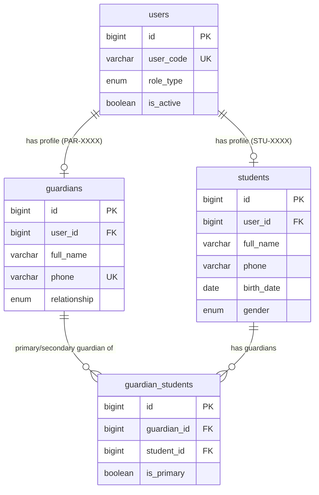

# 📊 مواصفات البيانات والكيانات — المرحلة 04-A (Data Specification)

> **الهدف:** توثيق المخطط الهيكلي للجداول الثلاثة (`students`, `guardians`, `guardian_students`) المطابقة بنسبة 100% للمصدر الرئيسي والحصري للحقيقة: [`MD/database.md`](../../database.md).  
> 
> ⚠️ **إرشادات وتنبيهات حوكمية إجبارية (System Governance Directives):**  
> 1. **قواعد العمل العامة (Business Rules SSoT):** يلزم على المطور أو الذكاء الاصطناعي قراءة واعتماد **ملف القواعد العامة بالمنظومة [`MD/business_rules.md`](../../business_rules.md)** والالتزام التام بكافة القيود ومصفوفة الصلاحيات والحوكمة المذكورة فيه قبل التكوييد والبناء.  
> 2. **مرجع شبكة الطلبات والاستجابات (Network SSoT):** ملف [`routes.md`](./routes.md) هو المصدر الرئيسي والوحيد لعقد الشبكة بالمنظومة؛ حيث تم توثيق **جسم الطلب الكامل (`Request Body Payload`)** لكل رابط، و**كامل شكل الاستجابة الصريحة (`Response Body Payload`)** لجميع الرموز والـ Status Codes (`200 OK`, `201 Created`, `400 Bad Request`, `401 Unauthorized`, `403 Forbidden`, `404 Not Found`, `409 Conflict`, `422 Unprocessable`, `500 Server Error`).  
> 📌 **توجيه إجباري عند البناء والتطوير:** يلتزم المطور بالكامل برسم وبناء مدخلات ومخرجات كود الـ Controllers والواجهات بناءً على الهياكل والرموز المسجلة في ملف [`routes.md`](./routes.md) حصراً بدون أي اجتهاد شخصي.

---

## 1. هيكل الجداول والكيانات (Tables Matrix)

---

### 1.1 [الخطوة 1] جدول الطلاب (`students`)

> **الوصف:** جدول سجلات ملفات الطلاب وبياناتهم الشخصية وتواريخ ميلادهم وربطهم بحسابات الدخول الموحدة (`STU-XXXX`).

| اسم العمود (Column) | نوع البيانات (MySQL Type) | القيود والخصائص (Constraints) | الوصف والدلالة الوظيفية |
| :--- | :--- | :--- | :--- |
| `id` | `BIGINT UNSIGNED` | `PRIMARY KEY AUTO_INCREMENT` | المعرف الرقمي الداخلي الفريد للطالب. |
| `user_id` | `BIGINT UNSIGNED` | `NOT NULL, UNIQUE` | معرف حساب الدخول الموحد (يرتبط بـ `users.id` صاحب كود `STU-XXXX`). |
| `full_name` | `VARCHAR(150)` | `NOT NULL` | الاسم الرباعي واللقب للطالب. |
| `phone` | `VARCHAR(20)` | `NULL DEFAULT NULL` | رقم هاتف الطالب أو وسيلة التواصل للتنبيهات. |
| `birth_date` | `DATE` | `NULL DEFAULT NULL` | تاريخ ميلاد الطالب بحسب المستندات الرسمية. |
| `gender` | `ENUM('male', 'female')` | `NOT NULL` | جنس الطالب (`male = ذكر`, `female = أنثى`). |
| `created_at` | `TIMESTAMP` | `NOT NULL, DEFAULT CURRENT_TIMESTAMP` | توقيت إنشاء السجل. |
| `updated_at` | `TIMESTAMP` | `NULL ON UPDATE CURRENT_TIMESTAMP` | توقيت آخر تحديث. |
| `deleted_at` | `TIMESTAMP` | `NULL DEFAULT NULL` | طابع الحذف المنطقي. |

- **العلاقات والقيود المرجعية:**
  - `user_id` يرتبط بجدول `users(id)` مع `ON DELETE RESTRICT, ON UPDATE CASCADE`.
  - `UNIQUE INDEX uq_students_user_id (user_id)`.
  - `INDEX idx_students_full_name (full_name)`.

---

### 1.2 [الخطوة 2] جدول أولياء الأمور (`guardians`)

> **الوصف:** جدول ملفات أولياء الأمور وبيانات الاتصال وصلة القرابة وربطهم بحسابات الدخول الموحدة (`PAR-XXXX`).

| اسم العمود (Column) | نوع البيانات (MySQL Type) | القيود والخصائص (Constraints) | الوصف والدلالة الوظيفية |
| :--- | :--- | :--- | :--- |
| `id` | `BIGINT UNSIGNED` | `PRIMARY KEY AUTO_INCREMENT` | المعرف الرقمي الداخلي الفريد لولي الأمر. |
| `user_id` | `BIGINT UNSIGNED` | `NOT NULL, UNIQUE` | معرف حساب الدخول الموحد (يرتبط بـ `users.id` صاحب كود `PAR-XXXX`). |
| `full_name` | `VARCHAR(150)` | `NOT NULL` | الاسم الكامل لولي الأمر. |
| `phone` | `VARCHAR(20)` | `NOT NULL, UNIQUE` | رقم هاتف التواصل مع ولي الأمر (مفتاح فريد للتواصل والتنبيهات). |
| `relationship` | `ENUM('father', 'mother', 'brother', 'uncle', 'other')` | `NOT NULL, DEFAULT 'father'` | صلة القرابة الافتراضية بالمؤسسة. |
| `created_at` | `TIMESTAMP` | `NOT NULL, DEFAULT CURRENT_TIMESTAMP` | توقيت إنشاء السجل. |
| `updated_at` | `TIMESTAMP` | `NULL ON UPDATE CURRENT_TIMESTAMP` | توقيت آخر تحديث. |
| `deleted_at` | `TIMESTAMP` | `NULL DEFAULT NULL` | طابع الحذف المنطقي. |

- **العلاقات والقيود المرجعية:**
  - `user_id` يرتبط بجدول `users(id)` مع `ON DELETE RESTRICT, ON UPDATE CASCADE`.
  - `UNIQUE INDEX uq_guardians_user_id (user_id)`.
  - `UNIQUE INDEX uq_guardians_phone (phone)`.
  - `INDEX idx_guardians_full_name (full_name)`.

---

### 1.3 [الخطوة 3] جدول وصاية أولياء الأمور على الطلاب (`guardian_students`)

> **الوصف:** جدول الربط متعدد لمتعدد (M:N) لتعيين شبكة الوصاية والروابط الأسرية بين أولياء الأمور والطلاب وتحديد الوصي الرئيسي `is_primary`.

| اسم العمود (Column) | نوع البيانات (MySQL Type) | القيود والخصائص (Constraints) | الوصف والدلالة الوظيفية |
| :--- | :--- | :--- | :--- |
| `id` | `BIGINT UNSIGNED` | `PRIMARY KEY AUTO_INCREMENT` | المعرف الرقمي فريد لسجل الوصاية. |
| `guardian_id` | `BIGINT UNSIGNED` | `NOT NULL, INDEXED` | معرف ولي الأمر (يرتبط بـ `guardians.id`). |
| `student_id` | `BIGINT UNSIGNED` | `NOT NULL, INDEXED` | معرف الطالب الابن (يرتبط بـ `students.id`). |
| `is_primary` | `TINYINT(1)` | `NOT NULL, DEFAULT 1` | هل هو الوصي الرئيسي المعتمد للطالب (`1 = نعم`, `0 = وصي إضافي`). |
| `created_at` | `TIMESTAMP` | `NOT NULL, DEFAULT CURRENT_TIMESTAMP` | توقيت إنشاء السجل. |
| `updated_at` | `TIMESTAMP` | `NULL ON UPDATE CURRENT_TIMESTAMP` | توقيت آخر تحديث. |
| `deleted_at` | `TIMESTAMP` | `NULL DEFAULT NULL` | طابع الحذف المنطقي. |

- **العلاقات والقيود المرجعية:**
  - `guardian_id` يرتبط بجدول `guardians(id)` مع `ON DELETE RESTRICT, ON UPDATE CASCADE`.
  - `student_id` يرتبط بجدول `students(id)` مع `ON DELETE RESTRICT, ON UPDATE CASCADE`.
  - `UNIQUE INDEX uq_guardian_student (guardian_id, student_id)`.

---

## 2. مخطط الكيانات والعلاقات لـ 04-A (ERD)

