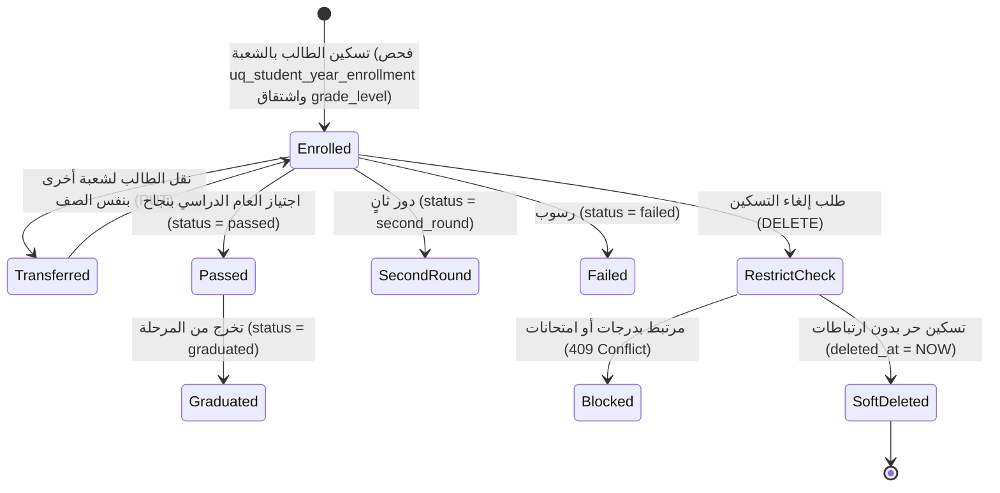

# ⚙️ مواصفات Backend — المرحلة 04-B: تسكين وتسجيل الطلاب بالفصول والشعب (Student Enrollments)

> **الهدف:** توثيق منطق المعالجة وقواعد التحقق وقواعد حوكمة تسكين وتسجيل الطلاب بالفصول وتوليد أرقام الجلوس لجدول `student_enrollments` المطابقة بنسبة 100% لـ [`MD/database.md`](../../database.md) و [`MD/business_rules.md`](../../business_rules.md)، مع دمج وتوحيد منطق الإنشاء والتعديل (`POST & PUT`) لتوفير الوضوح والرشاقة.  
> 
> ⚠️ **تكامل حوكمي صريح وملزم — مرجع الاستجابات (Network SSoT):**  
> ملف [`routes.md`](./routes.md) هو **المصدر الرئيسي والحصري والوحيد لكافة استجابات ومدخلات الـ API (Network SSoT)**. تم تسجيل كامل شكل الاستجابة (JSON Response Body) ورسائل الخطأ والنجاح صراحةً في [`routes.md`](./routes.md) لجميع الرموز والـ Status Codes (`200 OK`, `201 Created`, `400 Bad Request`, `401 Unauthorized`, `403 Forbidden`, `404 Not Found`, `409 Conflict`, `422 Unprocessable Entity`, `500 Internal Server Error`) لكل رابط.  
> 📌 **توجيه إجباري عند البناء والتطوير:** يلتزم المطور أو نموذج الذكاء الاصطناعي بالكامل بإنشاء ورسم كود الخادم واستجابات الـ API بناءً على الهياكل والرموز المسجلة في ملف [`routes.md`](./routes.md) حصراً بدون أي اجتهاد شخصي.

---

## 1. نطاق المرحلة والحدود المعمارية (Scope & Boundaries)

### 🟢 ما تشمله المرحلة (In-Scope):
- **إدارة سجل تسكين الطلاب بالفصول والشعب (`student_enrollments`) — [5 مسارات موثقة برباعية العمليات المدمجة]:**
  - استعراض وبحث كشف تسكين الطلاب مجمعاً هرمياً بالصفوف والشعب (`GET /api/v1/student-enrollments`).
  - استعراض السجل والأرشيف التسكيني التاريخي لطالب محدد عبر الأعوام (`GET /api/v1/students/:student_id/enrollments`).
  - تسكين وتعديل بيانات تسجيل طالب في صف وشعبة ورقم الجلوس (`POST & PUT /api/v1/student-enrollments`).
  - التسكين والتوزيع الجماعي لمجموعة طلاب دفعة واحدة في شعبة (`POST /api/v1/student-enrollments/bulk-enroll`).
  - إلغاء وتجريد تسكين طالب مع فحص الحماية المرجعية الصارمة (`DELETE /api/v1/student-enrollments/:id`).
- **الحوكمة والأمان:**
  - قصر عمليات التسكين والتعديل والإلغاء على مدير النظام (`admin`).
  - إتاحة عرض السجل التسكيني للطالب نفسه (`student`) وولي أمره (`parent`) أو لمدير النظام (`admin`) والمعلم (`teacher`).
  - فرض قيد التسكين السنوي الفريد (`uq_student_year_enrollment: academic_year_id, student_id`).
  - اشتقاق المستوى الأكاديمي `grade_level` تلقائياً من الصف الدراسي التابع له `classes.grade_level`.
  - حظر إلغاء التسكين في حال وجود درجات أو واجبات أو امتحانات سابقة (`ON DELETE RESTRICT`) وإرجاع `409 Conflict`.
  - تسجيل كافة العمليات والتعديلات في سجلات التدقيق `audit_logs`.

### 🔴 خارج نطاق المرحلة (Out-of-Scope):
- إنشاء وقبول ملفات الطلاب وسجلات أولياء الأمور $\rightarrow$ تابعة للمرحلة `04-A` (`students`, `guardians`).
- فتح وتعريف الصفوف والشعب $\rightarrow$ تابعة للمرحلة `02-C` (`class_sections`).
- إنشاء الواجبات والاختبارات والامتحانات $\rightarrow$ محالة إلى المراحل `06` (الواجبات)، `07` (الاختبارات القصيرة)، و `08` (الامتحانات).

> 🔗 **ملاحظة التكامل المعماري بين المراحل (Cross-Phase Integration):**  
> يمثل جدول التسكين (`student_enrollments`) العمود الفقري لتحديد تواجد الطالب الأكاديمي؛ حيث تعتمد عليه:
> 1. **المرحلة 05 (الجداول):** تحديد أي جدول حصص يتبعه الطالب بناءً على شعبته المسكن بها.
> 2. **المراحل 06 و 07 و 08 (الواجبات، الاختبارات، والامتحانات):** حصر كشوفات الطلاب المستهدفين برصد الدرجات والامتحانات في كل شعبة.
> 3. **المرحلة 09 (الصحائف والأرشفة):** استعراض السجل التسكيني التاريخي للطالب عبر الأعوام يعتمد على **جدول الصحائف المدرسية المؤرشفة (`student_transcripts`)** لحماية السجل الأكاديمي الدائم من مخاطر تصفير أو حذف جداول التسكين التشغيلية في بداية الأعوام الجديدة.

---

## 2. حوكمة الأدوار وقواعد الوصول وعزل البيانات (RBAC & Scoping Rules)

### 👥 مصفوفة الفاعلين والصلاحيات:
- **مدير النظام (Admin - `role_type = 'admin'`):**
  - يمتلك الصلاحية الكاملة على كافة مسارات التسكين (استعراض، تسكين فردي، تسكين جماعي، تعديل، إلغاء).
- **المعلم (Teacher - `role_type = 'teacher'`):**
  - يمتلك صلاحية استعراض كشوفات الطلاب المسكنين في الصفوف والشعب التي يدرسها فقط (`GET /api/v1/student-enrollments`).
  - يُحظر عليه إنشاء أو تعديل أو إلغاء تسكين أي طالب (`403 Forbidden`).
- **الطالب (Student) وولي الأمر (Parent):**
  - يمتلك الطالب وولي أمره صلاحية استعراض السجل التسكيني التاريخي الخاص بالطالب فقط (`GET /api/v1/students/:student_id/enrollments` حيث `student_id = auth.student.id`).
  - يُحظر عليهم تعديل أو إلغاء التسكين (`403 Forbidden`).
- **المستخدم غير المصادق عليه (Unauthenticated):**
  - أي طلب يفتقر إلى توكن `Bearer JWT` صالح ونشط يُرفض برمز `401 Unauthorized`.

---

## 3. دورة حياة الكيانات وقواعد ثبات النظام (Lifecycles & System Invariants)

### 🔒 قواعد ثبات النظام الصارمة (System Invariants):
1. **قيد التسكين السنوي الفريد (Single Annual Enrollment Invariant):**
   - يُمنع تسكين الطالب في أكثر من فصل أو شعبة خلال العام الدراسي الواحد (`uq_student_year_enrollment: academic_year_id, student_id`).
   - عند محاولة تكرار تسكين طالب مسكن مسبقاً، يرفض الطلب برمز `409 Conflict`.
2. **الاشتقاق التلقائي للمستوى الأكاديمي (`grade_level`):**
   - يقوم الخادم ذاتياً بجلب قيمة `grade_level` من الصف التابع له `classes.grade_level` وتخزينها لضمان السرعة ومنع التناقض.
3. **الحماية المرجعية الصارمة (RESTRICT Delete Protection):**
   - يُحظر إلغاء تسكين أي طالب إذا كان مرتبطاً بدرجات أو امتحانات أو واجبات مرصودة بالسجل الأكاديمي، ويُرجع الخادم `409 Conflict`.
4. **دورة حياة الحذف المنطقي (Soft Delete):**
   - عند إلغاء تسكين حر، يتم تعيين `deleted_at = CURRENT_TIMESTAMP` للسجل وتفريغ مقعد الشعبة.
5. **سجلات التدقيق (Audit Logging):**
   - تسجل كافة عمليات التسكين والنقل والتعديل والإلغاء في جدول `audit_logs`.

---

## 4. العمليات المنطقية والمسارات التفصيلية للمجال (Domain Operations & Routes)

---

### 🏫 الخطوة 1: إدارة تسكين وسجل تسجيل الطلاب الأكاديمي (`student_enrollments`)

#### 📋 جدول العمليات المدمجة:
| # | العملية المنطقية (Operation) | HTTP Method & Endpoint | الصلاحية | رمز النجاح | مرجع العقد في `routes.md` |
| :-: | :--- | :--- | :--- | :---: | :--- |
| **1.1** | استعراض وبحث كشف تسكين الطلاب | `GET /api/v1/student-enrollments` | `admin` / `teacher` | `200 OK` | [في routes.md](./routes.md) |
| **1.2** | استعراض السجل التسكيني لطالب محدد | `GET /api/v1/students/:student_id/enrollments` | `admin` / `student (own)` / `parent (own)` | `200 OK` | [في routes.md](./routes.md) |
| **1.3** | تسكين وتعديل تسجيل طالب | `POST /api/v1/student-enrollments` & `PUT /api/v1/student-enrollments/:id` | `admin` | `201 Created` / `200 OK` | [في routes.md](./routes.md) |
| **1.4** | التسكين الجماعي لمجموعة طلاب | `POST /api/v1/student-enrollments/bulk-enroll` | `admin` | `200 OK` | [في routes.md](./routes.md) |
| **1.5** | إلغاء وتجريد تسكين طالب | `DELETE /api/v1/student-enrollments/:id` | `admin` | `200 OK` | [في routes.md](./routes.md) |

---

#### 🔹 [Operation 1.1] `GET /api/v1/student-enrollments` — استعراض وبحث كشف تسكين الطلاب
- **الغرض والوظيفة:** استرجاع مصفوفة تسكين الطلاب بالعام الدراسي النشط مجمعة هرمياً لكل صف وشعبة (`classes -> sections -> students`) بدون تكرار للبيانات مع دعم التصفية بالصف أو الشعبة أو الحالة الأكاديمية والبحث النصي.
- **قواعد المعالجة والخادم:**
  - استرجاع السجلات النشطة فقط (`deleted_at IS NULL`).
  - تجميع الطلاب المسكنين تحت الصف والشعبة التابعين لها في مصفوفة `classes`.
  - حساب عدد الطلاب المسكنين في كل شعبة (`enrolled_count`).
- **عقد الاستجابات والمعاملات (Network SSoT):**
  - معاملات الاستعلام وهياكل الـ JSON الصريحة لـ (`200 OK`) موثقة في [`routes.md`](./routes.md).

#### 🔹 [Operation 1.2] `GET /api/v1/students/:student_id/enrollments` — استعراض السجل والأرشيف التسكيني لطالب محدد
- **الغرض والوظيفة:** جلب السجل التاريخي لتسكين الطالب وتدرجه الأكاديمي عبر الأعوام الدراسية المختلفة لمعرفة مساره التعليمي.
- **الاعتمادية المعمارية ومصدر البيانات (SSoT Data Source):**
  - **الأعوام الدراسية السابقة المنتهية:** تعتمد هذه العملية أساسياً على **جدول الصحائف المدرسية المؤرشفة (`student_transcripts` من المرحلة 09)** كمرجع أرشيفي دائم وثابت (Immutable History) لا يتأثر بتصفير أو حذف سجلات التسكين التشغيلية السنوية مع بداية كل عام.
  - **العام الدراسي النشط الحالي:** يتم دمج سجل التسكين التشغيلي للعام الجاري مباشرة من جدول `student_enrollments` ليعكس القيد ورقم الجلوس والشعبة الحالية.
- **قواعد الوصول:** متاح لمدير النظام (`admin`)، أو للطالب نفسه وولي أمره حصراً.
- **عقد الاستجابات والمدخلات (Network SSoT):**
  - استجابات (`200 OK`, `404 Not Found`) مسجلة في [`routes.md`](./routes.md).

#### 🔹 [Operation 1.3] `POST /api/v1/student-enrollments` & `PUT /api/v1/student-enrollments/:id` — تسكين وتعديل تسجيل طالب (Combined Domain Logic)
- **الغرض والوظيفة:**
  - **في الإنشاء (`POST`):** تسكين طالب في شعبة بالعام النشط وتوليد رقم الجلوس مع التحقق من عدم تكرار التسكين للعام الحالي (`uq_student_year_enrollment`).
  - **في التعديل (`PUT`):** نقل الطالب لشعبة أخرى في نفس الصف، أو تحديث رقم الجلوس أو تعديل الحالة الأكاديمية (`status`).
- **قواعد التحقق المشتركة (Validation Rules):**
  - `academic_year_id`: مطلوب، معرف عام دراسي صالح.
  - `student_id`: مطلوب، معرف طالب صالح وغير مسكن مسبقاً في العام الحالي (في حالة POST).
  - `class_section_id`: مطلوب، معرف شعبة صالحة (ويقوم الخادم تلقائياً باشتقاق `class_id` و `grade_level` من بيانات الشعبة).
  - `seating_number`: اختياري، نص رقم الجلوس.
  - `status`: اختياري، أحد قيم الـ ENUM المعتمدة (افتراضياً `enrolled`).
- **عقد الاستجابات والمدخلات (Network SSoT):**
  - هيكل الطلب واستجابات (`201 Created`, `200 OK`, `404 Not Found`, `409 Conflict`, `422 Unprocessable Entity`) مسجلة في [`routes.md`](./routes.md).

#### 🔹 [Operation 1.4] `POST /api/v1/student-enrollments/bulk-enroll` — التسكين الجماعي لمجموعة طلاب
- **الغرض والوظيفة:** تسكين وتوزيع دفعة من الطلاب دفعة واحدة في شعبة دراسية مخصصة ضمن معاملة قاعدة بيانات ذرية (Database Transaction).
- **قواعد التحقق:** التحقق من عدم تسكين أي طالب من المجموعة مسبقاً بالعام الحالي (`409 Conflict` في حال التضارب).
- **عقد الاستجابات والمدخلات (Network SSoT):**
  - استجابات (`200 OK`, `409 Conflict`, `422 Unprocessable Entity`) مسجلة في [`routes.md`](./routes.md).

#### 🔹 [Operation 1.5] `DELETE /api/v1/student-enrollments/:id` — إلغاء وتجريد تسكين طالب
- **الغرض والوظيفة:** إلغاء سجل تسكين الطالب وحذف تخصيص الشعبة بشرط عدم وجود درجات أو واجبات أو امتحانات مرصودة (`RESTRICT`).
- **عقد الاستجابات والمدخلات (Network SSoT):**
  - ردود الإلغاء (`200 OK`, `404 Not Found`, `409 Conflict`) مسجلة صراحةً في [`routes.md`](./routes.md).

---

## 5. الأداء، التزامن، والنزاهة المرجعية (Performance & Data Integrity)

1. **الاستعلامات والفهارس:**
   - استخدام الفهارس المعتمدة في `MD/database.md`: `uq_student_year_enrollment`، `idx_enrollments_class_id`، `idx_enrollments_grade_level`، `idx_enrollments_class_section`، `idx_enrollments_status`، `idx_enrollments_seating`، `idx_enrollments_deleted_at`.
2. **الحماية المرجعية:**
   - تطبيق `RESTRICT` على المفاتيح الخارجية لحظر حذف تسكين طالب له درجات أو سجلات مرتبطة.
3. **تجنب التسريب التقني والأمني في الاستجابات:**
   - توحيد رسائل الأخطاء عبر الرموز المعيارية (`401`, `403`, `404`, `409`, `422`, `500`).

---

## 6. معايير القبول الهندسية للباك إند (Backend Acceptance Criteria)

تعتبر متطلبات الخادم لهذه المرحلة مستوفاة بالكامل عند تحقق المعايير التالية:

- [x] قصر صلاحية إدارة التسكين (تسكين فردي، جماعي، تعديل، إلغاء) حصراً على المستخدمين بدور `admin`.
- [x] إرجاع `401 Unauthorized` لأي طلب بدون توكن مصادقة صالح.
- [x] إرجاع `403 Forbidden` عند محاولة المعلم أو الطالب تعديل بيانات التسكين.
- [x] التحقق الصارم من قيد التسكين السنوي الفريد `uq_student_year_enrollment` وإرجاع `409 Conflict` عند التكرار.
- [x] اشتقاق المستوى الأكاديمي `grade_level` تلقائياً من الصف الدراسي التابع له.
- [x] فرض الحماية المرجعية ومنع إلغاء التسكين المرتبط بدرجات أو امتحانات وإرجاع `409 Conflict`.
- [x] دعم استرجاع كشوفات التسكين هرمياً بالصفوف والشعب (`classes -> sections -> students`).
- [x] تنفيذ الحذف المنطقي بضبط `deleted_at` وتوثيق كافة العمليات في `audit_logs`.
- [x] مطابقة كافة المدخلات والمخرجات بنسبة 100% لعقد الشبكة في [`routes.md`](./routes.md).
