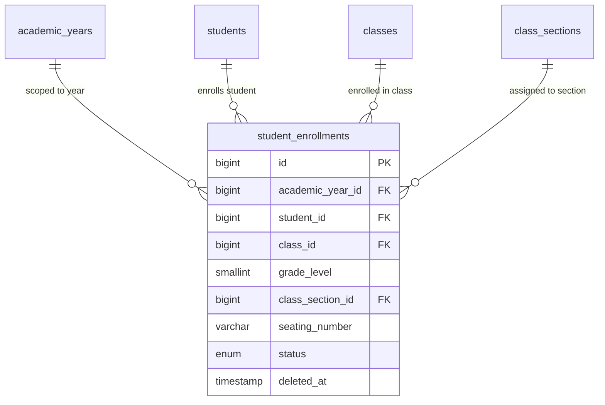

# 📊 مواصفات البيانات والكيانات — المرحلة 04-B (Data Specification)

> **الهدف:** توثيق المخطط الهيكلي لجدول تسكين وتسجيل الطلاب بالفصول والشعب (`student_enrollments`) المطابق بنسبة 100% للمصدر الرئيسي والحصري للحقيقة: [`MD/database.md`](../../database.md).  
> 
> ⚠️ **إرشادات وتنبيهات حوكمية إجبارية (System Governance Directives):**  
> 1. **قواعد العمل العامة (Business Rules SSoT):** يلزم قراءة واعتماد **ملف القواعد العامة بالمنظومة [`MD/business_rules.md`](../../business_rules.md)** والالتزام التام بكافة القيود ومصفوفة الصلاحيات والحوكمة المذكورة فيه قبل التكوييد والبناء.  
> 2. **مرجع شبكة الطلبات والاستجابات (Network SSoT):** ملف [`routes.md`](./routes.md) هو المصدر الرئيسي والوحيد لعقد الشبكة بالمنظومة؛ حيث تم توثيق **جسم الطلب الكامل (`Request Body Payload`)** لكل رابط، و**معاملات البحث والفلترة (`Query Parameters & Filters`)**، و**كامل شكل الاستجابة الصريحة (`Response Body Payload`)** لجميع الرموز والـ Status Codes (`200 OK`, `201 Created`, `400 Bad Request`, `401 Unauthorized`, `403 Forbidden`, `404 Not Found`, `409 Conflict`, `422 Unprocessable Entity`, `500 Server Error`).  
> 📌 **توجيه إجباري عند البناء والتطوير:** يلتزم المطور بالكامل برسم وبناء مدخلات ومخرجات كود الـ Controllers والواجهات بناءً على الهياكل والرموز المسجلة في ملف [`routes.md`](./routes.md) حصراً بدون أي اجتهاد شخصي.

---

## 1. هيكل الجداول والكيانات (Tables Matrix)

---

### 1.1 [الخطوة 1] جدول تسكين الطلاب بالفصول والشعب (`student_enrollments`)

> **الوصف:** جدول ربط وتسكين الطلاب بالفصول والشعب الدراسية للعام الأكاديمي، وتحديد الصف والمستوى وأرقام الجلوس وحالة الطالب بنهاية العام.

| اسم العمود (Column) | نوع البيانات (MySQL Type) | القيود والخصائص (Constraints) | الوصف والدلالة الوظيفية |
| :--- | :--- | :--- | :--- |
| `id` | `BIGINT UNSIGNED` | `PRIMARY KEY AUTO_INCREMENT` | المعرف الرقمي لسجل التسكين. |
| `academic_year_id` | `BIGINT UNSIGNED` | `NOT NULL` | معرف العام الدراسي (يرتبط بـ `academic_years.id`). |
| `student_id` | `BIGINT UNSIGNED` | `NOT NULL` | معرف الطالب (يرتبط بـ `students.id`). |
| `class_id` | `BIGINT UNSIGNED` | `NOT NULL` | معرف الصف الدراسي (يرتبط بـ `classes.id` لضمان النزاهة العلائقية). |
| `grade_level` | `SMALLINT UNSIGNED` | `NOT NULL` | المستوى الأكاديمي الرقمي (`1` إلى `12`) لتسريع التقارير وحسابات الترحيل. |
| `class_section_id` | `BIGINT UNSIGNED` | `NOT NULL` | معرف الفصل والشعبة المسكن بها (يرتبط بـ `class_sections.id`). |
| `seating_number` | `VARCHAR(50)` | `NULL DEFAULT NULL` | رقم جلوس الطالب في الامتحانات للعام الدراسي. |
| `status` | `ENUM('enrolled', 'passed', 'second_round', 'failed', 'graduated')` | `NOT NULL, DEFAULT 'enrolled'` | حالة الطالب الأكاديمية ونهاية العام. |
| `created_at` | `TIMESTAMP` | `NOT NULL, DEFAULT CURRENT_TIMESTAMP` | توقيت إنشاء السجل. |
| `updated_at` | `TIMESTAMP` | `NULL ON UPDATE CURRENT_TIMESTAMP` | توقيت آخر تحديث. |
| `deleted_at` | `TIMESTAMP` | `NULL DEFAULT NULL` | طابع الحذف المنطقي (Soft Delete). |

---

### 🔗 العلاقات والمفاتيح الخارجية (Foreign Keys):
* `academic_year_id` يرتبط بجدول `academic_years(id)` مع `ON DELETE RESTRICT, ON UPDATE CASCADE`.
* `student_id` يرتبط بجدول `students(id)` مع `ON DELETE RESTRICT, ON UPDATE CASCADE`.
* `class_id` يرتبط بجدول `classes(id)` مع `ON DELETE RESTRICT, ON UPDATE CASCADE`.
* `class_section_id` يرتبط بجدول `class_sections(id)` مع `ON DELETE RESTRICT, ON UPDATE CASCADE`.

---

### ⚡ الفهارس والقيود (Indexes & Constraints):
* `PRIMARY KEY (id)`
* `UNIQUE INDEX uq_student_year_enrollment (academic_year_id, student_id)`  
  *(قيد الحوكمة المحوري: يضمن تسكين الطالب في فصل وشعبة واحدة فقط خلال العام الدراسي الواحد لمنع التكرار والتضارب).*
* `INDEX idx_enrollments_class_id (class_id)`
* `INDEX idx_enrollments_grade_level (academic_year_id, grade_level)`
* `INDEX idx_enrollments_class_section (class_section_id)`
* `INDEX idx_enrollments_status (status)`
* `INDEX idx_enrollments_seating (seating_number)`
* `INDEX idx_enrollments_deleted_at (deleted_at)`

---

## 2. مخطط الكيانات والعلاقات لـ 04-B (ERD)

