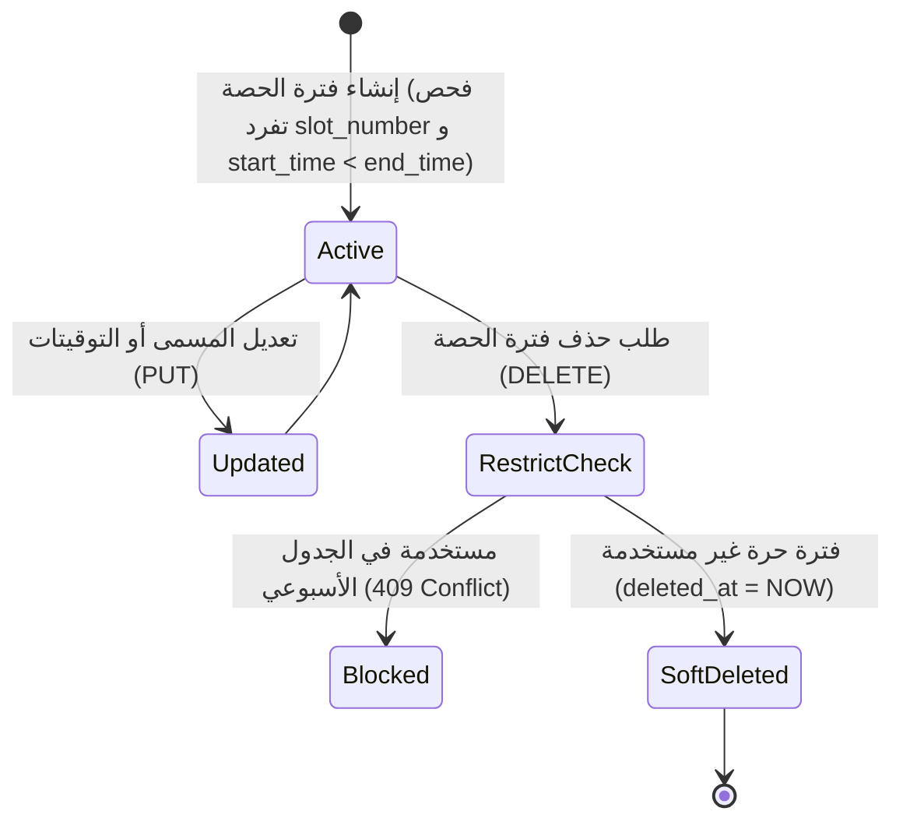

# ⚙️ مواصفات Backend — المرحلة 05-A: فترات وتوقيتات الحصص اليومية (Daily Period Slots)

> **الهدف:** توثيق منطق المعالجة وقواعد التحقق وقواعد حوكمة فترات وتوقيتات الحصص والفسح اليومية لجدول `period_slots` المطابقة بنسبة 100% لـ [`MD/database.md`](../../database.md) و [`MD/business_rules.md`](../../business_rules.md)، مع دمج وتوحيد منطق الإنشاء والتعديل (`POST & PUT`) لتوفير الوضوح والرشاقة.  
> 
> ⚠️ **تكامل حوكمي صريح وملزم — مرجع الاستجابات (Network SSoT):**  
> ملف [`routes.md`](./routes.md) هو **المصدر الرئيسي والحصري والوحيد لكافة استجابات ومدخلات الـ API (Network SSoT)**. تم تسجيل كامل شكل الاستجابة (JSON Response Body) ورسائل الخطأ والنجاح صراحةً في [`routes.md`](./routes.md) لجميع الرموز والـ Status Codes (`200 OK`, `201 Created`, `400 Bad Request`, `401 Unauthorized`, `403 Forbidden`, `404 Not Found`, `409 Conflict`, `422 Unprocessable Entity`, `500 Internal Server Error`) لكل رابط.  
> 📌 **توجيه إجباري عند البناء والتطوير:** يلتزم المطور أو نموذج الذكاء الاصطناعي بالكامل بإنشاء ورسم كود الخادم واستجابات الـ API بناءً على الهياكل والرموز المسجلة في ملف [`routes.md`](./routes.md) حصراً بدون أي اجتهاد شخصي.

---

## 1. نطاق المرحلة والحدود المعمارية (Scope & Boundaries)

### 🟢 ما تشمله المرحلة (In-Scope):
- **إدارة سجل فترات وتوقيتات الحصص اليومية (`period_slots`) — [4 مسارات موثقة برباعية العمليات المدمجة]:**
  - استعراض وبحث فترات وتوقيتات الحصص والفسح اليومية بالترقيم والفلترة (`GET /api/v1/period-slots`).
  - استعراض تفاصيل فترة حصة أو استراحة محددة بالمعرف (`GET /api/v1/period-slots/:id`).
  - إنشاء وتعديل فترة حصة أو استراحة مع فحص تفرد التسلسل (`POST & PUT /api/v1/period-slots`).
  - حذف فترة الحصة مع فحص الحماية المرجعية الصارمة (`DELETE /api/v1/period-slots/:id`).
- **الحوكمة والأمان:**
  - قصر عمليات الإضافة والتعديل والحذف على مدير النظام (`admin`).
  - إتاحة الاستعراض لكافة أطراف المنظومة (مدير، معلم، طالب، ولي أمر) لمعرفة أوقات اليوم المدرسي.
  - فرض قيد تفرد الرقم التسلسلي للحصة (`uq_period_slots_number`).
  - التحقق المنطقي الصارم من أسبقية وقت البداية على وقت النهاية (`start_time < end_time`).
  - حظر حذف أي فترة حصة مرتبطة بجدول الحصص الأسبوعي (`ON DELETE RESTRICT`) وإرجاع `409 Conflict`.
  - تسجيل كافة العمليات والتعديلات في سجلات التدقيق `audit_logs`.

### 🔴 خارج نطاق المرحلة (Out-of-Scope):
- توزيع الحصص على الشعب والمواد والمعلمين في الجدول الأسبوعي $\rightarrow$ تابعة للمرحلة `05-B` (`timetable_slots`).
- تعيين وتوزيع المعلمين على المواد $\rightarrow$ تابعة للمرحلة `03-B` (`teaching_assignments`).

> 🔗 **ملاحظة التكامل المعماري بين المراحل (Cross-Phase Integration):**  
> يمثل جدول فترات الحصص (`period_slots`) الهيكل الزمني الأساسي (Time Framework) الذي تبنى عليه المرحلة **05-B**؛ حيث يتم في المرحلة 05-B ربط كل حصة في الجدول الأسبوعي بـ `period_slot_id` محدد، بالإضافة لكونه الإطار الزمني المنظم لرصد حضور وغياب الطلاب والحصص في المراحل المتقدمة.

---

## 2. حوكمة الأدوار وقواعد الوصول وعزل البيانات (RBAC & Scoping Rules)

### 👥 مصفوفة الفاعلين والصلاحيات:
- **مدير النظام (Admin - `role_type = 'admin'`):**
  - يمتلك الصلاحية الكاملة على كافة مسارات فترات الحصص (استعراض، إنشاء، تعديل، حذف).
- **المعلم، الطالب، وولي الأمر (Teacher, Student, Parent):**
  - يمتلكون صلاحية القراءة والاستعراض فقط (`GET /api/v1/period-slots`).
  - يُحظر عليهم إنشاء أو تعديل أو حذف أي فترة زمنية (`403 Forbidden`).
- **المستخدم غير المصادق عليه (Unauthenticated):**
  - أي طلب يفتقر إلى توكن `Bearer JWT` صالح ونشط يُرفض برمز `401 Unauthorized`.

---

## 3. دورة حياة الكيانات وقواعد ثبات النظام (Lifecycles & System Invariants)

### 🔒 قواعد ثبات النظام الصارمة (System Invariants):
1. **قيد تفرد الرقم التسلسلي للحصة (Unique Slot Number):**
   - يُمنع تكرار `slot_number` لضمان الترتيب المحكم والتسلسل المنطقي للحصص اليومية (`uq_period_slots_number`).
   - عند محاولة تكرار رقم الحصة، يرفض الطلب برمز `409 Conflict`.
2. **الترتيب الزمني المنطقي (Logical Time Invariant):**
   - يلزم أن يكون وقت البداية `start_time` أسبق قطيعاً من وقت النهاية `end_time`، وخلاف ذلك يرفض برمز `422 Unprocessable Entity`.
3. **الحماية المرجعية الصارمة (RESTRICT Delete Protection):**
   - يُحظر حذف أي فترة حصة إذا كانت مرتبطة بحصص مجدولة في `timetable_slots`، ويُرجع الخادم `409 Conflict`.
4. **دورة حياة الحذف المنطقي وسجلات التدقيق:**
   - عند الحذف الحر، يتم تعيين `deleted_at = CURRENT_TIMESTAMP` وتوثق العملية في `audit_logs`.

---

## 4. العمليات المنطقية والمسارات التفصيلية للمجال (Domain Operations & Routes)

---

### ⏰ الخطوة 1: إدارة سجل فترات وتوقيتات الحصص اليومية (`period_slots`)

#### 📋 جدول العمليات المدمجة:
| # | العملية المنطقية (Operation) | HTTP Method & Endpoint | الصلاحية | رمز النجاح | مرجع العقد في `routes.md` |
| :-: | :--- | :--- | :--- | :---: | :--- |
| **1.1** | استعراض وبحث فترات الحصص والفسح | `GET /api/v1/period-slots` | الجميع | `200 OK` | [في routes.md](./routes.md) |
| **1.2** | استعراض تفاصيل فترة حصة محددة | `GET /api/v1/period-slots/:id` | `admin` / `teacher` | `200 OK` | [في routes.md](./routes.md) |
| **1.3** | إنشاء وتعديل فترة حصة | `POST /api/v1/period-slots` & `PUT /api/v1/period-slots/:id` | `admin` | `201 Created` / `200 OK` | [في routes.md](./routes.md) |
| **1.4** | حذف فترة حصة | `DELETE /api/v1/period-slots/:id` | `admin` | `200 OK` | [في routes.md](./routes.md) |

---

#### 🔹 [Operation 1.1] `GET /api/v1/period-slots` — استعراض وبحث فترات الحصص والفسح
- **الغرض والوظيفة:** استرجاع قائمة الفترات الزمنية باليوم المدرسي مرتبة تسلسلياً بحسب `slot_number` مع دعم الفرز والترقيم وتصفية فترات الاستراحة `is_break`.
- **عقد الاستجابات والمعاملات (Network SSoT):** مسجلة في [`routes.md`](./routes.md).

#### 🔹 [Operation 1.2] `GET /api/v1/period-slots/:id` — استعراض تفاصيل فترة حصة محددة
- **الغرض والوظيفة:** جلب البيانات التفصيلية لفترة زمنية محددة باليوم المدرسي.
- **عقد الاستجابات والمدخلات (Network SSoT):** مسجلة في [`routes.md`](./routes.md).

#### 🔹 [Operation 1.3] `POST /api/v1/period-slots` & `PUT /api/v1/period-slots/:id` — إنشاء وتعديل فترة حصة (Combined Domain Logic)
- **الغرض والوظيفة:**
  - **في الإنشاء (`POST`):** إضافة فترة حصة أو فسحة جديدة لليوم المدرسي مع التحقق من تفرد التسلسل (`uq_period_slots_number`) وأسبقية وقت البداية.
  - **في التعديل (`PUT`):** تحديث مسمى وتوقيتات الحصة.
- **قواعد التحقق المشتركة (Validation Rules):**
  - `name`: مطلوب، نص لا يتجاوز 50 حرفاً.
  - `slot_number`: مطلوب، رقم صحيح موجب فريد (في POST والتعديل).
  - `start_time`: مطلوب، توقيت صالح بصيغة `HH:MM:SS`.
  - `end_time`: مطلوب، توقيت صالح بصيغة `HH:MM:SS` ويجب أن يكون لاحقاً لـ `start_time`.
  - `is_break`: اختياري، قيمة بوليانية (`0` أو `1`، افتراضياً `0`).
- **عقد الاستجابات والمدخلات (Network SSoT):**
  - استجابات (`201 Created`, `200 OK`, `404 Not Found`, `409 Conflict`, `422 Unprocessable Entity`) مسجلة في [`routes.md`](./routes.md).

#### 🔹 [Operation 1.4] `DELETE /api/v1/period-slots/:id` — حذف فترة حصة
- **الغرض والوظيفة:** حذف فترة الحصة اليومية بشرط عدم استخدامها في أي جدول حصص أسبوعي (`RESTRICT`).
- **عقد الاستجابات والمدخلات (Network SSoT):**
  - استجابات (`200 OK`, `404 Not Found`, `409 Conflict`) مسجلة في [`routes.md`](./routes.md).

---

## 5. الأداء، التزامن، والنزاهة المرجعية (Performance & Data Integrity)

1. **الاستعلامات والفهارس:**
   - استخدام الفهارس المعتمدة في `MD/database.md`: `uq_period_slots_number`، `idx_period_slots_times`، `idx_period_slots_deleted_at`.
2. **الحماية المرجعية:**
   - تطبيق `RESTRICT` على المفاتيح الخارجية لمنع حذف فترة حصة مستخدمة في الجدول الأسبوعي.
3. **تجنب التسريب التقني والأمني في الاستجابات:**
   - توحيد رسائل الأخطاء عبر الرموز المعيارية (`401`, `403`, `404`, `409`, `422`, `500`).

---

## 6. معايير القبول الهندسية للباك إند (Backend Acceptance Criteria)

تعتبر متطلبات الخادم لهذه المرحلة مستوفاة بالكامل عند تحقق المعايير التالية:

- [ ] قصر صلاحية إضافة وتعديل وحذف فترات الحصص حصراً على المستخدمين بدور `admin`.
- [ ] إرجاع `401 Unauthorized` لأي طلب بدون توكن مصادقة صالح.
- [ ] إرجاع `403 Forbidden` عند محاولة المستخدمين غير المخولين إجراء تعديلات.
- [ ] التحقق الصارم من تفرد الرقم التسلسلي للحصة `uq_period_slots_number` وإرجاع `409 Conflict` عند التكرار.
- [ ] التحقق الصارم من أسبقية وقت البداية على وقت النهاية `start_time < end_time` وإرجاع `422 Unprocessable Entity` عند المخالفة.
- [ ] فرض الحماية المرجعية ومنع حذف فترة الحصة المرتبطة بجدول أسبوعي وإرجاع `409 Conflict`.
- [ ] تنفيذ الحذف المنطقي بضبط `deleted_at` وتوثيق كافة العمليات في `audit_logs`.
- [ ] مطابقة كافة المدخلات والمخرجات بنسبة 100% لعقد الشبكة في [`routes.md`](./routes.md).
