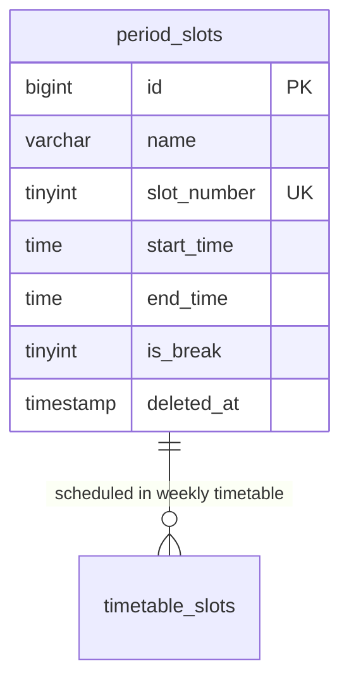

# 📊 مواصفات البيانات والكيانات — المرحلة 05-A (Data Specification)

> **الهدف:** توثيق المخطط الهيكلي لجدول فترات وتوقيتات الحصص والفسح اليومية (`period_slots`) المطابق بنسبة 100% للمصدر الرئيسي والحصري للحقيقة: [`MD/database.md`](../../database.md).  
> 
> ⚠️ **إرشادات وتنبيهات حوكمية إجبارية (System Governance Directives):**  
> 1. **قواعد العمل العامة (Business Rules SSoT):** يلزم قراءة واعتماد **ملف القواعد العامة بالمنظومة [`MD/business_rules.md`](../../business_rules.md)** والالتزام التام بكافة القيود ومصفوفة الصلاحيات والحوكمة المذكورة فيه قبل التكوييد والبناء.  
> 2. **مرجع شبكة الطلبات والاستجابات (Network SSoT):** ملف [`routes.md`](./routes.md) هو المصدر الرئيسي والوحيد لعقد الشبكة بالمنظومة؛ حيث تم توثيق **جسم الطلب الكامل (`Request Body Payload`)** لكل رابط، و**معاملات البحث والفلترة (`Query Parameters & Filters`)**، و**كامل شكل الاستجابة الصريحة (`Response Body Payload`)** لجميع الرموز والـ Status Codes (`200 OK`, `201 Created`, `400 Bad Request`, `401 Unauthorized`, `403 Forbidden`, `404 Not Found`, `409 Conflict`, `422 Unprocessable Entity`, `500 Server Error`).  
> 📌 **توجيه إجباري عند البناء والتطوير:** يلتزم المطور بالكامل برسم وبناء مدخلات ومخرجات كود الـ Controllers والواجهات بناءً على الهياكل والرموز المسجلة في ملف [`routes.md`](./routes.md) حصراً بدون أي اجتهاد شخصي.

---

## 1. هيكل الجداول والكيانات (Tables Matrix)

---

### 1.1 [الخطوة 1] جدول أوقات الحصص اليومية (`period_slots`)

> **الوصف:** جدول تحديد مواعيد وتوقيتات الحصص المدرسية اليومية والفسحة/الاستراحة المنظمة لليوم المدرسي والمحددة مركزياً من الإدارة.

| اسم العمود (Column) | نوع البيانات (MySQL Type) | القيود والخصائص (Constraints) | الوصف والدلالة الوظيفية |
| :--- | :--- | :--- | :--- |
| `id` | `BIGINT UNSIGNED` | `PRIMARY KEY AUTO_INCREMENT` | المعرف الرقمي للحصة اليومية. |
| `name` | `VARCHAR(50)` | `NOT NULL` | مسمى الحصة (مثال: `الحصة الأولى`, `الحصة الثانية`, `الفسحة / الاستراحة`). |
| `slot_number` | `TINYINT UNSIGNED` | `NOT NULL, UNIQUE` | الرقم التسلسلي للحصة خلال اليوم (`1, 2, 3...`). |
| `start_time` | `TIME` | `NOT NULL` | وقت بداية الحصة (مثال: `08:00:00`). |
| `end_time` | `TIME` | `NOT NULL` | وقت نهاية الحصة (مثال: `08:45:00`). |
| `is_break` | `TINYINT(1)` | `NOT NULL, DEFAULT 0` | هل هي فترة راحة/فسحة لا تتطلب تدريساً (`1 = استراحة`, `0 = حصة دراسية`). |
| `created_at` | `TIMESTAMP` | `NOT NULL, DEFAULT CURRENT_TIMESTAMP` | توقيت إنشاء السجل. |
| `updated_at` | `TIMESTAMP` | `NULL ON UPDATE CURRENT_TIMESTAMP` | توقيت آخر تحديث. |
| `deleted_at` | `TIMESTAMP` | `NULL DEFAULT NULL` | طابع الحذف المنطقي (Soft Delete). |

---

### 🔗 العلاقات والمفاتيح الخارجية (Foreign Keys):
* *لا يحتوي على مفاتيح خارجية مباشرة.*

---

### ⚡ الفهارس والقيود (Indexes & Constraints):
* `PRIMARY KEY (id)`
* `UNIQUE INDEX uq_period_slots_number (slot_number)`  
  *(قيد الحوكمة المحوري: يضمن عدم تكرار الرقم التسلسلي للحصة لضمان الترتيب المحكم لليوم الدراسي).*
* `INDEX idx_period_slots_times (start_time, end_time)`
* `INDEX idx_period_slots_deleted_at (deleted_at)`

---

## 2. مخطط الكيانات والعلاقات لـ 05-A (ERD)

