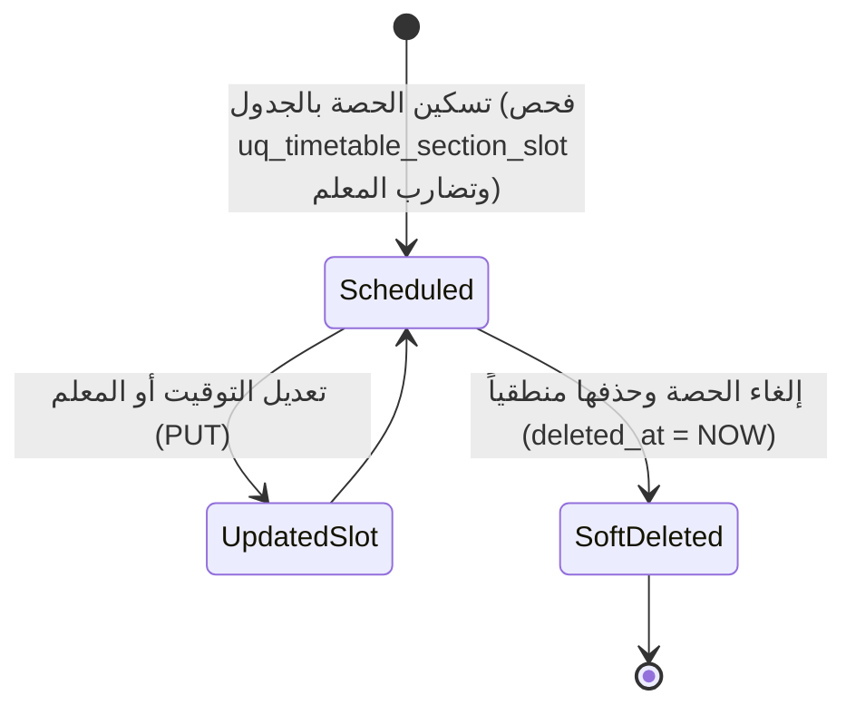

# ⚙️ مواصفات Backend — المرحلة 05-B: جدول الحصص الأسبوعي وحظر التعارضات (Timetables & Conflict Resolution)

> **الهدف:** توثيق منطق المعالجة وقواعد التحقق ومنع التضارب الزماني للشعب والمعلمين لجدول `timetable_slots` المطابقة بنسبة 100% لـ [`MD/database.md`](../../database.md) و [`MD/business_rules.md`](../../business_rules.md)، مع دمج وتوحيد منطق الإنشاء والتعديل (`POST & PUT`) لتوفير الوضوح والرشاقة.  
> 
> ⚠️ **تكامل حوكمي صريح وملزم — مرجع الاستجابات (Network SSoT):**  
> ملف [`routes.md`](./routes.md) هو **المصدر الرئيسي والحصري والوحيد لكافة استجابات ومدخلات الـ API (Network SSoT)**. تم تسجيل كامل شكل الاستجابة (JSON Response Body) ورسائل الخطأ والنجاح صراحةً في [`routes.md`](./routes.md) لجميع الرموز والـ Status Codes (`200 OK`, `201 Created`, `400 Bad Request`, `401 Unauthorized`, `403 Forbidden`, `404 Not Found`, `409 Conflict`, `422 Unprocessable Entity`, `500 Internal Server Error`) لكل رابط.  
> 📌 **توجيه إجباري عند البناء والتطوير:** يلتزم المطور أو نموذج الذكاء الاصطناعي بالكامل بإنشاء ورسم كود الخادم واستجابات الـ API بناءً على الهياكل والرموز المسجلة في ملف [`routes.md`](./routes.md) حصراً بدون أي اجتهاد شخصي.

---

## 1. نطاق المرحلة والحدود المعمارية (Scope & Boundaries)

### 🟢 ما تشمله المرحلة (In-Scope):
- **إدارة سجل وجدول الحصص الأسبوعي (`timetable_slots`) — [5 مسارات موثقة برباعية العمليات المدمجة]:**
  - استعراض وتصفية جدول الحصص العام بالترقيم والفلترة بالصف والشعبة والمعلم (`GET /api/v1/timetable-slots`).
  - استعراض مصفوفة جدول الحصص الأسبوعي لشعبة محددة (`GET /api/v1/class-sections/:class_section_id/timetable`).
  - استعراض جدول الحصص الأسبوعي لمعلم محدد (`GET /api/v1/teachers/:teacher_id/timetable`).
  - تسكين وتعديل حصة بالجدول الأسبوعي مع الفحص الذري لحظر التعارضات (`POST & PUT /api/v1/timetable-slots`).
  - حذف وإلغاء حصة من الجدول الأسبوعي (`DELETE /api/v1/timetable-slots/:id`).
- **الحوكمة ومنع التعارضات:**
  - فحص حظر التضارب الزمني للشعبة (`uq_timetable_section_slot`).
  - فحص حظر التضارب الزمني للمعلم (منع تدريس شعبتين بنفس اليوم والحصة) وإرجاع `409 Conflict`.
  - تسجيل كافة عمليات التسكين والتعديل والحذف في سجلات التدقيق `audit_logs`.

### 🔴 خارج نطاق المرحلة (Out-of-Scope):
- تعريف فترات وأوقات الحصص اليومية والفسحة $\rightarrow$ تابعة للمرحلة `05-A` (`period_slots`).
- إسناد المعلمين للمواد والشعب $\rightarrow$ تابعة للمرحلة `03-B` (`teaching_assignments`).
- إنشاء الواجبات والاختبارات والامتحانات $\rightarrow$ محالة إلى المراحل `06` (الواجبات)، `07` (الاختبارات القصيرة)، و `08` (الامتحانات).

> 🔗 **ملاحظة التكامل المعماري مع المرحلة 03-B (Cross-Phase Integration):**  
> تعتمد هذه المرحلة بشكل محوري على مخرجات المرحلة `03-B` (`teaching_assignments`)؛ حيث تُمثل كل حصة دراسية بالجدول سجلاً مرتبطاً بـ `teaching_assignment_id`، مما يضمن الربط التلقائي للمادة ومعلمها المكلف وفحص عدم تضارب جدوله الزمني مع شعب أخرى.

---

## 2. حوكمة الأدوار وقواعد الوصول وعزل البيانات (RBAC & Scoping Rules)

### 👥 مصفوفة الفاعلين والصلاحيات:
- **مدير النظام (Admin - `role_type = 'admin'`):**
  - يمتلك الصلاحية الكاملة على كافة مسارات الجدول الأسبوعي (استعراض، تسكين، تعديل، حذف).
- **المعلم (Teacher - `role_type = 'teacher'`):**
  - يمتلك صلاحية استعراض جدول حصصه الخاص (`GET /api/v1/teachers/:teacher_id/timetable` حيث `teacher_id = auth.teacher.id`) واستعراض جداول الشعب التي يدرسها.
  - يُحظر عليه تسكين أو تعديل أو حذف أي حصة في الجدول (`403 Forbidden`).
- **الطالب (Student) وولي الأمر (Parent):**
  - يمتلك الطالب وولي أمره صلاحية القراءة فقط لجدول الشعبة المسكن بها الطالب (`GET /api/v1/class-sections/:class_section_id/timetable`).
  - يُحظر عليهم تعديل أو حذف أي حصة (`403 Forbidden`).
- **المستخدم غير المصادق عليه (Unauthenticated):**
  - أي طلب يفتقر إلى توكن `Bearer JWT` صالح ونشط يُرفض برمز `401 Unauthorized`.

---

## 3. دورة حياة الكيانات وقواعد ثبات النظام (Lifecycles & System Invariants)

### 🔒 قواعد ثبات النظام الصارمة (System Invariants):
1. **قيد تفرد حصة الشعبة الزمني (Section Time Slot Invariant):**
   - يمنع وجود حصتين لنفس الشعبة في نفس اليوم والتوقيت خلال العام الدراسي (`uq_timetable_section_slot: academic_year_id, class_section_id, day_of_week, period_slot_id`).
   - عند محاولة التسكين المزدوج، يرفض الطلب برمز `409 Conflict`.
2. **قيد حظر تضارب جدول المعلم (Teacher Anti-Collision Invariant):**
   - يتحقق الخادم قبل التسكين من أن المعلم المرتبط بسجل `teaching_assignment_id` غير مسكن في حصة أخرى مع شعبة مختلفة في نفس اليوم والتوقيت بالعام الدراسي.
   - عند اكتشاف تضارب للمعلم، يرفض الطلب برمز `409 Conflict`.
3. **دورة حياة الحذف المنطقي (Soft Delete Lifecycle):**
   - عند حذف حصة من الجدول، يتم ضبط `deleted_at = CURRENT_TIMESTAMP` وإخلاء الفترة الزمنية.
4. **سجلات التدقيق (Audit Logging):**
   - تسجل كافة حركات التسكين والتعديل والحذف في جدول `audit_logs`.

---

## 4. العمليات المنطقية والمسارات التفصيلية للمجال (Domain Operations & Routes)

---

### 🗓️ الخطوة 1: إدارة جدول الحصص الأسبوعي وحظر التعارضات الزمانية (`timetable_slots`)

#### 📋 جدول العمليات المدمجة:
| # | العملية المنطقية (Operation) | HTTP Method & Endpoint | الصلاحية | رمز النجاح | مرجع العقد في `routes.md` |
| :-: | :--- | :--- | :--- | :---: | :--- |
| **1.1** | استعراض وتصفية سجلات الجدول الأسبوعي | `GET /api/v1/timetable-slots` | `admin` | `200 OK` | [في routes.md](./routes.md) |
| **1.2** | استعراض مصفوفة جدول الحصص لشعبة محددة | `GET /api/v1/class-sections/:class_section_id/timetable` | `admin` / `teacher` / `student` / `parent` | `200 OK` | [في routes.md](./routes.md) |
| **1.3** | استعراض جدول الحصص الأسبوعي لمعلم محدد | `GET /api/v1/teachers/:teacher_id/timetable` | `admin` / `teacher (own)` | `200 OK` | [في routes.md](./routes.md) |
| **1.4** | تسكين وتعديل حصة بالجدول الأسبوعي | `POST /api/v1/timetable-slots` & `PUT /api/v1/timetable-slots/:id` | `admin` | `201 Created` / `200 OK` | [في routes.md](./routes.md) |
| **1.5** | حذف وإلغاء حصة من الجدول الأسبوعي | `DELETE /api/v1/timetable-slots/:id` | `admin` | `200 OK` | [في routes.md](./routes.md) |

---

#### 🔹 [Operation 1.1] `GET /api/v1/timetable-slots` — استعراض وتصفية سجلات الجدول الأسبوعي
- **الغرض والوظيفة:** استرجاع مصفوفة سجلات جدول الحصص الأسبوعية مجمعة هرمياً بالصفوف والشعب والأيام والحصص (`classes -> sections -> days -> slots`) بدون تكرار للبيانات؛ حيث يتيح فلتر الصف (`class_id`) جلب جدول كافة شُعب الصف المحدد، مع دعم الفلترة بالشعبة، المعلم، المادة، اليوم، والبحث مع الترقيم.
- **عقد الاستجابات والمعاملات (Network SSoT):**
  - معاملات الاستعلام وهياكل الـ JSON الصريحة لـ (`200 OK`) موثقة في [`routes.md`](./routes.md).

#### 🔹 [Operation 1.2] `GET /api/v1/class-sections/:class_section_id/timetable` — استعراض مصفوفة جدول الحصص لشعبة محددة
- **الغرض والوظيفة:** جلب مصفوفة الجدول الأسبوعي الكاملة لشعبة معينة مقسمة بأيام الأسبوع.
- **عقد الاستجابات والمعاملات (Network SSoT):**
  - استجابات (`200 OK`, `404 Not Found`) مسجلة في [`routes.md`](./routes.md).

#### 🔹 [Operation 1.3] `GET /api/v1/teachers/:teacher_id/timetable` — استعراض جدول الحصص الأسبوعي لمعلم محدد
- **الغرض والوظيفة:** جلب جدول الحصص الأسبوعي لمعلم محدد.
- **عقد الاستجابات والمعاملات (Network SSoT):**
  - استجابات (`200 OK`, `404 Not Found`) مسجلة في [`routes.md`](./routes.md).

#### 🔹 [Operation 1.4] `POST /api/v1/timetable-slots` & `PUT /api/v1/timetable-slots/:id` — تسكين وتعديل حصة بالجدول الأسبوعي (Combined Domain Logic)
- **الغرض والوظيفة:**
  - **في الإنشاء (`POST`):** تسكين حصة جديدة بالجدول الأسبوعي للشعبة.
  - **في التعديل (`PUT`):** تحديث وتعديل توقيت أو شعبة أو مادة/معلم الحصة الأسبوعية.
- **قواعد التحقق المشتركة وحظر التضارب:**
  - `academic_year_id`: مطلوب، معرف عام دراسي صالح.
  - `class_section_id`: مطلوب، معرف شعبة صالحة.
  - `day_of_week`: مطلوب، أحد أيام الأسبوع المعيارية (`saturday` إلى `thursday`).
  - `period_slot_id`: مطلوب، معرف فترة زمنية يومية صالحة.
  - `teaching_assignment_id`: مطلوب، معرف إسناد تدريس صالح بالعام.
  - **فحص قيد الشعبة:** منع وجود حصة أخرى لنفس الشعبة في نفس اليوم والحصة (`uq_timetable_section_slot`).
  - **فحص تضارب المعلم:** التحقق من عدم تدريس المعلم لشعبة أخرى في نفس اليوم والحصة بالعام النشط.
- **عقد الاستجابات والمدخلات (Network SSoT):**
  - هيكل الطلب واستجابات (`201 Created`, `200 OK`, `404 Not Found`, `409 Conflict`, `422 Unprocessable Entity`) مسجلة في [`routes.md`](./routes.md).

#### 🔹 [Operation 1.5] `DELETE /api/v1/timetable-slots/:id` — حذف وإلغاء حصة من الجدول الأسبوعي
- **الغرض والوظيفة:** تنفيذ الحذف المنطقي لسجل الحصة بالجدول وتفريغ الفترة الزمنية.
- **عقد الاستجابات والمدخلات (Network SSoT):**
  - ردود الحذف (`200 OK`, `404 Not Found`) مسجلة صراحةً في [`routes.md`](./routes.md).

---

## 5. الأداء، التزامن، والنزاهة المرجعية (Performance & Data Integrity)

1. **الاستعلامات والفهارس:**
   - استخدام الفهارس المعتمدة في `MD/database.md`: `uq_timetable_section_slot`، `idx_timetable_teacher_conflict`، `idx_timetable_class_section`، `idx_timetable_deleted_at`.
2. **الترقيم ومنع الإغراق (Pagination & DoS Protection):**
   - حصر عدد السجلات في مسار الـ GET بـ `per_page` لمنع تحميل الذاكرة.
3. **تجنب التسريب التقني والأمني في الاستجابات:**
   - توحيد رسائل الأخطاء عبر الرموز المعيارية (`401`, `403`, `404`, `409`, `422`, `500`).

---

## 6. معايير القبول الهندسية للباك إند (Backend Acceptance Criteria)

تعتبر متطلبات الخادم لهذه المرحلة مستوفاة بالكامل عند تحقق المعايير التالية:

- [ ] قصر صلاحية إدارة الجدول الأسبوعي (تسكين، تعديل، حذف) حصراً على المستخدمين بدور `admin`.
- [ ] إرجاع `401 Unauthorized` لأي طلب بدون توكن مصادقة صالح.
- [ ] إرجاع `403 Forbidden` عند محاولة المعلم أو الطالب تعديل الجدول الأسبوعي.
- [ ] التحقق الصارم من قيد تفرد حصة الشعبة الزمني `uq_timetable_section_slot` وإرجاع `409 Conflict` عند التكرار.
- [ ] التحقق الصارم من قيد حظر تضارب جدول المعلم وإرجاع `409 Conflict` عند محاولة تسكين المعلم لشعبتين في نفس الحصة.
- [ ] دعم استرجاع مصفوفة الجدول المجمع للصف الدراسي وكافة شعبه عبر فلتر `class_id` بمسار واحد.
- [ ] تنفيذ الحذف المنطقي بضبط `deleted_at` وتوثيق العمليات في `audit_logs`.
- [ ] مطابقة كافة المدخلات والمخرجات بنسبة 100% لعقد الشبكة في [`routes.md`](./routes.md).
