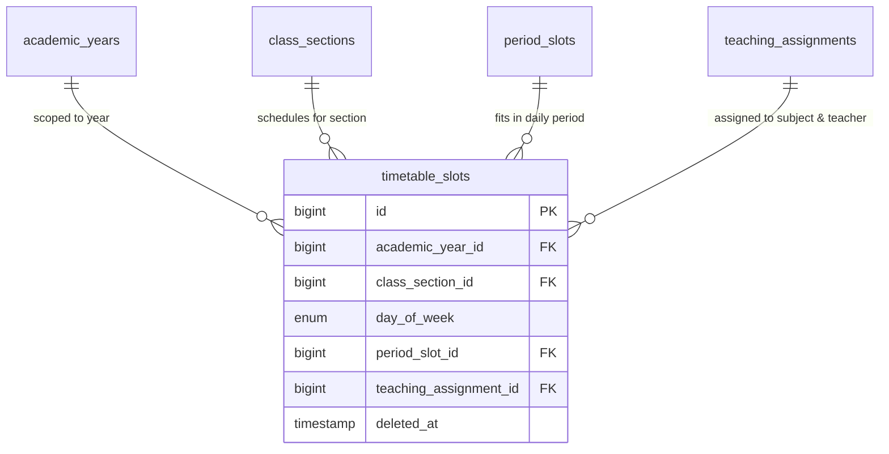

# 📊 مواصفات البيانات والكيانات — المرحلة 05-B (Data Specification)

> **الهدف:** توثيق المخطط الهيكلي لجدول الحصص بالجدول الأسبوعي (`timetable_slots`) المطابق بنسبة 100% للمصدر الرئيسي والحصري للحقيقة: [`MD/database.md`](../../database.md).  
> 
> ⚠️ **إرشادات وتنبيهات حوكمية إجبارية (System Governance Directives):**  
> 1. **قواعد العمل العامة (Business Rules SSoT):** يلزم قراءة واعتماد **ملف القواعد العامة بالمنظومة [`MD/business_rules.md`](../../business_rules.md)** والالتزام التام بكافة القيود ومصفوفة الصلاحيات والحوكمة المذكورة فيه قبل التكوييد والبناء.  
> 2. **مرجع شبكة الطلبات والاستجابات (Network SSoT):** ملف [`routes.md`](./routes.md) هو المصدر الرئيسي والوحيد لعقد الشبكة بالمنظومة؛ حيث تم توثيق **جسم الطلب الكامل (`Request Body Payload`)** لكل رابط، و**معاملات البحث والفلترة (`Query Parameters & Filters`)**، و**كامل شكل الاستجابة الصريحة (`Response Body Payload`)** لجميع الرموز والـ Status Codes (`200 OK`, `201 Created`, `400 Bad Request`, `401 Unauthorized`, `403 Forbidden`, `404 Not Found`, `409 Conflict`, `422 Unprocessable Entity`, `500 Server Error`).  
> 📌 **توجيه إجباري عند البناء والتطوير:** يلتزم المطور بالكامل برسم وبناء مدخلات ومخرجات كود الـ Controllers والواجهات بناءً على الهياكل والرموز المسجلة في ملف [`routes.md`](./routes.md) حصراً بدون أي اجتهاد شخصي.

---

## 1. هيكل الجداول والكيانات (Tables Matrix)

---

### 1.1 [الخطوة 1] جدول الحصص بالجدول الأسبوعي (`timetable_slots`)

> **الوصف:** جدول توزيع الحصص الدراسية على أيام الأسبوع (السبت إلى الخميس) لكل شعبة للعام الدراسي، وربطها بالمادة والمعلم المكلف مع منع التعارضات.

| اسم العمود (Column) | نوع البيانات (MySQL Type) | القيود والخصائص (Constraints) | الوصف والدلالة الوظيفية |
| :--- | :--- | :--- | :--- |
| `id` | `BIGINT UNSIGNED` | `PRIMARY KEY AUTO_INCREMENT` | المعرف الرقمي لسجل الحصة في الجدول الأسبوعي. |
| `academic_year_id` | `BIGINT UNSIGNED` | `NOT NULL` | معرف العام الدراسي النشط (يرتبط بـ `academic_years.id`). |
| `class_section_id` | `BIGINT UNSIGNED` | `NOT NULL` | معرف الفصل والشعبة المحددة (يرتبط بـ `class_sections.id`). |
| `day_of_week` | `ENUM('saturday', 'sunday', 'monday', 'tuesday', 'wednesday', 'thursday')` | `NOT NULL` | يوم الحصة في الأسبوع. |
| `period_slot_id` | `BIGINT UNSIGNED` | `NOT NULL` | معرف توقيت الحصة اليومية (يرتبط بـ `period_slots.id`). |
| `teaching_assignment_id` | `BIGINT UNSIGNED` | `NOT NULL` | معرف إسناد التدريس (يرتبط بـ `teaching_assignments.id` لتحديد المادة والمعلم). |
| `created_at` | `TIMESTAMP` | `NOT NULL, DEFAULT CURRENT_TIMESTAMP` | توقيت إنشاء السجل. |
| `updated_at` | `TIMESTAMP` | `NULL ON UPDATE CURRENT_TIMESTAMP` | توقيت آخر تحديث. |
| `deleted_at` | `TIMESTAMP` | `NULL DEFAULT NULL` | طابع الحذف المنطقي (Soft Delete). |

---

### 🔗 العلاقات والمفاتيح الخارجية (Foreign Keys):
* `academic_year_id` يرتبط بجدول `academic_years(id)` مع `ON DELETE RESTRICT, ON UPDATE CASCADE`.
* `class_section_id` يرتبط بجدول `class_sections(id)` مع `ON DELETE RESTRICT, ON UPDATE CASCADE`.
* `period_slot_id` يرتبط بجدول `period_slots(id)` مع `ON DELETE RESTRICT, ON UPDATE CASCADE`.
* `teaching_assignment_id` يرتبط بجدول `teaching_assignments(id)` مع `ON DELETE RESTRICT, ON UPDATE CASCADE`.

---

### ⚡ الفهارس وقيود منع التعارض (Indexes & Anti-Conflict Constraints):
* `PRIMARY KEY (id)`
* `UNIQUE INDEX uq_timetable_section_slot (academic_year_id, class_section_id, day_of_week, period_slot_id)`  
  *(قيد الحوكمة ومنع التعارض للشعبة: يمنع وجود حصتين لنفس الشعبة في نفس اليوم والتوقيت خلال العام الدراسي).*
* `INDEX idx_timetable_teacher_conflict (academic_year_id, day_of_week, period_slot_id, teaching_assignment_id)`  
  *(فهرس استعلام فحص تضارب المعلم: يمنع إسناد المعلم لتدريس شعبتين في نفس التوقيت واليوم).*
* `INDEX idx_timetable_class_section (class_section_id)`
* `INDEX idx_timetable_deleted_at (deleted_at)`

---

## 2. مخطط الكيانات والعلاقات لـ 05-B (ERD)

