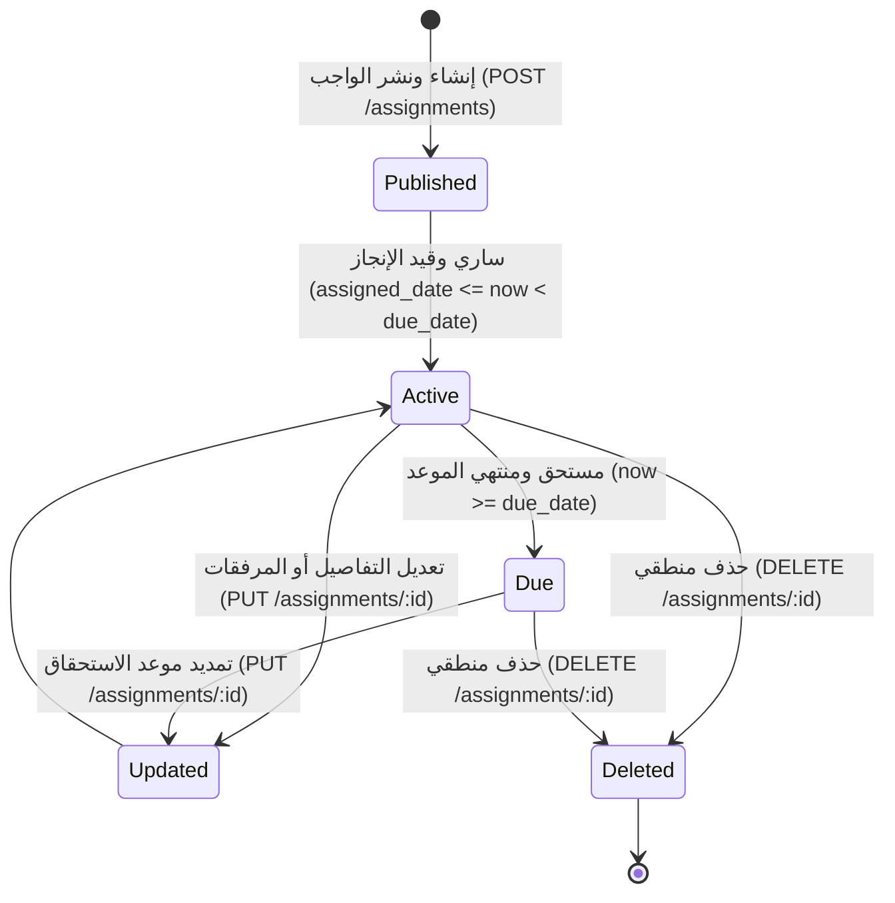

# ⚙️ مواصفات المعمارية والخلفية البرمجية — المرحلة 06 (Backend Architecture & Domain SSoT)

> **الهدف:** توثيق القواعد المنطقية، التحقق، المعالجات الخلفية، ومصفوفة الصلاحيات (RBAC) لإدارة ونشر ومتابعة الواجبات المدرسية والتكاليف المنزلية لجدول `assignments`، بما يطابق بنسبة 100% عقد الشبكة في [`routes.md`](./routes.md) وقواعد البيانات في [`data.md`](./data.md).  
> 
> ⚠️ **تكامل حوكمي صريح وملزم — مرجع الاستجابات (Network SSoT):**  
> ملف [`routes.md`](./routes.md) هو **المصدر الرئيسي والحصري والوحيد لكافة استجابات الـ API (Network SSoT)**. تم تسجيل كامل شكل الاستجابة (JSON Response Body) ورسائل الخطأ والنجاح صراحةً في [`routes.md`](./routes.md) لجميع الرموز والـ Status Codes (`200 OK`, `201 Created`, `400 Bad Request`, `401 Unauthorized`, `403 Forbidden`, `404 Not Found`, `409 Conflict`, `422 Unprocessable Entity`, `500 Server Error`) لكل رابط.  
> 📌 **توجيه إجباري عند البناء والتطوير:** يلتزم المطور بالكامل بإنشاء وتطوير خدمات الخلفية واستجابات الخادم بناءً على الهياكل والرموز المسجلة في ملف [`routes.md`](./routes.md) حصراً بدون أي اجتهاد شخصي.

---

## 1. بطاقة النطاق المعماري والمحددات الفنية (Architecture & Scope Boundary)

### 🟢 ما تشمله المرحلة (In-Scope):
- **إدارة ونشر ومتابعة الواجبات المدرسية (`assignments`) — [6 مسارات]:**
  - استعراض وتصفية وبحث قائمة الواجبات المدرسية بالترقيم والفلترة (`GET /api/v1/assignments`).
  - استعراض التفاصيل الكاملة والمرفقات لواجب مدرسي محدد (`GET /api/v1/assignments/:id`).
  - استعراض كراس واجبات شعبة دراسية محددة في الفصل الدراسي (`GET /api/v1/class-sections/:class_section_id/assignments`).
  - استعراض كراس واجبات صف دراسي كامل بكافة شُعبه (`GET /api/v1/classes/:class_id/assignments`).
  - استعراض الواجبات والتكاليف الصادرة عن معلم محدد (`GET /api/v1/teachers/:teacher_id/assignments`).
  - إنشاء وتعديل واجب مدرسي مع التحقق من إسناد التدريس والتواريخ (`POST & PUT /api/v1/assignments`).
  - حذف وإلغاء واجب مدرسي من المنظومة (`DELETE /api/v1/assignments/:id`).
- **الحوكمة والأمان:**
  - التحقق الصارم من نطاق صلاحية المعلم (`Scoped RBAC`): لا يمكن للمعلم نشر واجب إلا للمواد والشُعب المسندة إليه في جدول `teaching_assignments`.
  - المساندة الإدارية: يحق لمدير النظام (`role_type = 'admin'`) إنشاء الواجبات نيابة عن المعلمين مع توثيق معرف المنشئ الفعلي `created_by_user_id`.
  - إتاحة القراءة فقط للطلاب وأولياء الأمور للواجبات الموجهة لشعبهم المسكنين بها.
  - التحقق من تسلسل التواريخ: `due_date >= assigned_date`.
  - دعم المرفقات المتعددة (`attachments` JSON structure).
  - تسجيل كافة العمليات والتعديلات في سجلات التدقيق `audit_logs`.

### 🔴 خارج نطاق المرحلة (Out-of-Scope):
- تعريف الفصول والشعب الدراسية $\rightarrow$ تابعة للمرحلة `02-C` (`class_sections`).
- تعيين وإسناد تدريس المعلمين للمواد $\rightarrow$ تابعة للمرحلة `03-B` (`teaching_assignments`).
- تسليمات الطلاب وحلول الواجبات وتصحيحها $\rightarrow$ مرحلة مستقلة لحلول الطلاب (`assignment_submissions`).
- التطبيقات والاختبارات الدورية $\rightarrow$ تابعة للمرحلة `07` (`quizzes`).

---

## 2. حوكمة الأدوار وقواعد الوصول وعزل البيانات (RBAC & Scoping Rules)

### 👥 مصفوفة الفاعلين والصلاحيات:
- **مدير النظام (Admin - `role_type = 'admin'`):**
  - يمتلك الصلاحية الكاملة على كافة مسارات الواجبات (استعراض عام، تصفية لكافة الصفوف، نشر نيابة عن المعلمين، تعديل، وحذف).
- **المعلم (Teacher - `role_type = 'teacher'`):**
  - يمتلك صلاحية إنشاء ونشر الواجبات حصراً للمواد والشعب المسندة إليه بإسناد تدريس رسمي (`teaching_assignments`).
  - يمتلك صلاحية تعديل وحذف الواجبات التي أنشأها بنفسه أو المسندة لمادته وشعبته.
  - يمتلك صلاحية استعراض الواجبات الخاصة بشعبه ومواده وجدول واجباته الصادرة عنه.
  - يُحظر عليه نشر أو تعديل واجبات لمواد أو شعب لا يدرسها (`403 Forbidden`).
- **الطالب (Student - `role_type = 'student'`):**
  - يمتلك صلاحية القراءة فقط (`Read-Only`) لاستعراض كراس واجبات الشعبة المسكن بها في الفصل الدراسي النشط (`GET /api/v1/class-sections/:class_section_id/assignments`) وعرض تفاصيل ومرفقات الواجبات.
  - يُحظر عليه إنشاء أو تعديل أو حذف أي واجب (`403 Forbidden`).
- **ولي الأمر (Parent - `role_type = 'parent'`):**
  - يمتلك صلاحية القراءة فقط لاستعراض واجبات الشُعب المسكن بها أبناؤه المكفولون بالمنظومة لمتابعة تكاليفهم المنزلية.
  - يُحظر عليه إنشاء أو تعديل أو حذف أي واجب (`403 Forbidden`).
- **المستخدم غير المصادق عليه (Unauthenticated):**
  - أي طلب يفتقر إلى توكن `Bearer JWT` صالح ونشط يُرفض برمز `401 Unauthorized`.

---

## 3. دورة حياة الكيانات وقواعد ثبات النظام (Lifecycles & System Invariants)

### 🔄 دورة حياة الواجب المدرسي (`Assignment Lifecycle`):

---

## 📚 4. العمليات والخدمات المنطقية للخلفية (`assignments`) — [مواصفات العمليات]

### 📋 جدول العمليات والروابط:

| # | العملية المنطقية (Operation) | HTTP Method & Endpoint | الصلاحية | رمز النجاح | مرجع العقد في `routes.md` |
| :-: | :--- | :--- | :--- | :-: | :--- |
| **1.1** | استعراض وتصفية قائمة الواجبات المدرسية | `GET /api/v1/assignments` | `admin` / `teacher` | `200 OK` | [في routes.md](./routes.md) |
| **1.2** | استعراض تفاصيل ومرفقات واجب محدد | `GET /api/v1/assignments/:id` | `admin` / `teacher` / `student` / `parent` | `200 OK` | [في routes.md](./routes.md) |
| **1.3** | استعراض كراس واجبات شعبة محددة | `GET /api/v1/class-sections/:class_section_id/assignments` | `admin` / `teacher` / `student` / `parent` | `200 OK` | [في routes.md](./routes.md) |
| **1.4** | استعراض كراس واجبات صف دراسي كامل | `GET /api/v1/classes/:class_id/assignments` | `admin` / `teacher` | `200 OK` | [في routes.md](./routes.md) |
| **1.5** | استعراض الواجبات الصادرة عن معلم محدد | `GET /api/v1/teachers/:teacher_id/assignments` | `admin` / `teacher (own)` | `200 OK` | [في routes.md](./routes.md) |
| **1.6** | إنشاء وتعديل واجب مدرسي | `POST /api/v1/assignments` & `PUT /api/v1/assignments/:id` | `admin` / `teacher` | `201 Created` / `200 OK` | [في routes.md](./routes.md) |
| **1.7** | حذف وإلغاء واجب مدرسي | `DELETE /api/v1/assignments/:id` | `admin` / `teacher` | `200 OK` | [في routes.md](./routes.md) |

---

#### 🔹 [Operation 1.1] `GET /api/v1/assignments` — عرض وتصفية قائمة الواجبات المدرسية
- **الغرض والوظيفة:** استرجاع مصفوفة سجلات الواجبات المدرسية مجمعة هرمياً بالصفوف والشعب (`classes -> sections -> assignments`) بدون تكرار للبيانات مع دعم الفلترة بالصف الدراسي `class_id` والشعبة والسمستر والمادة والمعلم وتاريخ الاستحقاق والبحث.
- **عقد الاستجابات والمعاملات (Network SSoT):**
  - معاملات الاستعلام وهياكل الـ JSON الصريحة لـ (`200 OK`) موثقة في [`routes.md`](./routes.md).

#### 🔹 [Operation 1.2] `GET /api/v1/assignments/:id` — عرض تفاصيل ومرفقات واجب محدد
- **الغرض والوظيفة:** جلب السجل الكامل للواجب المدرسي متضمناً مصفوفة المرفقات (`attachments`) وروابط التحميل الآمنة.
- **عقد الاستجابات والمعاملات (Network SSoT):**
  - استجابات (`200 OK`, `404 Not Found`) مسجلة في [`routes.md`](./routes.md).

#### 🔹 [Operation 1.3] `GET /api/v1/class-sections/:class_section_id/assignments` — عرض كراس واجبات شعبة محددة
- **الغرض والوظيفة:** استرجاع كراس واجبات شعبة دراسية معينة للسمستر النشط لتمكين الطلاب وأولياء الأمور والمعلمين من متابعة الواجبات المسندة للشعبة.
- **عقد الاستجابات والمعاملات (Network SSoT):**
  - استجابات (`200 OK`, `404 Not Found`) مسجلة في [`routes.md`](./routes.md).

#### 🔹 [Operation 1.4] `GET /api/v1/classes/:class_id/assignments` — عرض كراس واجبات صف دراسي كامل
- **الغرض والوظيفة:** استرجاع الواجبات المجمعة لكافة شُعب الصف الدراسي في الفصل الدراسي لمتابعة التكاليف على مستوى المستوى الأكاديمي.
- **عقد الاستجابات والمعاملات (Network SSoT):**
  - استجابات (`200 OK`, `404 Not Found`) مسجلة في [`routes.md`](./routes.md).

#### 🔹 [Operation 1.5] `GET /api/v1/teachers/:teacher_id/assignments` — عرض الواجبات الصادرة عن معلم محدد
- **الغرض والوظيفة:** استرجاع كافة الواجبات التي نشرها معلم محدد لمتابعة إنتاجيته ومواعيد تسليم طلابه عبر مختلف الصفوف والشُعب.
- **عقد الاستجابات والمعاملات (Network SSoT):**
  - استجابات (`200 OK`, `404 Not Found`) مسجلة في [`routes.md`](./routes.md).

#### 🔹 [Operation 1.6] `POST /api/v1/assignments` & `PUT /api/v1/assignments/:id` — إنشاء وتعديل واجب مدرسي (Combined Domain Logic)
- **الغرض والوظيفة:**
  - **في الإنشاء (`POST`):** إنشاء ونشر واجب مدرسي جديد وتوثيق منشئه وتاريخ النشر والاستحقاق والمرفقات.
  - **في التعديل (`PUT`):** تحديث عنوان أو تفاصيل أو مرفقات أو تاريخ استحقاق واجب مدرسي قائم.
- **قواعد التحقق المشتركة:**
  - `academic_year_id`: مطلوب، معرف عام دراسي صالح ونشط.
  - `academic_term_id`: مطلوب، معرف فصل دراسي صالح بالعام.
  - `class_section_id`: مطلوب، معرف شعبة دراسية صالحة.
  - `teaching_assignment_id`: مطلوب، معرف إسناد تدريس رسمي يربط الشعبة والمادة والمعلم.
  - `title`: مطلوب، نص لا يتجاوز 200 حرف.
  - `description`: اختياري، نص التعليمات والتفاصيل.
  - `attachments`: اختياري، مصفوفة كائنات مرفقات JSON (`file_name`, `file_url`, `file_type`, `file_size`).
  - `assigned_date`: مطلوب، تاريخ نشر الواجب (`YYYY-MM-DD`).
  - `due_date`: مطلوب، تاريخ الاستحقاق ويجب أن يكون **مساوياً أو بعد** تاريخ التكليف (`due_date >= assigned_date`).
- **فحص النطاق والصلاحيات (Scoped Authorization Check):**
  - إذا كان المستخدم معلماً (`teacher`)، يتم التحقق من أن سجل `teaching_assignment_id` مسند لمعرف المعلم نفسه، وإلا يُرفض برمز `403 Forbidden`.
  - إذا كان المستخدم مدير نظام (`admin`)، يُسمح له بإنشاء وتعديل الواجب ويسجل `created_by_user_id` بمعرف المدير للتدقيق.
- **عقد الاستجابات والمعاملات (Network SSoT):**
  - استجابات (`201 Created`, `200 OK`, `403 Forbidden`, `404 Not Found`, `422 Unprocessable Entity`) مسجلة في [`routes.md`](./routes.md).

#### 🔹 [Operation 1.7] `DELETE /api/v1/assignments/:id` — حذف وإلغاء واجب مدرسي
- **الغرض والوظيفة:** حذف السجل منطقياً (Soft Delete) عبر تعيين طابع `deleted_at` مع التحقق من ملكية السجل وتوثيق الإلغاء في `audit_logs`.
- **عقد الاستجابات والمعاملات (Network SSoT):**
  - استجابات (`200 OK`, `403 Forbidden`, `404 Not Found`) مسجلة في [`routes.md`](./routes.md).

---

## 🔒 5. الأمان وسجل التدقيق الإداري (Audit Logging & Data Integrity)

1. **توثيق العمليات الحساسة في `audit_logs`:**
   - توثيق عمليات نشر وتعديل وحذف الواجبات المدرسية مع تسجيل `user_id` الفعلي، ونوع الإجراء (`ASSIGNMENT_CREATED`, `ASSIGNMENT_UPDATED`, `ASSIGNMENT_DELETED`)، والبيانات قبل وبعد التعديل.
2. **سلامة المرفقات والتخزين السحابي:**
   - التحقق من نوعية الملفات المرفقة وصلاحية روابط التخزين السحابي وحجم الملفات المسموح بها قبل حفظها في مصفوفة `attachments` بصيغة JSON.
