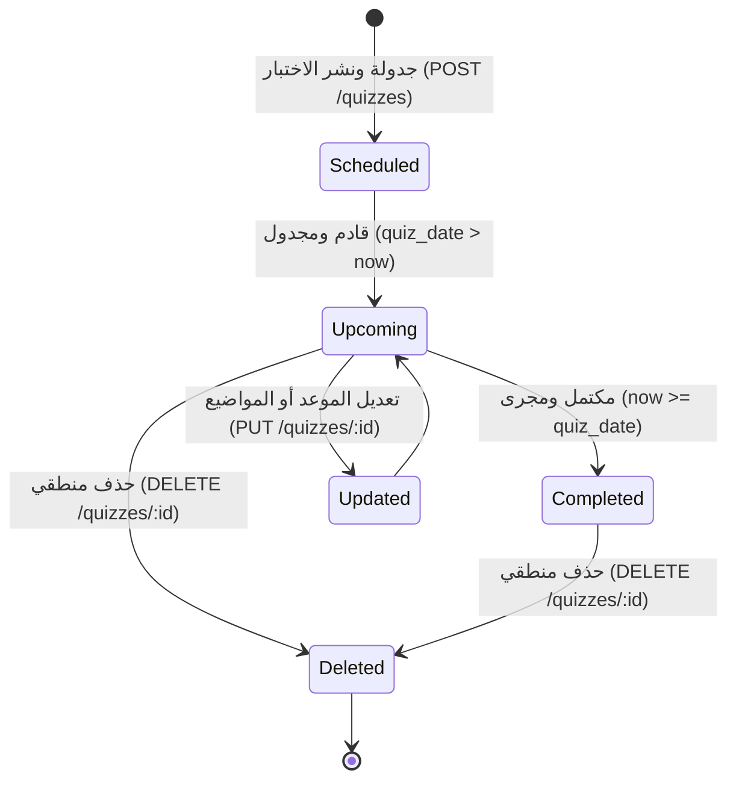

# ⚙️ مواصفات المعمارية والخلفية البرمجية — المرحلة 07 (Backend Architecture & Domain SSoT)

> **الهدف:** توثيق القواعد المنطقية، التحقق، المعالجات الخلفية، ومصفوفة الصلاحيات (RBAC) لإدارة وجدولة ونشر الاختبارات والتطبيقات الدورية والشهرية لجدول `quizzes`، بما يطابق بنسبة 100% عقد الشبكة في [`routes.md`](./routes.md) وقواعد البيانات في [`data.md`](./data.md).  
> 
> ⚠️ **تكامل حوكمي صريح وملزم — مرجع الاستجابات (Network SSoT):**  
> ملف [`routes.md`](./routes.md) هو **المصدر الرئيسي والحصري والوحيد لكافة استجابات الـ API (Network SSoT)**. تم تسجيل كامل شكل الاستجابة (JSON Response Body) ورسائل الخطأ والنجاح صراحةً في [`routes.md`](./routes.md) لجميع الرموز والـ Status Codes (`200 OK`, `201 Created`, `400 Bad Request`, `401 Unauthorized`, `403 Forbidden`, `404 Not Found`, `409 Conflict`, `422 Unprocessable Entity`, `500 Server Error`) لكل رابط.  
> 📌 **توجيه إجباري عند البناء والتطوير:** يلتزم المطور بالكامل بإنشاء وتطوير خدمات الخلفية واستجابات الخادم بناءً على الهياكل والرموز المسجلة في ملف [`routes.md`](./routes.md) حصراً بدون أي اجتهاد شخصي.

---

## 1. بطاقة النطاق المعماري والمحددات الفنية (Architecture & Scope Boundary)

### 🟢 ما تشمله المرحلة (In-Scope):
- **إدارة وجدولة ونشر الاختبارات والتطبيقات الدورية (`quizzes`) — [4 مسارات موحدة]:**
  - استعراض وتصفية وبحث قائمة الاختبارات والتطبيقات بالترقيم والهيكلة الهرمية (`classes -> sections -> quizzes`) بالصف والشعبة والمعلم والمادة وحالة الموعد (`GET /api/v1/quizzes`).
  - استعراض التفاصيل الكاملة والمرفقات ونماذج المراجعة لاختبار محدد (`GET /api/v1/quizzes/:id`).
  - إنشاء وتعديل اختبار/تطبيق دوري مع التحقق الصارم من إسناد التدريس وتاريخ الإجراء (`POST & PUT /api/v1/quizzes`).
  - حذف وإلغاء اختبار/تطبيق دوري من المنظومة (`DELETE /api/v1/quizzes/:id`).
- **الحوكمة والأمان وحماية الأداء (High Performance & Scoped RBAC):**
  - حصر الاستعلام التلقائي بالفصل الدراسي النشط (`academic_term_id`) وفرض ترقيم الصفحات (`Pagination`) لمنع الاستعلامات غير المحصورة.
  - التحقق الصارم من نطاق صلاحية المعلم (`Scoped RBAC`): لا يمكن للمعلم جدولة أو تعديل اختبار إلا للمواد والشُعب المسندة إليه رسمياً في جدول `teaching_assignments`.
  - المساندة الإدارية: يحق لمدير النظام (`role_type = 'admin'`) جدولة الاختبارات نيابة عن المعلمين مع توثيق معرف المنشئ الفعلي `created_by_user_id`.
  - إتاحة القراءة فقط للطلاب وأولياء الأمور للتطبيقات الموجهة لشعبهم المسكنين بها.
  - دعم المرفقات ونماذج المراجعة (`attachments` JSON structure).
  - تسجيل كافة العمليات والتعديلات في سجلات التدقيق `audit_logs`.

### 🔴 خارج نطاق المرحلة (Out-of-Scope):
- تعريف الفصول والشعب الدراسية $\rightarrow$ تابعة للمرحلة `02-C` (`class_sections`).
- تعيين وإسناد تدريس المعلمين للمواد $\rightarrow$ تابعة للمرحلة `03-B` (`teaching_assignments`).
- الواجبات والتكاليف المنزلية $\rightarrow$ تابعة للمرحلة `06` (`assignments`).
- الامتحانات النصفية والنهائية الرسمية وجداول الامتحانات $\rightarrow$ تابعة للمرحلة `08` (`official_exams`).
- رصد درجات وتجميد الصحائف الأكاديمية والترحيل $\rightarrow$ تابعة للمرحلة `09` (`student_transcripts`).

---

## 2. حوكمة الأدوار وقواعد الوصول وعزل البيانات (RBAC & Scoping Rules)

### 👥 مصفوفة الفاعلين والصلاحيات:
- **مدير النظام (Admin - `role_type = 'admin'`):**
  - يمتلك الصلاحية الكاملة على كافة مسارات التطبيقات والاختبارات (استعراض عام، تصفية لكافة الصفوف، جدولة نيابة عن المعلمين، تعديل، وحذف).
- **المعلم (Teacher - `role_type = 'teacher'`):**
  - يمتلك صلاحية إنشاء وجدولة الاختبارات والتطبيقات حصراً للمواد والشعب المسندة إليه بإسناد تدريس رسمي (`teaching_assignments`).
  - يمتلك صلاحية تعديل وحذف الاختبارات التي أنشأها بنفسه أو المسندة لمادته وشعبته.
  - يمتلك صلاحية استعراض الاختبارات الخاصة بشعبه ومواده.
  - يُحظر عليه نشر أو تعديل اختبارات لمواد أو شعب لا يدرسها (`403 Forbidden`).
- **الطالب (Student - `role_type = 'student'`):**
  - يمتلك صلاحية القراءة فقط (`Read-Only`) لاستعراض الاختبارات والتطبيقات الموجهة للشعبة المسكن بها بالعام والسمستر النشط وتفاصيلها ومرفقاتها ومواعيدها للاستعداد لها.
  - يُحظر عليه إنشاء أو تعديل أو حذف أي اختبار (`403 Forbidden`).
- **ولي الأمر (Parent - `role_type = 'parent'`):**
  - يمتلك صلاحية القراءة فقط لاستعراض جدول ومواعيد اختبارات وتطبيقات الشُعب المسكن بها أبناؤه المكفولون بالمنظومة لمتابعة استعدادهم الأكاديمي.
  - يُحظر عليه إنشاء أو تعديل أو حذف أي تطبيق (`403 Forbidden`).
- **المستخدم غير المصادق عليه (Unauthenticated):**
  - أي طلب يفتقر إلى توكن `Bearer JWT` صالح ونشط يُرفض برمز `401 Unauthorized`.

---

## 3. دورة حياة الكيانات وقواعد ثبات النظام (Lifecycles & System Invariants)

### 🔄 دورة حياة الاختبار/التطبيق الدوري (`Quiz Lifecycle`):

---

## 📝 4. العمليات والخدمات المنطقية للخلفية (`quizzes`) — [مواصفات العمليات]

### 📋 جدول العمليات والروابط:

| # | العملية المنطقية (Operation) | HTTP Method & Endpoint | الصلاحية | رمز النجاح | مرجع العقد في `routes.md` |
| :-: | :--- | :--- | :--- | :-: | :--- |
| **1.1** | استعراض وتصفية مصفوفة الاختبارات بالترقيم والهيكلة الهرمية | `GET /api/v1/quizzes` | `admin` / `teacher` / `student` / `parent` | `200 OK` | [في routes.md](./routes.md) |
| **1.2** | استعراض تفاصيل ومرفقات اختبار محدد | `GET /api/v1/quizzes/:id` | `admin` / `teacher` / `student` / `parent` | `200 OK` | [في routes.md](./routes.md) |
| **1.3** | إنشاء وتعديل اختبار/تطبيق دوري | `POST /api/v1/quizzes` & `PUT /api/v1/quizzes/:id` | `admin` / `teacher` | `201 Created` / `200 OK` | [في routes.md](./routes.md) |
| **1.4** | حذف وإلغاء اختبار/تطبيق دوري | `DELETE /api/v1/quizzes/:id` | `admin` / `teacher` | `200 OK` | [في routes.md](./routes.md) |

---

#### 🔹 [Operation 1.1] `GET /api/v1/quizzes` — عرض وتصفية قائمة الاختبارات بالترقيم والهيكلة الهرمية
- **الغرض والوظيفة:** استرجاع مصفوفة سجلات الاختبارات والتطبيقات مجمعة هرمياً بالصفوف والشعب (`classes -> sections -> quizzes`) بدون تكرار للبيانات مع دعم الفلترة الدقيقة بالصف الدراسي `class_id` والشعبة `class_section_id` والمعلم `teacher_id` والمادة `subject_id` وحالة الموعد `status: upcoming | completed`.
- **حماية الأداء:** يُلزم الاستعلام بحصر البيانات بالفصل الدراسي النشط افتراضياً وتطبيق ترقيم الصفحات (`page & per_page`) لمنع أي استعلام غير محصور.
- **عقد الاستجابات والمعاملات (Network SSoT):**
  - معاملات الاستعلام وهياكل الـ JSON الصريحة لـ (`200 OK`) موثقة في [`routes.md`](./routes.md).

#### 🔹 [Operation 1.2] `GET /api/v1/quizzes/:id` — عرض تفاصيل ومرفقات ومواضيع اختبار محدد
- **الغرض والوظيفة:** جلب السجل الكامل للاختبار الدوري متضمناً مواضيع الاختبار المقررة (`description`) ومصفوفة المرفقات ونماذج المراجعة (`attachments`) وروابط التحميل الآمنة.
- **عقد الاستجابات والمعاملات (Network SSoT):**
  - استجابات (`200 OK`, `404 Not Found`) مسجلة في [`routes.md`](./routes.md).

#### 🔹 [Operation 1.3] `POST /api/v1/quizzes` & `PUT /api/v1/quizzes/:id` — إنشاء وتعديل اختبار/تطبيق دوري (Combined Domain Logic)
- **الغرض والوظيفة:**
  - **في الإنشاء (`POST`):** جدولة ونشر اختبار دوري جديد وتوثيق منشئه وتاريخ إجرائه والمرفقات والمواضيع المقررة.
  - **في التعديل (`PUT`):** تحديث عنوان أو تفاصيل أو مواضيع أو مرفقات أو تاريخ إجراء اختبار قائم.
- **قواعد التحقق المشتركة:**
  - `academic_year_id`: مطلوب، معرف عام دراسي صالح ونشط.
  - `academic_term_id`: مطلوب، معرف فصل دراسي صالح بالعام.
  - `class_section_id`: مطلوب، معرف شعبة دراسية صالحة.
  - `teaching_assignment_id`: مطلوب، معرف إسناد تدريس رسمي يربط الشعبة والمادة والمعلم.
  - `title`: مطلوب، نص لا يتجاوز 200 حرف.
  - `description`: اختياري، نص المواضيع المقررة والتعليمات الإرشادية.
  - `attachments`: اختياري، مصفوفة كائنات مرفقات ونماذج مراجعة JSON (`file_name`, `file_url`, `file_type`, `file_size`).
  - `quiz_date`: مطلوب، تاريخ إجراء التطبيق في الفصل الدراسي (`YYYY-MM-DD`).
- **فحص النطاق والصلاحيات (Scoped Authorization Check):**
  - إذا كان المستخدم معلماً (`teacher`)، يتم التحقق من أن سجل `teaching_assignment_id` مسند لمعرف المعلم نفسه، وإلا يُرفض برمز `403 Forbidden`.
  - إذا كان المستخدم مدير نظام (`admin`)، يُسمح له بإنشاء وتعديل الاختبار ويسجل `created_by_user_id` بمعرف المدير للتدقيق.
- **عقد الاستجابات والمعاملات (Network SSoT):**
  - استجابات (`201 Created`, `200 OK`, `403 Forbidden`, `404 Not Found`, `422 Unprocessable Entity`) مسجلة في [`routes.md`](./routes.md).

#### 🔹 [Operation 1.4] `DELETE /api/v1/quizzes/:id` — حذف وإلغاء اختبار دوري
- **الغرض والوظيفة:** حذف السجل منطقياً (Soft Delete) عبر تعيين طابع `deleted_at` مع التحقق من ملكية السجل وتوثيق الإلغاء في `audit_logs`.
- **عقد الاستجابات والمعاملات (Network SSoT):**
  - استجابات (`200 OK`, `403 Forbidden`, `404 Not Found`) مسجلة في [`routes.md`](./routes.md).

---

## 🔒 5. الأمان وسجل التدقيق الإداري (Audit Logging & Data Integrity)

1. **توثيق العمليات الحساسة في `audit_logs`:**
   - توثيق عمليات جدولة وتعديل وحذف الاختبارات والتطبيقات مع تسجيل `user_id` الفعلي، ونوع الإجراء (`QUIZ_CREATED`, `QUIZ_UPDATED`, `QUIZ_DELETED`)، والبيانات قبل وبعد التعديل.
2. **سلامة المرفقات والتخزين السحابي:**
   - التحقق من نوعية الملفات المرفقة (نماذج امتحانات سابقة، ملخصات مراجعة) وصلاحية روابط التخزين السحابي وحجم الملفات المسموح بها قبل حفظها في مصفوفة `attachments` بصيغة JSON.

---

## 6. معايير القبول الهندسية للباك إند (Backend Acceptance Criteria)

تعتبر متطلبات الخادم لهذه المرحلة مستوفاة بالكامل عند تحقق المعايير التالية:

- [ ] تقييد صلاحية إنشاء وتعديل وجدولة الاختبارات للمعلم ضمن فصوله ومواده الموكلة إليه بإسناد التدريس `teaching_assignments` أو للإدارة المساندة.
- [ ] إرجاع `401 Unauthorized` لأي طلب بدون توكن مصادقة صالح.
- [ ] إرجاع `403 Forbidden` عند محاولة المعلم جدولة أو تعديل اختبار لمادة أو شعبة لا يدرسها، أو عند محاولة الطالب/ولي الأمر التعديل.
- [ ] التحقق الصارم من صحة تاريخ إجراء الاختبار `quiz_date` في الفصل الدراسي وإرجاع `422 Unprocessable Entity` عند عدم الصلاحية.
- [ ] دعم الفلترة الأفقية الشاملة بالصف والشعبة والمعلم والمادة وحالة الموعد محصورة بالترقيم القياسي.
- [ ] حفظ مصفوفة المرفقات ونماذج المراجعة ككائن JSON سليم يتضمن تفاصيل الملفات وروابطها الآمنة.
- [ ] تنفيذ الحذف المنطقي بضبط `deleted_at` وتوثيق كافة العمليات في سجل التدقيق `audit_logs`.
- [ ] مطابقة كافة المدخلات والمخرجات بنسبة 100% لعقد الشبكة في [`routes.md`](./routes.md).

