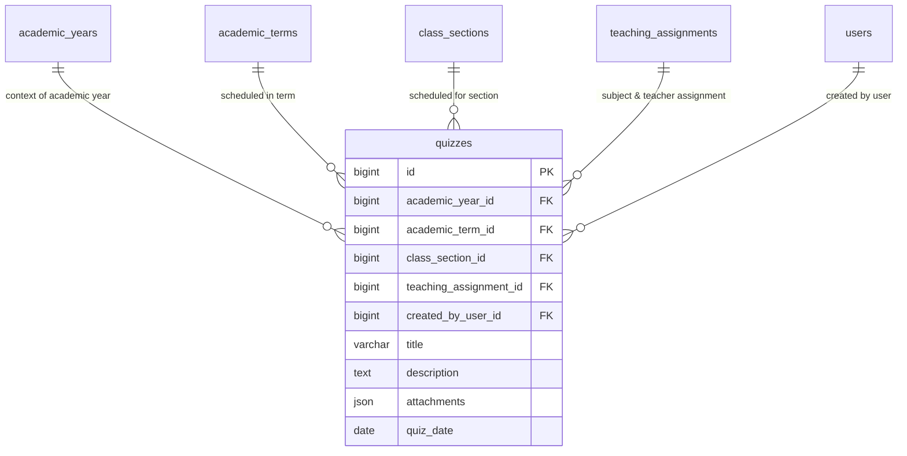

# 📊 مواصفات البيانات والكيانات — المرحلة 07 (Data Specification)

> **الهدف:** توثيق المخطط الهيكلي لجدول التطبيقات والاختبارات الدورية (`quizzes`) المطابق بنسبة 100% للمصدر الرئيسي والحصري للحقيقة: [`MD/database.md`](../../database.md).  
> 
> ⚠️ **إرشادات وتنبيهات حوكمية إجبارية (System Governance Directives):**  
> 1. **قواعد العمل العامة (Business Rules SSoT):** يلزم على المطور أو الذكاء الاصطناعي قراءة واعتماد **ملف القواعد العامة بالمنظومة [`MD/business_rules.md`](../../business_rules.md)** والالتزام التام بكافة القيود ومصفوفة الصلاحيات والحوكمة المذكورة فيه قبل التكوييد والبناء.  
> 2. **مرجع شبكة الطلبات والاستجابات (Network SSoT):** ملف [`routes.md`](./routes.md) هو المصدر الرئيسي والوحيد لعقد الشبكة بالمنظومة؛ حيث تم توثيق **جسم الطلب الكامل (`Request Body Payload`)** لكل رابط، و**كامل شكل الاستجابة الصريحة (`Response Body Payload`)** لجميع الرموز والـ Status Codes (`200 OK`, `201 Created`, `400 Bad Request`, `401 Unauthorized`, `403 Forbidden`, `404 Not Found`, `409 Conflict`, `422 Unprocessable`, `500 Server Error`).  
> 📌 **توجيه إجباري عند البناء والتطوير:** يلتزم المطور بالكامل برسم وبناء مدخلات ومخرجات كود الـ Controllers والواجهات بناءً على الهياكل والرموز المسجلة في ملف [`routes.md`](./routes.md) حصراً بدون أي اجتهاد شخصي.

---

## 1. هيكل جدول التطبيقات والاختبارات الدورية (`quizzes`)

> **الوصف:** جدول جدولة وإعلان مواعيد وتفاصيل الاختبارات الدورية والتطبيقات الشهرية التي ينشئها المعلم (أو الإدارة بصفة وكيل) لتمكين الطلاب وأولياء الأمور من الاطلاع عليها والاستعداد لها لكل عام دراسي وسمستر وشعبة.

### 📋 هيكل الأعمدة (Columns Matrix):

| اسم العمود (Column) | نوع البيانات (MySQL Type) | القيود والخصائص (Constraints) | الوصف والدلالة الوظيفية |
| :--- | :--- | :--- | :--- |
| `id` | `BIGINT UNSIGNED` | `PRIMARY KEY AUTO_INCREMENT` | المعرف الرقمي الفريد للتطبيق. |
| `academic_year_id` | `BIGINT UNSIGNED` | `NOT NULL, INDEXED` | معرف العام الدراسي النشط (يرتبط بـ `academic_years.id`). |
| `academic_term_id` | `BIGINT UNSIGNED` | `NOT NULL` | معرف الفصل الدراسي/السمستر (يرتبط بـ `academic_terms.id`). |
| `class_section_id` | `BIGINT UNSIGNED` | `NOT NULL, INDEXED` | معرف الفصل والشعبة الموجه لها التطبيق (يرتبط بـ `class_sections.id`). |
| `teaching_assignment_id` | `BIGINT UNSIGNED` | `NOT NULL, INDEXED` | معرف إسناد التدريس (يرتبط بـ `teaching_assignments.id` لتحديد المادة والمعلم بدقة). |
| `created_by_user_id` | `BIGINT UNSIGNED` | `NOT NULL` | المستخدم الفعلي الذي أنشأ السجل (يرتبط بـ `users.id` لتوثيق المنشئ سواء كان المعلم أو الإدارة). |
| `title` | `VARCHAR(200)` | `NOT NULL` | عنوان التطبيق (مثال: `تطبيق شهري 1 - الجبر`). |
| `description` | `TEXT` | `NULL DEFAULT NULL` | مواضيع الاختبار المقررة والتعليمات الإرشادية للطلاب. |
| `attachments` | `JSON` | `NULL DEFAULT NULL` | مصفوفة ملفات وصور مرفقة بالتطبيق بصيغة JSON (نماذج أسئلة، ملخصات، مراجعات). |
| `quiz_date` | `DATE` | `NOT NULL, INDEXED` | تاريخ وموعد إجراء التطبيق في الفصل. |
| `created_at` | `TIMESTAMP` | `NOT NULL, DEFAULT CURRENT_TIMESTAMP` | توقيت إنشاء السجل. |
| `updated_at` | `TIMESTAMP` | `NULL ON UPDATE CURRENT_TIMESTAMP` | توقيت آخر تحديث. |
| `deleted_at` | `TIMESTAMP` | `NULL DEFAULT NULL` | طابع الحذف المنطقي. |

---

### 🔗 العلاقات والمفاتيح الخارجية (Foreign Keys):
* `academic_year_id` يرتبط بجدول `academic_years(id)` مع `ON DELETE RESTRICT, ON UPDATE CASCADE`.
* `academic_term_id` يرتبط بجدول `academic_terms(id)` مع `ON DELETE RESTRICT, ON UPDATE CASCADE`.
* `class_section_id` يرتبط بجدول `class_sections(id)` مع `ON DELETE RESTRICT, ON UPDATE CASCADE`.
* `teaching_assignment_id` يرتبط بجدول `teaching_assignments(id)` مع `ON DELETE RESTRICT, ON UPDATE CASCADE`.
* `created_by_user_id` يرتبط بجدول `users(id)` مع `ON DELETE RESTRICT, ON UPDATE CASCADE`.

---

### ⚡ الفهارس والقيود (Indexes & Constraints):
* `PRIMARY KEY (id)`
* `INDEX idx_quizzes_section_term (class_section_id, academic_term_id)`  
  *(فهرس استعلام فائق السرعة لعرض جدول مواعيد تطبيقات الطالب في السمستر الحالي).*
* `INDEX idx_quizzes_teaching (teaching_assignment_id)`
* `INDEX idx_quizzes_academic_year (academic_year_id)`
* `INDEX idx_quizzes_date (quiz_date)`

---

## 2. مخطط الكيانات والعلاقات لـ Phase 07 (ERD)

