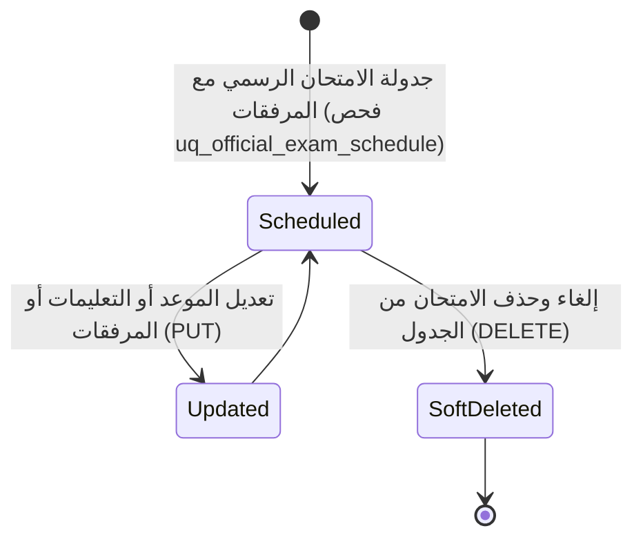

# ⚙️ مواصفات Backend — المرحلة 08: جدول الامتحانات الرسمية (Official Exams Schedule)

> **الهدف:** توثيق منطق المعالجة وقواعد التحقق وقواعد حوكمة جدول الامتحانات الرسمية (النصفية والنهائية والدور الثاني) لجدول `official_exams` والمرفقات المطابقة بنسبة 100% لـ [`MD/database.md`](../../database.md) و [`MD/business_rules.md`](../../business_rules.md)، مع دمج وتوحيد منطق الإنشاء والتعديل (`POST & PUT`) لتوفير الوضوح والرشاقة والحيادية التقنية التامة (Zero ORM Leakage).  
> 
> ⚠️ **تكامل حوكمي صريح وملزم — مرجع الاستجابات (Network SSoT):**  
> ملف [`routes.md`](./routes.md) هو **المصدر الرئيسي والحصري والوحيد لكافة استجابات ومدخلات الـ API (Network SSoT)**. تم تسجيل كامل شكل الاستجابة (JSON Response Body) ورسائل الخطأ والنجاح صراحةً في [`routes.md`](./routes.md) لجميع الرموز والـ Status Codes (`200 OK`, `201 Created`, `400 Bad Request`, `401 Unauthorized`, `403 Forbidden`, `404 Not Found`, `409 Conflict`, `422 Unprocessable Entity`, `500 Internal Server Error`) لكل رابط.  
> 📌 **توجيه إجباري عند البناء والتطوير:** يلتزم المطور أو نموذج الذكاء الاصطناعي بالكامل بإنشاء ورسم كود الخادم واستجابات الـ API بناءً على الهياكل والرموز المسجلة في ملف [`routes.md`](./routes.md) حصراً بدون أي اجتهاد شخصي.

---

## 1. نطاق المرحلة والحدود المعمارية (Scope & Boundaries)

### 🟢 ما تشمله المرحلة (In-Scope):
- **إدارة جدول الامتحانات الرسمية (`official_exams`) — [6 عمليات مدمجة تغطي 7 مسارات]:**
  - استعراض وتصفية وبحث جدول الامتحانات الرسمية بالترقيم والفلترة بالصف والمادة والمعلم (`GET /api/v1/official-exams`) — خاص بالإدارة حصراً.
  - استعراض تفاصيل امتحان رسمي محدد والتعليمات والقاعة والمرفقات الكاملة (`GET /api/v1/official-exams/:id`).
  - استعراض مصفوفة جدول امتحانات الصف الدراسي المعتمدة بالسمستر (`GET /api/v1/classes/:class_id/official-exams`) — خاص بالطالب وولي الأمر.
  - استعراض جدول الامتحانات الرسمية لمواد وصفوف معلم محدد (`GET /api/v1/teachers/:teacher_id/official-exams`) — خاص بالمعلم.
  - إضافة وتعديل جدولة موعد امتحان رسمي مع دعم المرفقات (`attachments JSON`) وفحص قيد التفرد (`POST & PUT /api/v1/official-exams`) — خاص بالإدارة.
  - حذف وإلغاء امتحان رسمي من الجدول المعتمد (`DELETE /api/v1/official-exams/:id`) — خاص بالإدارة.
- **الحوكمة وقواعد ثبات النظام:**
  - قصر صلاحيات إدارة وجدولة الامتحانات الرسمية وتعديلها وإلغائها حصراً على مدير النظام (`role_type = 'admin'`).
  - إتاحة جدول امتحانات الصف للطالب وولي الأمر بنمط القراءة فقط عبر مسارهما المخصص.
  - إتاحة جدول امتحانات المواد للمعلم بنمط القراءة فقط عبر مساره المخصص.
  - ربط جدول امتحانات المعلم آلياً بسجلات التدريس `teaching_assignments`.
  - فرض قيد تفرد جدولة المادة بالسمستر والنوع (`uq_official_exam_schedule: academic_year_id, academic_term_id, class_id, subject_id, exam_type`).
  - توثيق كافة حركات الجدولة والتعديل والإلغاء في سجلات التدقيق `audit_logs`.

### 🔴 خارج نطاق المرحلة (Out-of-Scope):
- إنشاء الواجبات والمهام المدرسية $\rightarrow$ تابعة للمرحلة `06` (`assignments`).
- إنشاء الاختبارات والتقييمات الدورية القصيرة $\rightarrow$ تابعة للمرحلة `07` (`quizzes`).
- رصد وتجميد درجات الامتحانات بالصحائف النهائية والترحيل $\rightarrow$ تابعة للمرحلة `09` (`student_transcripts`, `promotion_batches`).

---

## 2. حوكمة الأدوار وقواعد الوصول وعزل البيانات (RBAC & Scoping Rules)

### 👥 مصفوفة الفاعلين والصلاحيات:
- **مدير النظام (Admin - `role_type = 'admin'`):**
  - يمتلك الصلاحية الحصرية على مسار إدارة وجدولة وتصفية كافة الامتحانات الرسمية على مستوى المدرسة (`GET /api/v1/official-exams`).
  - ينفرد بكافة صلاحيات الإضافة، التعديل، الحذف، وإرفاق الملفات (`POST`, `PUT`, `DELETE`).
  - عند رغبته في استعراض جدول صف أو معلم، يعتمد على مساره الرئيسي بالفلترة (`?class_id=X` أو `?teacher_id=X`).
- **المعلم (Teacher - `role_type = 'teacher'`):**
  - يمتلك صلاحية استعراض جدول امتحانات مواده وصفوفه الخاصة حصراً عبر `GET /api/v1/teachers/:teacher_id/official-exams` ومعاينة تفاصيل ومرفقات الامتحان عبر `GET /api/v1/official-exams/:id` بنمط القراءة فقط (`200 OK`).
  - يُحظر عليه الوصول للمسار الإداري العام 1.1، أو إضافة أو تعديل أو حذف أي امتحان رسمي (`403 Forbidden`).
- **الطالب (Student) وولي الأمر (Parent):**
  - يمتلك الطالب وولي أمره صلاحية استعراض جدول امتحانات الصف الدراسي المعني حصراً عبر `GET /api/v1/classes/:class_id/official-exams` ومعاينة المرفقات والتفاصيل عبر `GET /api/v1/official-exams/:id` بنمط القراءة فقط.
  - يُحظر عليهم الوصول للمسار الإداري العام 1.1، أو إجراء أي تعديل أو حذف (`403 Forbidden`).
- **المستخدم غير المصادق عليه (Unauthenticated):**
  - أي طلب يفتقر إلى توكن `Bearer JWT` صالح ونشط يُرفض برمز `401 Unauthorized`.

---

## 3. دورة حياة الكيانات وقواعد ثبات النظام (Lifecycles & System Invariants)

### 🔒 قواعد ثبات النظام الصارمة (System Invariants):
1. **قيد تفرد المادة بالنوع والسمستر (`uq_official_exam_schedule`):**
   - يمنع منعاً باتاً تكرار جدولة امتحان رسمي لنفس المادة والصف الدراسي في نفس العام الدراسي والفصل الدراسي ونوع الامتحان (`midterm`, `final`, `second_round`).
   - عند محاولة تكرار الجدولة، يرفض الطلب فوراً برمز `409 Conflict`.
2. **حوكمة تخزين المرفقات (`attachments JSON Invariant`):**
   - تُخزن المرفقات كمصفوفة JSON تضم: اسم الملف (`file_name`)، رابطه السحابي الآمن (`file_url`)، نوع الملف (`file_type`)، وحجمه بالبايت (`file_size`).
3. **دورة حياة الحذف المنطقي (Soft Delete Lifecycle):**
   - عند إلغاء امتحان، يتم ضبط `deleted_at = CURRENT_TIMESTAMP` واستبعاده من الجداول النشطة.
4. **سجلات التدقيق (Audit Logging):**
   - تسجل كافة حركات الجدولة وتعديل المواعيد والإلغاء في جدول `audit_logs`.

---

## 4. العمليات المنطقية والمسارات التفصيلية للمجال (Domain Operations & Routes)

---

### 📝 الخطوة 1: إدارة جدول الامتحانات الرسمية (`official_exams`)

#### 📋 جدول العمليات المدمجة:
| # | العملية المنطقية (Operation) | HTTP Method & Endpoint | الصلاحية | رمز النجاح | مرجع العقد في `routes.md` |
| :-: | :--- | :--- | :--- | :-: | :--- |
| **1.1** | استعراض وتصفية جدول الامتحانات الرسمي للمدرسة | `GET /api/v1/official-exams` | `admin` *(حصراً)* | `200 OK` | [في routes.md](./routes.md) |
| **1.2** | استعراض تفاصيل امتحان رسمي والمرفقات | `GET /api/v1/official-exams/:id` | `admin` / `teacher` / `student` / `parent` | `200 OK` | [في routes.md](./routes.md) |
| **1.3** | استعراض جدول امتحانات الصف الدراسي | `GET /api/v1/classes/:class_id/official-exams` | `student` / `parent` *(حصراً)* | `200 OK` | [في routes.md](./routes.md) |
| **1.4** | استعراض جدول امتحانات مواد المعلم | `GET /api/v1/teachers/:teacher_id/official-exams` | `teacher (own)` *(حصراً)* | `200 OK` | [في routes.md](./routes.md) |
| **1.5** | إضافة وتعديل جدولة امتحان رسمي | `POST /api/v1/official-exams` & `PUT /api/v1/official-exams/:id` | `admin` | `201 Created` / `200 OK` | [في routes.md](./routes.md) |
| **1.6** | حذف وإلغاء امتحان رسمي من الجدول | `DELETE /api/v1/official-exams/:id` | `admin` | `200 OK` | [في routes.md](./routes.md) |

---

#### 🔹 [Operation 1.1] `GET /api/v1/official-exams` — استعراض وتصفية جدول الامتحانات الرسمية (لوحة تحكم الإدارة)
- **الغرض والوظيفة:** استرجاع قائمة سجلات جدول الامتحانات بالهيكل الهرمي مع الفلترة بالصف `class_id` والمادة والسمستر ونوع الامتحان والمعلم `teacher_id` ومؤشر `attachments_count`. خاص بمدير النظام حصراً.
- **عقد الاستجابات (Network SSoT):** مسجلة في [`routes.md`](./routes.md).

#### 🔹 [Operation 1.2] `GET /api/v1/official-exams/:id` — استعراض تفاصيل امتحان رسمي والمرفقات
- **الغرض والوظيفة:** جلب البيانات التفصيلية والتوجيهات والقاعة ومصفوفة المرفقات الكاملة `attachments` للامتحان المحدد.
- **عقد الاستجابات (Network SSoT):** مسجلة في [`routes.md`](./routes.md).

#### 🔹 [Operation 1.3] `GET /api/v1/classes/:class_id/official-exams` — استعراض جدول امتحانات الصف الدراسي (للطالب والولي)
- **الغرض والوظيفة:** جلب جدول الامتحانات المعتمد لصف دراسي محدد مجمعاً بأنواع الامتحانات (نصفي ونهائي) مع مؤشرات المرفقات للطباعة والعرض.
- **عقد الاستجابات (Network SSoT):** مسجلة في [`routes.md`](./routes.md).

#### 🔹 [Operation 1.4] `GET /api/v1/teachers/:teacher_id/official-exams` — استعراض جدول امتحانات مواد المعلم
- **الغرض والوظيفة:** جلب مواعيد الامتحانات الرسمية لكافة المواد والصفوف المسندة للمعلم عبر جدول `teaching_assignments`.
- **عقد الاستجابات (Network SSoT):** مسجلة في [`routes.md`](./routes.md).

#### 🔹 [Operation 1.5] `POST /api/v1/official-exams` & `PUT /api/v1/official-exams/:id` — إضافة وتعديل جدولة امتحان رسمي (Combined Domain Logic)
- **الغرض والوظيفة:**
  - **في الإنشاء (`POST`):** اعتماد وجدولة موعد امتحان رسمي جديد لصف ومادة بالسمستر مع دعم المرفقات والتحقق من عدم التكرار.
  - **في التعديل (`PUT`):** تحديث موعد الامتحان أو التاريخ أو الملاحظات والإرشادات أو قائمة المرفقات.
- **قواعد التحقق المشتركة (Validation Rules):**
  - `academic_year_id`: مطلوب، معرف عام دراسي صالح ونشط.
  - `academic_term_id`: مطلوب، معرف فصل دراسي صالح.
  - `class_id`: مطلوب، معرف صف دراسي صالح.
  - `subject_id`: مطلوب، معرف مادة صالحة للصف المحدد.
  - `exam_type`: مطلوب، أحد الأنواع المعيارية (`midterm`, `final`, `second_round`).
  - `exam_date`: مطلوب، تاريخ صالح بصيغة `YYYY-MM-DD`.
  - `notes`: اختياري، نص لا يتجاوز 255 حرفاً.
  - `attachments`: اختياري، مصفوفة من كائنات المرفقات الصالحة (`file_name`, `file_url`, `file_type`, `file_size`).
  - **قيد التفرد:** التحقق من عدم تكرار جدولة امتحان رسمي لنفس المادة والصف بالسمستر والنوع (`uq_official_exam_schedule`).
- **عقد الاستجابات (Network SSoT):** مسجلة في [`routes.md`](./routes.md).

#### 🔹 [Operation 1.6] `DELETE /api/v1/official-exams/:id` — حذف وإلغاء امتحان رسمي من الجدول
- **الغرض والوظيفة:** تنفيذ الحذف المنطقي (Soft Delete) عبر ضبط `deleted_at = CURRENT_TIMESTAMP` وتوثيق الإلغاء في سجل التدقيق `audit_logs`.
- **عقد الاستجابات (Network SSoT):** مسجلة في [`routes.md`](./routes.md).

---

## 🔒 5. الأمان وسجل التدقيق الإداري (Audit Logging & Data Integrity)

1. **توثيق العمليات الحساسة في `audit_logs`:**
   - توثيق كافة حركات الجدولة وتعديل المواعيد والإلغاء في جدول `audit_logs` مع تسجيل `user_id` الفعلي لمدير النظام.
2. **سلامة المرفقات والتخزين السحابي:**
   - التحقق من نوعية الملفات المرفقة وصلاحية روابط التخزين السحابي وحجم الملفات المسموح بها قبل حفظها في مصفوفة `attachments` بصيغة JSON.

---

## 6. معايير القبول الهندسية للباك إند (Backend Acceptance Criteria)

تعتبر متطلبات الخادم لهذه المرحلة مستوفاة بالكامل عند تحقق المعايير التالية:

- [ ] قصر صلاحية الوصول للمسار العام `GET /api/v1/official-exams` حصراً على مدير النظام (`admin`).
- [ ] قصر صلاحيات إضافة وتعديل وحذف الامتحانات الرسمية حصراً على مدير النظام (`admin`).
- [ ] إتاحة المسار `GET /api/v1/classes/:class_id/official-exams` للطلاب وأولياء الأمور بنمط القراءة فقط.
- [ ] إتاحة المسار `GET /api/v1/teachers/:teacher_id/official-exams` للمعلم لاستعراض امتحانات مواده بنمط القراءة فقط.
- [ ] إرجاع `401 Unauthorized` لأي طلب بدون توكن مصادقة صالح.
- [ ] إرجاع `403 Forbidden` عند محاولة المعلم أو الطالب استدعاء مسار الإدارة العام أو محاولة التعديل والحذف.
- [ ] التحقق الصارم من قيد تفرد جدولة المادة بالنوع والسمستر (`uq_official_exam_schedule`) وإرجاع `409 Conflict` عند التكرار.
- [ ] حفظ مصفوفة المرفقات ككائن JSON سليم يتضمن تفاصيل الملفات وروابطها الآمنة.
- [ ] تنفيذ الحذف المنطقي بضبط `deleted_at` وتوثيق كافة العمليات في سجل التدقيق `audit_logs`.
- [ ] مطابقة كافة المدخلات والمخرجات بنسبة 100% لعقد الشبكة في [`routes.md`](./routes.md).
