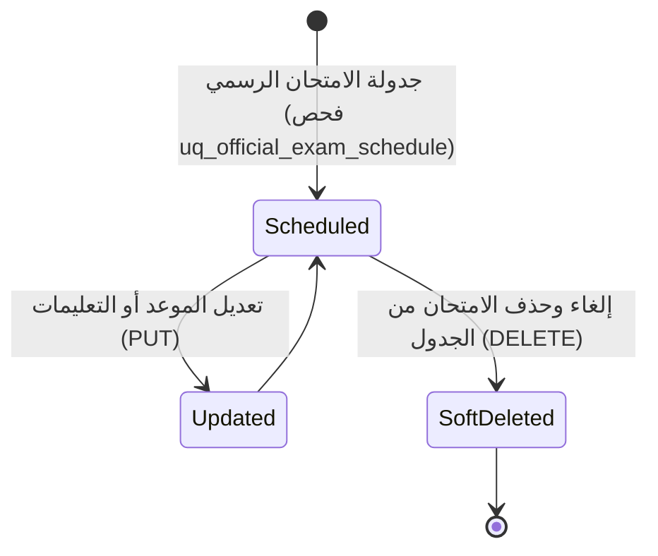

# ⚙️ مواصفات Backend — المرحلة 08: جدول الامتحانات الرسمية (Official Exams Schedule)

> **الهدف:** توثيق منطق المعالجة وقواعد التحقق وقواعد حوكمة جدول الامتحانات الرسمية (النصفية والنهائية والدور الثاني) لجدول `official_exams` المطابقة بنسبة 100% لـ [`MD/database.md`](../../database.md) و [`MD/business_rules.md`](../../business_rules.md)، مع دمج وتوحيد منطق الإنشاء والتعديل (`POST & PUT`) لتوفير الوضوح والرشاقة والحيادية التقنية التامة (Zero ORM Leakage).  
> 
> ⚠️ **تكامل حوكمي صريح وملزم — مرجع الاستجابات (Network SSoT):**  
> ملف [`routes.md`](./routes.md) هو **المصدر الرئيسي والحصري والوحيد لكافة استجابات ومدخلات الـ API (Network SSoT)**. تم تسجيل كامل شكل الاستجابة (JSON Response Body) ورسائل الخطأ والنجاح صراحةً في [`routes.md`](./routes.md) لجميع الرموز والـ Status Codes (`200 OK`, `201 Created`, `400 Bad Request`, `401 Unauthorized`, `403 Forbidden`, `404 Not Found`, `409 Conflict`, `422 Unprocessable Entity`, `500 Internal Server Error`) لكل رابط.  
> 📌 **توجيه إجباري عند البناء والتطوير:** يلتزم المطور أو نموذج الذكاء الاصطناعي بالكامل بإنشاء ورسم كود الخادم واستجابات الـ API بناءً على الهياكل والرموز المسجلة في ملف [`routes.md`](./routes.md) حصراً بدون أي اجتهاد شخصي.

---

## 1. نطاق المرحلة والحدود المعمارية (Scope & Boundaries)

### 🟢 ما تشمله المرحلة (In-Scope):
- **إدارة جدول الامتحانات الرسمية (`official_exams`) — [5 عمليات مدمجة تغطي 6 مسارات]:**
  - استعراض وتصفية وبحث جدول الامتحانات الرسمية بالترقيم والفلترة (`GET /api/v1/official-exams`).
  - استعراض تفاصيل امتحان رسمي محدد والتعليمات والقاعة (`GET /api/v1/official-exams/:id`).
  - استعراض مصفوفة جدول امتحانات الصف الدراسي المعتمدة (`GET /api/v1/classes/:class_id/official-exams`).
  - إضافة وتعديل جدولة موعد امتحان رسمي مع فحص قيد التفرد (`POST & PUT /api/v1/official-exams`).
  - حذف وإلغاء امتحان رسمي من الجدول المعتمد (`DELETE /api/v1/official-exams/:id`).
- **الحوكمة وقواعد ثبات النظام:**
  - قصر صلاحيات إضافة وتعديل وإلغاء الامتحانات الرسمية حصراً على مدير النظام (`role_type = 'admin'`).
  - إتاحة القراءة والاستعراض لكافة أطراف المنظومة (المعلم، الطالب، وولي الأمر) بنمط القراءة فقط (`Read-Only`).
  - فرض قيد تفرد جدولة المادة بالسمستر والنوع (`uq_official_exam_schedule: academic_year_id, academic_term_id, class_id, subject_id, exam_type`).
  - توثيق كافة حركات الجدولة والتعديل والإلغاء في سجلات التدقيق `audit_logs`.

### 🔴 خارج نطاق المرحلة (Out-of-Scope):
- إنشاء الواجبات والمهام المدرسية $\rightarrow$ تابعة للمرحلة `06` (`assignments`).
- إنشاء الاختبارات والتقييمات الدورية القصيرة $\rightarrow$ تابعة للمرحلة `07` (`quizzes`).
- رصد وتجميد درجات الامتحانات بالصحائف النهائية والترحيل $\rightarrow$ تابعة للمرحلة `09` (`student_transcripts`, `promotion_batches`).

---

## 2. حوكمة الأدوار وقواعد الوصول وعزل البيانات (RBAC & Scoping Rules)

### 👥 مصفوفة الفاعلين والصلاحيات:
- **مدير النظام (Admin - `role_type = 'admin'`):**
  - يمتلك الصلاحية الكاملة على كافة مسارات الامتحانات الرسمية (استعراض، جدولة، تعديل، حذف).
- **المعلم (Teacher - `role_type = 'teacher'`):**
  - يمتلك صلاحية استعراض جداول الامتحانات الرسمية لكافة الصفوف والمواد للاطلاع على مواعيد الامتحانات والمراقبة.
  - يُحظر عليه إضافة أو تعديل أو حذف أي امتحان رسمي (`403 Forbidden`).
- **الطالب (Student) وولي الأمر (Parent):**
  - يمتلك الطالب وولي أمره صلاحية استعراض جدول امتحانات الصف الدراسي المعني للاطلاع على المواعيد والتعليمات.
  - يُحظر عليهم تماماً إجراء أي تعديل أو حذف (`403 Forbidden`).
- **المستخدم غير المصادق عليه (Unauthenticated):**
  - أي طلب يفتقر إلى توكن `Bearer JWT` صالح ونشط يُرفض برمز `401 Unauthorized`.

---

## 3. دورة حياة الكيانات وقواعد ثبات النظام (Lifecycles & System Invariants)

### 🔒 قواعد ثبات النظام الصارمة (System Invariants):
1. **قيد تفرد المادة بالنوع والسمستر (`uq_official_exam_schedule`):**
   - يمنع منعاً باتاً تكرار جدولة امتحان رسمي لنفس المادة والصف الدراسي في نفس العام الدراسي والفصل الدراسي ونوع الامتحان (`midterm`, `final`, `second_round`).
   - عند محاولة تكرار الجدولة، يرفض الطلب فوراً برمز `409 Conflict`.
2. **صحة العام والسمستر والصف والمادة:**
   - يجب أن تكون المادة تابعة لمنهج الصف الدراسي المحدد في الفصل الدراسي.
3. **دورة حياة الحذف المنطقي (Soft Delete Lifecycle):**
   - عند إلغاء امتحان، يتم ضبط `deleted_at = CURRENT_TIMESTAMP` واستبعاده من الجداول النشطة.
4. **سجلات التدقيق (Audit Logging):**
   - تسجل كافة حركات الجدولة وتعديل المواعيد والإلغاء في جدول `audit_logs` متضمنة التوقيت والمستخدم المنفذ.

---

## 4. العمليات المنطقية والمسارات التفصيلية للمجال (Domain Operations & Routes)

---

### 📝 الخطوة 1: إدارة جدول الامتحانات الرسمية (`official_exams`)

#### 📋 جدول العمليات المدمجة:
| # | العملية المنطقية (Operation) | HTTP Method & Endpoint | الصلاحية | رمز النجاح | مرجع العقد في `routes.md` |
| :-: | :--- | :--- | :--- | :---: | :--- |
| **1.1** | استعراض وتصفية جدول الامتحانات الرسمية | `GET /api/v1/official-exams` | الجميع | `200 OK` | [في routes.md](./routes.md) |
| **1.2** | استعراض تفاصيل امتحان رسمي محدد | `GET /api/v1/official-exams/:id` | الجميع | `200 OK` | [في routes.md](./routes.md) |
| **1.3** | استعراض جدول امتحانات الصف الدراسي | `GET /api/v1/classes/:class_id/official-exams` | الجميع | `200 OK` | [في routes.md](./routes.md) |
| **1.4** | إضافة وتعديل جدولة امتحان رسمي | `POST /api/v1/official-exams` & `PUT /api/v1/official-exams/:id` | `admin` | `201 Created` / `200 OK` | [في routes.md](./routes.md) |
| **1.5** | حذف وإلغاء امتحان رسمي من الجدول | `DELETE /api/v1/official-exams/:id` | `admin` | `200 OK` | [في routes.md](./routes.md) |

---

#### 🔹 [Operation 1.1] `GET /api/v1/official-exams` — استعراض وتصفية جدول الامتحانات الرسمية
- **الغرض والوظيفة:** استرجاع قائمة سجلات جدول الامتحانات الرسمية بالمنظومة مع دعم الفلترة بالصف الدراسي `class_id` والمادة والسمستر ونوع الامتحان والتاريخ والبحث والترقيم.
- **قواعد المعالجة والخادم:**
  - استرجاع السجلات النشطة فقط (`deleted_at IS NULL`).
  - تضمين مسميات الصفوف والمواد والفصول الدراسية (`class_name`, `subject_name`, `term_name`).
- **عقد الاستجابات والمعاملات (Network SSoT):** مسجلة في [`routes.md`](./routes.md).

#### 🔹 [Operation 1.2] `GET /api/v1/official-exams/:id` — استعراض تفاصيل امتحان رسمي محدد
- **الغرض والوظيفة:** جلب البيانات التفصيلية والتوجيهات والقاعة للامتحان الرسمي المحدد بالمعرف.
- **عقد الاستجابات والمعاملات (Network SSoT):** مسجلة في [`routes.md`](./routes.md).

#### 🔹 [Operation 1.3] `GET /api/v1/classes/:class_id/official-exams` — استعراض جدول امتحانات الصف الدراسي
- **الغرض والوظيفة:** جلب جدول الامتحانات المعتمد بالكامل لصف دراسي محدد بالسمستر النشط مصفوفاً بحسب تواريخ الأيام لطباعة أو استعراض جدول الصف.
- **عقد الاستجابات والمعاملات (Network SSoT):** مسجلة في [`routes.md`](./routes.md).

#### 🔹 [Operation 1.4] `POST /api/v1/official-exams` & `PUT /api/v1/official-exams/:id` — إضافة وتعديل جدولة امتحان رسمي (Combined Domain Logic)
- **الغرض والوظيفة:**
  - **في الإنشاء (`POST`):** اعتماد وجدولة موعد امتحان رسمي جديد لصف ومادة بالسمستر مع التحقق من عدم التكرار.
  - **في التعديل (`PUT`):** تحديث موعد الامتحان أو التاريخ أو الملاحظات والإرشادات.
- **قواعد التحقق المشتركة (Validation Rules):**
  - `academic_year_id`: مطلوب، معرف عام دراسي صالح ونشط.
  - `academic_term_id`: مطلوب، معرف فصل دراسي صالح.
  - `class_id`: مطلوب، معرف صف دراسي صالح.
  - `subject_id`: مطلوب، معرف مادة صالحة للصف المحدد.
  - `exam_type`: مطلوب، أحد الأنواع المعيارية (`midterm`, `final`, `second_round`).
  - `exam_date`: مطلوب، تاريخ صالح بصيغة `YYYY-MM-DD`.
  - `notes`: اختياري، نص لا يتجاوز 255 حرفاً.
  - **قيد التفرد:** التحقق من عدم تكرار جدولة امتحان رسمي لنفس المادة والصف بالسمستر والنوع (`uq_official_exam_schedule`).
- **عقد الاستجابات والمدخلات (Network SSoT):**
  - استجابات (`201 Created`, `200 OK`, `404 Not Found`, `409 Conflict`, `422 Unprocessable Entity`) مسجلة في [`routes.md`](./routes.md).

#### 🔹 [Operation 1.5] `DELETE /api/v1/official-exams/:id` — حذف وإلغاء امتحان رسمي من الجدول
- **الغرض والوظيفة:** تنفيذ الحذف المنطقي لسجل الامتحان وتوثيق العملية في سجلات التدقيق.
- **عقد الاستجابات والمدخلات (Network SSoT):**
  - ردود الحذف (`200 OK`, `404 Not Found`) مسجلة في [`routes.md`](./routes.md).

---

## 5. الأداء، التزامن، والنزاهة المرجعية (Performance & Data Integrity)

1. **الاستعلامات والفهارس:**
   - استخدام الفهارس المعتمدة في `MD/database.md`: `uq_official_exam_schedule`، `idx_official_exams_lookup`، `idx_official_exams_date`، `idx_official_exams_deleted_at`.
2. **الترقيم ومنع الإغراق (Pagination & DoS Protection):**
   - حصر عدد السجلات في مسار الـ GET بـ `per_page` لمنع تحميل الذاكرة.
3. **تجنب التسريب التقني والأمني في الاستجابات:**
   - توحيد رسائل الأخطاء عبر الرموز المعيارية (`401`, `403`, `404`, `409`, `422`, `500`).

---

## 6. معايير القبول الهندسية للباك إند (Backend Acceptance Criteria)

تعتبر متطلبات الخادم لهذه المرحلة مستوفاة بالكامل عند تحقق المعايير التالية:

- [ ] قصر صلاحية إضافة وتعديل وحذف الامتحانات الرسمية حصراً على المستخدمين بدور `admin`.
- [ ] إتاحة استعراض جدول الامتحانات بنمط القراءة فقط للمعلمين والطلاب وأولياء الأمور.
- [ ] إرجاع `401 Unauthorized` لأي طلب بدون توكن مصادقة صالح.
- [ ] إرجاع `403 Forbidden` عند محاولة المعلم أو الطالب تعديل جدول الامتحانات الرسمية.
- [ ] التحقق الصارم من قيد تفرد جدولة المادة بالنوع والسمستر `uq_official_exam_schedule` وإرجاع `409 Conflict` عند التكرار.
- [ ] دعم استرجاع جدول الامتحانات المعتمد لصف دراسي محدد بمسار واحد منظم.
- [ ] تنفيذ الحذف المنطقي بضبط `deleted_at` وتوثيق العمليات في `audit_logs`.
- [ ] مطابقة كافة المدخلات والمخرجات بنسبة 100% لعقد الشبكة في [`routes.md`](./routes.md).
