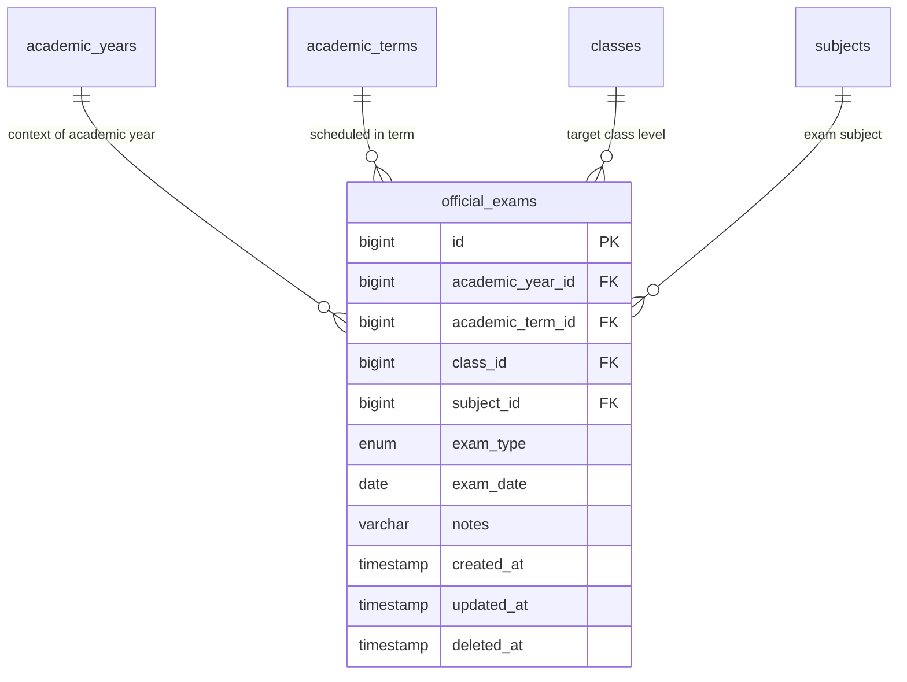

# 📊 مواصفات البيانات والكيانات — المرحلة 08 (Data Specification)

> **الهدف:** توثيق المخطط الهيكلي لجدول الامتحانات الرسمية (`official_exams`) المطابق بنسبة 100% للمصدر الرئيسي والحصري للحقيقة: [`MD/database.md`](../../database.md).  
> 
> ⚠️ **إرشادات وتنبيهات حوكمية إجبارية (System Governance Directives):**  
> 1. **قواعد العمل العامة (Business Rules SSoT):** يلزم على المطور أو الذكاء الاصطناعي قراءة واعتماد **ملف القواعد العامة بالمنظومة [`MD/business_rules.md`](../../business_rules.md)** والالتزام التام بكافة القيود ومصفوفة الصلاحيات والحوكمة المذكورة فيه قبل التكوييد والبناء.  
> 2. **مرجع شبكة الطلبات والاستجابات (Network SSoT):** ملف [`routes.md`](./routes.md) هو المصدر الرئيسي والوحيد لعقد الشبكة بالمنظومة؛ حيث تم توثيق **جسم الطلب الكامل (`Request Body Payload`)** لكل رابط، و**كامل شكل الاستجابة الصريحة (`Response Body Payload`)** لجميع الرموز والـ Status Codes (`200 OK`, `201 Created`, `400 Bad Request`, `401 Unauthorized`, `403 Forbidden`, `404 Not Found`, `409 Conflict`, `422 Unprocessable Entity`, `500 Server Error`).  
> 📌 **توجيه إجباري عند البناء والتطوير:** يلتزم المطور بالكامل برسم وبناء مدخلات ومخرجات كود الـ Controllers والواجهات بناءً على الهياكل والرموز المسجلة في ملف [`routes.md`](./routes.md) حصراً بدون أي اجتهاد شخصي.

---

## 1. هيكل جدول الامتحانات الرسمية (`official_exams`)

> **الوصف:** جدول جدولة ونشر مواعيد الامتحانات الرسمية (النصفية، النهائية، وامتحانات الدور الثاني) الصادرة مركزياً من إدارة المدرسة لكل صف دراسي ومادة في السمستر، ليطّلع عليها الطلاب والمعلمون وأولياء الأمور.

### 📋 هيكل الأعمدة (Columns Matrix):

| اسم العمود (Column) | نوع البيانات (MySQL Type) | القيود والخصائص (Constraints) | الوصف والدلالة الوظيفية |
| :--- | :--- | :--- | :--- |
| `id` | `BIGINT UNSIGNED` | `PRIMARY KEY AUTO_INCREMENT` | المعرف الرقمي الفريد لسجل الامتحان. |
| `academic_year_id` | `BIGINT UNSIGNED` | `NOT NULL, INDEXED` | معرف العام الدراسي النشط (يرتبط بـ `academic_years.id`). |
| `academic_term_id` | `BIGINT UNSIGNED` | `NOT NULL, INDEXED` | معرف الفصل الدراسي/السمستر (يرتبط بـ `academic_terms.id`). |
| `class_id` | `BIGINT UNSIGNED` | `NOT NULL, INDEXED` | معرف الصف الدراسي الموجه له الامتحان (يرتبط بـ `classes.id`). |
| `subject_id` | `BIGINT UNSIGNED` | `NOT NULL` | معرف المادة الدراسية (يرتبط بـ `subjects.id`). |
| `exam_type` | `ENUM('midterm', 'final', 'second_round')` | `NOT NULL, DEFAULT 'final'` | نوع الامتحان الرسمي (`midterm = نصفي`, `final = نهائي`, `second_round = دور ثانٍ`). |
| `exam_date` | `DATE` | `NOT NULL, INDEXED` | تاريخ يوم الامتحان. |
| `notes` | `VARCHAR(255)` | `NULL DEFAULT NULL` | تعليمات وإرشادات إضافية للطلاب بخصوص الامتحان (مثل القاعات والأدوات المسموحة). |
| `created_at` | `TIMESTAMP` | `NOT NULL, DEFAULT CURRENT_TIMESTAMP` | توقيت إنشاء السجل. |
| `updated_at` | `TIMESTAMP` | `NULL ON UPDATE CURRENT_TIMESTAMP` | توقيت آخر تحديث. |
| `deleted_at` | `TIMESTAMP` | `NULL DEFAULT NULL` | طابع الحذف المنطقي. |

---

### 🔗 العلاقات والمفاتيح الخارجية (Foreign Keys):
* `academic_year_id` يرتبط بجدول `academic_years(id)` مع `ON DELETE RESTRICT, ON UPDATE CASCADE`.
* `academic_term_id` يرتبط بجدول `academic_terms(id)` مع `ON DELETE RESTRICT, ON UPDATE CASCADE`.
* `class_id` يرتبط بجدول `classes(id)` مع `ON DELETE RESTRICT, ON UPDATE CASCADE`.
* `subject_id` يرتبط بجدول `subjects(id)` مع `ON DELETE RESTRICT, ON UPDATE CASCADE`.

---

### ⚡ الفهارس وقيود التفرد (Indexes & Constraints):
* `PRIMARY KEY (id)`
* `UNIQUE INDEX uq_official_exam_schedule (academic_year_id, academic_term_id, class_id, subject_id, exam_type)`  
  *(قيد الحوكمة المحوري: يمنع تكرار جدولة امتحان لنفس المادة والصف في نفس السمستر والنوع).*
* `INDEX idx_official_exams_lookup (academic_year_id, academic_term_id, class_id)`  
  *(فهرس استعلام سريع لجلب جدول امتحانات صف معين في سمستر معين).*
* `INDEX idx_official_exams_date (exam_date)`
* `INDEX idx_official_exams_deleted_at (deleted_at)`

---

## 2. مخطط الكيانات والعلاقات لـ Phase 08 (ERD)

