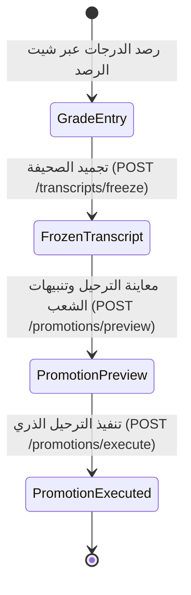

# ⚙️ مواصفات Backend — المرحلة 09: محرك الترحيل والأرشفة النهائية للصحائف (Promotion & Transcripts Archiving)

> **الهدف:** توثيق منطق المعالجة وقواعد التحقق وقواعد حوكمة أرشفة الصحائف المدرسية (`student_transcripts`) ومحرك الترحيل الأكاديمي السنوي الجماعي (`promotion_batches`) المطابقة بنسبة 100% لـ [`MD/database.md`](../../database.md) و [`MD/business_rules.md`](../../business_rules.md)، مع الالتزام الصارم بالحيادية التقنية التامة (Zero ORM Leakage).  
> 
> ⚠️ **تكامل حوكمي صريح وملزم — مرجع الاستجابات (Network SSoT):**  
> ملف [`routes.md`](./routes.md) هو **المصدر الرئيسي والحصري والوحيد لكافة استجابات ومدخلات الـ API (Network SSoT)**. تم تسجيل كامل شكل الاستجابة (JSON Response Body) ورسائل الخطأ والنجاح صراحةً في [`routes.md`](./routes.md) لجميع الرموز والـ Status Codes (`200 OK`, `201 Created`, `400 Bad Request`, `401 Unauthorized`, `403 Forbidden`, `404 Not Found`, `409 Conflict`, `422 Unprocessable Entity`, `500 Internal Server Error`) لكل رابط.  
> 📌 **توجيه إجباري عند البناء والتطوير:** يلتزم المطور أو نموذج الذكاء الاصطناعي بالكامل بإنشاء ورسم كود الخادم واستجابات الـ API بناءً على الهياكل والرموز المسجلة في ملف [`routes.md`](./routes.md) حصراً بدون أي اجتهاد شخصي.

---

## 1. نطاق المرحلة والحدود المعمارية (Scope & Boundaries)

### 🟢 ما تشمله المرحلة (In-Scope):
- **الخطوة 1: أرشفة وتصفح الصحائف المدرسية (`student_transcripts`) — [4 مسارات]:**
  - استعراض وتصفية الصحائف المدرسية المؤرشفة بالترقيم والفلترة (`GET /api/v1/transcripts`).
  - استعراض لقطة الصحيفة التجميدية الكاملة وتفاصيل درجات المواد (`GET /api/v1/transcripts/:id`).
  - استعراض السجل الأكاديمي التاريخي لكافة صحائف طالب محدد (`GET /api/v1/students/:student_id/transcripts`).
  - تجميد وإصدار صحيفة دراسية فصلية أو سنوية عبر شيت رصد الدرجات (`POST /api/v1/transcripts/freeze`).
- **الخطوة 2: محرك الترحيل الأكاديمي الجماعي (`promotion_batches`) — [4 مسارات]:**
  - استعراض سجل دفعات الترحيل السنوي المنفذة بالترقيم (`GET /api/v1/promotions/batches`).
  - استعراض تفاصيل وإحصائيات ورسوم بيانية لدفعة ترحيل محددة (`GET /api/v1/promotions/batches/:id`).
  - محاكاة ومعاينة نتائج الترحيل وتنبيهات الشعب المنخفضة قبل التنفيذ (`POST /api/v1/promotions/preview`).
  - اعتماد وتنفيذ الترحيل السنوي الجماعي وتسكين الطلاب بالعام الجديد (`POST /api/v1/promotions/execute`).

### 🔴 خارج نطاق المرحلة (Out-of-Scope):
- إدارة جداول الحصص والتسكين الأسبوعي $\rightarrow$ تابعة للمرحلة `05`.
- جداول الامتحانات الرسمية $\rightarrow$ تابعة للمرحلة `08`.

---

## 2. حوكمة الأدوار وقواعد الوصول وعزل البيانات (RBAC & Scoping Rules)

### 👥 مصفوفة الفاعلين والصلاحيات:
- **مدير النظام (Admin - `role_type = 'admin'`):**
  - يمتلك الصلاحية الحصرية لتجميد الصحائف الدراسية (`freeze`) وتنفيذ دفعات الترحيل السنوي (`execute`) ومعاينتها (`preview`).
- **المعلم (Teacher - `role_type = 'teacher'`):**
  - يمتلك صلاحية استعراض الصحائف المدرسية لطلابه للاطلاع بنمط القراءة فقط (`200 OK`).
  - يُحظر عليه تنفيذ أو معاينة الترحيل السنوي الجماعي (`403 Forbidden`).
- **الطالب (Student) وولي الأمر (Parent):**
  - يستعرض الطالب وولي أمره الصحائف المؤرشفة الخاصة بالطالب فقط عبر السجل التاريخي بنمط القراءة فقط.
- **المستخدم غير المصادق عليه (Unauthenticated):**
  - يرفض أي طلب غير مزود بتوكن صالح برمز `401 Unauthorized`.

---

## 3. دورة حياة الكيانات وقواعد ثبات النظام (Lifecycles & System Invariants)

### 🔒 قواعد ثبات النظام الصارمة (System Invariants):
1. **اللقطة التجميدية الثابتة والدقيقة للصحائف (`Immutable JSON Snapshot`):**
   - تحفظ درجات المواد والتقييمات بصيغة JSON غير قابلة للتعديل بجدول `student_transcripts.transcript_data` متضمنة `coursework_score` والحد الأقصى `max_coursework_score` و `exam_score` والحد الأقصى `max_exam_score` و `exam_passing_score` و `passing_score` و `is_passed` و `second_round_details`.
2. **قاعدة النجاح المزدوج للمادة في محرك الترحيل (Dual-Criterion Passing Invariant):**
   - يُعتبر الطالب مجتازاً للمادة (`is_passed = true`) حصراً عند تحقق: `(total_score >= passing_score) && (exam_score >= exam_passing_score)`.
   - في حال كان المجموع الكلي $\ge 50$ ولكن درجة الامتحان أقل من درجة نجاح الامتحان (مثل $20 < 30$)، يُعتبر الطالب راسباً في المادة وتتحول حالته إلى `second_round`.
3. **قيد تفرد الصحيفة (`uq_student_transcript_term`):**
   - يمنع تكرار تجميد أكثر من صحيفة معتمدة لنفس الطالب في نفس العام الدراسي والفترة ونوع الصحيفة.
4. **سياسة النقل المباشر لرموز الشعب (Direct Section-to-Section Mapping):**
   - يُنقل الطلاب الناجحون بنفس رمز شعبتهم الأصلية إلى الصف الأعلى بالعام الجديد (5/أ $\rightarrow$ 6/أ، و 5/ب $\rightarrow$ 6/ب، و 5/ج $\rightarrow$ 6/ج).
5. **تنبيه السعة المنخفضة لشعب الراسبين (Low Enrollment Alert):**
   - في حال وجود طلاب راسبين بشعبة سابقة لا مقابل لها (مثل 7 طلاب راسبين بـ 6/د)، تُبقى الشعبة كما هي مع إصدار تنبيه مرئي `low_enrollment_warnings` للإدارة بالمعاينة.
6. **التنفيذ الذري للترحيل الجماعي (Atomic Execution Invariant):**
   - تنفذ عملية الترحيل لجميع طلاب المدرسة في معاملة ذرية متكاملة تضمن إما نجاح ترحيل وتسكين كافة الطلاب أو التراجع التام عند حدوث أي خطأ.

---

## 4. العمليات المنطقية والمسارات التفصيلية للمجال (Domain Operations & Routes)

---

### 📄 الخطوة 1: أرشفة وتصفح الصحائف المدرسية (`student_transcripts`)

#### 📋 جدول العمليات:
| # | العملية المنطقية (Operation) | HTTP Method & Endpoint | الصلاحية | رمز النجاح | مرجع العقد في `routes.md` |
| :-: | :--- | :--- | :--- | :---: | :--- |
| **1.1** | استعراض وتصفية الصحائف وبطاقات الصفوف | `GET /api/v1/transcripts` | `admin` | `200 OK` | [في routes.md](./routes.md) |
| **1.2** | استعراض تفاصيل لقطة الصحيفة الكاملة | `GET /api/v1/transcripts/:id` | `admin`, `student`, `parent` | `200 OK` | [في routes.md](./routes.md) |
| **1.3** | استعراض صحائف طالب تاريخية | `GET /api/v1/students/:student_id/transcripts` | `admin`, `student (own)`, `parent (child)` | `200 OK` | [في routes.md](./routes.md) |
| **1.4** | تجميد وإصدار صحيفة دراسية | `POST /api/v1/transcripts/freeze` | `admin` | `201 Created` | [في routes.md](./routes.md) |

---

#### 🔹 [Operation 1.1] `GET /api/v1/transcripts` — استعراض وتصفية الصحائف وبطاقات الصفوف التنفيذية
- **الغرض والوظيفة:** جلب ملخص بطاقات مؤشرات الصفوف التنفيذية (نسب النجاح، أعداد الناجحين والدور الثاني والراسبين) مع كشف تفصيلي لترتيب طلاب الصف المختار من الأعلى تقييماً إلى الأقل تقييماً، مع دعم الفرز التنازلي بنسبة الدرجات (`percentage`) والفلترة بالمستوى الأكاديمي (`grade_level`) أو معرف الشعبة (`class_section_id`) أو اسم العام والفترات والترقيم.
- **عقد الاستجابات (Network SSoT):** مسجلة في [`routes.md`](./routes.md).

#### 🔹 [Operation 1.2] `GET /api/v1/transcripts/:id` — استعراض تفاصيل لقطة الصحيفة الكاملة
- **الغرض والوظيفة:** استرجاع البيانات التجميدية الكاملة لدرجات الطالب مع لقطة الـ JSON الثابتة.
- **عقد الاستجابات (Network SSoT):** مسجلة في [`routes.md`](./routes.md).

#### 🔹 [Operation 1.3] `GET /api/v1/students/:student_id/transcripts` — استعراض صحائف طالب تاريخية
- **الغرض والوظيفة:** جلب السجل الأكاديمي التاريخي الكامل لصحائف الطالب عبر كافة الأعوام السابقة مع دعم الفلترة بالسنة ونوع الصحيفة.
- **عقد الاستجابات (Network SSoT):** مسجلة في [`routes.md`](./routes.md).

#### 🔹 [Operation 1.4] `POST /api/v1/transcripts/freeze` — تجميد وإصدار صحيفة دراسية
- **الغرض والوظيفة:** اعتماد وتجميد نتيجة طالب لفصل دراسي محدد أو لعام كامل وحفظ كائن الـ JSON المتكامل.
- **قواعد التحقق المشتركة (Validation Rules):**
  - `student_id`: مطلوب، معرف طالب صالح ونشط.
  - `transcript_type`: مطلوب، أحد النوعين (`term`, `annual`).
  - `class_academic_term_id`: مطلوب إذا كانت الصحيفة فصلية (`term`).
  - `academic_year_name`, `class_name`, `section_name`: نصوص مطلوبة.
  - `grade_level`: مطلوب من 1 إلى 12.
  - `total_score`, `percentage`: أرقام صالحة.
  - `final_status`: مطلوب، أحد القرارات (`passed`, `second_round`, `failed`, `graduated`).
  - `transcript_data`: كائن/مصفوفة صالحة متضمنة تفاصيل المواد والدرجات وأعمال السنة والامتحانات.
  - **قيد التفرد:** التحقق من عدم وجود صحيفة معتمدة سابقة بنفس النوع والفترة (`uq_student_transcript_term`).
- **عقد الاستجابات (Network SSoT):** مسجلة في [`routes.md`](./routes.md).

---

### 🚀 الخطوة 2: محرك الترحيل الأكاديمي الجماعي (`promotion_batches`)

#### 📋 جدول العمليات:
| # | العملية المنطقية (Operation) | HTTP Method & Endpoint | الصلاحية | رمز النجاح | مرجع العقد في `routes.md` |
| :-: | :--- | :--- | :--- | :---: | :--- |
| **2.1** | استعراض سجل دفعات الترحيل السنوي | `GET /api/v1/promotions/batches` | `admin` | `200 OK` | [في routes.md](./routes.md) |
| **2.2** | استعراض إحصائيات دفعة ترحيل محددة | `GET /api/v1/promotions/batches/:id` | `admin` | `200 OK` | [في routes.md](./routes.md) |
| **2.3** | معاينة نتائج الترحيل وتنبيهات الشعب | `POST /api/v1/promotions/preview` | `admin` | `200 OK` | [في routes.md](./routes.md) |
| **2.4** | اعتماد وتنفيذ الترحيل السنوي الجماعي | `POST /api/v1/promotions/execute` | `admin` | `200 OK` | [في routes.md](./routes.md) |

---

#### 🔹 [Operation 2.1] `GET /api/v1/promotions/batches` — استعراض سجل دفعات الترحيل السنوي
- **الغرض والوظيفة:** جلب سجل عمليات الترحيل السنوي المعتمدة مع الترقيم القياسي.
- **عقد الاستجابات (Network SSoT):** مسجلة في [`routes.md`](./routes.md).

#### 🔹 [Operation 2.2] `GET /api/v1/promotions/batches/:id` — استعراض إحصائيات دفعة ترحيل محددة
- **الغرض والوظيفة:** جلب الإحصائيات الشاملة ونسب نجاح الصفوف ومعدلات الرسوب للدفعة المحددة.
- **عقد الاستجابات (Network SSoT):** مسجلة في [`routes.md`](./routes.md).

#### 🔹 [Operation 2.3] `POST /api/v1/promotions/preview` — معاينة نتائج الترحيل وتنبيهات الشعب
- **الغرض والوظيفة:** محاكاة عملية الترحيل السنوية وحساب أعداد الناجحين والراسبين والدور الثاني ورصد الشعب ذات السعة المنخفضة (أقل من 10 طلاب) وإرجاع `low_enrollment_warnings`.
- **المدخلات وخيارات الاحتساب (Parameters & Calculation Flags):**
  - `from_academic_year_id`: مطلوب، معرف العام الدراسي المنتهي.
  - `to_academic_year_id`: مطلوب، معرف العام الدراسي الجديد المستهدف.
  - `enable_annual_exam_compensation`: اختياري، منطقي (`boolean`، القيمة الافتراضية `false`).
    - عند `false` (النمط الصارم): تقييم اجتياز الامتحان النهائي لكل فصل دراسي بشكل مستقل (`exam_score >= exam_passing_score`).
    - عند `true` (نمط التعويض السنوي): يتم احتساب مجموع امتحانات الفصول معاً ومقارنتها بإجمالي درجات نجاح الامتحانات السنوية (`sum(exam_scores) >= sum(exam_passing_scores)`).
- **عقد الاستجابات (Network SSoT):** مسجلة في [`routes.md`](./routes.md).

#### 🔹 [Operation 2.4] `POST /api/v1/promotions/execute` — اعتماد وتنفيذ الترحيل السنوي الجماعي
- **الغرض والوظيفة:** تنفيذ الترحيل الذري للطلاب وتسكينهم بالعام الجديد بناءً على سياسة الاحتساب المعتمدة وتوثيق السجل في `promotion_batches`.
- **قواعد التحقق والتنفيذ:**
  - `from_academic_year_id`: مطلوب، معرف عام دراسي سابق.
  - `to_academic_year_id`: مطلوب، معرف عام دراسي جديد.
  - `enable_annual_exam_compensation`: اختياري، منطقي (`boolean`، افتراضي `false`).
  - التحقق من عدم تنفيذ ترحيل مسبق بين العامين (`uq_promotion_batch_years`).
  - نقل الناجحين للصف الأعلى بنفس رمز الشعبة، ونقل الراسبين لنفس الصف للإعادة.
- **عقد الاستجابات (Network SSoT):** مسجلة في [`routes.md`](./routes.md).

---

## 5. الأداء، التزامن، والنزاهة المرجعية (Performance & Data Integrity)

1. **المعاملات الذرية الحازمة (Atomic DB Transactions):**
   - تنفيذ كافة عمليات الترحيل الجماعي داخل Transaction تضمن التماسك المطلق للبيانات.
2. **الفهارس واستعلامات التجميع:**
   - استخدام الفهارس المعتمدة في `MD/database.md`: `uq_student_transcript_term`، `idx_transcripts_year_class`، `idx_transcripts_status`، `uq_promotion_batch_years`، `idx_promotion_executed_by`.
3. **تجنب التسريب التقني:**
   - توحيد الردود ورسائل الخطأ عبر الرموز المعيارية (`401`, `403`, `404`, `409`, `422`, `500`).

---

## 6. معايير القبول الهندسية للباك إند (Backend Acceptance Criteria)

تعتبر متطلبات الخادم لهذه المرحلة مستوفاة بالكامل عند تحقق المعايير التالية:

- [ ] قصر صلاحيات تجميد الصحائف وتنفيذ الترحيل السنوي حصراً على المستخدمين بدور `admin`.
- [ ] إتاحة استعراض الصحائف المدرسية بنمط القراءة فقط للطلاب وأولياء الأمور والمعلمين.
- [ ] حفظ لقطة الصحيفة التجميدية الدقيقة بصيغة JSON الثابتة متضمنة درجات أعمال السنة والامتحانات والدور الثاني.
- [ ] التحقق من قيد تفرد الصحيفة `uq_student_transcript_term` وإرجاع `409 Conflict` عند التكرار.
- [ ] تطبيق سياسة النقل المباشر لرموز الشعب (5/أ $\rightarrow$ 6/أ).
- [ ] توليد تنبيهات السعة المنخفضة (`low_enrollment_warnings`) للشعب التي تقل عن 10 طلاب.
- [ ] تنفيذ الترحيل السنوي الجماعي في معاملة ذرية متكاملة وتسجيل السجل بجدول `promotion_batches`.
- [ ] مطابقة كافة المدخلات والمخرجات بنسبة 100% لعقد الشبكة في [`routes.md`](./routes.md).

## 🔄 ملحق تحديث سياسات الدور الثاني (Second Round Policy Specification)
- يتم قراءة الحد الأقصى لمواد الدور الثاني من حقل `class.max_second_round_subjects` لكل صف.
- خيارات احتساب الدور الثاني: `replace_exam` أو `full_score`.
- خيار سقف النجاح 50%: `enable_second_round_capping`.
