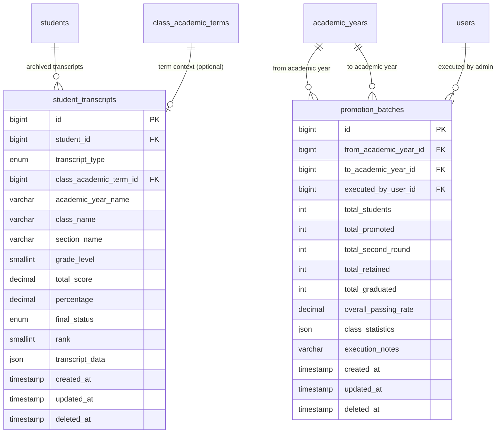

# 📊 مواصفات البيانات والكيانات — المرحلة 09 (Data Specification)

> **الهدف:** توثيق المخطط الهيكلي لجدولي الصحائف المدرسية المؤرشفة (`student_transcripts`) ودفعات الترحيل السنوي (`promotion_batches`) المطابق بنسبة 100% للمصدر الرئيسي والحصري للحقيقة: [`MD/database.md`](../../database.md).  
> 
> ⚠️ **إرشادات وتنبيهات حوكمية إجبارية (System Governance Directives):**  
> 1. **قواعد العمل العامة (Business Rules SSoT):** يلزم على المطور أو الذكاء الاصطناعي قراءة واعتماد **ملف القواعد العامة بالمنظومة [`MD/business_rules.md`](../../business_rules.md)** والالتزام التام بكافة القيود ومصفوفة الصلاحيات والحوكمة المذكورة فيه قبل التكوييد والبناء.  
> 2. **مرجع شبكة الطلبات والاستجابات (Network SSoT):** ملف [`routes.md`](./routes.md) هو المصدر الرئيسي والوحيد لعقد الشبكة بالمنظومة؛ حيث تم توثيق **جسم الطلب الكامل (`Request Body Payload`)** لكل رابط، و**كامل شكل الاستجابة الصريحة (`Response Body Payload`)** لجميع الرموز والـ Status Codes (`200 OK`, `201 Created`, `400 Bad Request`, `401 Unauthorized`, `403 Forbidden`, `404 Not Found`, `409 Conflict`, `422 Unprocessable Entity`, `500 Internal Server Error`).  
> 📌 **توجيه إجباري عند البناء والتطوير:** يلتزم المطور بالكامل برسم وبناء مدخلات ومخرجات كود الـ Controllers والواجهات بناءً على الهياكل والرموز المسجلة في ملف [`routes.md`](./routes.md) حصراً بدون أي اجتهاد شخصي.

---

## 1. جدول الصحائف المدرسية المؤرشفة (`student_transcripts`)

> **الوصف:** جدول أرشفة وتجميد الصحيفة المدرسية (سواء صحيفة سمستر دراسي معين أو الصحيفة السنوية النهائية) للطالب، متضمناً تفاصيل الفصول والدرجات وأعمال السنة والامتحانات والدور الثاني كلقطة بيانات نهائية ثابتة (Immutable JSON Snapshot) لا تتأثر ببدء العام الجديد.

### 📋 هيكل الأعمدة (Columns Matrix):

| اسم العمود (Column) | نوع البيانات (MySQL Type) | القيود والخصائص (Constraints) | الوصف والدلالة الوظيفية |
| :--- | :--- | :--- | :--- |
| `id` | `BIGINT UNSIGNED` | `PRIMARY KEY AUTO_INCREMENT` | المعرف الرقمي الفريد لسجل الصحيفة. |
| `student_id` | `BIGINT UNSIGNED` | `NOT NULL, INDEXED` | معرف الطالب الدائم (يرتبط بـ `students.id`). |
| `transcript_type` | `ENUM('term', 'annual')` | `NOT NULL, DEFAULT 'annual'` | نوع الصحيفة المؤرشفة (`term = صحيفة سمستر`, `annual = صحيفة سنوية`). |
| `class_academic_term_id` | `BIGINT UNSIGNED` | `NULL DEFAULT NULL` | معرف فترة الصف المرتبطة بالصحيفة إذا كانت سمستر محدد (يرتبط بـ `class_academic_terms.id`). |
| `academic_year_name` | `VARCHAR(50)` | `NOT NULL, INDEXED` | مسمى العام الدراسي كنص صلب (مثال: `2024/2025`). |
| `class_name` | `VARCHAR(50)` | `NOT NULL` | اسم الصف الدراسي كنص صلب (مثال: `الصف الخامس`). |
| `section_name` | `VARCHAR(50)` | `NOT NULL` | اسم الشعبة كنص صلب (مثال: `شعبة أ`). |
| `grade_level` | `SMALLINT UNSIGNED` | `NOT NULL` | المستوى الأكاديمي الرقمي وقت التخرج من السنة (`1` إلى `12`). |
| `total_score` | `DECIMAL(7,2)` | `NOT NULL` | المجموع الكلي للدرجات التي تحصل عليها الطالب. |
| `percentage` | `DECIMAL(5,2)` | `NOT NULL` | النسبة المئوية العامة للطالب (مثال: `94.50%`). |
| `final_status` | `ENUM('passed', 'second_round', 'failed', 'graduated')` | `NOT NULL, INDEXED` | النتيجة والقرار النهائي للطالب بنهاية الفصل أو العام. |
| `rank` | `SMALLINT UNSIGNED` | `NULL DEFAULT NULL` | الترتيب على مستوى الصف أو الشعبة (مثال: `الأول`, `الثاني`). |
| `transcript_data` | `JSON` | `NOT NULL` | اللقطة الكاملة للصحيفة: يتم رصد وإدخال درجات المواد عبر واجهة شيت رصد الدرجات (Grade Entry Sheet UI) وتخزينها بصيغة JSON متضمنة لقطة كل مادة (`coursework_score`, `max_coursework_score`, `exam_score`, `max_exam_score`, `total_score`, `passing_score`, `max_score`, `status`, `second_round_details`). |
| `created_at` | `TIMESTAMP` | `NOT NULL, DEFAULT CURRENT_TIMESTAMP` | توقيت تجميد وإصدار الصحيفة. |
| `updated_at` | `TIMESTAMP` | `NULL ON UPDATE CURRENT_TIMESTAMP` | توقيت آخر تحديث. |
| `deleted_at` | `TIMESTAMP` | `NULL DEFAULT NULL` | طابع الحذف المنطقي. |

---

### 🔗 العلاقات والمفاتيح الخارجية (Foreign Keys):
* `student_id` يرتبط بجدول `students(id)` مع `ON DELETE RESTRICT, ON UPDATE CASCADE`.
* `class_academic_term_id` يرتبط بجدول `class_academic_terms(id)` مع `ON DELETE SET NULL, ON UPDATE CASCADE`.

---

### ⚡ الفهارس وقيود التفرد (Indexes & Constraints):
* `PRIMARY KEY (id)`
* `UNIQUE INDEX uq_student_transcript_term (student_id, academic_year_name, transcript_type, class_academic_term_id)`  
  *(يضمن حفظ صحيفة سمستر واحدة أو صحيفة سنوية واحدة معتمدة لكل طالب بالعام).*
* `INDEX idx_transcripts_year_class (academic_year_name, class_name)`
* `INDEX idx_transcripts_status (final_status)`
* `INDEX idx_transcripts_deleted_at (deleted_at)`

---

## 2. جدول سجل وإحصائيات دفعات الترحيل السنوي (`promotion_batches`)

> **الوصف:** جدول توثيق وتتبع كل دفعة ترحيل سنوي جماعي تنفذها الإدارة، مع حفظ الإحصائيات الشاملة ونسب النجاح والرسوب وأعداد الطلاب لكل صف دراسي بصيغة JSON.

### 📋 هيكل الأعمدة (Columns Matrix):

| اسم العمود (Column) | نوع البيانات (MySQL Type) | القيود والخصائص (Constraints) | الوصف والدلالة الوظيفية |
| :--- | :--- | :--- | :--- |
| `id` | `BIGINT UNSIGNED` | `PRIMARY KEY AUTO_INCREMENT` | المعرف الرقمي لسجل دفعة الترحيل. |
| `from_academic_year_id` | `BIGINT UNSIGNED` | `NOT NULL` | معرف العام الدراسي المُنتهى المرحل منه (يرتبط بـ `academic_years.id`). |
| `to_academic_year_id` | `BIGINT UNSIGNED` | `NOT NULL` | معرف العام الدراسي الجديد المرحل إليه (يرتبط بـ `academic_years.id`). |
| `executed_by_user_id` | `BIGINT UNSIGNED` | `NOT NULL, INDEXED` | المدير الذي قام باعتماد وتنفيذ عملية الترحيل (يرتبط بـ `users.id`). |
| `total_students` | `INT UNSIGNED` | `NOT NULL` | إجمالي عدد طلاب المدرسة المشمولين بالترحيل. |
| `total_promoted` | `INT UNSIGNED` | `NOT NULL` | إجمالي عدد الطلاب الناجحين المنقولين للمستوى الأعلى. |
| `total_second_round` | `INT UNSIGNED` | `NOT NULL` | إجمالي عدد طلاب الدور الثاني/الملاحق. |
| `total_retained` | `INT UNSIGNED` | `NOT NULL` | إجمالي عدد الراسبين الباقين للإعادة في نفس الصف. |
| `total_graduated` | `INT UNSIGNED` | `NOT NULL` | إجمالي عدد الخريجين من المرحلة النهائية. |
| `overall_passing_rate` | `DECIMAL(5,2)` | `NOT NULL` | النسبة المئوية العامة لنجاح المدرسة في ذلك العام (مثال: `88.50%`). |
| `class_statistics` | `JSON` | `NOT NULL` | إحصائيات تفصيلية لكل صف دراسي بصيغة JSON (اسم الصف، عدد الناجحين والراسبين، ونسبة النجاح). |
| `execution_notes` | `VARCHAR(255)` | `NULL DEFAULT NULL` | ملاحظات الإدارة على دفعة الترحيل. |
| `created_at` | `TIMESTAMP` | `NOT NULL, DEFAULT CURRENT_TIMESTAMP, INDEXED` | توقيت تنفيذ عملية الترحيل. |
| `updated_at` | `TIMESTAMP` | `NULL ON UPDATE CURRENT_TIMESTAMP` | توقيت آخر تحديث. |
| `deleted_at` | `TIMESTAMP` | `NULL DEFAULT NULL` | طابع الحذف المنطقي. |

---

### 🔗 العلاقات والمفاتيح الخارجية (Foreign Keys):
* `from_academic_year_id` يرتبط بجدول `academic_years(id)` مع `ON DELETE RESTRICT, ON UPDATE CASCADE`.
* `to_academic_year_id` يرتبط بجدول `academic_years(id)` مع `ON DELETE RESTRICT, ON UPDATE CASCADE`.
* `executed_by_user_id` يرتبط بجدول `users(id)` مع `ON DELETE RESTRICT, ON UPDATE CASCADE`.

---

### ⚡ الفهارس وقيود التفرد (Indexes & Constraints):
* `PRIMARY KEY (id)`
* `UNIQUE INDEX uq_promotion_batch_years (from_academic_year_id, to_academic_year_id)`  
  *(يضمن تسجيل دفعة ترحيل واحدة معتمدة بين كل عامين دراسيين).*
* `INDEX idx_promotion_executed_by (executed_by_user_id)`
* `INDEX idx_promotion_created_at (created_at)`
* `INDEX idx_promotion_deleted_at (deleted_at)`

---

## 3. مخطط الكيانات والعلاقات لـ Phase 09 (ERD)

